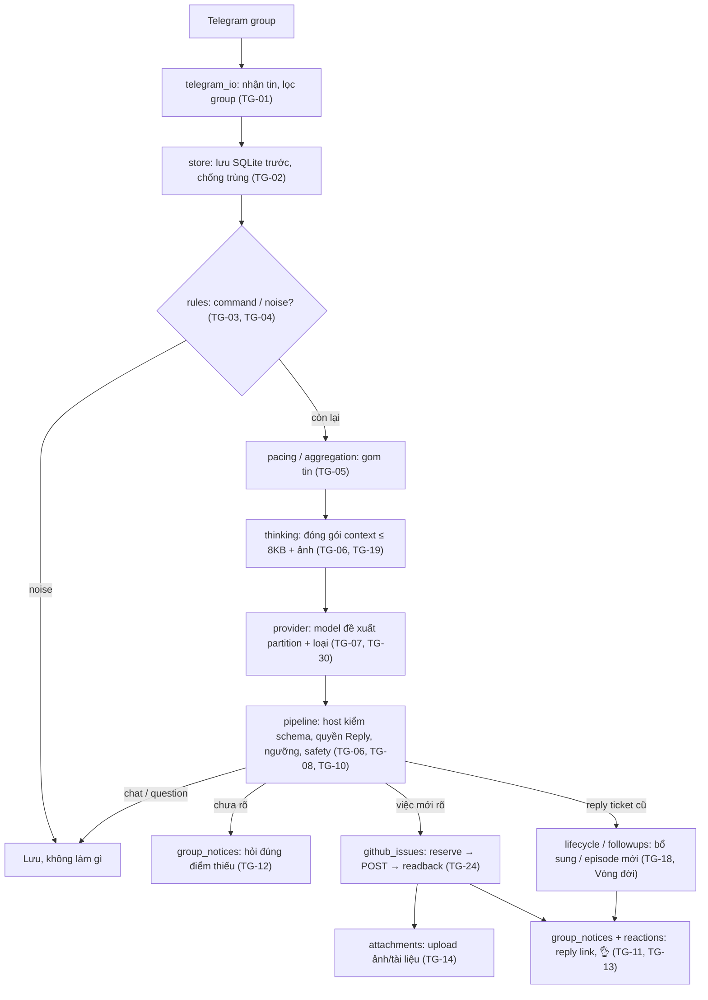

# Telegram triage → GitHub ticket — Overview và bàn giao

**Version**: v1.0.1 · **Updated**: 2026-10-28 (Asia/Saigon) · **Owner/state lineage**: AlexChu · **Author**: Claude · **Baseline code**: `d8accc8`

**Status**: Tài liệu bàn giao. Không thay thế nguồn nghiệp vụ. Mọi quy tắc ở đây trỏ về TG-ID trong [Business DOCS](../01-product/telegram-triage-noissue_business_261015_v1.0.0.md); quy tắc chi tiết dạng MUST/MUST NOT nằm ở [Rulebook](../01-product/telegram-triage-noissue_rulebook_261027_v1.0.0.md).

## 1. Cách dùng bộ tài liệu

Bộ tài liệu dành cho bất kỳ ai nhận lại tính năng: thành viên team, operator, Agent mạnh (Opus, GPT-5, Codex…) hay Agent yếu/rẻ (Haiku, model nhỏ local). Mục tiêu: **ai cũng làm đúng như nhau**, không phụ thuộc khả năng suy luận riêng.

| Bạn là… | Đọc theo thứ tự | Được làm gì |
|---|---|---|
| Agent/người chỉ hỏi về hành vi | Overview §2–§5 → Rulebook | Trả lời, trích TG-ID |
| Operator sửa/điều tra ticket đã log | Overview §8 (Việc B, C) → Rulebook §12 → Business DOCS "Bộ nhớ, truy vấn và debug vận hành" | Đọc DB `mode=ro`, chạy script reformat theo đúng quy trình |
| Dev/Agent sửa code hoặc prompt | Toàn bộ Overview → Rulebook → Business DOCS → [Engineering](../02-engineering/telegram-triage-noissue_thinking-research_261015_v1.0.0.md) → [QA](../03-qa/telegram-triage-noissue_qa_261015_v1.0.0.md) | Sửa trong worktree, test, dừng trước commit/push/deploy |
| Owner | §10 (quyết định còn mở) | Chốt quyết định, cấp quyền |

**Quy tắc vàng cho Agent yếu:**
1. Chỉ làm điều Rulebook cho phép rõ ràng. Rule không nói tới ⇒ **dừng và hỏi Owner**, không tự suy ra.
2. Mỗi kết luận phải dẫn TG-ID hoặc file:dòng. Không có nguồn ⇒ ghi "chưa xác minh".
3. Không bao giờ tạo issue, gửi Telegram, POST lại, reset reservation, commit, push hay deploy nếu Owner chưa yêu cầu trong phiên.

**Thứ tự ưu tiên khi tài liệu mâu thuẫn:** Business DOCS (TG-01…TG-33) > Rulebook > Overview > `listener/README.md` > comment trong code > tài liệu Fleet cũ (lịch sử). Gặp mâu thuẫn: làm theo nguồn cao hơn và báo lại chỗ lệch. TG = Telegram triage.

## 2. Tính năng làm gì

Listener đọc tin nhắn trong group Telegram của team phần mềm, hiểu hội thoại (text, ảnh, caption, reply), rồi:
- **Tạo GitHub issue** cho việc team cần làm: bug, task, feedback.
- **Bổ sung** vào ticket đã có khi người dùng reply vào đúng nguồn.
- **Hỏi lại** trong group khi yêu cầu chưa rõ.
- **Bỏ qua** chat thường, cảm ơn, câu hỏi thông tin.
- **Reply** link ticket vào đúng tin gốc, thả reaction ❤ / 👌.

Người dùng không cần tag bot, không cần biết cú pháp lệnh hay số ticket.

**Trong phạm vi:** intake không tag, nhiều chủ đề xen kẽ, ảnh/caption/reply theo gói, hỏi làm rõ, bổ sung ticket open/closed, lỗi tái diễn, tách ticket, template chuẩn, truy vết.

**Ngoài phạm vi (không được tự làm):** tự sửa bug, tự đóng/mở lại issue, tìm kiếm ngữ nghĩa toàn lịch sử, dashboard debug, thay đổi quyền/provider/consent, phân loại theo module sản phẩm (chưa có, xem §10).

## 3. Kiến trúc và luồng xử lý

### Hai đường xử lý — phải biết đang chạy đường nào

| Đường | Bật khi | Gom tin | Định tuyến chủ đề |
|---|---|---|---|
| **Legacy** | `[thinking] autonomous_enabled = false` (mặc định trong source) | Cửa sổ `window_minutes` (mặc định 2 phút); reply nối vào case của tin được reply, nếu không thì cùng sender trong cửa sổ | Model chia topic trong cửa sổ; không chắc ⇒ `needs_human` tạo ticket theo dõi và hỏi |
| **Autonomous** | `autonomous_enabled = true` và `[thinking] enabled = true` | Đợi 30s yên lặng, tối đa 60s | NEW/CONTINUE/CLARIFY/CHAT; không chắc ⇒ giữ pending và hỏi, **không** tạo ticket |

`[thinking] enabled` mặc định `true`; đặt `false` + restart để quay về semantic path cũ. Trạng thái thật trên máy chạy (THINKPAD) **phải đọc từ config đang cài**, không suy từ file mẫu hay tài liệu.

## 4. Thuật ngữ

| Thuật ngữ | Nghĩa |
|---|---|
| Source / tin nguồn | Một tin Telegram, khóa `(chat_id, message_id)` |
| Case / group | Đơn vị gom tin (legacy) và nhóm chủ đề do model chia |
| Topic / chủ đề | **Một vụ việc** (incident hoặc đầu việc), sinh động từ hội thoại; không phải danh mục định sẵn |
| Root | Tin gốc của topic đã có ticket/notice; là điểm neo cho bổ sung |
| Followup | Tin bổ sung cho root đã có |
| Candidate | Ngữ cảnh cũ được host xác minh qua Reply thật, đưa vào packet |
| Notice | Tin bot gửi vào group (link ticket, câu hỏi, báo lỗi) |
| Pending | Đã lưu, chưa đủ để tạo ticket, đang chờ trả lời |
| `needs_human` | Cần người xác nhận (legacy tạo ticket theo dõi nhãn `needs-human`) |
| `pending_review` | Để đó, không tạo ticket, không hỏi (ví dụ ảnh đơn lẻ không yêu cầu) |
| Human binding | Người dùng xác nhận "đây là ticket 1/2" — bằng chứng mạnh hơn giả thuyết model |
| Episode | Lần tái diễn lỗi sau khi đã xác nhận chạy tốt; ticket mới gắn liên quan parent |
| Reservation | Bản ghi đặt chỗ trước side effect (POST, upload, notice) để không làm 2 lần |
| `ambiguous` | Side effect đã có thể xảy ra nhưng không xác minh được — **cấm tự retry** |
| Dry-run | `mode = "dry-run"`: không ghi GitHub, không gửi notice text |
| Owner / AlexChu | Chủ quy trình và dữ liệu; Agent chỉ là executor tạm thời |

## 5. Bản đồ tài liệu và code

### Tài liệu

| File | Vai trò |
|---|---|
| [Business DOCS](../01-product/telegram-triage-noissue_business_261015_v1.0.0.md) | **Nguồn nghiệp vụ duy nhất**, TG-01…TG-33, trace code/test |
| [Rulebook](../01-product/telegram-triage-noissue_rulebook_261027_v1.0.0.md) | Rule chi tiết MUST/MUST NOT, bảng quyết định, ví dụ chuẩn |
| [Engineering THINKING](../02-engineering/telegram-triage-noissue_thinking-research_261015_v1.0.0.md) | Thiết kế controller, budget, journal |
| [QA](../03-qa/telegram-triage-noissue_qa_261015_v1.0.0.md) | TC-01…TC-13, tiêu chí bằng chứng |
| [listener/README.md](../../listener/README.md) | Vận hành, cấu hình, drift check, reformat |
| [listener/AGENTS.md](../../listener/AGENTS.md) | Điểm vào cho Agent |
| [Template log ticket](../templates/github-ticket/README.md) | Khuôn `.md` cho issue, comment, câu trả lời group; có test chống lệch với code |
| `worker-agent-fleet-1_*` | Lịch sử. §12.11 "phải tag" **đã lỗi thời** |

### Code (`listener/src/tg_triage/`)

| File | Trách nhiệm | TG |
|---|---|---|
| `telegram_io.py`, `pacing.py` | Nhận tin, gom theo nhịp hội thoại | 01, 05 |
| `store.py`, `followup_store.py`, `autonomy_store.py`, `topic_store.py` | SQLite, ledger, topic | 02, 19, 24 |
| `rules.py` | Command và noise — nơi duy nhất code tự quyết về nội dung | 03, 04 |
| `models.py` | Danh mục category/type/label, record | 07 |
| `classifier.py`, `ingress_model.py`, `followup_model.py` | Parse/validate output model | 06, 07, 18 |
| `thinking.py`, `thinking_transport.py`, `provider.py`, `ai_transport.py` | Đóng gói context, gọi model, budget | 06, 19, 30 |
| `pipeline.py` | Quyết định cuối: ngưỡng, safety, vision fallback | 06, 08, 09, 10, 15 |
| `autonomous.py`, `lifecycle.py`, `followups.py` | Định tuyến autonomous, vòng đời ticket, bổ sung | 05, 16, 18, 20–23 |
| `github_issues.py`, `issue_format.py` | Ghi GitHub, template issue | 11, 17, 24, 31 |
| `attachments.py` | Kiểm tra và upload ảnh/tài liệu | 14 |
| `group_notices.py`, `reactions.py` | Reply trong group, reaction | 11, 12, 13, 26, 28 |
| `trace.py` | Truy vết chỉ đọc | 19, 27 |

Prompt: `listener/prompts/` (`autonomous.md`, `thinking-topics.md`, `topics.md`, `case.md`, `classify.md`, `followup.md`). Runtime load prompt đóng gói, **không** load Markdown trong `Docs/`.

## 6. Cấu hình và giới hạn số

Giá trị mặc định lấy từ [listener.example.toml](../../config/listener.example.toml) và code tại baseline. Máy chạy thật có thể khác.

| Khóa / hằng số | Mặc định | Ý nghĩa |
|---|---|---|
| `mode` | `dry-run` | `live` mới ghi GitHub và gửi notice |
| `ollama.confidence_threshold` | 0.7 | Dưới ngưỡng ⇒ không tự tạo ticket |
| `github.max_issues_per_hour` | 20 | Quota tạo issue, tính cả sibling và outcome không rõ |
| `aggregation.window_minutes` | 2 | Cửa sổ gom (legacy) |
| `aggregation.max_messages_per_case` / `_per_window` | 20 / 40 | Trần tin mỗi case / cửa sổ |
| `thinking.context_quiet_seconds` / `_max_wait_seconds` | 30 / 60 | Nhịp gom (autonomous) |
| Budget model | 2 attempt / 40s, mỗi request ≤ 20s | TG-30 |
| Packet text | ≤ 8000 byte UTF-8; 20 tin mới; 6 candidate | TG-05, TG-30 |
| `attachments.max_bytes` | 10 MB | Mỗi file |
| `attachments.max_per_case` / `max_documents_per_case` | 5 / 5 | Ảnh / tài liệu mỗi case |
| `attachments.max_per_hour` | 60 | Upload chung ảnh + tài liệu |
| Ảnh hợp lệ | JPEG, PNG, WEBP | Kiểm signature |
| Tài liệu hợp lệ | pdf, docx, xlsx, pptx, txt, csv, md, json, html, zip | Cố định trong code |
| Tách ticket | Tối đa 5 ticket tổng | TG-21 |
| Câu hỏi làm rõ | Tối đa 3 câu | TG-12 |
| Title issue | Tối đa 80 ký tự | `issue_format.py` |
| `model.cloud_consent` / `cloud_image_consent` | false / false | Không gửi text/ảnh lên cloud khi chưa bật |
| `thinking.autonomous_enabled` | false | Xem §3 |
| `thinking.topic_memory_enabled` | false | Projection topic, chỉ để truy vết |

## 7. Vai trò và quyền

| Vai trò | Được | Không được |
|---|---|---|
| Owner (AlexChu) | Chốt rule, cấp quyền deploy/commit, quyết định retry khi `ambiguous` | — |
| Operator | Đọc DB `mode=ro`, trace, chạy `reformat-telegram-issue.py` theo quy trình, backup | Reset reservation, POST lại, sửa DB tay, xuất session |
| Dev / Agent mạnh | Đọc, sửa code/prompt/test trong worktree, đề xuất rule | Commit/push/deploy khi chưa được yêu cầu; đổi semantics mà không sửa Business DOCS |
| Agent yếu | Đọc, trả lời có dẫn nguồn, chạy test/drift check, làm checklist | Sửa logic quyết định, sửa prompt, mọi side effect ngoài |
| Model trong runtime | Đề xuất partition, loại, nội dung | Chọn repo, URL, label, permission, hành động |

Danh tính harness luôn là **AlexChu**, không đổi theo Agent đang chạy. Task code đi qua `/dispatch`; việc đụng GitHub write hoặc production thuộc GATE 0b.

## 8. Quy trình theo loại việc

Mỗi loại việc có checklist. **Không bỏ bước.** Bước nào không làm được ⇒ ghi lý do trong báo cáo.

### Việc A — Trả lời "trường hợp X sẽ được xử lý thế nào?"
1. Xác định đường đang chạy (legacy hay autonomous, §3).
2. Tra Rulebook §13 (bảng quyết định tổng hợp) và §14 (ví dụ chuẩn).
3. Trả lời kèm TG-ID. Nếu không có rule nào khớp ⇒ nói rõ "chưa có rule", đưa vào §10 cho Owner.

### Việc B — Sửa nội dung một ticket đã log sai
1. Xác nhận repository, issue number, chat/source IDs.
2. Điều tra theo Việc C để biết vì sao sai.
3. Dựng input JSON chỉ từ source đã đối chiếu thuộc ticket đó.
4. `python scripts/reformat-telegram-issue.py --input … --output preview.json` → đọc preview.
5. Tính SHA-256 body hiện tại → chạy lại với `--apply --repo … --issue … --expected-body-sha256 …` **chỉ khi Owner cho phép ghi**.
6. Đọc lại issue. PATCH lỗi/không rõ ⇒ đọc lại trước, không chạy lại mù.
7. **Không** tạo ticket mới, không viết body tay, không sửa SQLite.

### Việc C — Điều tra vì sao bot làm sai
Theo Business DOCS "Quy trình điều tra bắt buộc" (6 bước). Tóm tắt:
1. Ghi hiện tượng, kỳ vọng, host, thời gian có timezone, repo/issue, chat/message IDs.
2. Mở SQLite `mode=ro`; **không** khởi tạo `Store`.
3. Đọc `messages` → case/group → `followup_roots` → `thinking_decisions` / events → jobs / operations → `group_notices`.
4. GET issue và đọc tin Telegram thật để xác minh side effect.
5. Báo cáo theo "Tiêu chí bàn giao": khóa đã tìm, reason/budget, trạng thái ledger, phần chưa xác minh.

### Việc D — Sửa code hoặc prompt
1. Đọc rule liên quan trong Business DOCS và Rulebook; xác định TG-ID bị ảnh hưởng.
2. Làm trong worktree/branch riêng.
3. Đổi hành vi ⇒ sửa Business DOCS cùng lượt (TG + trace JSON + changelog), cập nhật Rulebook, thêm/sửa test.
4. Chạy từ `listener/`: `python -m unittest discover -s tests -t . -v` và `python -m compileall -q src tests` (đặt `PYTHONPATH=src`).
5. Chạy từ repo root: `python scripts/check-telegram-triage-policy.py` và `python scripts/test_telegram_triage_policy.py`. Hash khớp **không** chứng minh đúng nghĩa.
6. Kiểm bằng dry-run/fake tools/smoke script trong README; **không** replay tin thật, không tạo issue thật.
7. Dừng trước commit/push. Báo cáo: file đổi, TG bị ảnh hưởng, kết quả test thật.

### Việc E — Deploy / bật tính năng
Chỉ khi Owner yêu cầu. Theo [deploy guide](../../deploy/README.md). Cần evidence riêng: immutable release, installed tests, service readback. Không suy "đã deploy" từ version tài liệu.

### Định nghĩa "xong" (áp cho mọi việc)
- [ ] Mỗi kết luận có TG-ID hoặc file:dòng.
- [ ] Test / drift check đã chạy và dán kết quả thật (nếu có sửa).
- [ ] Không có side effect ngoài phạm vi được giao.
- [ ] Ghi rõ phần chưa xác minh.
- [ ] Rule mới/đổi ⇒ đã cập nhật Business DOCS + Rulebook + trace.

## 9. Khi nào phải dừng và hỏi Owner

- Gặp outcome `reserved`, `ambiguous`, `unknown` của GitHub/Telegram.
- Repo/issue URL không khớp config (TG-17).
- Rule không bao phủ tình huống, hoặc hai tài liệu mâu thuẫn mà thứ tự ưu tiên §1 không giải được.
- Cần ghi GitHub, gửi Telegram, đổi config/consent, commit, push, deploy.
- Cần đọc nội dung hội thoại riêng tư ngoài mức tối thiểu để debug.

## 10. Quyết định còn mở và chỗ lệch đã biết

Các mục dưới đây **chưa được Owner chốt**. Không tự sửa; ghi nhận và hỏi.

| ID | Vấn đề | Hiện trạng | Cần quyết định |
|---|---|---|---|
| G-01 | Một số câu hỏi trong code viết "Bạn" (`VISION_NOTE` ở [pipeline.py](../../listener/src/tg_triage/pipeline.py), `FEEDBACK_QUESTIONS`, nhiều câu trong `followups.py`) | Tin gửi vào group **đã đúng**: `address_question` trong [group_notices.py](../../listener/src/tg_triage/group_notices.py) đổi "Bạn" thành "Anh/Chị". Chỉ bản sao câu hỏi trong body issue GitHub (mục "Cần làm rõ") còn chữ "Bạn" | Có cần thống nhất cả trong body issue? |
| G-02 | Ảnh upload nguyên vẹn, không che dữ liệu nhạy cảm | TG-31 chỉ redact text | Có cần rule che/không upload ảnh chứa mật khẩu, SĐT? |
| G-03 | Không có danh mục module (booking, POS, login…) | Topic chỉ theo vụ việc; nhãn chỉ có loại | Có thêm nhãn `area:*` / TG-33? |
| G-04 | Comment code còn ghi "12.11/12.12/12.13" | Hành vi đúng TG, comment trỏ tài liệu cũ | Đổi comment sang TG-ID? |
| G-05 | Comment `listener.example.toml` nói "unsure untagged group waits as pending_review" | Code legacy chuyển `needs_human` (TG-08) | Sửa comment |
| G-06 | "Bug đủ rõ" chỉ định nghĩa trong prompt | Code chỉ kiểm `actionable` + `confidence` | Có cần validation cứng? |
| G-07 | Chống hỏi lặp khi diễn đạt khác (paraphrase) | Chưa triển khai | Ưu tiên? |
| G-08 | Trạng thái autonomous trên THINKPAD | Source mặc định `false` | Xác nhận bằng config đang cài |

## Changelog

| Version | Ngày giờ (Asia/Saigon) | Tác giả | Thay đổi |
|---|---|---|---|
| v1.0.1 | 2026-10-28 | Claude / owner AlexChu | Thêm link thư mục template log ticket. Sửa G-01: tin trong group đã được đổi "Bạn" → "Anh/Chị" khi gửi; chỉ body issue còn "Bạn". |
| v1.0.0 | 2026-10-27 02:30 | Claude / owner AlexChu | Tạo overview bàn giao: phạm vi, kiến trúc, hai đường xử lý, thuật ngữ, bản đồ tài liệu/code, cấu hình, vai trò, quy trình A–E, điểm dừng, quyết định còn mở. |
