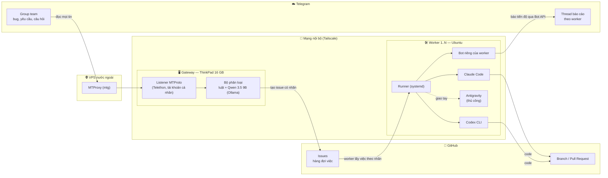
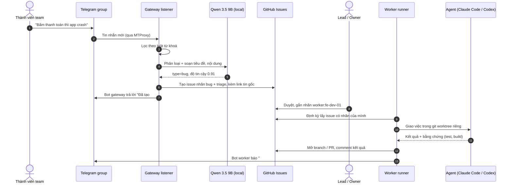
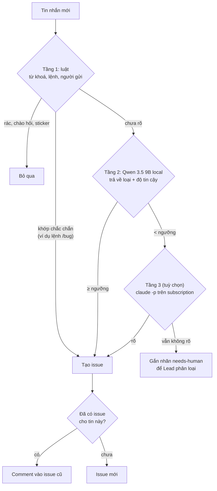
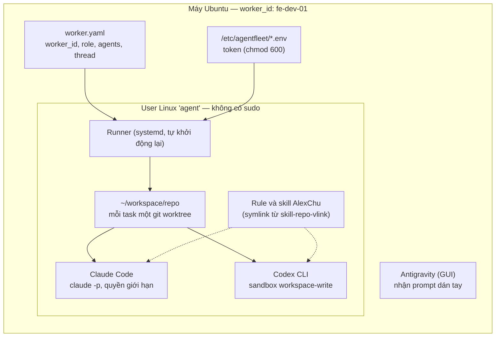
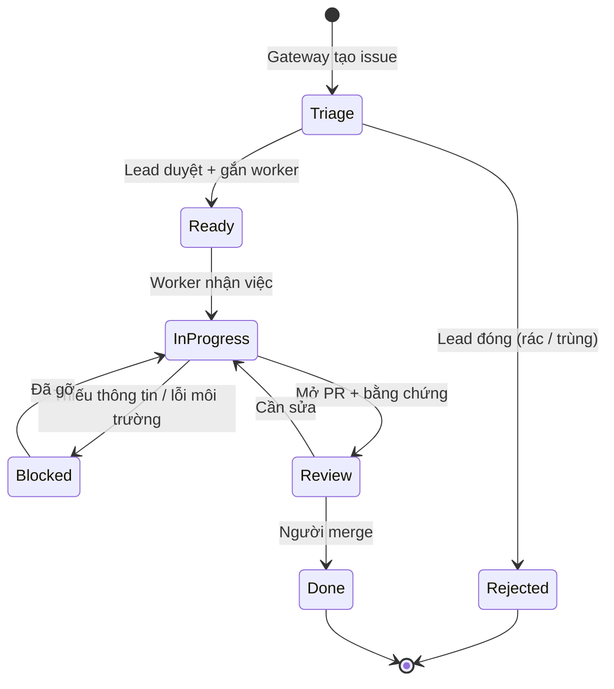
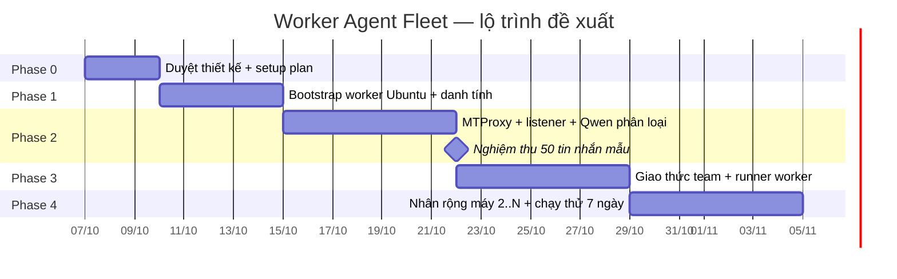

# Solution Brief: Worker Agent Fleet

<!-- telegram-triage-historical -->
> **Telegram triage — phần lịch sử/đề xuất:** mô tả nghiệp vụ triage trong tài liệu này không còn là nguồn hiện hành. Xem [TG-01..TG-32](../01-product/telegram-triage-noissue_business_261015_v1.0.0.md) cho bản đã triển khai baseline `9746ef2`. Các kế hoạch Fleet/worker ngoài triage, sign-off, incident và số đo cũ được giữ nguyên; không coi đề xuất là chức năng đã chạy.

> Tài liệu trình bày giải pháp cho CTO. Nguồn phạm vi Fleet là Master Doc
> [`worker-agent-fleet-1_master_261007_v1.0.8.md`](./worker-agent-fleet-1_master_261007_v1.0.8.md).
> Master Doc quản lý phạm vi Fleet; nghiệp vụ Telegram triage hiện hành theo nguồn TG-01..TG-32 phía trên.
> **Giai đoạn 1 (MVP) chỉ làm Telegram Triage Agent chạy local** — kế hoạch từng bước: [`worker-agent-fleet-1_setup-plan_261008_v1.0.6.md`](./worker-agent-fleet-1_setup-plan_261008_v1.0.6.md). Tài liệu này mô tả toàn bộ hệ thống về sau.
> **Giai đoạn 1 kết nối Telegram trực tiếp** (mạng hiện không chặn); MTProxy trên VPS trong các sơ đồ dưới đây là trạng thái về sau, khi bị chặn hoặc khi chuyển lên VPS (D7).

| | |
|---|---|
| **Feature ID** | 1 (ticket nội bộ) |
| **Phiên bản** | v1.0.8 — 2026-10-15 21:15 (Asia/Saigon) |
| **Người soạn** | AlexChu (Main Agent harness) |
| **Trạng thái** | Chờ CTO duyệt |

---

## 1. Tóm tắt

> Phạm vi triage tại mục này là snapshot/đề xuất cũ: [quy tắc hiện hành](../01-product/telegram-triage-noissue_business_261015_v1.0.0.md). Không áp lại gate phải tag, chỉ reaction, local-only, /question→issue, quota comment hoặc late-reply→comment từ snapshot này.

- **Vấn đề:** agent AI đang chạy rời rạc trên máy dev, không có danh tính cố định, không có kênh nhận việc chung. Yêu cầu trên Telegram vẫn phải chép tay sang GitHub.
- **Giải pháp:** mỗi máy Ubuntu là một **worker** có vai trò cố định, cài sẵn Claude Code, Codex và Antigravity. Một **máy gateway** đọc Telegram bằng tài khoản cá nhân qua MTProto, **phân loại bằng model local Qwen 3.5 9B**, rồi tạo ticket GitHub. Worker nhận ticket, làm việc và báo cáo lại lên Telegram.
- **Nguyên tắc thiết kế:** **GitHub Issues là hàng đợi việc (nguồn sự thật). Telegram là kênh giao tiếp.**
- **Chi phí vận hành thêm:** không có API trả theo token. Code dùng subscription sẵn có, phân loại chạy local.
- **Cần CTO quyết:** 6 điểm ở §13, quan trọng nhất là chính sách dùng tài khoản subscription và việc ticket tự tạo có cần người duyệt hay không.

---

## 2. Vấn đề hiện tại

> Phạm vi triage tại mục này là snapshot/đề xuất cũ: [quy tắc hiện hành](../01-product/telegram-triage-noissue_business_261015_v1.0.0.md). Không áp lại gate phải tag, chỉ reaction, local-only, /question→issue, quota comment hoặc late-reply→comment từ snapshot này.

| Hiện trạng | Hệ quả |
|---|---|
| Agent chạy trên máy cá nhân, gắn với phiên làm việc của một người | Người đó tắt máy là việc dừng, không ai tiếp quản |
| Telegram chỉ có bot **gửi** thông báo một chiều | Yêu cầu từ team trên Telegram vẫn phải chép tay thành ticket |
| Không có quy ước "ai nhận việc gì" giữa các agent | Trùng việc, sót việc, khó biết agent nào đang giữ task nào |
| Telegram có thể bị chặn hoặc chập chờn ở mạng nội bộ | Kết nối tự động tới Telegram không ổn định |

---

## 3. Kiến trúc tổng thể

> Phạm vi triage tại mục này là snapshot/đề xuất cũ: [quy tắc hiện hành](../01-product/telegram-triage-noissue_business_261015_v1.0.0.md). Không áp lại gate phải tag, chỉ reaction, local-only, /question→issue, quota comment hoặc late-reply→comment từ snapshot này.

**Vì sao chia như vậy:**

| Lựa chọn | Lý do |
|---|---|
| **Một** listener dùng tài khoản cá nhân, đặt ở gateway | Bot Telegram **không đọc được tin của bot khác** trong group. Tài khoản người dùng thì đọc được mọi tin, kể cả tin của bot worker. Chỉ chạy một instance để tránh tạo ticket trùng và tránh bị Telegram đánh dấu bất thường. |
| Worker **gửi** tin bằng bot riêng | Mỗi worker có tên riêng trong group nên dễ theo dõi. Tài khoản cá nhân chỉ đọc, không gửi hàng loạt, nên giảm rủi ro bị khoá. |
| GitHub Issues làm hàng đợi | Có sẵn lịch sử, nhãn, người giữ việc, liên kết với PR. Worker không cần đọc Telegram. |
| MTProxy trên **VPS nước ngoài** | Proxy chỉ chuyển tiếp kết nối. Đặt trong mạng nội bộ đang bị chặn thì chính proxy cũng không tới được Telegram. Bot gửi tin qua Bot API (HTTPS), không đi qua MTProxy; nếu Bot API cũng bị chặn thì dùng thêm proxy SOCKS5 trên cùng VPS. |

---

## 4. Luồng chính: từ tin nhắn tới báo cáo

> Phạm vi triage tại mục này là snapshot/đề xuất cũ: [quy tắc hiện hành](../01-product/telegram-triage-noissue_business_261015_v1.0.0.md). Không áp lại gate phải tag, chỉ reaction, local-only, /question→issue, quota comment hoặc late-reply→comment từ snapshot này.

> Bước 7 (Lead duyệt) là **đề xuất có người duyệt**. CTO quyết định giữ hay bỏ ở §13.

---

## 5. Bộ phân loại 3 tầng

> Phạm vi triage tại mục này là snapshot/đề xuất cũ: [quy tắc hiện hành](../01-product/telegram-triage-noissue_business_261015_v1.0.0.md). Không áp lại gate phải tag, chỉ reaction, local-only, /question→issue, quota comment hoặc late-reply→comment từ snapshot này.

**Vì sao chọn Qwen 3.5 9B (quyết định D5):**

| Tiêu chí | Qwen 3.5 9B trên ThinkPad 16 GB |
|---|---|
| Bộ nhớ | Khoảng 6–7 GB ở mức nén 4-bit, còn chỗ cho hệ điều hành và listener |
| Tốc độ (CPU) | Ước lượng 8–15 token/giây cho model cỡ 8–9B, đủ cho tin nhắn ngắn |
| Năng lực | Có gọi tool sẵn, có chế độ suy luận, context tới 256K |
| Chi phí | Không tốn quota subscription, chạy liên tục được |
| Dữ liệu | Tin nhắn nội bộ không rời máy gateway |

**Nghiệm thu:** cho model phân loại 50 tin nhắn mẫu do Owner chấm. Đạt **≥ 85%** đúng nhãn thì giữ. Không đạt thì bật tầng 3 hoặc đổi model.

---

## 6. Bên trong một worker

- **Dựng bằng một script bootstrap** chạy lại được nhiều lần. Mục tiêu: máy sạch thành worker trong **≤ 30 phút**.
- **Bước con người không tự động hoá được:** đăng nhập subscription (`claude setup-token`, `codex login`), `gh auth login`, mã OTP Telegram. Script dừng lại và hướng dẫn ở các bước này.
- **Danh tính bất biến** của toàn hệ thống vẫn là **AlexChu** (chủ dữ liệu, task history). `worker_id` chỉ là tên của máy.

---

## 7. Vòng đời một task

**Ranh giới quan trọng:** agent **không tự merge** vào nhánh chính. Merge luôn do người làm, theo quy tắc hiện hành của harness.

---

## 8. Chiến lược model

| Việc | Model | Nguồn chi phí | Lý do |
|---|---|---|---|
| Phân loại tin nhắn, soạn ticket | **Qwen 3.5 9B** (local, Ollama) | Phần cứng sẵn có + điện | Việc đơn giản, chạy liên tục, giữ dữ liệu nội bộ |
| Viết code, sửa bug | **Claude Code / Codex** | Subscription sẵn có | Model local hiện yếu hơn rõ ở việc code nhiều bước, nhiều file |
| Việc đọc ảnh, việc lặp lại nhiều | **Antigravity (Gemini)** | Subscription sẵn có | Nhận việc thủ công |
| Ca phân loại khó (tuỳ chọn) | `claude -p` | Subscription | Chỉ dùng khi model local không chắc |

**Lưu ý về subscription:** nhiều máy dùng chung một tài khoản thì **chia nhau hạn mức** của tài khoản đó. Cho người khác dùng chung tài khoản thường trái điều khoản nhà cung cấp. Cần chốt chính sách trước khi nhân rộng (§13).

---

## 9. Bảo mật

| Tài sản | Rủi ro nếu lộ | Biện pháp |
|---|---|---|
| Session MTProto (`*.session`) | **Toàn quyền tài khoản Telegram cá nhân** | Chỉ nằm trên gateway, thuộc user riêng (không phải user `agent`), không commit (đã chặn trong `.gitignore`) |
| `api_id` / `api_hash`, bot token | Mạo danh bot, lạm dụng API | Lưu trong `/etc/agentfleet/*.env` (chmod 600), đọc qua systemd |
| GitHub token | Ghi vào repo | PAT **fine-grained**, chỉ quyền Issues của repo đích |
| Ollama API | Ollama **không có xác thực**: ai vào được cổng là dùng được model | Chỉ nghe `127.0.0.1` |
| Máy worker | Agent chạy lệnh nguy hiểm | User không có sudo, danh sách lệnh cho phép, sandbox Codex |
| Truy cập từ xa | Lộ cổng ra Internet | Tailscale + SSH key, không mở port công khai |

---

## 10. Rủi ro và cách giảm

| Rủi ro | Mức | Cách giảm |
|---|---|---|
| Telegram khoá tài khoản cá nhân vì automation | Cao | Tài khoản chỉ đọc + tạo ticket. Gửi tin bằng bot. Một instance duy nhất. |
| Subscription chạm giới hạn hoặc trái điều khoản khi nhân rộng | Cao | Chốt chính sách tài khoản trước Phase 4. Mỗi máy nặng dùng tài khoản riêng. Phương án dự phòng: API key cho phần chạy tự động. |
| Qwen 3.5 9B phân loại sai | Trung bình | Nghiệm thu 50 tin mẫu. Ngưỡng tin cậy. Nhãn `needs-human`. Lead duyệt trước khi giao việc. |
| VPS MTProxy chết hoặc bị chặn IP | Trung bình | `--restart unless-stopped` + listener tự kết nối lại. Giữ sẵn proxy dự phòng; đổi IP/VPS khi bị chặn. |
| Ticket rác hoặc trùng | Thấp | Chống trùng theo ID tin nhắn. Luật lọc tin rác ở tầng 1. |
| Agent sửa code sai | Trung bình | Không tự merge. Verifier khác executor. Người review PR. |

---

## 11. Lộ trình

---

## 12. Tiêu chí nghiệm thu

| KPI | Mục tiêu |
|---|---|
| Thời gian dựng một worker từ máy sạch | ≤ 30 phút (không tính đăng nhập thủ công); chạy lại script không đổi gì |
| Tin nhắn hợp lệ thành đúng 1 issue | ≥ 95%, độ trễ ≤ 60 giây |
| Độ chính xác phân loại (50 tin mẫu) | ≥ 85% |
| Listener chạy liên tục | 7 ngày không can thiệp tay |
| Secret trong git history | 0 |

---

## 13. Cần CTO quyết

| # | Câu hỏi | Đề xuất |
|---|---|---|
| 1 | **Chính sách tài khoản subscription** khi chạy trên nhiều máy | Mỗi máy làm việc nặng một tài khoản riêng; ngân sách dự phòng API key nếu vượt hạn mức |
| 2 | Ticket tự tạo có cần **Lead duyệt** trước khi giao worker không | **Có** trong 4 tuần đầu, sau đó nới cho các nhãn đã ổn định |
| 3 | Ticket tạo vào **repo GitHub nào**, có lên project board không | Repo sản phẩm chính + board hiện có |
| 4 | Số máy và **vai trò** từng máy | Bắt đầu 2 máy: 1 gateway (ThinkPad), 1 worker code |
| 5 | Những **group Telegram** nào được nghe; có nghe tin nhắn riêng không | Chỉ group team; không nghe tin nhắn riêng |
| 6 | Dùng tài khoản Telegram **của ai** làm listener | Một tài khoản dành riêng cho dự án, không dùng tài khoản cá nhân chính |

---

## Phụ lục — Quyết định đã chốt

| # | Quyết định |
|---|---|
| D1 | Repo `AgentBuilder`, hiện chỉ local |
| D2 | Nghe Telegram bằng tài khoản cá nhân qua MTProto |
| D3 | Mỗi worker cài Claude Code + Codex CLI + Antigravity |
| D4 | Docker chạy trên một máy riêng; lỗi Docker xử lý như track riêng (không còn chặn tiến độ vì MTProxy chuyển sang VPS) |
| D5 | Qwen 3.5 9B (Ollama) trên gateway ThinkPad 16 GB làm bộ phân loại |
| D6 | Giai đoạn 1 (MVP) chỉ gồm Telegram Triage Agent chạy local; worker và agent dùng subscription làm sau |
| D7 | Giai đoạn 1 chạy toàn bộ trên ThinkPad, kết nối Telegram trực tiếp; tối ưu lên VPS sau |
| D8 | Trong lúc thử nghiệm, issue tạo vào repo riêng `tg-triage-sandbox` |

**Chưa kiểm chứng (nói trước với CTO):**
- Cấu hình thật của ThinkPad chưa đo. Tốc độ 8–15 token/giây là ước lượng từ các bài test công khai cho model cỡ 8–9B chạy CPU.
- Tag chính xác của Qwen 3.5 9B trên Ollama chưa tra lại.
- Máy Docker nội bộ đang lỗi, chưa có log. Không còn nằm trên đường găng vì MTProxy chạy trên VPS.

---

## Changelog

| Version | Date | Time | Author | Changes |
|---------|------|------|--------|---------|
| v1.0.0 | 2026-10-07 | 16:25 | AlexChu (Claude Code) | Bản đầu trình CTO |
| v1.0.1 | 2026-10-08 | 08:27 | AlexChu (Claude Code) | Chuyển MTProxy sang VPS nước ngoài (proxy trong mạng bị chặn không tới được Telegram); bot báo cáo đi qua Bot API; thêm link Setup Plan |
| v1.0.2 | 2026-10-08 | 08:38 | AlexChu (Claude Code) | Ghi rõ MVP = Telegram Triage Agent (D6); link Setup Plan v1.0.1, Master v1.0.3 |
| v1.0.3 | 2026-10-08 | 08:50 | AlexChu (Claude Code) | Cập nhật link: Master v1.0.4, Setup Plan v1.0.2 (có phụ lục thuật ngữ) |
| v1.0.4 | 2026-10-08 | 09:33 | AlexChu (Claude Code) | Ghi chú giai đoạn 1 kết nối thẳng, MTProxy/VPS là về sau (D7); cập nhật link Master v1.0.5, Setup Plan v1.0.3 |
| v1.0.5 | 2026-10-09 | 11:52 | AlexChu (Claude Code) | Cập nhật link: Master v1.0.6, Setup Plan v1.0.4 (có số đo B4 thật) |
| v1.0.6 | 2026-10-09 | 15:09 | AlexChu (Claude Code) | Thêm D8; cập nhật link Master v1.0.7, Setup Plan v1.0.5 |
| v1.0.7 | 2026-10-09 | 15:27 | AlexChu (Claude Code) | Cập nhật link: Master v1.0.8, Setup Plan v1.0.6 |

## Changelog chuẩn hóa Telegram triage

| Version | Ngày giờ (Asia/Saigon) | Tác giả | Thay đổi |
|---|---|---|---|
| v1.0.8 | 2026-10-15 21:15 | Codex / owner AlexChu | Gắn nhãn snapshot/đề xuất, thêm đối chiếu nguồn TG-01..TG-32; giữ lịch sử và sign-off. |
