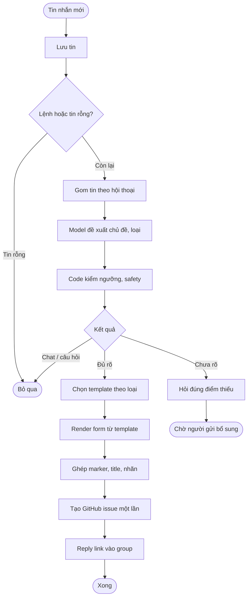
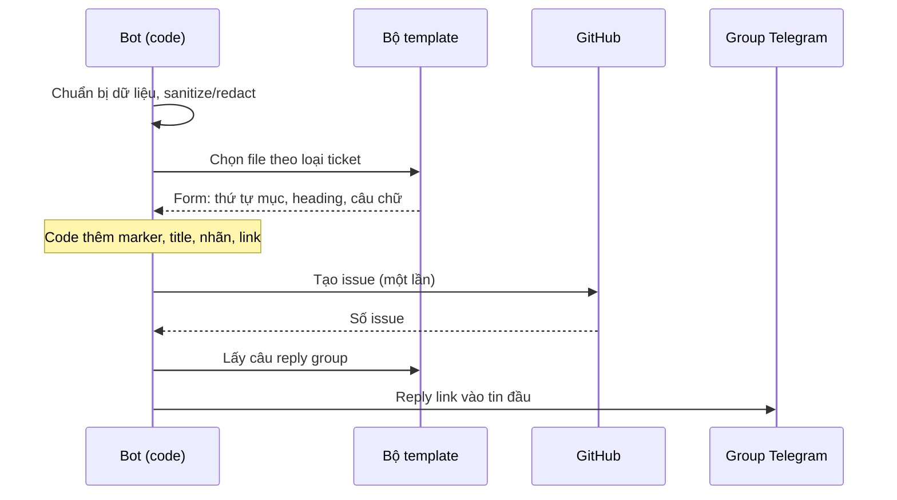
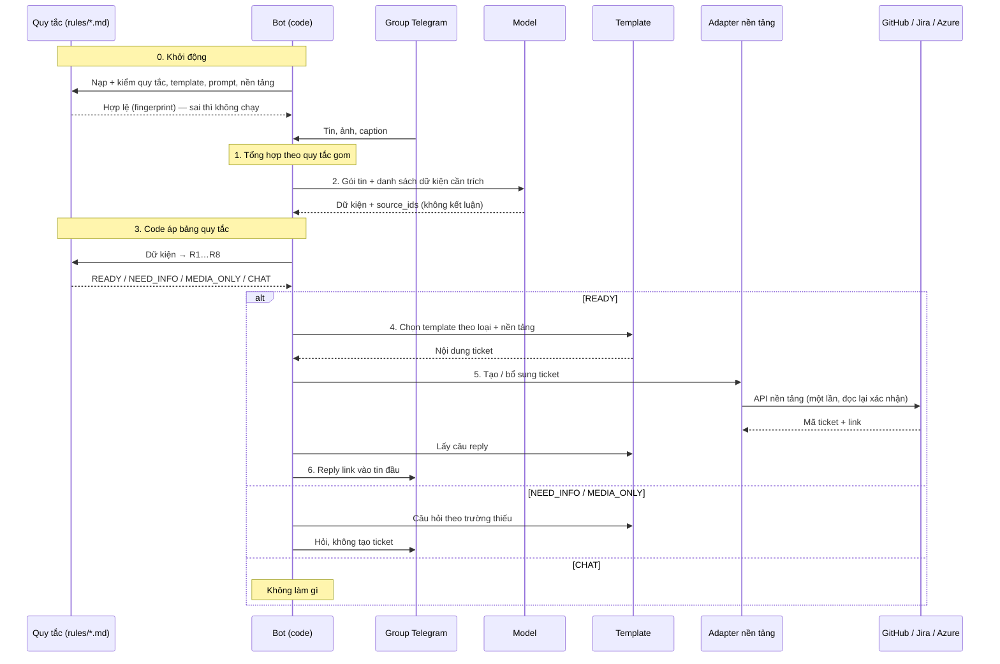
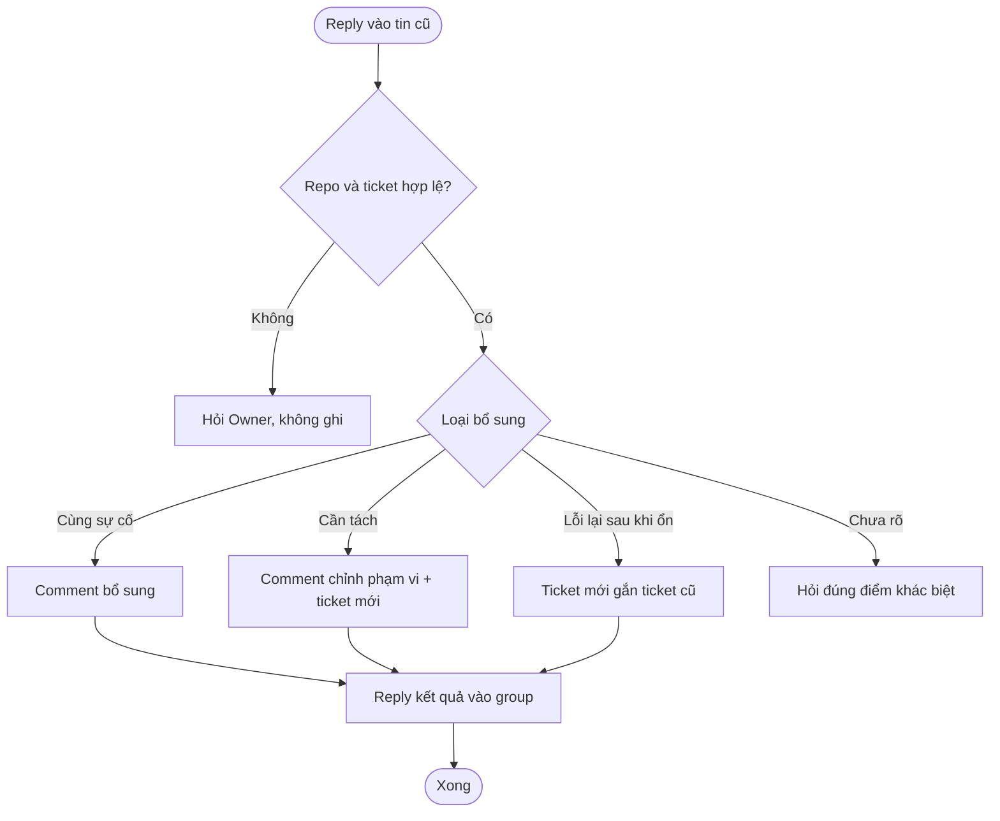
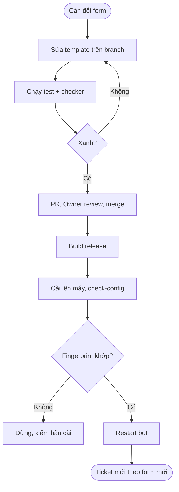
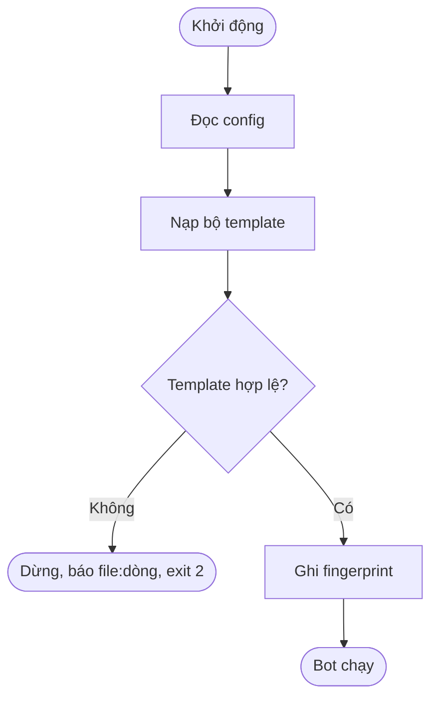
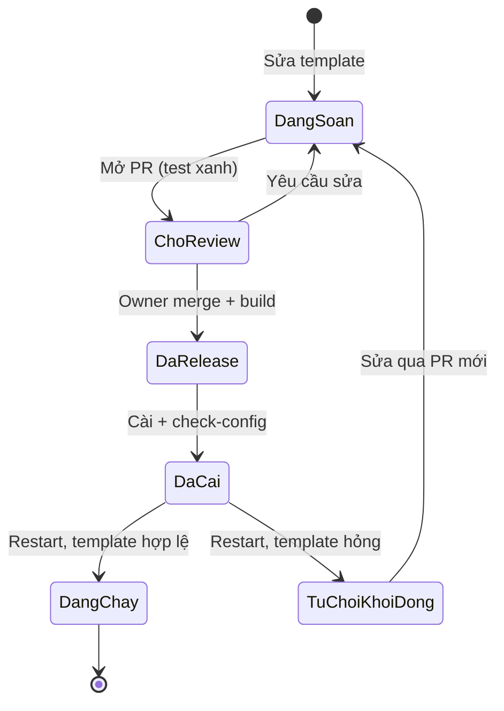
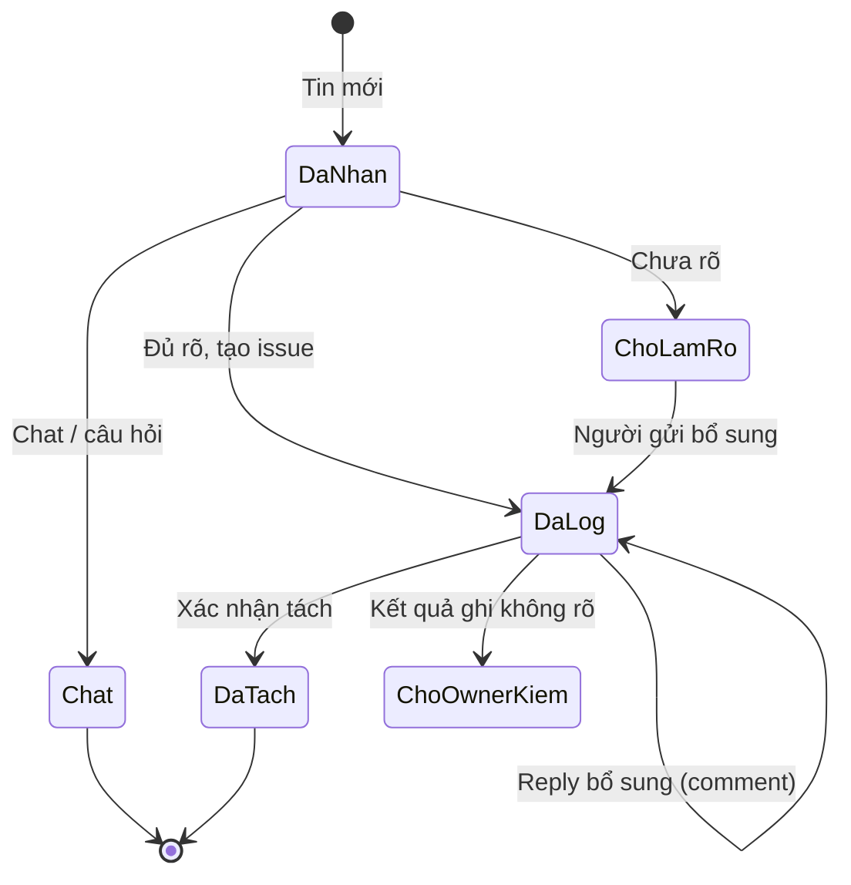

## Telegram Triage → GitHub Ticket (sau PR #81: ticket theo template)

**Last Updated:** 2026-10-29
**Audience:** Owner, team dev/QA, operator, Agent tiếp nhận
**Status:** Review

> Tài liệu nghiệp vụ dạng tổng quan. Nguồn quy tắc duy nhất vẫn là [Business DOCS TG-01…TG-33](telegram-triage-noissue_business_261015_v1.0.0.md); khi lệch, Business DOCS thắng. Rule chi tiết: [Rulebook](telegram-triage-noissue_rulebook_261027_v1.0.0.md).

---

### Overview

> Bot đọc hội thoại trong group Telegram của team, nhận ra việc cần làm (bug, task, feedback), tạo hoặc bổ sung GitHub issue và trả lời link ngay trong group. Từ PR #81, **hình dạng và câu chữ** của issue, comment và câu bot trả lời được lấy từ **bộ template Markdown** đóng gói cùng bot (`listener/templates/github-ticket/`), không còn viết cứng trong code. Owner đổi được form ticket bằng một PR sửa template, không cần lập trình viên sửa logic; cách bot phân loại và quyết định giữ nguyên.

---

### Key Concepts

| Term | Definition |
| :--- | :--- |
| Ticket | GitHub issue do bot tạo từ hội thoại Telegram |
| Chủ đề (topic) | Một vụ việc trong hội thoại; mặc định một chủ đề thành một ticket |
| Bộ template | 7 file Markdown quyết định bố cục và câu chữ: `bug.md`, `task.md`, `feedback.md`, `needs-human.md`, `_common.md`, `comments.md`, `group-replies.md` |
| Khối (block) | Phần nội dung có tên trong template, ví dụ `body`, `notice.issue`; chữ ngoài khối chỉ là hướng dẫn cho người đọc |
| Slot | Chỗ trống bot điền dữ liệu, ví dụ `{{summary}}`; `{{work\|(chưa có thông tin)}}` in chữ mặc định khi trống |
| Mục tùy chọn | Phần chỉ hiện khi có dữ liệu: `{{#if reason}}…{{/if}}` |
| Dòng lặp | Dòng lặp cho mỗi phần tử danh sách: `- [ ] {{@done}}` |
| Fingerprint | Mã SHA-256 đại diện cho đúng một bộ template; dùng để đối chiếu bản đang chạy với bản đã release |
| needs-human | Ticket hoặc trạng thái cần người xác nhận vì yêu cầu chưa rõ |
| TG-33 | Business rule mới: template là nguồn bố cục và câu chữ, code giữ phần an toàn |

---

### User Roles

| Role | Responsibilities in this Feature |
| :--- | :--- |
| Người gửi trong group | Báo lỗi, giao việc, góp ý bằng chat tự nhiên; reply để bổ sung hoặc xác nhận |
| Bot (listener) | Phân loại, quyết định, dựng nội dung từ template, ghi GitHub, trả lời group |
| Owner (AlexChu) | Quyết định form ticket; duyệt PR đổi template; duyệt release |
| Team dev / Agent | Sửa template hoặc code qua PR; chạy test, checker |
| Operator | Cài bản release lên máy chạy, chạy `check-config`, đối chiếu fingerprint, restart |

---

### Cấu trúc listener

Bot nằm trọn trong thư mục `listener/`. Ba thư mục bot **đọc khi chạy** là `templates/`, `prompts/` và `src/tg_triage/`; tài liệu trong `Docs/` bot không đọc.

```
listener/
├── AGENTS.md                 ← điểm vào cho Agent tiếp nhận
├── README.md                 ← vận hành, cấu hình, quy trình đổi template
├── pyproject.toml            ← đóng gói prompts + templates vào bản cài (wheel)
│
├── templates/github-ticket/  ← FORM TICKET + CÂU CHỮ (bot đọc lúc khởi động) — mới từ PR #81
│   ├── bug.md                   form issue bug
│   ├── task.md                  form issue task
│   ├── feedback.md              form issue feedback / đề xuất
│   ├── needs-human.md           form issue chưa rõ, cần người xác nhận
│   ├── _common.md               khối Tin gốc, footer, câu dùng chung
│   ├── comments.md              comment bổ sung / tách / tái diễn
│   └── group-replies.md         câu bot trả lời trong group
│
├── prompts/                  ← HƯỚNG DẪN CHO MODEL (bot đọc): cách hiểu hội thoại, chia chủ đề, phân loại
│   ├── autonomous.md, thinking-topics.md, topics.md
│   └── case.md, classify.md, followup.md
│
├── src/tg_triage/            ← LOGIC + AN TOÀN (code Python)
│   └── (nhóm theo bước nghiệp vụ — xem bảng dưới)
│
└── tests/                    ← 48 file test, 932 ca; gồm golden 352 ca chốt form ticket
    ├── test_template_golden.py + fixtures/template_golden.json
    └── test_ticket_templates.py
```

**Code theo bước nghiệp vụ** (`listener/src/tg_triage/`):

| Bước nghiệp vụ | File | Việc chính |
| :--- | :--- | :--- |
| Khởi động, kiểm cấu hình | `__main__.py`, `config.py`, `runtime.py`, `receipt.py` | Đọc config, nạp và kiểm template (hỏng ⇒ exit 2), bảo vệ thư mục/tiến trình, xác nhận bản đã nạp |
| Nhận tin, gom tin | `telegram_io.py`, `pacing.py` | Nghe group, chờ 30–60s (autonomous) hoặc cửa sổ 2 phút (legacy) |
| Lưu và chống trùng | `store.py`, `followup_store.py`, `autonomy_store.py`, `topic_store.py` | SQLite, sổ ghi thao tác, bộ nhớ chủ đề |
| Lọc lệnh, noise | `rules.py` | Lệnh `/bug /task /feedback…`, tin rỗng |
| Hiểu hội thoại (model) | `thinking.py`, `thinking_transport.py`, `provider.py`, `ai_transport.py`, `classifier.py`, `ingress_model.py`, `followup_model.py`, `model_lock.py` | Đóng gói context ≤ 8 KB, gọi model, kiểm output |
| Quyết định | `pipeline.py`, `autonomous.py`, `models.py` | Ngưỡng 0.7, safety, chọn tạo / hỏi / bỏ qua; danh mục loại và nhãn |
| Ticket đã có | `followups.py`, `lifecycle.py` | Bổ sung, tách, tái diễn, trạng thái open/closed |
| **Dựng nội dung** | `ticket_templates.py` (mới), `issue_format.py` | Nạp/kiểm/render template; ghép marker, title, nhãn, sanitize |
| Ghi GitHub | `github_issues.py`, `attachments.py` | Tạo issue một lần, comment, upload ảnh/tài liệu |
| Trả lời group | `group_notices.py`, `reactions.py` | Câu reply (từ template), xưng hô, ❤ / 👌 |
| Truy vết, thống kê | `trace.py`, `usage.py` | Điều tra chỉ đọc, usage model |

**Ai sửa thư mục nào:**

| Muốn đổi | Sửa ở | Quy trình |
| :--- | :--- | :--- |
| Bố cục, heading, câu chữ ticket / câu reply | `templates/github-ticket/` | PR → test + checker → release → `check-config` → restart |
| Cách model hiểu và phân loại | `prompts/` | PR → test + checker → release |
| Logic quyết định, an toàn, nhãn, title | `src/tg_triage/` | Sửa Business DOCS trước, rồi code qua `/dispatch` |
| Quy tắc nghiệp vụ | `Docs/01-product/…business…md` | Owner duyệt; đồng bộ Rulebook và trace |

---

### End-to-End Workflows

#### Workflow 1: Log ticket mới từ hội thoại

**Primary Actor:** Người gửi trong group
**Trigger:** Tin nhắn mới trong group được cấu hình
**Outcome:** GitHub issue đúng form template, bot reply link vào tin đầu của chủ đề

**User Stories:**
- As a người gửi, I want to báo lỗi bằng chat thường, so that team nhận ticket mà tôi không cần tag bot hay dùng lệnh.
- As a team dev, I want to mọi ticket cùng loại có cùng bố cục, so that tôi đọc và xử lý nhanh.
- As a người gửi, I want to được hỏi đúng điểm còn thiếu khi yêu cầu chưa rõ, so that tôi không phải nhắc lại thông tin đã gửi.
- As a Owner, I want to chat thường và câu hỏi thông tin không thành ticket, so that board không bị rác.

| Step | Who | Action | System Response | Notes |
| :--- | :--- | :--- | :--- | :--- |
| 1 | Người gửi | Gửi tin, ảnh, caption | Lưu tin trước mọi xử lý; chống xử lý trùng | TG-01, TG-02 |
| 2 | Bot | Lọc lệnh và tin rỗng | Lệnh `/bug /task /feedback` có nội dung ép loại; tin không chữ là noise | TG-03, TG-04 |
| 3 | Bot | Gom tin theo nhịp hội thoại | Legacy: cửa sổ 2 phút. Autonomous: chờ 30s yên lặng, tối đa 60s | TG-05 |
| 4 | Bot + model | Chia chủ đề, đề xuất loại | Model chỉ đề xuất; code kiểm schema, quyền Reply, ngưỡng 0.7, safety | TG-06 → TG-10 |
| 5 | Bot | Quyết định | Chat/câu hỏi: bỏ qua. Chưa rõ: hỏi (legacy tạo ticket needs-human). Đủ rõ: tạo issue | TG-08, TG-09, TG-12 |
| 6 | Bot | **Dựng nội dung từ template** | Chuẩn bị dữ liệu đã sanitize/redact → chọn template theo loại → render form → ghép marker, title, nhãn | **TG-33** (thay đổi của PR #81) |
| 7 | Bot | Ghi GitHub | Đặt chỗ → tạo issue một lần → đọc lại; kết quả không rõ thì không gửi lại | TG-24 |
| 8 | Bot | Trả lời group | Reply tin đầu bằng câu trong `group-replies.md`; ❤ khi nhận, 👌 khi có số issue | TG-11, TG-13 |



**Bot chọn template thế nào:**

| Trường hợp | Template dùng |
| :--- | :--- |
| Bug đủ rõ | `bug.md` |
| Task (kể cả redesign) | `task.md` |
| Feedback / đề xuất tính năng | `feedback.md` |
| Chưa xác định loại, hoặc không có chi tiết | `needs-human.md` |
| Khối "Tin gốc", footer "Phân loại…" | `_common.md` |
| Câu bot trả lời trong group | `group-replies.md` |

**Sequence hiện tại (PR #81, đang chạy):** model phán đủ rõ; GitHub là nền tảng duy nhất.



**Sequence đích (Owner chốt 2026-10-29, CHƯA triển khai):** mọi quyết định theo file markdown quy tắc; model chỉ trích dữ kiện; nền tảng ticket đổi được bằng cấu hình. Thiết kế chi tiết: [Kế hoạch §0](../04-tasks/telegram-triage-noissue_tasks_261029_v1.0.0.md) · bảng quy tắc nháp: [listener/rules/README.md](../../listener/rules/README.md).

| Bước | Việc | Ai làm | Dựa vào file |
| :--- | :--- | :--- | :--- |
| 0 | Nạp + kiểm quy tắc, template, prompt, cấu hình nền tảng (sai ⇒ không khởi động) | Code | `rules/`, `templates/`, `prompts/`, `platforms/`, config |
| 1 | Tổng hợp tin theo quy tắc gom (Reply thật, gói context) | Code | `rules/` |
| 2 | Trích dữ kiện + tin nguồn (không kết luận) | Model | `prompts/` (danh sách trường sinh từ `rules/`) |
| 3 | Áp bảng quy tắc → READY / NEED_INFO / MEDIA_ONLY / CHAT | Code | `rules/README.md` |
| 4 | Chọn template theo loại + trạng thái + nền tảng | Code | `templates/` |
| 5 | Tạo / bổ sung ticket qua adapter nền tảng | Code | `platforms/<nền tảng>.md`, config |
| 6 | Reply group | Code | `templates/group-replies.md` |



#### Workflow 2: Bổ sung, tách, tái diễn ticket đã có

**Primary Actor:** Người gửi trong group
**Trigger:** Người gửi **Reply thật** vào tin gốc hoặc tin bot đã gửi
**Outcome:** Comment hoặc ticket mới đúng form `comments.md`, bot trả lời theo `group-replies.md`

**User Stories:**
- As a người gửi, I want to reply thêm ảnh/chi tiết vào ticket đang có, so that thông tin không bị tách thành ticket trùng.
- As a người gửi, I want to nói "cần lên 2 ticket" rồi chỉ "đây là ticket 1/2", so that mỗi việc có ticket riêng.
- As a team dev, I want to lỗi tái diễn sau khi đã chạy tốt thành ticket mới có link ticket cũ, so that lịch sử từng lần lỗi rõ ràng.

| Step | Who | Action | System Response | Notes |
| :--- | :--- | :--- | :--- | :--- |
| 1 | Người gửi | Reply vào tin gốc/notice | Chỉ Reply thật mới được nối vào ticket cũ | TG-16 |
| 2 | Bot | Kiểm repo và trạng thái ticket | URL phải khớp repo cấu hình; đọc trạng thái open/closed hiện tại | TG-17, Vòng đời |
| 3a | Bot | Bổ sung | Comment theo khối `enrichment` | Ticket closed vẫn giữ closed |
| 3b | Bot | Tách ticket | Comment `scope_correction` lên ticket gốc; ticket mới nối dòng `append.source` | Tối đa 5 ticket |
| 3c | Bot | Tái diễn | Ticket mới, nối dòng `append.recurrence` trỏ ticket cũ | Không tự reopen |
| 4 | Bot | Trả lời group | `followup.updated` / `followup.split` / `followup.recurrence` | |



#### Workflow 3: Đổi form ticket (đổi template)

**Primary Actor:** Owner / Team dev
**Trigger:** Muốn đổi bố cục, heading, câu chữ, câu hỏi tự động hoặc câu trả lời của bot
**Outcome:** Bản release mới chạy trên máy với fingerprint đã đối chiếu

**User Stories:**
- As a Owner, I want to đổi thứ tự mục hoặc thêm mục tùy chọn trong ticket bug, so that ticket hợp với cách team làm việc.
- As a Owner, I want to mọi thay đổi template đi qua review, so that câu chữ chạy thật luôn là bản đã duyệt.
- As a operator, I want to biết chắc máy đang chạy đúng bộ template, so that tôi không phải đoán khi ticket trông lạ.

| Step | Who | Action | System Response | Notes |
| :--- | :--- | :--- | :--- | :--- |
| 1 | Team dev | Sửa file trong `listener/templates/github-ticket/` trên branch | — | Chỉ sửa phần trong khối `{{#block}}` |
| 2 | Team dev | Chạy test listener | Validator bắt lỗi cú pháp/slot/text cấm; golden test đỏ ở ca bị đổi form | Cập nhật golden có chủ đích, ghi lý do trong PR |
| 3 | Team dev | Chạy policy checker | Hash template đổi → checker đòi cập nhật trace trong Business DOCS | `check-telegram-triage-policy.py` |
| 4 | Owner | Review và merge PR | — | |
| 5 | Team dev | Build release wheel | Template được đóng gói vào bản cài | `deploy/build_wheel.py` |
| 6 | Operator | Cài bản mới, chạy `check-config` | In fingerprint bộ template | So với fingerprint của bản release |
| 7 | Operator | Restart bot | Bot nạp template mới; ticket sau đó theo form mới | Không có reload nóng |



#### Workflow 4: Khởi động bot và kiểm template

**Primary Actor:** Operator
**Trigger:** Bot khởi động (`run`) hoặc operator chạy `check-config`
**Outcome:** Bot chạy với bộ template hợp lệ, hoặc dừng và báo lỗi rõ

| Step | Who | Action | System Response | Notes |
| :--- | :--- | :--- | :--- | :--- |
| 1 | Operator | Chạy `run` hoặc `check-config` | Đọc config | |
| 2 | Bot | Nạp bộ template | Tìm trong source, nếu không có thì trong bản cài | Không trộn hai nơi |
| 3 | Bot | Kiểm template | Đủ 7 file, đủ khối, slot hợp lệ, không có mention/link/HTML lạ | TG-31 |
| 4a | Bot | Hợp lệ | Ghi log fingerprint, chạy tiếp | |
| 4b | Bot | Không hợp lệ | Dừng, mã thoát 2, báo `file:dòng: lý do` | Ví dụ `bug.md:3: unknown slot` |



---

### System Configuration & Administration

- As a Owner, I want to template chỉ đổi qua PR + release, không có thư mục override trên máy, so that không ai sửa câu chữ production ngoài review.
- As a operator, I want to `check-config` in fingerprint mà không in nội dung template, so that tôi đối chiếu được mà không lộ dữ liệu.
- As a team dev, I want to validator báo đúng file và dòng, so that sửa template sai nhanh.

---

### State Lifecycle

**Bộ template**

| Current Status | Trigger | New Status | Notes |
| :--- | :--- | :--- | :--- |
| Đang soạn | Mở PR | Chờ review | Test + checker phải xanh |
| Chờ review | Owner merge | Đã release | Build wheel |
| Đã release | Cài lên máy + `check-config` | Đã cài, chờ restart | So fingerprint |
| Đã cài, chờ restart | Restart, template hợp lệ | Đang chạy | Ticket mới theo form mới |
| Đã cài, chờ restart | Restart, template hỏng | Từ chối khởi động | Exit 2, sửa qua PR mới |



**Ticket (trạng thái xử lý của bot, không phải open/closed trên GitHub)**

| Current Status | Trigger | New Status | Notes |
| :--- | :--- | :--- | :--- |
| Đã nhận | Gom xong, model + code quyết định | Chat / Chờ làm rõ / Đã log | |
| Chờ làm rõ | Người gửi reply đủ thông tin | Đã log | Legacy: đã có ticket needs-human |
| Đã log | Reply bổ sung cùng sự cố | Đã log (có comment) | |
| Đã log | Xác nhận tách | Đã tách | Ticket gốc giữ yêu cầu đầu |
| Đã log | Ghi GitHub không rõ kết quả | Chờ Owner kiểm | Không tự gửi lại |



---

### Business Rules

- **Template quyết định:** thứ tự mục, thêm/bỏ mục tùy chọn, heading, emoji, tên trường, dòng tĩnh, câu hỏi tự động, câu comment, câu trả lời group (TG-33).
- **Code giữ cố định:** marker nguồn `<!-- tg:… -->`, title (tối đa 80 ký tự), nhãn GitHub, mọi link và ảnh, sanitize/redact, trích dẫn tin gốc, logic chọn template và giới hạn. Lý do: bước cập nhật ticket đối chiếu theo marker/title, và link/mention là kênh chèn nội dung.
- **Link trong tin nguồn:** code kiểm tra http/https, host IDNA, không userinfo, tối đa 2000 ký tự; loại trùng tối đa 10 và dựng link có thể click trong evidence. Link chứa email/phone vẫn đầy đủ; link GitHub có thể tạo cross-reference theo ngoại lệ Owner ngày 2026-10-29. Display được sanitize, quote vẫn redact email/phone và vô hiệu hóa link/reference; link cũng tính là evidence bug (TG-31).
- **Chỉ bản đóng gói:** không có thư mục override, không reload nóng; đổi template = PR + release + restart.
- **Template hỏng = không khởi động:** bot dừng với mã thoát 2, không âm thầm dùng form khác.
- **Nội dung người dùng không bao giờ là lệnh template:** chuỗi như `{{summary}}` trong tin nhắn được in nguyên văn (TG-31).
- **Template không được chứa:** mention `@`, link, `<script>`/HTML ngoài 6 thẻ cho phép, ký tự điều khiển, khoảng trắng cuối dòng.
- **Ticket cũ không bị sửa lại khi đổi template:** chỉ lần bổ sung/refresh sau mới theo form mới; kiểm tra SHA (TG-18) không vỡ.
- Các rule phân loại, gom chủ đề, vòng đời ticket, ghi GitHub một lần **giữ nguyên** (TG-01 → TG-32).

> 💡 **Important:** Đổi template là đổi nội dung ghi lên GitHub và câu bot nói trong group. Luôn chạy test + checker và đối chiếu fingerprint trước khi restart.

---

### Edge Cases & Exception Handling

| Scenario | What Happens | Who Resolves It |
| :--- | :--- | :--- |
| Tin có link http/https | Link hợp lệ kể cả chứa email/phone hoặc dẫn đến GitHub được đưa đầy đủ vào evidence; userinfo và link không hợp lệ bị bỏ qua. Quote vẫn sanitize/redact; link GitHub có thể tạo cross-reference. | Bot |
| Template sai cú pháp / thiếu slot bắt buộc / slot lạ | Bot không khởi động, báo `file:dòng` | Team dev sửa qua PR |
| Template chứa `@mention`, link, HTML lạ | Bị chặn lúc nạp, exit 2 | Team dev |
| Tin người dùng chứa `{{…}}` | In nguyên văn, không thực thi | Auto |
| Bản cài thiếu file template (cài `--user`/`--target`) | Không khởi động | Operator cài lại đúng cách |
| Fingerprint trên máy khác bản release | Không restart; kiểm bản cài | Operator |
| Ticket tạo trước khi đổi template | Giữ form cũ; bổ sung sau theo form mới | Auto (chấp nhận) |
| Ghi GitHub không rõ kết quả | Không gửi lại; báo Owner | Owner |

---

### Frequently Asked Questions

**Q: Muốn đổi heading "🐞 Lỗi" thành chữ khác thì làm gì?**
A: Sửa `listener/templates/github-ticket/bug.md` trong khối `body`, chạy test và checker, mở PR, release, cài và restart.

**Q: Có đổi được nhãn GitHub hoặc tiền tố title `[bug]` bằng template không?**
A: Chưa. Nhãn và title vẫn cố định trong code vì bước cập nhật ticket đối chiếu theo chúng.

**Q: Sửa template trực tiếp trên máy chạy có được không?**
A: Không nên và không được hỗ trợ: không có thư mục override; sửa tay sẽ lệch fingerprint với bản release.

**Q: Câu hỏi làm rõ bot gửi trong group đã nằm hết trong template chưa?**
A: Chưa. Khoảng 25 câu hỏi làm rõ rải rác trong logic bổ sung/tách ticket vẫn viết cứng; sẽ chuyển ở đợt 2.

**Q: PR #81 đã chạy trên máy production chưa?**
A: Chưa. Cần release, cài lên THINKPAD, chạy `check-config` và đối chiếu fingerprint.

---

### Related Features

- [Business DOCS — TG-01…TG-33](telegram-triage-noissue_business_261015_v1.0.0.md)
- [Rulebook](telegram-triage-noissue_rulebook_261027_v1.0.0.md)
- [Overview và bàn giao](../00-master/telegram-triage-noissue_overview_261027_v1.0.0.md)
- [Hướng dẫn template](../templates/github-ticket/README.md)
- [Hướng dẫn listener](../../listener/README.md) · [AGENTS.md](../../listener/AGENTS.md)
- [PR #81](https://github.com/PersonalProjectJob/telegram-agent/pull/81)
