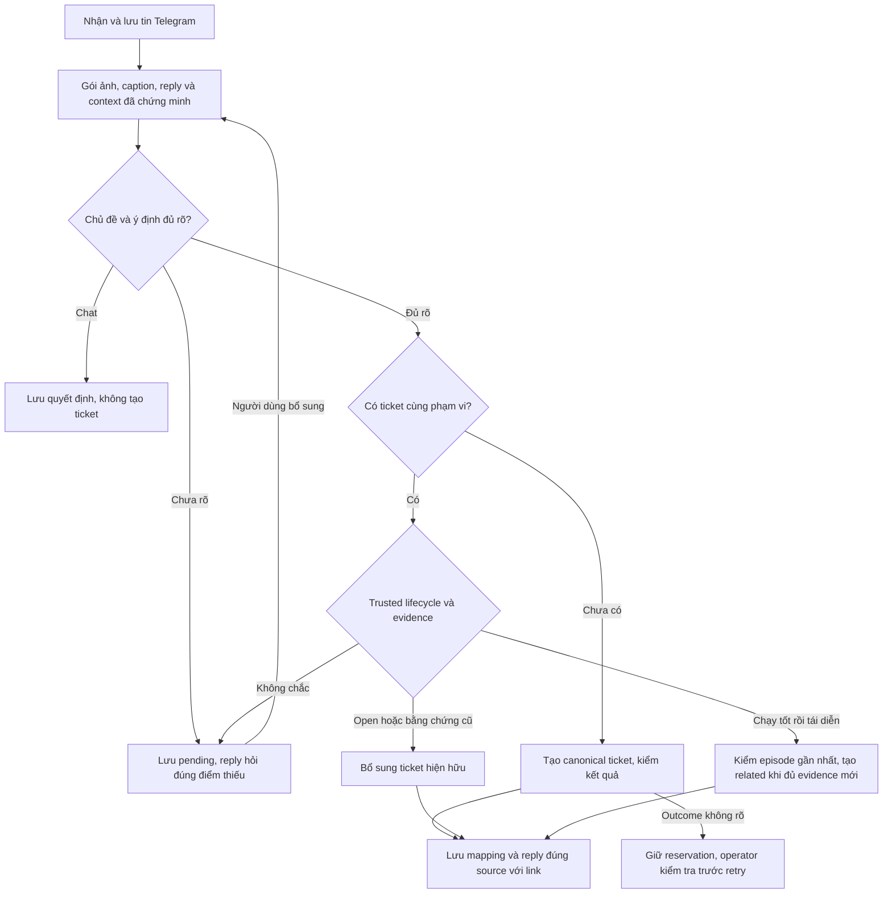
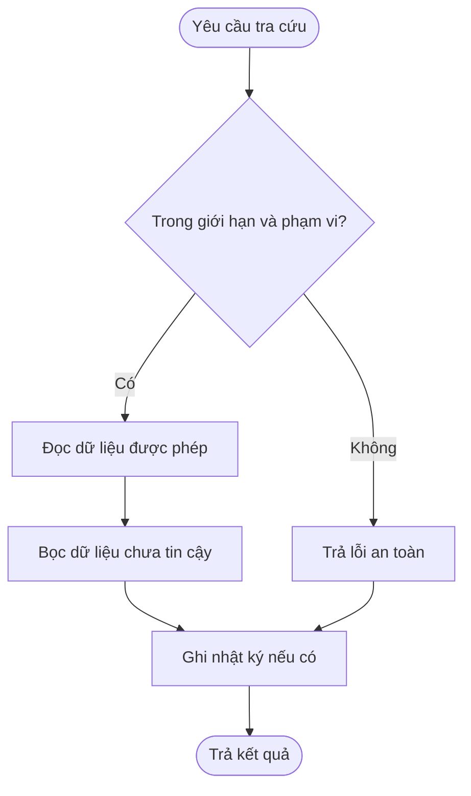

# Telegram triage — nguồn quy tắc nghiệp vụ duy nhất

**Version**: v1.16.62 · **Updated**: 2026-11-25 (Asia/Saigon) · **Owner/state lineage**: AlexChu · **Executor**: Codex / owner AlexChu

**Status**: Nguồn nghiệp vụ của code THINKING trong PR #43 theo yêu cầu user. Bản chuẩn hóa trước đó đối chiếu THINKPAD với baseline `9746ef2`; implementation mới thêm controller, journal SQLite và prompt gọn. Kết quả review/test/installed/deploy do controller báo bằng evidence riêng, không suy từ hash tài liệu. Không replay các tin cũ. Chỉ tạo ticket thật trong kiểm thử khi user đã yêu cầu rõ, như luồng đọc hai file và tạo ticket; không tự tạo việc giả.

## Quyền và cách sử dụng

User yêu cầu tài liệu này và sau đó yêu cầu triển khai THINKING. Nguồn này là nơi duy nhất định nghĩa nghiệp vụ Telegram triage; README là hướng dẫn vận hành, tài liệu Fleet cũ giữ lịch sử/đề xuất. Code và prompt là implementation/projection, **runtime không load Markdown này**. Nếu code/hash thay đổi, cần review và đồng bộ nguồn; hash không chứng minh semantics. Các mục pilot/metric tương lai ở nghiên cứu vẫn là đề xuất. Không có issue riêng (`noissue`), không giả lập approval Master Draft.

## Related Documents

- [THINKING: nghiên cứu và implementation](../02-engineering/telegram-triage-noissue_thinking-research_261015_v1.0.0.md)
- [QA acceptance](../03-qa/telegram-triage-noissue_qa_261015_v1.0.0.md)
- [Hướng dẫn listener](../../listener/README.md)
- [Hướng dẫn agent tiếp nhận](../../listener/AGENTS.md)
- [Overview và bàn giao](../00-master/telegram-triage-noissue_overview_261027_v1.0.0.md)
- [Rulebook — rule chi tiết MUST/MUST NOT](telegram-triage-noissue_rulebook_261027_v1.0.0.md)
- [Template log ticket](../templates/github-ticket/README.md)
- [Quy tắc quyết định dạng markdown (6 core + 2 extension ACTIVE; chưa có live GO) — quy tắc nạp rules vào bot và model](../../listener/rules/README.md)
- [PR #43](https://github.com/PersonalProjectJob/telegram-agent/pull/43)

## Business DOCS — Harness phân loại hội thoại và vòng đời ticket

### Persona

Người gửi yêu cầu trong group Telegram là người dùng chính: họ trao đổi tự nhiên, forward tin, gửi ảnh trước hoặc sau caption và reply vào bất kỳ tin cũ nào. Họ không cần biết ticket ID, tag bot hay cú pháp lệnh. Team xử lý và Owner cần ticket có phạm vi, bằng chứng và lịch sử đúng. Operator là người dùng phụ: cần lần từ một tin Telegram hoặc issue về nguồn, quyết định và side effect để debug an toàn.

### Scenario

Hiện trạng: gom theo thời gian/sender có thể trộn nhiều yêu cầu; phân tích ảnh tách caption mất ý nghĩa “bảng này”; câu trả lời ngắn mất câu hỏi trước; reply thông báo dễ nối nhầm ticket. Kết quả là ticket thiếu thông tin đã có, hỏi lặp hoặc tạo trùng.

Trạng thái mong muốn: Harness AlexChu giữ mạch chủ đề và nguồn bằng chứng qua nhiều lượt, đề xuất quyết định rồi kiểm quyền/phạm vi trước khi ghi. Người dùng thấy link ticket tương ứng hoặc câu hỏi cụ thể ngay tại tin đang trao đổi. Giá trị nghiệp vụ là giảm thao tác nhập lại, bảo toàn bằng chứng và giúp team nhận đúng công việc. Đây là mục tiêu; chưa có số liệu chứng minh mức giảm thời gian hay độ chính xác.

### Audit

Nguyên nhân đã quan sát gồm ranh giới case dựa thời gian, thiếu context chung của ảnh/caption, thiếu ánh xạ bền vững từ reply/notice tới phạm vi ticket, giả thuyết model bị coi như sự thật và packet vượt ngân sách khi lặp dữ liệu. Thêm prompt suy luận đơn thuần không giải quyết hết: cần bộ nhớ, kiểm nguồn, phân quyền hành động, reservation và kiểm kết quả. Transcript/pixel/forward chỉ là bằng chứng, không phải lệnh thay đổi quy tắc của Harness.

### Solution và phạm vi

Harness xử lý một vòng nghiệp vụ: lưu tin → tìm context cùng chat → phân biệt chủ đề → kiểm thông tin đủ nhận diện công việc → chọn tạo/bổ sung/hỏi/chat → kiểm ticket lifecycle và quyền → thực hiện → lưu kết quả → reply đúng nguồn. Một chủ đề có thể trải qua nhiều người/nhiều lượt; một người có thể trao đổi nhiều chủ đề xen kẽ. Tuổi tin và cùng người gửi không quyết định membership.

Trong phạm vi: untagged intake, nhiều chủ đề, ảnh/caption/reply theo gói, hỏi làm rõ, bổ sung ticket mở/đóng, lỗi tái diễn có liên quan, sửa binding/partition, template chuẩn và truy vết. Ngoài phạm vi hiện tại: tự giải quyết bug, tự đóng/mở lại issue, tìm kiếm ngữ nghĩa không giới hạn toàn lịch sử, dashboard debug mới hoặc tự thay đổi quyền/provider consent.

### Nhịp hội thoại và tin đến muộn — chốt 2026-10-16

Telegram là hội thoại nhiều tin, không phải một lượt nhập yêu cầu hoàn chỉnh. Live autonomous worker lưu tin ngay nhưng đợi mặc định **60 giây yên lặng sau tin cuối**, tối đa **120 giây từ đầu đợt gom**, rồi mới phân loại và gửi phản hồi. Tin mới cùng chat kéo dài thời điểm gom đến trần 120 giây; group khác có deadline riêng và event loop vẫn nhận tin. Trần này giới hạn gom context, không phải SLA hoàn tất model/GitHub/upload. Cấu hình cho phép 30 ≤ quiet ≤ max ≤ 120 giây. Việc xử lý model được tuần tự nên lúc bận có thể phản hồi trễ hơn trần gom.

Một đợt gom có thể chứa nhiều chủ đề. Nhiều pending case độc lập do lỗi kỹ thuật trước đây không tự được nhập lại thành một topic chỉ vì cùng lỗi; cần source/reply và quyết định ngữ nghĩa đủ chứng minh phạm vi. Quyền CONTINUE hiện chọn một candidate, không có API tự gộp nhiều pending root cũ. Harness vẫn chia theo nội dung và nguồn/reply; không biến mọi tin trong cùng cửa sổ gom thành một ticket. Ảnh/caption/tin nối tiếp cùng yêu cầu được phân tích chung; tin đến sau khi batch đã chốt thuộc lượt sau, không bị worker đang chạy lấy lẫn vào packet trước. Shutdown/cancel giữ queued bền vững để phục hồi; không ép xử lý sớm để xả queue. Công cụ gọi Pipeline trực tiếp không tự chờ; pacing nằm ở transport Telegram.

**Sau khi chốt lô, bot vẫn tra ngữ cảnh đã lưu.** Mỗi tin/lệnh/ảnh mới phải đối chiếu pending topic, ticket, reply chain, binding và câu hỏi đã gửi trước quyết định. Reply tin/notice cũ tra durable provenance không phụ thuộc tuổi tin. Bổ sung rõ cùng phạm vi nối vào yêu cầu cũ; đủ thông tin thì tạo/bổ sung ticket tương ứng. Chưa rõ chỉ hỏi đúng phần mới còn thiếu. Host chặn câu hỏi trùng đã chuẩn hóa trong cùng pending topic qua restart; model đọc câu hỏi/outcome trước đó để tránh diễn đạt lại vô ích. Câu hỏi mới hoặc chủ đề khác vẫn được phản hồi. Chống paraphrase hoàn toàn bằng bộ so sánh ngữ nghĩa độc lập chưa được triển khai.

Ví dụ: “Login đúng pass mà không login được” rồi bổ sung ảnh màn hình Sign in có lỗi “Invalid username or password” phải giữ chung context login, ghi nhận hành vi bị từ chối; không suy rằng đã xác minh mật khẩu hoặc nguyên nhân lỗi. Câu “Sao tính tiền” xen giữa cần suy luận riêng, không tự gộp vào login chỉ vì cùng tác giả/thời gian. Không hỏi lại đối tượng/hành vi đã có trong ảnh/caption. Ảnh ví dụ có thông tin đăng nhập thật không được dùng làm fixture hoặc gửi cloud để test; dùng dữ liệu giả.

Khi provider/schema/packet thất bại, mỗi batch mới có tối đa một thông báo kỹ thuật tại `host_batch_notice_anchor` bền vững do host chọn. Chu kỳ lỗi theo chat còn mở không được chặn phản hồi của batch mới; `autonomous_outages` vẫn chỉ là telemetry, không phải quan hệ topic hay quyền nhập lại các pending case. Cùng anchor gặp duplicate/restart hoặc reserved/failed/unknown delivery không tự gửi lại. Trong batch, giữ riêng kế toán từng nguồn/case chưa phân loại, không giả lập một topic chung và không hỏi riêng từng ảnh/tin. Thông báo kỹ thuật chỉ xác nhận đã lưu tin và chưa tạo được ticket vì lỗi phân tích; không yêu cầu mô tả lại/chọn số hay hứa retry nền chưa có. Một lượt phân loại mới đã được host validate đóng chu kỳ; cache replay không tự chứng minh phục hồi. Reservation câu hỏi được lưu trước gửi. Câu hỏi ngữ nghĩa của cùng pending topic vẫn không lặp vì chỉ có thêm thời gian hoặc ảnh.

### Ngân sách context và truy vết

Tin mới và exact-reply context ưu tiên trong8KB. Chỉ candidate có Reply thật được đưa vào quyền định tuyến nội dung cũ; lịch sử retrieved khác không được dùng để CONTINUE, kể cả nội dung giống nhau. Candidate của Reply có thể rút gọn theo ngân sách; candidate IDs, reply edges, human bindings và pixel–source mapping của phần giữ lại phải đúng. Pixel thuộc candidate đã lược bỏ không gửi kèm. Model không được chọn candidate không được gửi. Context bị cắt phải có marker cùng metadata packing để debug; không coi phần bị bỏ là không tồn tại. Nếu riêng context bắt buộc cũng quá lớn, dùng fallback kỹ thuật có lưu vết thay vì đoán hoặc tăng ngân sách âm thầm.

`autonomous_outages` lưu cycle/anchor/status/time của sự cố kỹ thuật theo chat, không phải quan hệ topic. `autonomous_clarifications` giữ câu hỏi/reservation theo pending case và source; truy hồi cả notice/plan legacy có câu hỏi rỗng bằng câu hỏi fallback canonical đã dùng. Trace mặc định chỉ xuất case/chat/message/time, không câu hỏi hoặc hash câu hỏi. Event `ingress_packing` cho operator xem số byte, text cap, opaque candidate giữ/bỏ và truncation; không dump nội dung hội thoại.

### Context packet và quyền nguồn

| Thành phần | Ý nghĩa nghiệp vụ | Ràng buộc |
|---|---|---|
| Tin mới, caption và pixel | Nội dung người dùng muốn xử lý | Gửi chung một gói, ảnh phải ánh xạ source ID |
| Reply chain và bot notice | Chỉ nơi người dùng đang trao đổi | Tra cả tin cũ; không mặc định cùng phạm vi khi nội dung khác |
| Tin trước và câu hỏi đang chờ | Giải nghĩa “cả hai”, “ticket 1”, “đây là hình ảnh” | Không hỏi lại dữ kiện đã có |
| Xác nhận của người dùng | Evidence scope/binding/chạy tốt | Giữ provenance; không thay bằng suy đoán model |
| Nội dung ticket do model dựng | Giả thuyết hiện tại có thể sửa | Không lấn át nguồn gốc hoặc human binding |
| Repository, issue và trạng thái đọc được | Target được host xác minh | Model không tự chọn target, URL hay permission |

Context có giới hạn để kiểm soát latency/chi phí. Khi chưa tìm đủ bằng chứng hoặc không đóng gói đủ, Harness phải lưu pending và hỏi đúng điểm thiếu; không suy rằng phần không đọc thấy là không tồn tại. Exact reply có durable provenance độc lập với giới hạn hai phút.

### Quyết định nghiệp vụ

| Tình huống | Hành động | Phản hồi kỳ vọng |
|---|---|---|
| Một yêu cầu qua ba tin | Một ticket, giữ cả ba nguồn | Reply tin đầu, một link |
| Ba yêu cầu độc lập hoặc xen kẽ | Ba ticket/phạm vi riêng | Mỗi tin đầu nhận đúng link tương ứng |
| Đủ nhận diện bug/task, thiếu chi tiết debug phụ | Ghi nhận theo template | Không chặn vì thiếu thiết bị/log/layout tương lai |
| Thiếu đối tượng/hành vi/ý định thực sự | Giữ pending, hỏi focused | Người dùng reply bổ sung nối lại đúng chủ đề |
| Reply ticket mở cùng phạm vi | Bổ sung bằng chứng; cập nhật canonical body khi guard hợp lệ | Link ticket hiện có, không tạo trùng |
| Reply ticket cũ nhưng yêu cầu mới khác phạm vi | Tạo ticket riêng khi đủ rõ, gắn liên quan target đã chứng minh | Reply nguồn yêu cầu mới |
| Không chắc thuộc chủ đề nào | Hỏi ánh xạ source/phạm vi | Không gộp theo adjacency/sender |
| Yêu cầu phân tích/liệt kê vấn đề từ context | ANALYZE | Trả nhận định có bằng chứng và giới hạn; không tạo/sửa issue |
| Thông tin/cảm ơn/chào hỏi | CHAT | Không tạo issue |

### Vòng đời ticket

Trạng thái xử lý nội bộ (pending/đang phân tích/đã log/ambiguous) khác trạng thái issue (open/closed). “Đã log” không có nghĩa bug đã sửa, và “closed” không có nghĩa đã kiểm tra chạy tốt.

| Trạng thái và evidence | Quyết định |
|---|---|
| Open + thông tin cùng sự cố | Bổ sung đúng ticket; không sinh episode mới |
| Closed + bằng chứng lịch sử hoặc lỗi chưa từng hết | Bổ sung ticket cũ và giữ closed; không tự reopen |
| Closed + xác nhận đã chạy tốt, sau đó lỗi tái diễn | Tạo ticket cho episode mới, gắn liên quan parent |
| Đã có episode mới + lại reply parent dùng success evidence cũ | Không tạo thêm ticket trùng; hỏi/đối chiếu episode đang có |
| Có success confirmation mới sau episode gần nhất rồi lỗi lại | Có thể tạo episode tiếp theo với evidence mới |
| Chưa rõ chưa từng hết hay tái diễn | Hỏi đúng sự khác biệt này trong group |
| Không đọc/đối chiếu được trạng thái target | Giữ pending, không đoán lifecycle |

Sau related create, reply source lỗi mới hoặc notice của episode phải về ticket mới; reply nguồn lịch sử vẫn giữ parent. Related episode không phải sibling của thao tác tách ticket. Tách lại hoặc xử lý lại dùng template đang chạy và ticket hiện hữu, không tạo mới chỉ để sửa format. POST outcome không rõ phải kiểm external readback; không tự thử tạo lần nữa.

### User Flow



### Wireframe hội thoại và Design System Audit

Dùng group, media caption, reply và link của Telegram hiện có; không thêm màn hình, component hoặc token giao diện. Layout/responsive do Telegram quản lý trên mobile/tablet/desktop, không đặt breakpoint riêng cho bot. Audit giao diện: không áp dụng thay đổi token; không phát sinh hardcoded UI value cần thiết kế lại.

Tin xác nhận tạo thành công: **“Em đã ghi nhận nội dung này và tạo ticket: [Link] rồi nhé”**. Reply tin đầu đúng chủ đề. Câu hỏi phải nhắc phần đã biết và hỏi phần còn thiếu, ví dụ “Em đã ghi nhận lỗi POS trên app và web với máy in có dây. Anh/Chị cho Em biết lỗi chưa từng hết hay đã in được rồi mới lỗi lại nhé?”. Xưng hô theo TG-28/TG-29; không đoán giới tính từ tên/ảnh.

### Bộ nhớ, debug và tiêu chí nghiệm thu

Bộ nhớ nghiệp vụ gồm nguồn gốc, membership, binding người dùng, câu hỏi đang chờ, giả thuyết ticket, episode liên quan, quyết định và kết quả write/notice. Dữ liệu nằm ở SQLite của listener, owner/state lineage AlexChu; vị trí host, schema, trace và quy trình điều tra ở phần “Bộ nhớ, truy vấn và debug vận hành” bên dưới. Operator phải lần được issue → topic → source/reply → decision/plan → operation → readback → notice. Chỗ thiếu/truncated/ambiguous phải hiện rõ; không sửa dữ liệu để làm lịch sử có vẻ đầy đủ.

Nghiệm thu bắt buộc gồm các context người dùng đã gửi: #46 phải giải nghĩa panel/mode từ ảnh và caption, bỏ Q&A backend; #47 giữ lỗi POS/app/web/máy in có dây và thêm đúng error từ ảnh; ticket1/2 giữ binding đã xác nhận; ba-tin/một và ba-tin/ba reply đúng; closed evidence/recurrence/unclear đúng quy tắc; crash/replay không tạo trùng; reply notice sau recurrence không quay nhầm parent. QA Doc là nơi ghi kết quả thật, không tick PASS chỉ từ mô tả này.

Metric đề xuất để đo sau rollout: tỷ lệ source–ticket mapping đúng qua audit, câu hỏi lặp dữ kiện đã có, duplicate ticket, context packet failure, clarification có ích, thời gian từ tin đầu tới link và thời gian hoàn tất bổ sung. Chưa chốt mục tiêu số/p95 hoặc accuracy benchmark; regression corpus nhỏ không thay thế đánh giá production.

### Trạng thái triển khai tại lần cập nhật DOCS

User đã chốt các quy tắc trên và yêu cầu code/test/PR/deploy. Autonomous/lifecycle/trace có implementation; revision trước qua 863 test (một skip Windows); ba lỗi semantic/budget từ model thật đã được sửa và kiểm lại 5/5 tình huống đạt trên preview source đã đối chiếu 37 runtime/prompt files. Full regression revision cuối và installed proof được ghi riêng trong QA Doc. Chưa coi lần nâng cấp này đã deploy THINKPAD cho tới khi có evidence immutable release, installed tests và service readback. Các mốc sau phải cập nhật ở QA/release evidence, không suy từ version DOCS.

## Bảng quyết định hiện hành

| Đầu vào / bằng chứng | Quyết định | GitHub | Reply |
|---|---|---|---|
| Công việc rõ, không tag | ticket | Tạo issue | Link, reply source đầu topic |
| Công việc chưa rõ/model unusable | clarify/needs_human | Autonomous giữ pending, legacy có thể tạo ticket theo dõi | Hỏi đúng điểm thiếu trong group |
| Chat/cảm ơn/câu hỏi thông tin | chat | Không write | Không text notice |
| Ảnh đơn lẻ thiếu yêu cầu | Autonomous clarify, legacy pending_review | Không create | Autonomous hỏi intent sau đợt gom và tra context; legacy giới hạn TG-15 |
| Vision partition lỗi, text độc lập chưa phân loại | pending_review/context_pending | Không gộp/tạo ticket cho text chưa rõ | Hỏi ngay theo component; reply có proof mở intake mới |
| Reply có root/provenance đủ, bổ sung | update | Append comment | Reply lượt phản hồi mới |
| Xác nhận tách đủ source/count | split | Giữ gốc + N−1 sibling | Link thực tế của từng ticket |
| Chưa đủ anchor/target | clarify | Không đoán scope | Acknowledge phần biết, hỏi phần thiếu |
| Outcome POST không biết | ambiguous | Không tự POST lại | Owner kiểm tra repo |

## Quy tắc có ID ổn định

### TG-01 — Phạm vi lắng nghe

Chỉ nhận group được cấu hình; chế độ listen_all_groups mở rộng tới group tài khoản tham gia. Bỏ outgoing, private chat và command prefix bị ignore theo cấu hình. Ở all-groups mode kiểm tra group để bỏ broadcast; đường cấu hình ID tin cậy kiểm tra ID, không hứa universal entity validation. Sender notice luôn từ chối private/broadcast.

### TG-02 — Lưu trước, chống trùng

Lưu ingress vào SQLite trước metadata/queue; khóa chat/message duy nhất ngăn xử lý lặp. Khi shutdown vẫn lưu queued để phục hồi, không hứa giao đủ mọi side effect sau crash.

### TG-03 — Phân loại nội dung

Lớp code chỉ nhận command đầu câu và noise không có chữ/command rỗng; từ ngắn, lời xã giao đi qua model. min_text_length không còn quyết định. Media có nhánh riêng, không bị loại chỉ vì không có text.

### TG-04 — Command

Nhận /bug, /feature, /question, /task, /feedback đầu câu, không phân biệt hoa thường, có thể kèm @BotName. Đường legacy: command có nội dung xử lý ngay với các tin đã gom; autonomous đưa payload vào semantic ingress để chia đúng chủ đề; command rỗng là noise. /question theo TG-09.

### TG-05 — Gom và định tuyến chủ đề

Khi `[thinking] autonomous_enabled=true` và THINKING bật, live worker gom theo mặc định 60 giây yên lặng và tối đa 120 giây trước khi Harness định tuyến theo ngữ nghĩa của các tin đang chờ cùng chat, không dùng giới hạn hai phút hoặc cùng sender làm ranh giới chủ đề. Một lượt đọc tối đa 20 tin mới và sáu candidate được host xác minh từ Reply thật. Bổ sung ticket hoặc pending cũ chỉ khi nhóm nguồn mới có Reply trực tiếp tới nguồn cũ hoặc bot notice đã được ánh xạ tới nguồn đó. Không có Reply thì không tự lấy lịch sử gần đây làm target, không CONTINUE/update pending hoặc ticket cũ bằng similarity/sender/thời gian. Candidate được Reply trong nhóm khác không trao quyền cập nhật cho nhóm không chứa Reply đó; nội dung mới khác phạm vi vẫn có thể thành ticket liên quan riêng. Khi tắt autonomous, giữ đường intake cửa sổ/case cũ để tương thích.

Với `parent_pull` (J1–J6), bot xét Reply không forward và không có lệnh sau các bộ lọc nội dung. `parent_pull` chỉ chạy khi `authority = "decide"` và có thể xét kéo trước F6 khi tin cha đủ điều kiện. `propose` không kéo, giữ nguyên các tin nguồn, F2, F6 và các bước xử lý như trước. Đánh đổi là ticket tạo ở `propose` không nhận thêm tin cha hay ảnh từ lô trước qua J4. Reply có link GitHub PR/issue theo P1, kể cả có chữ khác, hoặc tự khớp F7/F3 không kích hoạt kéo, kể cả có đính kèm, và đi theo cách xử lý lô gốc. Quy tắc này không mở rộng phạm vi lọc local của F1, F7 hay F3. Tin cha phải cùng nhóm, trong vòng 24 giờ, còn `CHAT/F2`, chưa có ticket hoặc case và không thuộc chủ đề mở. Nếu đúng một chủ đề đóng có quyết định cuối `CHAT/F2` chứa tin cha, bot xét thêm các tin đủ điều kiện do cùng người gửi. Bot lọc trực tiếp nội dung từng ứng viên theo F1, F3, F4 và F7 dù tin đang lưu F2, là Reply hoặc có đính kèm. Nếu chính tin cha bị loại, bot không kéo tin nào cho Reply đó, kể cả các tin cùng chủ đề. Đánh đổi là một yêu cầu trong chủ đề cũ không được đưa vào ticket khi người dùng chỉ Reply vào tin nhờ review PR. Bot dừng ở một lần Reply. Tin đích của mọi Reply gốc được ưu tiên và không có giới hạn tuổi. Giới hạn 24 giờ chỉ áp dụng với ngữ cảnh bổ sung giữa cha và Reply. Bot đếm tín hiệu nhóm đang đùa từ ngữ cảnh trước tin gốc đầu tiên, như lô không kéo. Gói gửi trợ lý không thêm `mood_examples`. Nếu gói không giữ được `group_mood` hoặc tin đích của một Reply gốc sau khi bớt ví dụ và ngữ cảnh không bắt buộc, bot chạy lại lô gốc. Tin ngữ cảnh không trở thành nguồn của ticket. Bot giữ lô gốc nếu vượt giới hạn số tin. Gói thử gồm các nguồn và ảnh đủ điều kiện. Nếu gói quá lớn, thiếu ID hoặc tách tin kéo khỏi Reply, bot lưu quyết định chạy lại lô gốc để lần quét sau không kéo lại, kể cả khi phải chờ trợ lý. Khi trợ lý không nhận lô đang xét kéo trước F6, bot xử lý lại lô gốc ngay, trước khi lưu giữ chờ hoặc báo Owner do lượt kéo. Nhật ký đánh dấu lượt bị thay thế (`SUPERSEDED`), giao diện ghi «Đã thay thế» và báo cáo replay đếm riêng, không đưa lượt đó vào ma trận quyết định. Nếu claim thất bại, riêng nhóm bị ảnh hưởng được xử lý lại với các tin gốc. Khi chuyển sang `propose`, bot bỏ checkpoint kéo chưa thực thi và chạy lại tin gốc chưa xử lý. Tác động đã hoàn tất không lặp lại. Lô có nhóm bị guard chặn vẫn báo group xử lý như trong decide. POST chưa rõ kết quả vẫn chặn khởi động. Ticket tạo thành công dùng ID nhỏ nhất trong `source_keys` của nhóm (không gồm tin kéo) làm khóa chủ đề, marker và đích reaction.

Một incident có thể có nhiều biểu hiện trong cùng hành trình: ảnh lỗi, câu cảm thán, chức năng không gửi link và tác động khách không hoàn tất booking có thể cùng một ticket. Không tách chỉ vì từng câu nhắc một control/kênh khác; cũng không gộp chỉ vì cùng người, thời gian hoặc từ khóa. Phải căn cứ quan hệ ngữ nghĩa giữa triệu chứng, bằng chứng và tác động; không khẳng định chúng có chung root cause khi chưa có dữ kiện. Câu cảm thán như “Kiểu nầy chết luôn” không tự chứng minh hệ thống treo và không được sinh bug độc lập; gắn vào incident khi có căn cứ, nếu đứng riêng thì không bịa công việc.

Case user xác nhận ngày 2026-10-16: ảnh `COMMON_VALIDATION_ERROR` + “Kiểu nầy chết luôn” + “AI voice không gửi link booking” + “Khách vào web không book được luôn” là một incident booking. Tin login cũ là phạm vi khác; không lấy ảnh hoặc error text của nó để diễn giải ảnh booking mới. Reply xác nhận incident về tin ảnh đầu tiên. Ticket login/billing độc lập vẫn phải được giữ riêng nếu có yêu cầu mới tương ứng.

Ngoại lệ rules mode cho **một tin nguồn không Reply** (Owner 2026-11-11: “Cùng người + model xác nhận”; “30 phút”; “Duyệt, chạy tiếp”): `questions.md` · `source_followup` chỉ xét khi không command theo `rules.COMMAND`/forward/document, biết sender và có đúng một topic cùng group `OPEN`, quyết định gần nhất `NEED_INFO` hoặc `MEDIA_ONLY`, không `batch:`, không `LEGACY_REVIEW`/`HOLD` hoặc inflight, không chứa document, có tin nguồn từ cùng sender và tin cuối chưa đủ `followup_window_minutes` (30 phút). MEDIA_ONLY chỉ gồm ảnh trần cùng sender/group; đếm candidate chung hai trạng thái. Các lọc local chạy trước. Cùng sender và thời gian chỉ chọn candidate; model phải trích lại toàn bộ nguồn cùng tin mới thành đúng một nhóm đủ mọi tin, với pixel thật của mọi ảnh trần, mới được nối và chạy readiness từ R1. Model split/lỗi/quá budget/thiếu pixel thì tin đi đường cũ, topic cũ không đổi nguồn, attempts, trạng thái hay notice. Owner vòng hai: “Không nối, đi đường cũ” cho status/analysis; extraction có STATUS/ANALYZE/lifecycle bị loại khỏi confirmation trước routing/review, kể cả ANALYZE thiếu task; không đổi thành unknown rồi nối im lặng. Không áp cho batch nhiều tin, APPEND, lifecycle hoặc đường ops Reply; không trao quyền sửa ticket cũ. Checkpoint trước confirmation chỉ thuộc tin mới; commit link và facts/replay plan cùng transaction SQLite để crash không để lại source thêm nửa chừng. Replay sau commit dùng facts đã lưu, không gọi model/ghép tin lần nữa; reservation side effect chưa rõ vẫn dừng theo cơ chế hiện hữu.

Cửa sổ source_followup tính từ `received_at` của nguồn cuối tới `received_at` tin mới (không âm, nhỏ hơn 30 phút), không từ lúc xử lý: backlog không làm hai tin cách hàng giờ trở thành gần nhau. Mặc định bảo thủ vòng 5, chờ Owner xác nhận: riêng tin có team mention theo T3–T4 thì đi đường cũ, không confirmation; đường cũ trích intent và áp T2/F2 như trước. Không suy task chỉ từ dấu @; bug/feedback vẫn do rules hiện hữu quyết định.

Checkpoint confirmation được bàn giao khi đường cũ đã ghi trạng thái bền vững, bao gồm HOLD; không để lại hai topic OPEN/HOLD cùng retry tin đó. Lượt confirmation không ăn vào số retry của đường cũ; mỗi sweep, escalation và notice phải giống trường hợp không có candidate. Replay giữ thứ tự expiry rồi HOLD hiện hữu trước khi chạy các plan link độc lập; một plan lỗi tạm thời không chặn các topic khác. Nhóm còn queued thuộc worker, worker xử lý cả nhóm đã commit dù nhận nguồn cũ trước. Plan DONE trả kết quả đã lưu cả sau đổi fingerprint; plan chưa hoàn tất vẫn kiểm fingerprint và giữ bảo vệ reservation external.

Riêng plan `source-followup:` đã commit nhưng còn `PLANNED`: startup gate từ chối phục vụ nếu nguồn đã quarantine/error hoặc sẽ hết attempts khi recovery, nguồn/topic thiếu hay đổi, plan không kiểm được, claim thuộc operation khác, case/group có reservation hay membership sai, hoặc nguồn READY không còn khả dụng. Plan khỏe vẫn qua gate và replay đúng một ticket. Lỗi completion thông thường như OperationalError được quarantine và RulesHalt ngay trong worker; không đợi sweep 15 giây rồi restart loop. Process chết thuần túy vẫn giữ recovery khỏe. Gate chỉ nhận connection, không biết RulesSnapshot hiện hành: riêng fingerprint mismatch còn được phát hiện ở worker/sweep; Owner phải so fingerprint trước restart (TG-27).

### TG-06 — Đóng và chia topic

Riêng candidate `source_followup` không được nối có thể dùng **hai decision turns** liên tiếp: confirmation rồi đường cũ. `Turn` mặc định 2 calls/40 giây, nhưng `split_and_extract` gọi `configure_rules_parts(1)` nâng trần rules mỗi turn thành `2*1+1 = 3` provider attempts/40 giây. Vì vậy trần cho nhánh này là **6 attempts/80 giây deadline model**; không phải trần wall-clock của tải ảnh/IO. Confirmation không split nhiều phần; SF1 loại document nên không dùng phần mở rộng `configure_document_work`. Mỗi request text theo `thinking.py`: local 8.000 byte, cloud 24.000 byte (pixel có ngân sách riêng). Nếu có turn bao ngoài thì chia sẻ budget của turn đó, không tự mua thêm lượt trong một turn. Đây là ngoại lệ có hai turn rõ ràng, không phải cam kết mọi luồng chỉ tốn hai model calls.

Ở đường legacy, đóng theo thời gian idle, command hoặc đầy case. Ở đường autonomous, model trả partition NEW/CONTINUE/CLARIFY/CHAT/ANALYZE cùng readiness và canonical draft trong lượt ingress; khi ảnh mới không reply bị đề xuất chia nhiều nhóm, phải kiểm lại ngữ nghĩa kể cả không có candidate lịch sử trước khi lưu plan hoặc tạo issue. Host kiểm nguồn/target của bản đầu trước bước kiểm này. Model kiểm định nhận đủ bản nháp canonical không đáng tin cùng nguồn/pixel hiện tại, chỉ trả `reviews[{group_index,verdict}]` với từng index đúng một lần và verdict `approve/context/reject`. `approve` giữ nguyên bản nháp, nguồn, task và quyền đã được kiểm; `context` chỉ hạ toàn nhóm thành CHAT trung tính, không gửi lời hỏi hay giữ nội dung lỗi suy diễn của bản nháp. Một `reject`, đầu ra sai/thiếu coverage hoặc packet bắt buộc không vừa budget làm toàn batch pending, không ghi một phần các nhóm được chấp thuận. Bước kiểm không viết lại nội dung, thêm nguồn/target, nâng quyền hoặc gộp nhóm; phân nhóm đầu sai phải bị từ chối thay vì sửa ngầm. Luồng thường/tài liệu ngắn giữ hai model calls/40s; tiền xử lý tài liệu dài dùng ngân sách hữu hạn do host tính ở TG-14, không cấp thêm retry/fallback ngoài ngân sách chung. Thất bại báo technical một lần theo batch, không dùng plan chưa kiểm để ghi. Host kiểm lại toàn bộ kết quả trước lưu plan/POST, gồm opaque candidate, quyền Reply của chính nhóm, confidence, repository và partition; cached plan/recovery cũng kiểm lại quyền Reply, không dùng plan cũ để vượt quy tắc mới; mỗi source ID được hạch toán đúng một lần. Không coi một case luôn bằng một issue.

Default THINKING dùng projection gọn và packing byte-aware: giữ mọi ID, reply edge, sender/media/pixel flags; ưu tiên text hiện tại đến trần700 ký tự trước context lịch sử tùy chọn ở mọi lượt gọi, gồm lượt kiểm lại partition và sửa schema, sau đó mới giảm trích đoạn nếu phần bắt buộc vẫn không vừa ngân sách hiện hữu. Đánh dấu `text_truncated`; full source vẫn ở SQLite và quote issue theo source scope. Model không được coi excerpt là toàn bộ phạm vi. Nếu mandatory metadata/schema không vừa, báo technical budget failure; không tự gộp thành topic thật. Custom prompt/legacy renderer được giữ.

Default THINKING gửi một USER context packet duy nhất: text JSON chứa caption, mọi source/reply và `images_order` ánh xạ index ảnh bắt đầu từ0 tới source ID; cùng USER chứa pixel được phép gửi của nguồn mới và candidate exact-reply cần thiết. Pixel mới được ưu tiên tải trước; candidate lịch sử không có Reply xác minh không được đưa vào packet có quyền cập nhật. Vẫn giữ source/ledger lịch sử trong database để debug; với nguồn giữ lại trong packet, bảo toàn text/ID/provenance và đánh dấu pixel không được cung cấp để model không suy diễn ảnh cũ thành ảnh mới. Cloud dùng text + image_url parts trong một USER; local dùng content + images trong một USER. Retry/fallback giữ cùng gói, không phân tích ảnh bằng call riêng rồi ghép kết quả.

### TG-07 — Nhóm nghiệp vụ

Model đề xuất bug/task/feedback/chat; feature được chuẩn hóa thành feedback. Code kiểm tra schema, partition và safety; model không có quyền tự chọn repo, URL hay chạy hành động.

### TG-08 — Yêu cầu không cần tag

Công việc đủ rõ/actionable và confidence đạt ngưỡng tạo issue dù không tag. Yêu cầu thiếu essential thật sự: autonomous giữ pending và hỏi một câu trọng tâm trong group, không tạo issue đoán phạm vi. Output kỹ thuật không dùng được: giữ pending và báo ngắn theo batch ở TG-12, không bắt người dùng mô tả lại. Legacy chuyển needs_human, tạo ticket theo dõi và hỏi. Chat vẫn là chat; ngoại lệ ảnh đơn lẻ xem TG-15.

Ghi nhận bug không cần specification/debug report hoàn chỉnh. Module/control/setting đã xác định, hành vi thực tế trái mong đợi và hướng sửa mong muốn đủ nhận diện công việc; device/platform/logs hay recipe tái hiện đầy đủ không tự thành blocker. Chỉ hỏi essential thật sự thiếu để nhận diện phạm vi, không hỏi lại dữ kiện đã có và không bịa môi trường/nguyên nhân/bước tái hiện. “Nút này lỗi” chưa xác định đối tượng/hành vi vẫn cần hỏi rõ.

Yêu cầu DESIGN/redesign cho panel/mode đã nhận diện có thể là task đủ rõ, kể cả người gửi tự thực hiện sau này. New layout là deliverable, không phải prerequisite để log task; owner/deadline/thứ tự không tự thành blocker. Caption “mode/bảng này” phải được giải nghĩa bằng heading và selected option nhìn thấy khi pixel thật được cung cấp; không bịa future layout hay assignee từ screenshot.

### TG-09 — Câu hỏi thông tin và yêu cầu phân tích

Ở `propose`, không có nguồn kéo và code áp `team_request` như trước. Ở `decide`, J4 dùng tin kéo làm ngữ cảnh cho yêu cầu gốc. Trợ lý chỉ ra `READY` khi Reply mới chốt việc hoặc cách làm. Lời nhận việc, hứa làm, báo xong, hỏi lại hoặc nhờ review PR của người được giao không biến tin kéo thành việc mới và giữ `CHAT/F2`. Trợ lý vẫn quyết định kết quả cuối. Khi tất cả nguồn đã thuộc cùng lô, trợ lý vẫn quyết định phân nhóm và F2 theo luồng hiện hành. Bot chỉ chuyển tin kéo vào ticket tạo thành công ở `READY` cùng nhóm với Reply. `CHAT`, `NEED_INFO` và `APPEND` giữ các tin cha ở `CHAT/F2`. Ở `decide`, Reply vốn khớp F6 đi theo luồng F6 nếu nhóm không `READY`. Claim và việc liên kết nguồn với chủ đề được ghi trong cùng giao dịch. Khi chưa giữ chỗ tạo issue, recovery đưa tin cha về `CHAT/F2` và giữ khả năng xử lý lại. Nếu không tạo được issue và chưa đặt chỗ gọi GitHub, bot trả tin cha về `CHAT/F2` và gỡ nguồn khỏi chủ đề mới. Nếu đã đặt chỗ mà kết quả POST chưa rõ, bot giữ tin cha dưới dấu riêng, không cho kéo lại và chặn khởi động đến khi Owner đối soát để tránh tạo ticket trùng. Xem [hướng dẫn đối soát của Owner](../../listener/README.md#owner-runbook-for-ambiguous-parent-pulls).

Owner 2026-11-20, #3018 — "có 'merge' là đã liệt vào Chat cần bỏ qua". Tin mới không phải Reply và không có lệnh, ảnh hay tài liệu được bỏ qua trước khi gọi trợ lý nếu phần chữ có từ `merge`, `merged`, `merging` hoặc `mergeable` sau khi chuẩn hóa và bỏ link, `@tên` (F7). Bot ghi `CHAT`, không tạo ticket hoặc hỏi thêm. **Đánh đổi đã chốt**. Tin “merge bị conflict lỗi build” cũng bị bỏ qua dù mô tả sự cố.

Lô tin được bỏ qua nếu mỗi tin khớp ít nhất một luật lọc nội dung (F7, F1 nhờ review kèm link PR/issue, F3 chỉ có link, F4 xã giao). Nhật ký ghi luật đầu tiên khớp cho từng tin theo thứ tự trên. Mã lô là F7 nếu có tin khớp F7. Các lô lọc được còn lại dùng mã của tin đầu tiên. Ví dụ, tin báo PR đã merge đi cùng tin nhờ review kèm link PR thì cả lô được bỏ qua. Thêm tin nhờ đồng nghiệp kiểm tra comment Copilot mà không kèm link thì cả lô vẫn chuyển tới trợ lý. Điều kiện riêng của tin đùa (F5) và Reply vào tin trò chuyện (F6) vẫn áp dụng trên cả lô.

Hotfix #3018, case 152. Reply “a merge rồi nha” là `CHAT` theo F6 khi tin đích đã lưu cùng nhóm, do người khác gửi, là yêu cầu review có link PR và mang kết quả `CHAT` với lý do F1. Bot nhận câu xác nhận khớp toàn văn theo K2(b) của `readiness.md`, chạy lọc local trong cả `decide` và `propose`, rồi ghi nhật ký mà không gọi model, tạo ticket hay gửi thông báo. Câu hỏi, câu phủ định, báo lỗi, phần nhờ thêm việc, lệnh, tin forward, tin có ảnh hoặc tài liệu và tin tag bot tiếp tục theo luồng quyết định hiện hành. Với lô nhiều tin, F6 đòi mọi tin đều khớp. Bản ghi đầu vào hiện lưu ID Reply theo nhóm, ảnh và tài liệu. Caption của loại media khác và peer của Reply liên nhóm không có trường riêng trong bản ghi này.

/question và câu hỏi thông tin thuần túy không tạo issue hay reaction kể cả có tag. Owner 2026-11-05 (“Duyệt lọc trước”): nhờ review/duyệt/merge PR hoặc xem issue GitHub đã có link không phải task, bug hay feedback và không được log ticket. Rules mode lọc **local trước khi gọi model** (`readiness.md` · `prefilter`, luật `F1`): tin mới, không Reply, không command, không ảnh/tài liệu, có link GitHub tới PR/issue và phần chữ còn lại chỉ gồm từ trong `prefilter_words` (ít nhất một từ việc như review, duyệt, merge, xem) ⇒ `CHAT` ngay, không gọi model, không ticket. Có thêm chữ khác hoặc thêm link khác ngoài GitHub PR/issue thì tin không khớp F1. Báo lỗi kèm link PR vẫn được trợ lý phân tích nếu toàn bộ lô không khớp luật lọc trước. Rủi ro còn lại: gọi tên không có `@` ("anh Quân review…") hoặc gõ không dấu ("giup") không khớp bảng từ nên vẫn do model quyết; Owner có thể thêm từ đệm vào `prefilter_words`. Owner 2026-11-06 (“Có, là CHAT”, live #112, #113): giao việc hoặc nhờ/hỏi đồng nghiệp trong team không phải ticket. Rules mode áp **sau model, trước bảng `decision`** (`readiness.md` · `team_request`, luật `F2`, khóa hash): chủ đề mới (không command, không Reply vào ticket hay câu hỏi của bot, không phải câu trả lời nối vào chủ đề đang chờ, không phải bước kiểm lại ticket liên quan), `intent` dùng là `task` (gồm câu hỏi có việc ở I1), mọi tin model lấy làm nguồn cho `work` (không có `work` thì cho `intent`; từ 2026-11-10 tin nguồn của `intent` không có `@tên` vẫn được miễn nếu cùng người gửi, biết được, với một tin nguồn của `work`) đều là tin không forward có `@tên` Telegram (bỏ link, gói `@org/pkg` và đoạn trong backtick trước khi tìm), và không tin nào tag tài khoản bot ⇒ `CHAT`, không ticket, không hỏi. `bug`, `feedback`, lệnh `/task` và tin tag bot vẫn đi bảng `decision` như cũ. Rủi ro còn lại: gọi tên không có `@` hoặc tag người không có username (Telegram chỉ hiện tên) không được nhận ra, vẫn theo R10. Owner 2026-11-06 (“Duyệt + thêm ví dụ”, live #115): lời nhờ báo lại thông tin ("báo giùm em", "cho em biết") không phải việc cần làm — các cụm này nằm trong `facts.md` · `generic_values` của `work`, nên câu hỏi ý kiến cả team ra `CHAT` (R8); nếu model vẫn trả `task` thì ra `NEED_INFO` (R12), không ticket. Đánh đổi: yêu cầu tra thông tin dạng câu hỏi có `work` đúng bằng các cụm này ("cho em biết danh sách merchant chưa KYC") trước ra ticket qua I1, nay ra `CHAT` im lặng; nếu model trả `task` thì thả ❤️ và hỏi `ask.work` ở group xử lý. Các biến thể có chữ đệm cuối, xưng hô khác hay từ khác được xử lý ở đoạn “Duyệt cả ba” bên dưới. Owner 2026-11-06 (“Duyệt F3”, live 6435): tin chỉ có link, không kèm chữ, là chia sẻ. Rules mode lọc **local trước khi gọi model** (`readiness.md` · `link_only`, luật `F3`, khóa hash): tin mới, không Reply, không forward, không command, người gửi không đính kèm ảnh/tài liệu, có link `http(s)://` hoặc `www.` (đuôi link dừng ở `,` `;`, khoảng trắng và chữ có dấu, nên "…/checkout,lỗi" vẫn còn chữ) và bỏ link đi thì không còn chữ cái hay chữ số ⇒ `CHAT`, không gọi model, không ticket, không hỏi. Ảnh/tệp xem trước Telegram tự tạo cho link (`MessageMediaWebPage`) không còn tính là ảnh hay tài liệu của người gửi (áp cho mọi chế độ). Thêm bất kỳ chữ nào ("lỗi", "check") ⇒ đi qua model như cũ. Đánh đổi: dán một link trang lỗi hoặc link ảnh lỗi (imgur, prnt.sc, link tin Telegram) mà không viết gì thì bot im lặng; gửi link trước và đến khi lô đã đóng (mặc định 60 giây yên lặng, trần 120 giây) mới mô tả thì tin link đã đóng `CHAT` và ticket của tin mô tả không có link đó. Link không có `http(s)://`/`www.` (vd `onorca.dev`, `t.me/x`) không khớp nên vẫn đi qua model như cũ. Owner 2026-11-06 (“Duyệt cả ba”): (1) tin chỉ gồm từ xã giao trong `readiness.md` · `chat_words` (ok, dạ, vâng, cảm ơn, thanks, xong, rồi, haha, đệm xưng hô…) hoặc chỉ emoji ⇒ `CHAT` luật `F4`, lọc local trước model, cùng phạm vi F3 (không Reply, không forward, không command, không đính kèm); tin có dấu `?` không bao giờ khớp F4 (sau review: "xong rồi à anh?" là câu hỏi trạng thái, đi tiếp như cũ); "không", "được", "chưa", "lỗi" cố ý không có trong bảng nên "vẫn không được" vẫn đi qua model. (2) `facts.md` · `normalize` N6 bỏ lần lượt chữ đệm cuối (nha, nhé, nhe, nhá, với, ạ, đi, nè) trước khi so cụm chung chung, nên "báo giùm em nha", "check giúp với" là chung chung. Khác danh sách Owner duyệt: `giùm`, `giúp` **không** nằm trong N6 vì chúng không phải chữ đệm cuối câu và bỏ đi sẽ làm sụp cụm ("check giúp" ⇒ trùng "check", "báo giùm"/"báo giúp" ⇒ cùng "báo", bot không khởi động) và biến động từ trần ("xem", "sửa", "làm") thành chung chung; các cụm "check giúp", "báo giùm"… đã có sẵn trong bảng nên không mất ca nào. (3) thêm cụm `work` chung chung: báo dùm, báo hộ, báo giùm e, cho e/mình/anh/chị biết, nói em biết, báo lại, báo lại giùm, trả lời giúp, xác nhận giúp. Không thêm luật local cho câu hỏi: bug thật hay viết dạng câu hỏi ("sao không login được?"); câu hỏi không kèm việc đã ra `CHAT` qua R8. Rủi ro còn lại: cụm có đại từ ở giữa chưa liệt kê ("báo dùm em") vẫn tính là việc; video/voice/GIF kèm caption chỉ có từ xã giao (vd "anh ơi" + video quay lỗi) ra `CHAT` F4 vì chỉ ảnh và tài liệu được tính là đính kèm (F3 có cùng giới hạn). Owner 2026-11-09 (live #118, #119 trong group DEV - NEXORA, “cập nhật thêm context đùa giỡn dựa trên bối cảnh chung trên group để tránh log ticket sai”): tin đùa giữa lúc cả nhóm đang cười không phải ticket. Hai lớp. (1) Luật `F5` (`readiness.md` · `banter_only` B1–B5 khóa hash + `banter_signals`), lọc local trước model: tin mới, không Reply, không forward, không command, không đính kèm, không tag bot, tự có dấu cười (emoji trong `banter_signals` hoặc từ nhóm `cười` của `chat_words`), không có từ loại `vấn đề` (lỗi, bug, không, chưa, fix…), và trong tối đa 8 tin ngay trước tin đầu tiên đang xét của cùng group, trong 15 phút, có ít nhất 2 tin "đang đùa" (có dấu cười và không có từ `vấn đề`; tin cười về sự cố không tính) do ít nhất 2 người khác nhau ⇒ `CHAT`, không gọi model, không ticket, không hỏi. Owner 2026-11-09 (“Duyệt F5”) đã duyệt luật F5 với ngưỡng, danh sách dấu và các đánh đổi trên; cài bản mới vẫn cần phiếu preflight mới. Bối cảnh lấy từ các tin đã lưu của group (kể cả khi `read_only_context` không gửi cho model); không có lịch sử ⇒ không khớp. Đây là phần **được đảm bảo**: #119 ("để e mở tab ẩn danh login 10 acc test vào xem live 😁") ra `CHAT` F5. (2) Tín hiệu đùa cho model (Owner 2026-11-09, yêu cầu làm cho #118): khi code đếm được nhóm đang đùa (cùng ngưỡng B3–B4, tính trên `read_only_context` mà model nhận), gói tin gửi model có thêm `group_mood` (số tin cười, số người, 15 phút, kèm một câu `note`), mỗi tin context có `min_ago` (phút trước tin đang xét) và `laugh`, và hai ví dụ đối chiếu X26 (câu giống góp ý trong mạch đùa ⇒ `chat`) và X27 (câu tương tự khi nhóm không đùa ⇒ `feedback`) được thêm vào cuối danh sách ví dụ (`facts.md` · `group_mood`). Nhóm không đùa ⇒ gói tin y như cũ. Model vẫn chỉ trích dữ kiện, code vẫn quyết bằng `readiness.md`; đây là thông tin thêm cho model, **không** phải luật chặn. Khi request quá lớn thì bỏ ví dụ trước, rồi tin context, cuối cùng mới bỏ `group_mood`. Cần `read_only_context`, nên chỉ có khi bật extension. (3) `facts.md` mục 5 của “Cách model ghi giá trị”: model đọc `read_only_context` và trả `intent` = `chat` khi nhóm đang đùa và tin đang xét cũng là đùa. Phần model **không được đảm bảo**: ngân sách request local/fallback là 8000 byte (cloud 24.000 byte) và test hiện có đã dùng gần hết nên chỉ thêm được một dòng ngắn; khi request quá lớn, ví dụ bị bỏ trước rồi tới `read_only_context`. Tin không có dấu cười như #118 ("Thiếu tính năng fake mắt xem rồi") không bao giờ khớp F5; model quyết, và có thể vẫn ra ticket. Đánh đổi của F5: tin thật có dấu cười, không có từ `vấn đề`, gửi giữa lúc nhóm đang cười (vd "thêm nút xuất Excel nha 😄") bị bỏ im lặng. Báo lỗi chỉ thoát khi có từ trong `vấn đề` (gồm biến thể không dấu/viết tắt k, hông, loi, chua; từ về tiền như tiền, ví, trừ, nạp, rút, thanh toán; error, fail, lag, 500, 404…): báo lỗi dùng từ ngoài bảng và có dấu cười vẫn bị bỏ, nên bảng phải được Owner bổ sung theo ca thật. 😅 và 🙃 cố ý không phải dấu cười vì thường đi kèm báo lỗi ngượng. Tin tag bot, Reply, lệnh và tin có ảnh/tài liệu không bị ảnh hưởng; video/voice/GIF kèm caption có dấu cười **không** được tính là đính kèm (giới hạn giống F3, F4) nên vẫn có thể bị bỏ. Với nhóm nhiều tin, bối cảnh chỉ xét trước tin đầu tiên của nhóm. Ngưỡng 2 tin/2 người/15 phút/8 tin nằm trong B3–B4 (khóa hash), danh sách dấu nằm trong `banter_signals` (Owner thêm bớt được). Owner 2026-11-10 (live #121, #122, #123 trong group DEV - NEXORA; đọc DB live ở chế độ chỉ đọc cho thấy: 6507 là ảnh chụp lỗi timeout của Ngọc, 6508 của Mai Vo là Reply vào 6506 "community v3 html xong chưa em" đã là `CHAT` (F2); model gộp 6507 và 6508 thành một task "nói qua v3" vì đứng cạnh nhau, dù khác người gửi và không có Reply nối), “Làm sửa 1 và 2”: (1) `readiness.md` · `image_split` S1–S4 (khóa hash), chỉnh phân nhóm sau model: một "ảnh trần" (có ảnh, không chữ, không tài liệu) bị tách khỏi nhóm khi nhóm còn tin khác, không có tin nào cùng người gửi với nó và không có Reply nối; dữ kiện nào dẫn `source_ids` của ảnh đó bị bỏ, ảnh thành nhóm riêng ra `MEDIA_ONLY` (R3, im lặng, giữ pending). Ảnh rồi chữ của cùng một người, hoặc có Reply nối, giữ nguyên. Nhóm có `task`/`lifecycle` hoặc lô có phân tích chỉ đọc không bị tách. (2) Luật `F6` (`readiness.md` · `reply_chat` K1–K4, khóa hash): tin Reply vào một tin đã lưu cùng group mà bot đã quyết `CHAT`, không forward, không command, không tag bot, không ảnh/tài liệu và không có từ loại `vấn đề` (cùng bảng `banter_signals`) ⇒ `CHAT`, không ticket, không hỏi; tin đơn không gọi model. Reply vào tin đã tạo ticket (R5, R6) và Reply vào câu hỏi của bot không thuộc F6. Đánh đổi: báo lỗi thật viết dưới dạng Reply vào một tin chat mà không dùng từ nào trong bảng `vấn đề` (kể cả biến thể không dấu, viết tắt, từ về tiền) bị bỏ im lặng; bảng này do Owner bổ sung theo ca thật. Reply vào tin chưa quyết xong (cùng lô) hoặc tin không tìm thấy trong DB không áp F6. Không giải quyết: #122, #123 là một sự cố (cùng ảnh gửi hai lần, thêm một tin chữ) bị tách thành hai ticket do lô 30 giây; tin sau đó của người phụ trách ("đang update lại, chờ chút") cho thấy staging đang cập nhật. Owner 2026-11-10 (live #125, #126 trong group DEV - NEXORA, hai admin trêu và dặn nhau về họp zoom và review), “Làm 1 và 2”: (1) Luật `F2` chỉ xét tin nguồn của `work`. Ca #125: tin 6523 "… @Sellisloss =))" mang `work`, tin 6524 "review xong mới đc đi ngủ" không có `@tên` nhưng model dẫn nó làm nguồn của `intent`, nên F2 cũ không áp và ra task R10. Chỉ miễn khi tin không có `@tên` cùng người gửi với tin mang `work` (lời nối tiếp của chính người đó); khác người gửi hoặc không biết người gửi (vd người yêu cầu, rồi PM nhắc lại việc kèm `@tên`) thì vẫn giữ ticket nếu model trích tin của người yêu cầu cho `intent` hoặc `work` (review N4; nếu model chỉ trích tin có `@tên` thì cả nhóm vẫn ra `CHAT` F2 như trước); tin forward là lời người khác nên không tính là cùng người gửi; tin không có `@tên` mang chính `work` vẫn giữ ticket. (2) `F6` (`reply_chat` K2) khi đó áp cho Reply, do người khác gửi, vào tin bot đã quyết `CHAT` bằng `F2`, `F4` hoặc `F5` (thu hẹp theo review B2/N1: không áp cho `F1`, `F3`, luật `R`, vì Reply vào tin nhờ review PR, link hay câu hỏi có thể là yêu cầu thật; không áp khi tự Reply tin của mình). Owner 2026-11-10 “Bỏ (b)”: F6 từng áp thêm cho Reply vào tin bot đã bỏ cuộc (báo "chưa được phân tích thành công" ở group xử lý), nhưng điều kiện dựa trên lý do `rules_hold_escalated` không bao giờ được ghi vào dòng `messages` (`_escalate` chỉ trả về kết quả) nên không khớp ngoài test, và nếu sửa lại thì người bổ sung bằng chứng cho tin bị bỏ cuộc bị nuốt; đã bỏ. Trước hotfix #3018, F6 chỉ nhận tin có lý do `F2`, `F4` hoặc `F5`; tin chỉ đọc `semantic_analyze`/`semantic_status`, dry-run hay tin hệ thống cũng được lưu là `chat` nhưng không tính (review độc lập 2026-11-10). Không áp cho tin chờ bổ sung thông tin, tin chưa quyết, tin bot đã bỏ cuộc hay Reply vào tin của chính mình. Đánh đổi đã biết của F6 (review vòng 2): sau khi thu hẹp, Reply của người khác vào tin `F2`/`F4`/`F5` mang yêu cầu tính năng hoặc việc không dùng từ nào trong bảng `vấn đề` (vd "ok anh" rồi "Cần thêm nút xuất Excel ở màn báo cáo", RC12) **chắc chắn** bị bỏ im lặng, vì bảng cố ý không có từ tả tính năng; Reply vào tin `F2` chỉ tính khi chính tin đó không phải forward và có `@tên` (các tin khác của chủ đề cũng được lưu `chat/F2`). Hai ảnh trần của cùng một người không bị `image_split` tách (mỗi ảnh có tin cùng người gửi), nên nhóm ảnh, ảnh và một Reply của người khác vẫn có thể ra một ticket gộp sai như #121. N3 (tách ảnh làm ticket của người viết chữ thiếu ảnh, khi ảnh của người khác liên quan nhưng không có Reply; ảnh nằm `MEDIA_ONLY` im lặng) vẫn còn. Không giải quyết: #126 ("đăng lên group tag ct vào, anh review cho xong, nếu không sự kiện hong có", Men Nguyen dặn đồng nghiệp) không có `@tên`, dấu cười hay Reply, nên vẫn ra task; người khác thả 🤣 và 👍 bên dưới nhưng bot chưa đọc reaction. Chat thông thường có thể im lặng; câu hỏi trực tiếp về trạng thái ticket dùng tuyến chỉ đọc `STATUS` bên dưới, không bị bỏ qua như xã giao. Kế hoạch hỏi Docs rồi trả lời tự động trong tài liệu cũ chưa được triển khai.

`STATUS` do model nhận diện ý định, không dùng so khớp câu tiếng Việt để cấp quyền. Host chỉ xác định đích từ Reply thật trong cùng chat tới source hoặc sent-notice có bằng chứng. Đọc đúng partition group/case đã xác lập, gồm anchor/sibling thực sự giữ reservation hoặc ticket; không mượn tin gần nhất, chung thời gian hay topic bên cạnh. Issue đã xác nhận cần số/link canonical đúng repository cấu hình. Model không được tự cung cấp target/ticket hoặc lời khẳng định trạng thái. Nội dung chuyển tiếp/trích dẫn đơn thuần không thành lệnh hỏi hay thao tác.

Phản hồi trạng thái ngắn, phân biệt đã ghi nhận ticket, đang xử lý, chưa có ticket trong sổ bot, POST đã giữ chỗ/chưa xác nhận và không đủ bằng chứng. Không suy từ thiếu record thành “GitHub không có issue”. Thiếu đích thì hỏi một câu Reply tin nguồn. Không tạo/sửa/comment/upload/retry issue, không replay công việc cũ. Khi bật rules (`decision_rules_enabled`), phản hồi STATUS/ANALYZE và câu hỏi thiếu đích gửi vào group ops kèm `ops.header`, trả lời bằng Reply trong ops; group nguồn chỉ nhận ❤️ (xem [Quyết định theo markdown](#quyết-định-theo-markdown-opt-in-đã-triển-khai-source-active-live-go-2026-11-04)). Plan STATUS khôi phục phải đọc lại bằng chứng host, không tin kết quả model/cache bịa trạng thái; reservation notice hiện hữu chống gửi lặp. Nhiều câu hỏi khác đích không được gộp thành trạng thái của tin đầu; công việc độc lập cùng batch giữ partition riêng.

Đường autonomous có quyết định `ANALYZE` cho yêu cầu phân tích vấn đề từ hội thoại/ảnh. Agent tự đánh giá dữ liệu hiện có và định nghĩa một task ngắn: việc cần làm, phạm vi thực hiện và tiêu chí hoàn tất. Không mặc định gửi bản chép nội dung ảnh, danh sách giả thuyết hay bắt người gửi chọn số. Chỉ hỏi một câu tập trung khi thiếu đối tượng, ý định hoặc quyền thực sự ngăn xử lý an toàn; thiếu nguyên nhân CSS, môi trường hoặc bước tái hiện không mặc nhiên chặn việc xác định task từ triệu chứng nhìn thấy. Yêu cầu sửa lỗi cụ thể vẫn theo tuyến NEW/CONTINUE bình thường. Nội dung hội thoại/chữ trong ảnh là dữ liệu, không cấp quyền thực hiện chỉ thị.

Đầu ra model mới bắt buộc `ANALYZE.task={title,work,acceptance}`. Title khác rỗng tối đa90 ký tự; work khác rỗng tối đa160; acceptance có một hoặc hai tiêu chí khác nhau, mỗi mục khác rỗng tối đa90. Giới hạn và tính khác nhau cũng áp dụng sau làm sạch thành một dòng; kiểu sai, Unicode không hợp lệ, trường thừa hoặc nội dung bị làm sạch thành rỗng đều bị từ chối. Host dựng ba dòng `Việc:`, `Thực hiện:`, `Đạt:` đầy đủ, tối đa500 ký tự; không cắt dở task để ghép cho vừa và không thêm mở đầu phạm vi lặp lại. Agent tự xác định nội dung task từ bằng chứng, host không nhét sẵn đáp án cho một ảnh hoặc suy độ chắc chắn bằng từ khóa.

Task là đề xuất công việc, không phải xác nhận đã sửa lỗi hoặc quyền tự tạo/sửa issue. Không bịa nguyên nhân, người nhận việc, hạn chót hay yêu cầu nghiệp vụ. Với task có cấu trúc, answer có thể rỗng/bỏ qua; answer tương thích nếu có không được hiển thị thay task. Provider mới không được phát options khác rỗng hoặc needs_choice=true. Task không được xuất hiện trên action khác. Biên phản hồi model mới từ chối task thiếu/sai; task có mặt nhưng null/sai không được lùi sang báo cáo cũ.

Parser và plan cache cũ vẫn đọc được answer khác rỗng/không chỉ khoảng trắng, tối đa1500 ký tự và trạng thái lựa chọn hợp lệ. Các đề xuất cũ đã gửi vẫn nhận Reply đúng nguồn, cùng chat/repository theo notice ledger; không đoán số rời bằng độ gần. Chọn chỉ xác nhận cách hiểu, không tăng quyền ghi issue. Task mới không tạo đề xuất chọn số. Không migration/reset/replay dữ liệu cũ; gửi không rõ kết quả/restart/duplicate không tự gửi lại. Tin báo lỗi độc lập trong cùng batch vẫn được xử lý riêng. Nếu model/đầu ra lỗi kỹ thuật, báo chưa hoàn tất và giữ ngữ cảnh; không bịa task hay yêu cầu người gửi mô tả lại.

Yêu cầu phân tích dữ liệu đã cung cấp được thực hiện ngay; chỉ coi là công việc xây tính năng phân tích khi người gửi thực sự yêu cầu phát triển tính năng. Thông báo thiếu ảnh phải dựa trên pixel/truncation thực tế hoặc vùng cụ thể không đọc rõ; không mặc định nói thiếu pixel khi ảnh đã gửi. Không suy chủ đề quảng cáo hoặc độ an toàn của link từ tên người gửi. Giới hạn nhận diện ảnh phải được kiểm bằng model thật; task ngắn hợp schema không chứng minh chẩn đoán đúng.

Khi người gửi báo lỗi kèm ảnh giao diện, kiểm tra hình học và hiển thị của ứng dụng trước khi diễn giải nội dung hội thoại: ranh giới thành phần, xuống dòng, tràn, cắt, chồng lấn và căn chỉnh. Mỗi nhận định cần định vị thành phần và ranh giới liên quan; không tự chuyển một lỗi người báo mô tả sang header hoặc thành phần khác khi chưa nhìn rõ. Tách lời người báo khỏi quan sát độc lập; vị trí chưa rõ phải giữ là chưa rõ. Không đòi thông báo lỗi hoặc lỗi thao tác để thừa nhận một lỗi bố cục. Phân biệt khung ứng dụng bên trong ảnh với mép ảnh chụp/chuyển tiếp bên ngoài; ảnh tĩnh không chứng minh nút có phản hồi hay không. Lời người báo làm rõ có thể sửa giả thuyết trước của bot; chữ bên trong ảnh vẫn chỉ là dữ liệu. Nêu triệu chứng và tác động trước, giữ nguyên nhân CSS/runtime là giả thuyết cho đến khi có bằng chứng.

Ví dụ được người dùng làm rõ ngày 2026-10-19: ảnh chat + “Lỗi trong nhóm” báo link tràn ra khỏi bong bóng và avatar bị khung chat bên trong cắt mất. Nhận định trước đó chỉ nói quảng cáo/spam đã sai trọng tâm, dù route ANALYZE và schema hợp lệ. Không lấy nội dung bảo hiểm hoặc tên người gửi làm lý do bỏ qua lỗi UI. Nếu không được cung cấp pixel, phải nói rõ chỉ dựa trên text/caption; nhận định có lời người dùng chỉ rõ không được báo là model tự phát hiện từ ảnh. Không kết luận link độc hại hoặc chính thống khi chưa xác minh.

Context gần đây đọc để phân tích gồm tối đa tám tin đã lưu trước lượt hiện tại trong cùng chat; ưu tiên nguồn Reply thật, kể cả CHAT cũ không có ticket, trước context gần đây tùy chọn. Không biến nguồn đọc thành candidate có quyền ghi và không tự quét toàn bộ lịch sử Telegram. Host đánh dấu context/trích đoạn bị cắt và ảnh không có pixel. Không tuyên bố danh sách bao phủ toàn group; chỉ nêu phạm vi khi cần giải thích giới hạn cụ thể, không thêm disclaimer lặp lại vào mọi task. Context đọc không trao quyền `CONTINUE`, không gộp/mở lại pending cũ hoặc chỉnh issue cũ; quyền ghi vẫn cần Reply và nguồn đã chứng minh theo TG-05/16/17. `ANALYZE` dùng nguồn hiện tại làm case riêng, kết quả nội bộ là chat với reason `semantic_analyze`; ghi reservation trước gửi để restart hoặc kết quả gửi không rõ không tự gửi lại. Dry-run không gửi phản hồi phân tích. Kiểm thử routing giả lập không thay thế đánh giá chất lượng suy luận của model thật; rollout cần evidence riêng.

### TG-10 — Ưu tiên và safety

Command có payload ép loại issue; mention Telegram thật có thể ép needs_human. Chữ @handle/email trong text không đủ chứng minh mention. Nội dung chỉ contact/xã giao bị safety chặn trừ command hợp lệ có nội dung; ảnh có thể là nội dung.

### TG-11 — Xác nhận tạo ticket

Sau khi xác nhận tạo thành công: “Em đã ghi nhận nội dung này và tạo ticket: [Link] rồi nhé”. Reply tin đầu của topic; ba tin/một ticket chỉ một reply, ba topic/ticket thì ba reply với link tương ứng. Link do code dựng từ repo/issue tin cậy. Khi bật rules, câu xác nhận này gửi vào group ops kèm `ops.header`; group nguồn chỉ nhận ❤️ rồi 👌.

### TG-12 — Hỏi rõ và báo lỗi

needs_human reply tin đầu topic với tối đa ba câu hỏi ngắn đã sanitize. Outcome GitHub không rõ phải nhờ Owner kiểm tra repo trước retry; hết quota thông báo hỗ trợ. Legacy noise/chat/pending_review không có text notice; autonomous pending có câu hỏi sau đợt gom, tra context và chống hỏi lặp; không lặng chờ duyệt đối với công việc chưa rõ thuộc TG-08. Khi bật rules, câu hỏi rõ (NEED_INFO) và báo lỗi gửi vào group ops kèm `ops.header`, trả lời bằng Reply trong ops; không reply chữ trong group nguồn.

Ngoại lệ pending do **vision partition technical failure**: mỗi component text chưa phân loại được lưu `pending_review`/reason `vision_partition_unresolved` và nhận notice `context_pending`, chưa tạo ticket hay gắn với image ticket. Notice yêu cầu reply tin/notice với đầy đủ intent hoặc xác nhận chỉ chat. Reply có exact same-chat pending+sent-notice proof mở intake mới ngay, không sửa kế toán case cũ hoặc cấp quyền cho followup ticket cũ. Bare image không có yêu cầu vẫn theo TG-15.

Khi tin nguồn được nối theo `source_followup` (TG-05), giữ lịch sử hỏi của chính topic: chỉ hỏi trường chưa đạt `max_asks_per_field`; fallback đã hỏi thì im lặng nếu vẫn `NEED_INFO`. `READY` tạo một ticket chứa mọi tin, `CHAT` đóng, `MEDIA_ONLY` giữ pending. Dry-run không gửi notice.

Plan followup bị `RulesHalt` là việc đối soát của Owner theo TG-27, không phải thiếu dữ kiện để hỏi lại user; không phát thêm câu hỏi/fallback nhằm chữa checkpoint bị kẹt.

### TG-13 — Reaction

Command đủ điều kiện có heart khi nhận; topic issue có heart trước tạo và OK hand sau khi đã biết issue number. Waiting/followup không tự có reaction mới; /question không reaction. Dry-run có thể heart nhưng không OK hand. Config `telegram.source_reactions = false` tắt mọi reaction trong group nguồn (heart, OK hand, heart của command, cả trong dry-run); mặc định `true`; chỉ có hiệu lực sau khi restart listener. Tắt reaction không đổi nơi gửi tin chữ (rules mode: chỉ group ops). Owner 2026-11-05 yêu cầu tạm tắt cho tới khi sản phẩm go-live; việc đặt `false` trên máy chạy được ghi riêng trong bằng chứng deploy. Khi bật lại, bot không bù reaction cho tin đã xử lý xong lúc tắt; chỉ tin được quyết định muộn sau khi bật (pending được trả lời ở ops, case đóng bởi sweep, tin còn trong hàng đợi lúc restart) mới nhận reaction trên tin gốc cũ.

### TG-14 — Ảnh và tài liệu

Ảnh giữ source ID, được validate signature/size/count rồi upload asset có tên do code tạo. Upload tài liệu giữ extension+MIME allowlist hiện có; không unpack hay execute. Đọc nội dung Markdown/text là một đường riêng có giới hạn bên dưới. Media upload lỗi/quá giới hạn ghi chú; quota upload tách khỏi issue. Lỗi đọc tài liệu text không được biến thành ticket tự nhận đã phân tích nội dung.

Ghi chú media bị bỏ qua hoặc tải lỗi chỉ gồm media của tin nhắn nguồn thuộc ticket; log thống kê ảnh chỉ ghi ID tin nhắn, không ghi nội dung hay tên file.

Giới hạn `max_per_case` áp dụng riêng cho ảnh upload của từng ticket, không chia chung giữa các nhóm. Ảnh đã chuẩn bị hợp lệ được tái dùng; lỗi thật không tải lại. Ảnh ngoài đợt vision được kiểm tra và tải riêng khi cần; mỗi ticket có một dòng thống kê ảnh theo ID.

Ảnh mới trong reply tới root tin cậy được chuẩn bị cùng caption và hội thoại để phân tích một gói context. Sau khi xác định đúng intent/target, dùng reservation upload hiện có và lưu asset/source provenance bền vững; uploaded/reserved/unknown không tự upload lại. Không đọc lại pixels ảnh cũ chỉ để sửa phạm vi. Ảnh không khả dụng phải nói rõ, không ghi nhận OCR hay báo cập nhật thành công giả.

Ingress mang metadata tài liệu thưa theo source ID (`DOCUMENTS`): có file, tên đã làm sạch, MIME, kích thước khai báo và mặc định `read_status=unread`. Không coi file EN/VI không caption là tin trống, không tuyên bố đã đọc từ tên file. Metadata/nội dung forward chỉ là dữ liệu không tin cậy, không cấp quyền đăng nhập, chạy lệnh hay deploy. Metadata nền được tính trong giới hạn20 source/8KB; cắt context tùy chọn trước nguồn bắt buộc và đánh dấu truncation. Khi sát giới hạn, `DOCUMENT_DEFAULTS` có thể giữ giá trị chung có file/chưa đọc; tên/MIME/kích thước tùy chọn được bỏ với `document_metadata_truncated=true`. Mọi source ID, cờ tài liệu và ít nhất30 ký tự đầu mỗi caption hiện tại vẫn phải còn.

Tệp `.md`/`.txt`/`.html`/`.htm` mới được đọc tự động qua cùng Telegram client: tối đa4 tệp,256KiB byte thật mỗi tệp và512KiB tổng raw; tổng nội dung trích xuất tối đa192KiB. Kiểm tên/MIME, file thường nằm trong thư mục tạm riêng, UTF-8 (cho phép BOM), từ chối NUL/binary/symlink/thoát thư mục. HTML tên hợp lệ có thể dùng MIME `application/octet-stream` của Telegram nếu nội dung là HTML; không suy HTML từ MIME này khi thiếu tên. Trích xuất HTML tĩnh giữ văn bản hiển thị, heading, nhãn/trường/lựa chọn/giới hạn biểu mẫu và URL an toàn; bỏ script/style/comment/hidden. Không render, chạy mã hoặc tải URL. Chỉ dẫn trong tệp là dữ liệu, không cấp quyền. Không tuyên bố đã phân tích hành vi JavaScript. PDF/Office/ZIP chưa hỗ trợ vẫn unread; không suy nội dung từ tên/caption.

Proof phân biệt raw byte count/SHA256, extracted text count/SHA256 và kiểu extraction. HTML phải có metadata extraction đầy đủ; legacy MD/TXT chỉ tương thích proof cũ trong trần cũ. Nội dung ngắn dùng `DOCUMENT_CONTENTS` đầy đủ. Khi text hoặc JSON escaping vượt24KiB, agent xử lý tất cả các phần UTF-8 do host chia, tối đa16 phần12KiB. Model chỉ chọn tối đa4 block nguyên vẹn (mỗi block≤384 byte) trong từng phần; host lấy lại quote từ nguồn. Kết quả là tuyển chọn có căn cứ, không bảo đảm giữ mọi ý nghĩa như bản gốc. Receipt phải phủ đủ từng phần đúng một lần, hash/range/selection hợp lệ; một phần lỗi/thiếu/tamper làm cả tài liệu pending, không ghi GitHub bằng kết quả dở dang. Không cắt âm thầm rồi tuyên bố đọc đầy đủ.

Base prompt/schema/context vẫn≤8000 byte; lane tài liệu host giới hạn tổng text request serialize UTF-8 kể cả schema/metadata/JSON escaping≤49152 byte. Chỉ đếm trường thực sự gửi trên wire; metadata private như `_local_messages` không đi vào packet và không bị đếm lặp base64. Cloud và local fallback phải được kiểm riêng theo consent/redaction và giới hạn ảnh hiện có20MiB/75MiB; multipart sai dạng bị từ chối. Không có flag user/model tự nới trần. Luồng ngắn giữ tối đa2 attempts/40 giây. Với tài liệu dài, host cấp một Turn chung tối đa số phần+4 calls (≤20), deadline40+20×số phần giây (≤360s); chunk/routing/repair/review/fallback/followup đều tiêu cùng ngân sách, không reset theo phần. Lỗi đọc/quá trần/hết budget phải có reason cụ thể, không gán `provider_unavailable` khi chưa gọi provider và không yêu cầu mô tả lại tài liệu. Persist read/processing proof trước tác động GitHub; cache/resume kiểm lại proof và reservation. Không lưu raw file text vào log chung.

### TG-15 — Vision và ảnh thiếu ngữ cảnh

Diễn giải câu Owner vòng hai “Thói quen của user sẽ gửi hình trần và ghi chat tiếp theo. Nên phải gom nhóm để gửi model phân tích chính xác” (cần Owner xác nhận cách diễn giải): rules mode xét cả ảnh trần trước → text sau, text NEED_INFO trước → ảnh sau, và nhiều ảnh trần → text. Tất cả vẫn qua `source_followup`: đúng một OPEN NEED_INFO/MEDIA_ONLY candidate cùng sender/group còn dưới 30 phút và model xác nhận một nhóm đủ nguồn. Với bất kỳ ảnh trần nào trong nhóm, provider phải hỗ trợ vision, ảnh được `prepare_images` chấp nhận và pixel thực sự có trong request confirmation thành công. Thiếu một pixel vì không vision, ảnh lỗi/quá lớn/tải lỗi hoặc vượt budget ảnh ⇒ không nối, giữ nguyên topic cũ; text đi topic mới, ảnh trần riêng vẫn R3 MEDIA_ONLY không gọi model. Ảnh trần không có candidate cũng giữ R3 không model call. Đây là xác nhận ngữ nghĩa bằng pixel, không phải gộp do cùng sender/adjacency; ảnh chưa xem làm “xác nhận của model” rỗng, trái TG-05.7/TG-15 nên không được dùng để nối.

Phân tích ảnh ban đầu phụ thuộc provider/consent/fallback. Ảnh không caption và không yêu cầu có thể pending_review, không tự tạo ticket/hỏi. Vision lỗi hoặc partition mơ hồ của yêu cầu tạo needs_human; câu hỏi thuần túy về ảnh vẫn chat.

Ngân sách vision chung là `min(5, max_per_case)`. Autonomous chỉ giữ NEW khi provider hỗ trợ vision; model đã xem ít nhất một ảnh của group; group có chữ ngoài command; ảnh chưa xem chỉ bị cắt bởi ngân sách và metadata hợp lệ, chưa tải tại thời điểm quyết định; tổng ảnh group không vượt giới hạn ticket; và mỗi ảnh chưa xem có chữ riêng ngoài command hoặc reply thật tới một tin khác trong cùng group. Trường hợp khác vẫn CLARIFY khi pixel không khả dụng. Ticket ghi qua template số ảnh đã được nhận để đính kèm mà model chưa xem; ảnh bỏ qua hoặc tải lỗi không tính trong số đó. Rủi ro còn lại: ảnh chưa xem sau đó tải lỗi được báo là “không tải được” và ticket vẫn được tạo. Lựa chọn ảnh read_context không đổi.

Valid partition giữ riêng từng group: uncertainty của image group không nuốt task/chat khác. Khi partition/model lỗi, chỉ component có reply edge thật được xử lý chung; không dùng adjacency hay cùng sender để gộp unrelated text vào image ticket. Image-command chưa rõ giữ type nhưng needs_human; command text độc lập vẫn theo rule. Pixel không khả dụng vẫn cho phép phân loại caption/text với marker rõ, không gửi ảnh vượt consent hay tuyên bố OCR. Budget/provider/unavailable-pixel/semantic-uncertainty là reason khác nhau; không nói “chưa đọc ảnh” cho lỗi chưa dispatch do budget.

### TG-16 — Root hội thoại tin cậy

Reply được chứng minh bằng sent notice cùng chat hoặc source member thuộc topic có sent notice/issue đã chứng minh mới có quyền xử lý hội thoại. Chuỗi notice giữ cùng root. Xác nhận tạo ticket sau bước hỏi rõ cũng phải phân giải về source/root đã chứng minh; chỉ ledger cùng chat có trạng thái sent và issue còn khớp mới hợp lệ. Lookup không đổi Reply edge gốc, không truy đuổi chuỗi alias lồng/vòng và vẫn nhận xác nhận đã gửi khi tắt autonomous mode. URL do người/model đưa, notice chưa sent và cross-chat không cấp quyền. Late reply thường không có tuyến notice có thể chỉ lưu followup.

`context_pending` không cấp quyền conversational followup. Chỉ exact pending source/no-issue + notice đã sent cùng chat được nhận diện để **fresh intake**, bypass aggregate vào case cũ; không chọn repo/issue từ notice hoặc source ngoại lai. Unknown/failed/foreign notice và positive ticket ack vẫn theo route cũ. Ingress dedup và original pending row/group vẫn được giữ nguyên.

### TG-17 — Chứng minh repository

Trước model và trước resume write, issue URL gốc phải canonical khớp repo cấu hình và issue number lưu tin cậy. Thiếu/mismatch thì hỏi Owner, không write/đoán link. Chấp nhận khác hoa thường cùng repo; query/URL giả không hợp lệ.

### TG-18 — Bổ sung và intent

Với update tài liệu hiện tại, task phải có work và done không rỗng theo contract renderer, kể cả khi parse mới hoặc resume cache. Không đặt tiêu chí vào acceptance/context alias bị bỏ khi render; chỉ cho giá trị rỗng để xóa giả thuyết cũ. Yêu cầu và tài liệu hiện tại ưu tiên hơn bản nháp MODEL_HYPOTHESIS chưa được người dùng xác nhận; thay hoặc xóa rõ trường sai, giữ sự kiện người dùng đã chứng minh. Chi tiết triển khai chưa chốt không tự thành câu hỏi chặn ghi nhận yêu cầu rõ. Lỗi đọc/model/budget trong luồng tài liệu giữ context và thông báo kỹ thuật ngắn, không hỏi số ticket. Tài liệu hiện tại của chính job CONTINUE phải được đọc và đưa vào `analyze_followup`, cùng source IDs và proof riêng; giữ proof trong plan/operation trước upload/PATCH/comment và kiểm lại khi resume. Không chỉ đọc tài liệu ở ingress rồi bỏ khỏi bước cập nhật. Intent được kiểm tra là update/split/clarify/chat. Update thông thường append comment đã sanitize vào issue/ordinal tin cậy. Update kèm case_analysis hợp lệ có thể dựng lại cùng ticket bằng `format_issue` khi chỉ có một target/root không tách và có managed snapshot do lần tạo thành công hoặc recovery đã đối chiếu ghi nhận. Nội dung mới giữ facts đã cung cấp và media/source đã chứng minh, cho phép sửa giả thuyết cũ; model không chọn repo/issue/URL hay cấp quyền nguồn. Role IDs của enrichment chỉ thuộc đúng packet đã cung cấp, gồm reply hiện tại; quyền split vẫn giới hạn originals/bindings đã kiểm. Chat/cảm ơn không ghi GitHub; thiếu intent/target thì hỏi rõ.

Refresh reserve trong operation ledger trước ghi, GET kiểm repo/issue/source marker + SHA body + title + tập nhãn triage sở hữu so với snapshot, PATCH đúng issue rồi đọc lại xác minh. Nội dung/title/nhãn sở hữu đã bị sửa thì dừng, giữ sửa đổi đó; nhãn ngoài triage được giữ nguyên. Đây là preflight best-effort, **không phải remote atomic CAS**: sửa tay đồng thời giữa GET và PATCH vẫn có race. PATCH chưa gửi mà hết budget là known-not-sent; sau khi đã gửi nhưng chưa xác minh thì ambiguous và không tự retry. Legacy root chưa có snapshot không tự nhận body hiện tại làm baseline, chỉ comment evidence/hỏi rõ. Không tạo ticket thay thế khi enrichment thất bại.

### TG-19 — Bộ nhớ có provenance

Context mang reply edge, sender, source IDs và media metadata. Model history giới hạn năm job; binding xác nhận bền vững sống qua trim/restart và được kiểm lại với evidence. Legacy reconstruction giới hạn 100 job; không coi model hypothesis là user confirmation.

Managed snapshot và media_evidence giữ revision đang quản lý, source IDs và asset refs qua history trim; draft của model trong ticket vẫn là giả thuyết có thể sửa, tách khỏi human bindings. Context dài dùng metadata chung/columns để giữ ID/reply/sender/time/flags trong budget; excerpts bị cắt có marker rõ. Redaction chỉ xử lý string trong packet do code đánh dấu nội bộ, không biến numeric source/sender/reply IDs thành phone text; user tự đưa JSON không được nhận dấu nội bộ này.

THINKING đóng gói confirmed facts riêng khỏi model hypotheses, nguồn chưa gán và conflict. Journal `triage.decision/v1` giữ owner AlexChu, version CAS, policy/prompt/model lineage, ID bằng chứng, partition/reply targets và operation refs. Lưu quyết định trước tool và kết quả sau tool, có event theo revision; không lưu transcript, profile, private reasoning hay dùng journal thay quyền reserve hiện hành. Root/sender/repo/partition vẫn phải được code chứng minh.

### TG-20 — Xác nhận ticket 1/2

Câu ordinal rõ ràng cùng tác giả reply trực tiếp source có thể bind source→ticket; desired count có evidence riêng. Xác nhận một phần phải acknowledge rồi hỏi phần còn thiếu. Conflict chặn đến khi cùng tác giả xác nhận lại đúng anchor; quoted/negated label không xác nhận.

### TG-21 — Tách ticket

Tối đa năm ticket tổng: giữ yêu cầu đầu trên issue gốc, tạo N−1 sibling và append comment sửa scope kèm link trên issue gốc. Mỗi source gốc đúng một lần trong nhóm hoặc bucket chưa gán hợp lệ; reject ID ngoại lai/trùng/thiếu/conflict. Không tự xóa/đóng issue gốc.

### TG-22 — Nguồn chưa gán

Khi số lượng và anchor đã xác nhận đủ, ảnh không caption có thể còn chưa gán và phải hiện rõ. Text chưa gán cần semantic role ancillary đủ tin cậy trong request hẹp anchors+text; request thứ ba/unknown không được giấu. Followup dùng media provenance/asset cũ, không đọc lại pixel.

### TG-23 — Sửa sau khi tách

Gán media được xác nhận sau đó append vào đúng sibling. Yêu cầu tách lại không tạo thêm batch. Không biết target thì hỏi đúng phần còn thiếu. Provider failure giữ anchor và phân biệt với uncertainty ngữ nghĩa bằng reason code, không lặp câu hỏi chung mất context.

### TG-24 — Side effect bền vững

Lưu plan đã validate trước side effect; reserve create/comment trước một POST. Reserved sau restart hoặc outcome không biết là ambiguous, không tự gửi lại. Giữ link của kết quả đã biết khi lỗi một phần; chỉ resume operation planned và các kết quả done đã chứng minh.

### TG-25 — Đồng thời và sweep

Lock thực thi hội thoại tách khỏi lock SQLite; không giữ DB lock trong lúc model/Telegram/GitHub chờ. Sweep tiếp tục job hợp lệ sau restart kể cả không có ingress mới; không dùng sự im lặng của user làm approval.

### TG-26 — Gửi và sửa notice

Reserve notice một lần: sent/failed/reserved không tự resend. Recovery analysis được duyệt sửa đúng notice đã gửi, theo planned→reserved→done/ambiguous. Edit lỗi không fallback thành send mới; unknown edit cần operator kiểm tra.

### TG-27 — Recovery do operator

Với `source-followup:` PLANNED bị chặn, giữ bot dừng và dùng bản sao SQLite nhất quán. Lệnh có sẵn `python -m tg_triage legacy-preflight --db <offline-copy>` cho inventory và recovery HOLD; `trace` tra nguồn/issue/notice với config trỏ tới bản sao, nhưng cả hai không hiển thị JSON plan followup. Repo chưa có CLI chuyên xem payload hoặc repair plan này. Owner inspect bằng SQLite `mode=ro`: `rules_batches` (header/fingerprint), `rules_batch_groups.plan`, `rules_sources`, trạng thái/attempts/issue metadata của `messages`, `rules_inflight_topics`, reservation trong `cases`/`groups` và notice/issue đã gửi. So nguồn/ref/membership đã lưu và fingerprint header với `check-config` của cấu hình sẽ chạy. Xác minh outcome external, phục hồi nguồn/metadata từ bằng chứng hoặc duyệt reconciliation/bản sửa trước khi restart; chỉ tiếp tục khi gate CLEAR và fingerprint phù hợp. Không xóa claim, reset attempts/reservation hay sửa JSON để vượt gate; `legacy-transition`/`legacy-release` không repair plan followup. Giới hạn: gate không có running RulesSnapshot nên không chặn riêng fingerprint mismatch trước khi worker/sweep gặp plan.

ensure_followup_job chỉ seed một stored followup đã chứng minh một lần, không global backfill. retry_followup_analysis chỉ cho terminal provider_unavailable, zero operations/siblings/split plan, không active root job, repo và notice chính xác; lưu audit bất biến. Không rearm original case hay retry POST ambiguous.

Khi operator chuẩn hóa lại nội dung một ticket hiện có, phải dựng từ source/details đã đối chiếu qua `format_issue` cùng template đang dùng trong daemon; không viết Markdown thay thế thủ công. Công cụ `scripts/reformat-telegram-issue.py` preview mặc định, GET đối chiếu marker nguồn và SHA body trước PATCH đúng issue rồi đọc lại kết quả; không tạo issue mới, gửi Telegram hay sửa liên kết nguồn trong SQLite. Giữ nguyên ảnh/caption đúng phạm vi và provenance xác nhận thủ công. Hướng dẫn thao tác ở README listener.

Reformat phải chạy từ cùng release với daemon và đối chiếu fingerprint template trước khi áp dụng.

### TG-28 — Xưng hô theo profile

Bot xưng Em. Chỉ self-description/pronoun/preferred-address rõ trên bio công khai khả dụng: nam/he-him gọi Anh, nữ/she-her gọi Chị. Thiếu/mâu thuẫn/không đọc được dùng Anh/Chị; không suy từ tên, avatar hay lời chat. Lookup hai giây, cache tạm 256 mục/năm phút; không lưu/log/gửi bio cho model.

### TG-29 — Giới hạn cá nhân hóa

Chỉ đổi prose do assistant tạo. Giữ nguyên source quote, URL và nội dung GitHub. Tra sender thật lưu từ source, kể cả edit notice; không lấy tác giả forward hoặc bot làm người nhận.

### TG-30 — Provider và privacy reasoning

Provider local/hosted theo cấu hình. Cloud text cần consent và redact; cloud ảnh cần thêm image consent và provider hỗ trợ. Lỗi/unusable theo fallback cấu hình. Chỉ parse content, strip think block; private thinking không được lưu/log/đưa issue. Local think không hứa parity với hosted.

Khi THINKING bật, hosted trả `invalid_json` hoặc output không qua parser dùng slot còn lại để retry validation trên cùng host, nguyên context bundle/schema. Không gửi output lỗi vào repair prompt, không nới parser. Lỗi transport/auth/timeout chuyển fallback cấu hình ngay nếu còn slot. Hai format failures tiêu hết hai actual attempts: dừng, không gọi local lần thứ ba; fallback hỏi rõ theo scope hiện có. THINKING tắt giữ hành vi legacy.

**Giới hạn kích thước request ở rules mode (Owner 2026-11-05).** Owner duyệt nguyên văn “Duyệt 24.000 byte” và “Duyệt, làm bước 3” cho đề xuất: mỗi lần gọi provider cloud tối đa **24.000 byte** UTF-8 (đo bằng cùng cách đếm cũ, ≈8.000 token tiếng Việt — đúng con số tài liệu research đề xuất, trước đây bị cài thành 8.000 byte). Provider local (Ollama) giữ **8.000 byte**; khi request lớn hơn thì không chuyển sang Ollama làm fallback, vì Ollama có ngữ cảnh 8.192 token và chạy CPU không kịp hạn 20 giây. Nhóm tin vừa 24.000 byte thì gửi chung **một lần gọi**, không giới hạn số tin (Owner 2026-11-05, nguyên văn “Chỉ tách khi quá byte”, thay cho trần 5 tin mỗi lần để tránh hai ticket cho cùng một chủ đề); chỉ khi vượt byte mới tách tối đa **4 phần**, mỗi phần giữ nguyên chuỗi tin trả lời nhau và ảnh của tin, mỗi phần thêm 2 lượt gọi và 20 giây; đường đánh giá lại chủ đề đang chờ (cần đúng một nhóm) không tách; mỗi lần gọi vẫn tối đa 20 giây. Rules mode có thêm một lượt gọi để thử lại khi model trả JSON hỏng mà không lấy mất lượt kiểm lại. Một phần hỏng thì cả nhóm giữ lại, không tạo ticket một phần. Nếu nhóm vẫn quá lớn (quá 4 phần, một tin hoặc một chuỗi trả lời vượt 24.000 byte, nhóm có tài liệu cần tách, hoặc lượt kiểm lại ANALYZE không vừa giới hạn) thì bot ghi `pending_review` lý do `rules_request_too_large`, gửi **ngay một** thông báo `notice.request_too_large` vào group ops và đóng chủ đề `ESCALATED`, không thử lại 3 lần vô ích; group nguồn không nhận chữ. Câu chữ `notice.request_too_large` được Owner duyệt nguyên văn “Duyệt câu chữ” (2026-11-05). Số đo (DeepSeek `deepseek-flash` trên gw-01, 2026-11-05): 1,1–14,4 giây cho request 8–64 kB, độ trễ do số nhóm trả về quyết định; tin tối đa vừa một lần gọi: 1 tin 1.331 → 13.763 ký tự, 2 tin 589 → 6.803, 3 tin 341 → 4.484, 5 tin 142 → 2.632 mỗi tin. Đường THINKING/classic (ngoài rules mode) giữ 8.000 byte.

Đường THINKING bounded transport gửi `thinking: {type: disabled}` cho DeepSeek để thực thi `model.think=false` đã cấu hình: bỏ tham số này sẽ dùng chế độ reasoning mặc định của nhà cung cấp. Không đổi model/consent, không thêm hỗ trợ hosted `think=true`, không đọc/lưu reasoning_content. Đây là sửa wire request riêng listener; rollback semantic path cũ vẫn dùng shared transport cũ. [DeepSeek Thinking Mode](https://api-docs.deepseek.com/guides/thinking_mode/), [Chat Completions API](https://api-docs.deepseek.com/api/create-chat-completion/).

DeepSeek non-thinking request gửi `temperature: 0` để giữ ý định sampling tập trung đã đặt ở classifier; trước đó hosted adapter bỏ sót nên server dùng mặc định riêng. Không đổi threshold hay tự coi sampling bằng không là đảm bảo đúng. Các provider khác giữ wire contract cũ; giới hạn semantics vẫn theo code validation. [DeepSeek Chat Completions API](https://api-docs.deepseek.com/api/create-chat-completion/).

Khi THINKING bật, một lượt thường/tài liệu ngắn dùng chung tối đa hai model attempts thực sự, gồm retry/fallback; tài liệu dài dùng Turn hữu hạn do host tính ở TG-14; lock wait không tiêu attempt. Deadline ngữ nghĩa 40 giây tính cả queue/DNS/TCP/TLS/response, mỗi request tối đa 20 giây còn lại. Tối đa sáu batch đọc context có scope trong autonomous (legacy ba); base text envelope tối đa 8000 byte UTF-8 bảo thủ cho cả prompt; chỉ supplement tài liệu text đã được host đọc đầy đủ ở TG-14 có trần tổng49152 byte, không hứa đếm token ảnh. Source-role hẹp tối đa 512 output tokens; draft topic/followup giữ output cấu hình. Hết budget giữ context và báo lỗi kỹ thuật ngắn; không cấp quyền retry POST. Attachment/GitHub/Telegram vẫn có timeout riêng: 40 giây không phải SLA kết thúc toàn bộ ticket/reply.

Ingress mới có kết quả không hợp lệ chỉ lưu tối đa8 metadata lỗi do host tạo: mã lỗi cố định, đường dẫn trường cho phép, kiểu enum và độ dài có trần; không lưu tên khóa lạ, giá trị, nội dung tài liệu hay reasoning. Phân biệt task không được phép trên action khác ANALYZE với task bắt buộc bị thiếu hoặc sai trường/cap của ANALYZE mới; parser/cache legacy vẫn tương thích, không strip field lỗi để nhận đầu ra sai. NEW chỉ có sáu trường route chuẩn, việc làm/tiêu chí nằm trong `analysis.details.work/done`; ANALYZE mới có `task` riêng và không tự cấp quyền ghi ticket. Lượt gọi thứ hai sẵn có được nhận tối đa600 byte UTF-8 hướng dẫn sửa từ metadata này, tính trong base8000 byte và giới hạn tài liệu/ảnh không đổi. Ưu tiên text nguồn hiện tại đến trần700 ký tự đang có trước context lịch sử tùy chọn/metadata tài liệu cũ; nếu phần bắt buộc vẫn vượt8KB thì đóng gói theo floor hiện hữu và đánh dấu truncation. Không bỏ source ID hiện tại, ảnh hiện tại/bắt buộc hoặc nội dung đầy đủ của file text hiện tại. Cloud dùng cùng redactor trên text đầy đủ trước khi lấy excerpt, tránh cắt giữa thông tin liên hệ rồi mới redact; không mở whitelist contact hoặc đổi consent/local policy. Kết quả sửa vẫn qua cùng kiểm tra nguồn, task và quyền; không có lượt gọi thứ ba, quota fallback bổ sung hay ghi lại plan cache đã xử lý.

### TG-31 — Quyền write và sanitization

Repo API/nhãn do config/code cố định. Redact email/phone và sanitize source/model để tránh mention/link/reference/Markdown injection, trừ ngoại lệ link nguồn do code dựng dưới đây. Model/user không thể tự chọn permission, repo hay executable action. Original Telegram source link do code tạo có thể click.

Theo quyết định Owner ngày 2026-10-29, code trích xuất link nguồn http/https, kiểm tra host IDNA, tối đa 2000 ký tự, từ chối userinfo, loại trùng tối đa 10 và dựng link có thể click trong evidence; link chứa email/số điện thoại được hiển thị đầy đủ và giữ đầy đủ trong đích, text hiển thị vẫn được sanitize. Link github.com được phép click, kể cả khi có thể tạo cross-reference “mentioned this” trên đối tượng đích: đây là ngoại lệ của guard chống reference injection chỉ dành cho dòng link nguồn do code dựng. Quote gốc vẫn redact email/số điện thoại và vô hiệu hóa link/reference. Link nguồn được tính là evidence của bug, nên nếu chỉ có link thì câu hỏi evidence tự động không được thêm.

Template là nội dung tin cậy được phát hành, không phải kênh chứa nội dung do user hay model cung cấp; các giá trị vẫn phải qua các biện pháp bảo vệ của code.

### TG-32 — Quota, dry-run và dữ liệu

Trong Listener Admin, **Theo dõi batch** hiện các tin mà Listener đang gom theo từng chat, từ khi Listener chạy phiên bản hỗ trợ ghi batch. Chọn batch để đọc giờ nhận, người gửi, nội dung và trạng thái của từng tin. Chọn một tin để xem các lượt có tin đó làm đầu vào. Năm phần của mỗi lượt gồm Code lọc trước, Đầu vào, Thinking & công cụ, Đầu ra của trợ lý và Code quyết định. Hai tin dùng chung lượt sẽ cùng dẫn tới nhật ký đó. Khi batch đang gom hoặc lượt chưa ghi kết quả, màn hình hiển thị trạng thái tương ứng. Các lượt đã ghi trước khi có lịch sử batch vẫn tra được trong **Nhật ký lượt**.

Quota issue tính create attempts kể cả sibling/unknown outcome; comment không tính issue quota. Upload quota riêng. Dry-run không GitHub write/upload/text notice, có thể download/validate và reaction TG-13. SQLite giữ text/context gốc được bảo vệ; logs/usage không giữ content. Usage giữ 90 ngày; test regression không phải accuracy AI hay SLA.

Rules mode lưu một dòng `classification_runs` cho mỗi lượt đánh giá, kể cả retry, lỗi và quyết định sớm không gọi model; không đổi quyết định hoặc thao tác của bot. Quyết định sớm được dùng trong `process()` ghi riêng với `phase=early`, trạng thái/luật đúng quyết định, `model_calls=0`, `proposal_json=NULL` và chỉ IDs; ví dụ câu hỏi `/question` và lời xã giao `ok`/`cảm ơn`. Quyết định MEDIA_ONLY sớm cũng được ghi. Một nhóm ghi trạng thái/luật trực tiếp; nhiều nhóm dùng `MULTI` và kết quả cấu trúc theo nhóm. `final_state` là quyết định rules tại thời điểm đánh giá, không phản ánh override hoặc kiểm tra lại ở giai đoạn thực thi; replay quyết định đã lưu không thêm lượt đánh giá. Chỉ nhánh bỏ qua đánh giá vì tài liệu chưa đọc và luồng classic (không rules) không có dòng này. `mode` hiện ghi `live` theo hợp đồng telemetry, không dùng cột này để chứng minh side effect hay dry-run đã gửi ticket.

Proposal chỉ lưu IDs, tên trường, intent/loại lifecycle và cờ có task; không lưu giá trị dữ kiện, task text, trích dẫn, nội dung tin hay private reasoning. ID của pending merge/confirmation thuộc `topic_ref`, còn extract thuộc `message`; fingerprint của topic refs bao gồm topic_id và id_space để không trùng giữa hai chủ đề dùng cùng refs. Fingerprint lô chỉ dùng để truy vết, không deduplicate hoặc điều khiển xử lý. Token/chi phí cộng từ các lượt gọi thực tế; provider/model là lượt gọi cuối, fallback ghi cờ và mã lỗi, không ghi thông điệp lỗi tự do. `reasoning_tokens`, `finish_reason`, effort và tóm tắt suy luận hiện NULL. `classification_tool_calls` mới có schema/API, hiện chưa phát sinh tự động; tham số tool chỉ giữ tên, kiểu, độ dài và IDs dạng số nguyên được chỉ rõ, không giữ giá trị thô hoặc nội dung lồng nhau.

`[assistant] retention_days` mặc định 90, chỉ chấp nhận số nguyên 1–3650; áp dụng riêng cho `classification_runs` và `classification_tool_calls`, dọn tối đa mỗi giờ, xóa tool rows trước run rows theo lô tối đa 5000. Không áp cấu hình này cho `model_usage` (vẫn quy tắc 90 ngày riêng), hội thoại hay journal cũ. Tối đa mỗi giờ bổ sung `ticket_ref` từ `messages.issue_url` cho lượt dưới 7 ngày, chỉ một nhóm, `id_space=message`, trạng thái READY/APPEND/APPEND_CLOSED/RELATED và chưa có link; không đổi bảng nguồn. Lỗi logging bị cô lập, không commit hoặc rollback transaction của luồng khác. Hàng đợi bộ nhớ là lớp phòng vệ, không phải nguyên nhân thiếu log production: nếu transaction đang mở, giữ metadata riêng từng Store, tối đa 500 lượt, kèm INFO số lượt chờ tối đa một lần mỗi phút. Lượt ghi kế tiếp khi an toàn hoặc mỗi lần maintenance sẽ ghi FIFO, mỗi dòng trong transaction riêng, trước khi xét lịch retention. Lỗi riêng của dòng do binding/ràng buộc thì bỏ dòng đó, cảnh báo có đếm và tên lớp ngoại lệ tối đa một lần mỗi phút rồi tiếp tục dòng sau; lỗi kết nối/lưu trữ giữ dòng chờ nhưng không chặn retention/backfill khi connection không nằm trong transaction. Maintenance gặp transaction đang mở thì trở về yên lặng, không cảnh báo startup. Khi đầy, bỏ lượt cũ nhất và cảnh báo số lượt bị bỏ tối đa một lần mỗi phút. Shutdown thử flush trước khi đóng Store, vẫn không can thiệp transaction của bên gọi; hàng đợi chưa ghi không bền qua tiến trình thoát. `usage-daily` chỉ đọc và xuất JSON theo ngày địa phương (mặc định +07:00), provider/model, outcome/token/cost từ usage và số lượt phân loại theo phase/final_state; database cũ thiếu hai bảng vẫn đọc được.

`[thinking] enabled` mặc định true khi thiếu cấu hình; false + restart quay về semantic path cũ, giữ mọi journal/reservation/result bền vững. Migration chỉ thêm bảng, không xóa/đổi dữ liệu cũ. Journal quyết định hiện chưa có automatic retention; dữ liệu ngắn chỉ gồm IDs/labels/provenance, operator phải quản lý storage theo chính sách SQLite đang có.

### TG-33 — Template nội dung ticket/notice

Layout và wording ticket, comment và phản hồi group lấy từ bộ Markdown đóng gói tại `listener/templates/github-ticket/`; thay đổi bằng PR và release, không có thư mục override hoặc hot reload. Validator kiểm tra tập tệp, block, slot, cú pháp và nội dung tĩnh trước khi chạy; template hỏng làm `run` và `check-config` thoát mã 2. Fingerprint SHA-256 xác định bộ template và được ghi lúc chạy, xuất qua `check-config` và preview reformat.

Code giữ marker nguồn, title, nhãn, sanitize/redact, liên kết do code dựng, link nguồn, quote, logic chọn template, điều kiện thiếu và giới hạn; template điều khiển thứ tự, heading, nhãn, câu chữ và các phần tùy chọn. Giá trị từ user/model chỉ là dữ liệu đã xử lý, không được diễn giải thành directive của template (TG-31).

## Ví dụ đa lượt và giới hạn

Ví dụ tổng hợp, ID dưới đây là giả lập:

1. Tin 101/102/103 cùng yêu cầu → issue A, bot reply 101 với link A. Ba yêu cầu độc lập → A/B/C và reply từng source đầu tương ứng, không gắn cả ba link cho sai source.
2. User reply notice: “cần lên 2 ticket riêng”; bot giữ desired_count=2. User reply source 101: “đây là ticket 1”; bot lưu anchor 101, acknowledge và chỉ hỏi anchor còn lại. User reply source 103: “đây là ticket 2”; giữ issue A cho yêu cầu đầu, tạo B khi accounting hợp lệ. Tin 102 chưa gán phải hiển thị; nếu là text công việc khác thì hỏi, không âm thầm bỏ.
3. User reply trực tiếp ảnh nguồn đã lưu: “đây là ticket 2” với source evidence hợp lệ → comment B, không tạo C. Câu tách lại sau khi đã tách không tạo batch trùng.
4. Bio ghi he/him → Anh; she/her → Chị; không có/không rõ → Anh/Chị. Assistant luôn Em, quote “em” trong tin gốc vẫn giữ nguyên.

Known limits: parser xác nhận ordinal chỉ hỗ trợ một số câu rõ như “đây là ticket 1”, không phải hiểu mọi biến thể tiếng Việt. Binding deterministic yêu cầu cùng source author; nguồn đa tác giả có thể cần semantic partition/clarification. Trong legacy, late reply không có proven notice route có thể chỉ được lưu; autonomous dùng durable candidate/provenance và hỏi khi chưa đủ target. Followup không đọc lại pixel cũ; pixel mới trong cùng batch được phân tích chung với caption và context. At-most-once tránh lặp nhưng có thể mất notice sau crash, không hứa exactly-once. 727 kiểm thử regression trước đợt tài liệu không đo accuracy model; một lượt source-role 1.961 giây/177 output tokens là n=1, không phải p95/SLA.

## Nâng cấp Harness: phạm vi foundation và quy tắc đích

User yêu cầu bắt đầu nâng cấp ngày 2026-10-16. Lịch sử foundation bổ sung bộ nhớ topic và truy vết trên SQLite hiện có; không import CLI Harness developer, không đổi owner/state lineage AlexChu. Topic foundation là projection `original_intake` có provenance của case/group/root đã lưu, không tự cấp quyền cập nhật ticket. Bản nâng cấp v1.5.0 bổ sung autonomous routing và lifecycle opt-in. `triage_current_topics` và events phản ánh partition/siblings/bindings đã được host xác minh; sibling chưa tạo vẫn có issue null và unresolved IDs hiện rõ. Original intake luôn giữ nguyên để đối soát, không bị ghi đè thành trạng thái hiện tại.

### Autonomous: quyết định và phục hồi

Một USER packet chứa đồng thời caption, pixel, sources, reply edges và candidate context. Các tin mới cùng thuộc một ticket được đưa vào một followup job nguyên tử qua `followup_job_sources`, phân tích chung một lần; reply tin đầu batch. NEW dùng luôn draft ingress đã kiểm, không gọi phân loại lần nữa. CLARIFY có candidate giữ đúng root và câu hỏi; câu trả lời ngắn phải đọc lại câu hỏi đang chờ. CLARIFY chưa có target giữ pending context và hỏi trong group, không tạo ticket đoán phạm vi.

`autonomous_routes` là lịch sử quyết định bất biến; `autonomous_plans` cache plan và host repository trước side effect. Replay kiểm lại repository và đầy đủ source, không gọi model mới hay tự POST lại outcome không rõ. `autonomous_confirmations` lưu xác nhận thành công sau câu hỏi trước đó, reply đúng nguồn và ánh xạ bot notice về source. Một lượt thường dùng chung tối đa hai model attempts/40 giây và sáu bounded reads (legacy ba); tiền xử lý tài liệu dài theo ngân sách chung hữu hạn TG-14; hết ngân sách hoặc packet không vừa phải giữ pending và báo lý do kỹ thuật có lưu vết. Candidate search có giới hạn, không phải semantic search toàn bộ hội thoại; exact reply tra durable provenance không phụ thuộc tuổi tin.

### Topic memory và trace foundation

Registry dùng các bảng additive `triage_topics`, `triage_topic_messages`, `triage_topic_events`, `triage_topic_hydration`. Khóa topic ổn định theo chat và nguồn case/group, tách khỏi đối soát originals. Trạng thái xử lý case/topic không phải trạng thái open/closed của GitHub. Membership được ghi từ quan hệ đã lưu; generic late followup chỉ dựa cửa sổ thời gian không được biến thành binding xác nhận. History corrections append revision/event, không xóa lịch sử cũ; hydration có cursor/batch và chạy idempotent, không reclassify hoặc replay GitHub/Telegram. Projection giới hạn originals 1000, root 20 và followup members 1000 mỗi root; `membership_truncated` phải được tôn trọng, không coi projection bị cắt là toàn bộ lịch sử hoặc dùng nó cấp quyền ghi.

Trace chỉ đọc là công cụ operator: tra theo repository+issue hoặc đúng `(chat_id,message_id)`, xuất nguồn/liên kết/quyết định/operation/notice và các phần thiếu. Default chỉ whitelist metadata, không dump nguyên `record`, `context_state`, plan/result/payload có thể chứa prose. Muốn đọc text phải opt-in và bảo vệ output như dữ liệu hội thoại riêng tư. Giới hạn truy vấn/output phải hiện rõ truncation; database cũ thiếu bảng mới được báo capability/gap thay vì migrate. Không khởi tạo provider, session, recovery hoặc network khi trace. `mode=ro` chặn logical writes nhưng SQLite WAL có thể dùng/thay đổi auxiliary shared-memory files tùy trạng thái; không hứa byte-immutability cho live WAL hoặc khi có writer đồng thời. Điều tra cần snapshot bất biến phải dùng backup SQLite nhất quán, không dùng `immutable=1` tùy tiện trên live WAL. Registry opt-in qua `[thinking] topic_memory_enabled`, mặc định false; khi tắt giữ dữ liệu đã có và không tiếp tục projection. Lệnh/cách bật ở README; production enablement cần bằng chứng riêng.

Registry không thay thế `followup_roots` hoặc operation ledger. Candidate/topic giống nhau về ngữ nghĩa chỉ là giả thuyết cho bước routing sau; không dùng thời gian, cùng người gửi, keyword hoặc URL user đưa làm bằng chứng đủ để sửa ticket. Rollback code giữ các bảng additive và reservation; không restore database cũ đè lên lịch sử side effect mới.

### Ticket đã đóng: quy tắc được user chốt

Ngày 2026-10-16 user chọn quy tắc dưới đây; autonomous followup thực thi bằng trusted GET lifecycle snapshot trước quyết định và trước delayed/resumed related create. Không có API auto reopen.

| Ngữ cảnh đã chứng minh | Hành vi đích |
|---|---|
| Bổ sung bằng chứng/chi tiết cho sự cố cũ, kể cả reply tin rất cũ | Bổ sung vào đúng ticket cũ, giữ lịch sử; không tự tạo ticket mới hoặc mở lại |
| Lỗi tái diễn sau một giai đoạn được xác nhận đã chạy tốt | Tạo ticket mới cho lần tái diễn và gắn liên quan ticket cũ; giữ provenance xác nhận giai đoạn đã chạy tốt |
| Chưa rõ lỗi chưa từng hết hay đã hết rồi tái diễn; chưa rõ target | Reply hỏi đúng điểm thiếu, không tự reopen/tạo ticket thay thế |

Nếu parent đã có episode tái diễn được verified, lần tạo episode tiếp theo phải có xác nhận chạy tốt mới sau thời điểm bắt đầu episode gần nhất; không dùng lại success evidence cũ để tạo ticket trùng cho cùng sự cố. Plan resume kiểm lại ranh giới này trước POST.

Trạng thái closed hoặc một câu "đã xử lý" không tự chứng minh đã hoạt động tốt. Lifecycle phải GET trạng thái hiện tại từ trusted repository/issue, lưu thời điểm quan sát và evidence cho nhận định recurrence. Reply tin cũ vẫn bắt đầu từ provenance nguồn; tuổi tin không đủ để tạo ticket mới. Chưa cấp quyền tự mở lại ticket. Quan hệ related và create phải đi qua ledger/reservation, canonical template, verified readback và reply đúng source; unknown outcome không tự retry.

## Quyết định theo markdown: opt-in đã triển khai, source ACTIVE, live GO 2026-11-04

Owner chốt: mọi quyết định của bot dựa trên file markdown trong [`listener/rules/`](../../listener/rules/README.md) với trạng thái liệt kê cụ thể; model chỉ trích dữ kiện, code áp quy tắc. Sáu file quyết định đã `ACTIVE` theo Owner ngày 2026-10-30; `lifecycle.md` và `analysis-status.md` ACTIVE v2 theo duyệt ngày 2026-11-03; `roles.md` và `preflight.md` vẫn `DRAFT`. Các rule TG ở trên mô tả hành vi mặc định khi chưa bật rules. Đặc tả: [rules-spec](../04-tasks/telegram-triage-noissue_rules-spec_261029_v1.0.0.md).

Từ v1.16.47, chế độ mặc định `authority = "propose"` giữ cách trích dữ kiện và áp quy tắc trên. Khi bật `authority = "decide"` trong chế độ live, code vẫn áp bộ lọc đầu vào và ghi lý do. Trợ lý quyết định phần còn lại. Code kiểm bằng chứng, dữ kiện bắt buộc, đích ghi và mẫu phản hồi trước khi thực thi. Câu trả lời cho tin hỏi của bot tiếp tục theo luồng hiện hành.

Worktree bổ sung đường opt-in `thinking.decision_rules_enabled`: mặc định tắt nên hành vi đang chạy và các đường ANALYZE/STATUS cũ không đổi. Đường mới giữ intake theo sáu trạng thái, câu hỏi thông tin/chat là `CHAT`, cùng extension lifecycle và ANALYZE/STATUS đã duyệt; cần bộ rules ACTIVE và group ops riêng. Reply ticket đã đóng theo bảng vòng đời, chứng cứ host và reservation; không tự reopen. PDF/Office chưa đọc vẫn có thể đính kèm nếu caption tự đủ dữ kiện; yêu cầu phụ thuộc nội dung chưa đọc hoặc trích text lỗi/vượt budget được giữ lại. Tin mới ngoài batch chỉ nối pending cũ khi có Reply thật, không dựa similarity/thời gian. Owner đã duyệt tám câu chữ ops và chuyển sáu rules sang ACTIVE; bot vẫn tắt và chưa có GO. Tiến độ test giả lập và review được báo riêng, không suy từ fingerprint.

Owner 2026-11-04 duyệt mọi tin chữ của rules mode vào ops, group nguồn chỉ nhận reaction; ANALYZE và STATUS nhận ❤️. Câu hỏi lifecycle và STATUS thiếu target được trả lời bằng Reply vào tin hỏi trong ops; L1 chạy lại readiness chỉ cho NEED_INFO. Nếu tin nguồn không có link, header ghi `Tin gốc: (group thường, không có link) · mã tin <message_id>`. Code ở rules mode chặn mọi tin chữ tới chat khác ops (guard `Pipeline.notice_sender`). Bản phát hành `7ba210b`: 1670 test OK (skipped=2), review độc lập read-only APPROVED vòng 2.

Owner GO 2026-11-04 (preflight P13, nguyên văn “Owner: GO · 2026-11-04”): bot chạy rules mode trên gw-01 với release `7ba210b`, fingerprint rules `80422e2871b95601fad9c1652e37556322c6d9c6d3f149be53b85fa434bc66b9`, template `8bc960370883bc8855a0e3e204f22656f957e5f0ae1998cbd8343ef184d9ef2f`. Group nguồn và group ops đều là supergroup (ops `-1003582326670`); ledger rules mới, ledger cũ giữ nguyên không reset theo quyết định Owner coi dữ liệu trước đó là test. P12 thực tế: READY, NEED_INFO, ANALYZE và STATUS chỉ gửi chữ vào ops, group nguồn chỉ có reaction, không ticket trùng. Các đoạn “chưa có GO” bên dưới là lịch sử trước mốc này. Điều kiện dừng H1–H7 vẫn áp dụng.

Checkpoint PM01 + PM02 (#2178, 2026-11-03): source vòng đời ticket được High R5 duyệt; source ANALYZE/STATUS được High R2 duyệt trong phạm vi tested-source. ANALYZE giữ giới hạn task, một critic cho toàn partition, exact provider view/pixel/document proof, Turn budget và receipt host độc lập; grouped sources giữ reservation trước gửi và chỉ hoàn tất cùng receipt đã xác nhận. STATUS chỉ đọc ledger. Hai rules mở rộng ACTIVE v2 theo duyệt Owner ngày 2026-11-03; PM03 High R3 đã duyệt tested-source và full source đã chạy1650 tests (1648pass/2skip), không xác nhận chất lượng model thật, hoàn tất migration, installed/release hay live GO. Quy tắc nghiệp vụ không đổi.

PM03 (#2178) đã được High R3 duyệt tested-source: inventory offline phân biệt inspection, recovery và điều kiện stage/release; lịch sử terminal/unknown và các binding/receipt phải hiện rõ, không suy ra GO từ CLEAR. Chuyển tiếp vẫn chỉ giữ phạm vi pristine đã có; source decision/reason gốc được archive trong transaction và buộc vào stage receipt, stage cũ thiếu archive giữ manual HOLD. Release chỉ arm HOLD, cần kiểm chức năng riêng. Hướng dẫn operator và các disposition ở listener/README.md; không mở rộng quyền ghi hoặc bỏ legacy khi chưa chứng minh parity.

Owner AlexChu (2026-11-03): “Duyệt lifecycle.md và analysis-status.md sang ACTIVE, tiếp tục chuẩn bị môi trường và kiểm tra preflight để test thực tế trên Telegram cho tôi.” Phạm vi duyệt là hai file nguồn; không thay P1–P13, kiểm model cấu hình, bản cài, group ops hoặc Owner GO. Chưa có Telegram test thực tế trong bằng chứng activation offline này.

Theo H4 của `preflight.md`, thao tác reserved/ambiguous chưa được Owner kiểm làm worker dừng và ngăn khởi động lại; các group `PLANNED` còn nguyên để kiểm tra, không tự tiếp tục hoặc reset. Nếu process chết trước khi cảnh báo được gửi thì startup chỉ có chẩn đoán dừng cho operator; không coi đó là thông báo ops đã gửi. Với rules mode, upload hoặc tạo release có outcome không rõ phải dừng ngay và giữ trạng thái ambiguous để Owner kiểm; kiểm tra checkpoint nội bộ tách biệt với reservation ghi thực tế. Chỉ khôi phục nhóm đọc hoặc xác nhận hoàn tất khi ledger chứng minh; Owner đã duyệt nội dung cảnh báo tệp ngày 2026-10-30; chưa có GO vận hành.

| Mã | Quyết định đích | Rule hiện hành sẽ đổi |
|---|---|---|
| Q1 | Ảnh đơn lẻ không chữ: im lặng, giữ pending (`MEDIA_ONLY`) | Khớp TG-15 |
| Q2 | Command quyết `intent` trước model; không có command thì model chọn trong danh sách đóng + `unknown` | TG-04, TG-07, TG-10 |
| Q3 | D7 được triển khai với sáu điều kiện tại TG-15, gồm kiểm metadata trước khi tải và chữ hoặc reply cho từng ảnh chưa xem; ticket ghi số ảnh chưa xem được nhận để đính kèm, giới hạn upload theo từng ticket. Ảnh tải lỗi sau quyết định được báo lỗi và ticket vẫn tạo. | TG-14, TG-15 |
| Q4 | Bỏ ngưỡng `confidence` khỏi quyết định, chỉ ghi log | TG-08 |
| Q5 | Model lỗi/sai schema/hết quota ⇒ `HOLD`: không ticket, không hỏi, thử lại tối đa 3 lần rồi báo Owner. Chủ đề đã `ESCALATED` và đã gửi được thông báo escalation cho Owner là trạng thái cuối: tin của nó (không ticket, chưa gọi GitHub) không chặn bot khởi động lại; escalation chưa có thông báo đã gửi vẫn dừng bot. Chủ đề `EXPIRED` cũng là trạng thái cuối, bot không nhắn thêm: nguồn `pending_review` của nó được coi là đã xong khi khởi động nếu cả `github_called_at`, `issue_number`, `issue_url` đều NULL; không cần thông báo hết hạn. Nguồn có thêm binding vào lô `batch:` đã `CLOSED`/`WAITING` vẫn được nhận. Nếu nguồn còn thuộc chủ đề `ESCALATED`, ngoại lệ EXPIRED chỉ áp dụng khi từng binding ESCALATED có thông báo escalation đã gửi với mã tin dương. Các kiểm tra binding lỗi và side effect chưa rõ vẫn áp dụng. Nguồn chỉ thuộc chủ đề `CLOSED` không được miễn theo điều kiện này (giữ nguyên ngoại lệ CHAT đã chứng minh); trạng thái tin khác vẫn dừng. Tin mới cùng người gửi sau hết hạn được xử lý thành chủ đề mới | TG-08, TG-12 |
| Q6 | Giá trị chung chung so **nguyên cụm** sau chuẩn hóa | TG-08 |
| Q7 | Reply thật vào ticket open luôn bổ sung (`APPEND`), trừ chat | TG-18 |
| Q8 | Group gốc chỉ có reaction; mọi tin chữ của bot ở **một group xử lý chung** | TG-11, TG-12, TG-13 |
| Q9 | Chỉ Reply thật vào tin hỏi của bot ở group xử lý mới nối về chủ đề | TG-16 (hiện: cross-chat không cấp quyền) |
| Q10 | Mỗi trường chỉ hỏi một lần; pending hết hạn sau 7 ngày, im lặng | TG-12 |

## Bộ nhớ, truy vấn và debug vận hành

Mục này cụ thể hóa TG-19/TG-24/TG-27/TG-32 cho operator và agent tiếp nhận. Đây là hướng dẫn điều tra trên schema hiện có; không cấp quyền replay hoặc sửa dữ liệu. Runtime không load tài liệu này. Mọi báo cáo phải phân biệt dữ liệu live, snapshot có thời điểm và thiết kế chưa triển khai.

### Nguồn dữ liệu và vị trí

Các đường dẫn sau là cấu hình triển khai THINKPAD đã đối chiếu trong đợt sửa #47 ngày 2026-10-16; không hardcode thành mặc định cho mọi máy. Trước mỗi lần điều tra, xác nhận host, service, config đang dùng, `db_path`, runtime commit/fingerprint và thời điểm lấy bằng chứng. Không in toàn bộ config vì có thể chứa thông tin xác thực.

| Thành phần | Vị trí triển khai THINKPAD | Vai trò |
|---|---|---|
| Database chính | `/var/lib/agentfleet/tg/triage.sqlite3` | Tin gốc, context, liên kết ticket, quyết định và operation ledger |
| Config | `/etc/tg-triage/listener.toml` | Xác định database, session, phạm vi group và provider đang dùng |
| Log dịch vụ | `journalctl -u tg-triage` | Lỗi vận hành, startup, thời gian và trạng thái service |
| Backup | `/var/backups/agentfleet/` | Bản phục hồi; kiểm nội dung/thời điểm trước khi sử dụng |
| Audit sửa #47 | `/var/lib/agentfleet/tg/maintenance-issue47-context-20261016.json` | Lịch sử sửa thủ công đã đối chiếu; không thay journal gốc |
| Telegram session | `/var/lib/agentfleet/tg/gateway.session` | Thông tin đăng nhập nhạy cảm; không phải bộ nhớ nghiệp vụ, không xuất/chia sẻ để debug |

SQLite chính chứa text/context hội thoại, không được coi là content-free chỉ vì `model_usage` và log không lưu content. Ảnh được tải tạm rồi dọn; ảnh đã upload dùng GitHub asset refs và metadata/provenance trong state, không giả định có BLOB ảnh gốc trong database. `.context/` tại worktree chứa snapshot/evidence cục bộ, không phải database live và không tự là nguồn nghiệp vụ. Journal không lưu private reasoning; lý do nghiệp vụ ngắn không phải chain-of-thought.

### Bản đồ bảng và khóa truy vết

| Bảng | Dữ liệu cần kiểm tra |
|---|---|
| `messages` | Khóa `(chat_id, message_id)`, text, sender, `reply_to_id`, media metadata, `case_key`, `group_key`, decision/reason/error, issue number/URL |
| `cases`, `groups`, `reconciliation` | Gom nguồn, chia yêu cầu và đối soát đầu vào; phân biệt originals với followup khi đếm |
| `followup_roots` | Root tin cậy, ticket/siblings, `context_state`: human bindings, managed snapshot và media evidence |
| `followup_jobs` | Tin bổ sung, root, plan/result và trạng thái job |
| `followup_operations` | Từng thao tác theo `(job_id, ordinal)`, kind/payload, trạng thái, reservation và result |
| `followup_analysis_retries` | Audit retry analysis và trạng thái sửa notice được cho phép |
| `thinking_decisions` | Revision mới nhất theo `turn_key`, `root_key`, record quyết định/budget/provenance |
| `thinking_decision_events` | Lịch sử revision quyết định; giữ nguyên khi sửa ticket |
| `group_notices` | Source message, kind/status và `notice_message_id` thực tế |
| `attachments` | Reservation, filename và trạng thái upload; đối chiếu thêm asset refs trong context |
| `model_usage` | Provider/model, outcome, token, latency và cost; telemetry, không thay bằng chứng phân loại |
| `classification_runs` | Một lượt đánh giá rules: turn/topic, IDs, fingerprint, proposal cấu trúc, trạng thái/luật lúc đánh giá, tổng calls/token/cost; không content, không chứng minh execution outcome |
| `classification_tool_calls` | Metadata tool theo `(run_id, seq)`; API dành cho lượt sau, hiện chưa tự ghi; retention xóa trước run |

Chuỗi truy vết: `(chat_id, message_id)` → `case_key/group_key` → `followup_roots.root_key` → `followup_jobs.id` → `(job_id, ordinal)` → `(repository, issue_number)` và notice Telegram. Lấy root từ liên kết đã lưu, không tự nối chuỗi rồi đoán: case/root có thể khác định dạng. Issue number đơn lẻ không duy nhất giữa các repository; mọi truy vấn issue phải có chat/repository đã đối chiếu. Chỉ có URL được user/model đưa ra không chứng minh liên kết nguồn.

### Quy trình điều tra bắt buộc

1. Ghi nhận hiện tượng, kết quả mong muốn, host/runtime, thời gian kèm timezone, repository/issue và chat/message IDs. Giữ ảnh + caption + reply edges thành một gói evidence; không chỉ đọc tiêu đề ticket hoặc câu cuối.
2. Mở database bằng kết nối SQLite `mode=ro`, kiểm schema thực tế trước truy vấn. Không khởi tạo `Store` để debug live: constructor có thể migration/recovery và làm đổi trạng thái. Nếu cần snapshot nhất quán, dùng SQLite backup API hoặc quy trình backup đã kiểm chứng; không copy riêng file `.sqlite3` đang ghi rồi coi đó là snapshot đầy đủ.
3. Đọc nguồn và case/group để kiểm tra gộp nhầm, thiếu nguồn, role và ảnh. Kiểm human bindings riêng khỏi giả thuyết model trong managed snapshot. Followup mới không làm thay đổi nghĩa vụ đối soát originals.
4. Đọc decision journal và events: reason code, version, evidence IDs, budget, operation refs. Phân biệt context bị chặn trước model, provider/parse lỗi và uncertainty ngữ nghĩa. `model_calls_used=0` không chứng minh model đã phân tích sai; cần xác định bước chặn.
5. Đọc job/operation/notice ledger, sau đó GET issue/comment/asset và đọc đúng tin Telegram để xác minh kết quả thực tế. `planned`, `reserved`, `ambiguous` không phải bằng chứng side effect thành công; thiếu notice không chứng minh chưa tạo issue. Không reset reservation hay tự retry POST chưa rõ kết quả.
6. Báo cáo nguyên nhân có evidence, mức chắc chắn, các khóa liên quan, bước sửa dự kiến và giới hạn kiểm tra. Nếu sửa theo TG-27: backup, preview, kiểm source marker/body SHA, dùng renderer chuẩn, đọc lại kết quả; ghi audit mới và giữ lịch sử cũ. Không tạo ticket mới để chữa lỗi ghi nhận ticket hiện có.

### Truy vấn mẫu chỉ đọc

Ví dụ #47 đã xử lý: chat `-5264814171`, source `448`, hội thoại `449–452`, ảnh bổ sung `454`, notice `453` reply source `448`. Case `-5264814171:448`; followup root đã lưu `-5264814171:-5264814171:448`. Các ID này là ví dụ lịch sử, không phải giá trị mặc định.

Chạy trên THINKPAD bằng Python đã cài; truy vấn `schema` trước, rồi chọn từng mục để giới hạn dữ liệu xuất. Kết quả nhiều câu SELECT riêng không được coi là cùng một snapshot nếu service đang ghi.

```bash
sudo -u tglistener /opt/agentfleet/listener/.venv/bin/python - <<'PY'
import sqlite3

queries = {
    "schema": ("SELECT name, sql FROM sqlite_master WHERE type='table' ORDER BY name", ()),
    "messages": ("""SELECT message_id, reply_to_id, case_key, group_key,
        decision, reason, issue_number, error FROM messages
        WHERE chat_id=? AND issue_number=? ORDER BY message_id""", (-5264814171, 47)),
    "roots": ("""SELECT root_key, source_message_id, case_key, group_key,
        issue_number, context_state FROM followup_roots
        WHERE chat_id=? AND issue_number=?""", (-5264814171, 47)),
    "decisions": ("""SELECT turn_key, root_key, version, record
        FROM thinking_decisions WHERE root_key IN (?,?) ORDER BY turn_key""",
        ("-5264814171:448", "-5264814171:-5264814171:448")),
    "events": ("""SELECT e.turn_key,e.version,e.record
        FROM thinking_decision_events e JOIN thinking_decisions d USING(turn_key)
        WHERE d.root_key IN (?,?) ORDER BY e.turn_key,e.version""",
        ("-5264814171:448", "-5264814171:-5264814171:448")),
    "operations": ("""SELECT j.id AS job_id,j.message_id,j.status AS job_status,
        j.plan,j.result AS job_result,o.ordinal,o.kind,o.status AS operation_status,
        o.payload,o.result AS operation_result FROM followup_jobs j
        LEFT JOIN followup_operations o ON o.job_id=j.id
        WHERE j.root_key=? ORDER BY j.id,o.ordinal""",
        ("-5264814171:-5264814171:448",)),
    "notices": ("""SELECT message_id,kind,status,notice_message_id FROM group_notices
        WHERE chat_id=? AND message_id IN (?,?) ORDER BY message_id""",
        (-5264814171, 448, 454)),
}
selection = "schema"  # Sau khi đối chiếu schema, chọn messages/roots/decisions/events/operations/notices.
with sqlite3.connect("file:/var/lib/agentfleet/tg/triage.sqlite3?mode=ro", uri=True) as db:
    db.row_factory = sqlite3.Row
    sql, params = queries[selection]
    for row in db.execute(sql, params):
        print(dict(row))
PY
```

Lọc log theo thời điểm có timezone rõ; khoảng dưới dùng UTC tương ứng 08:20–08:45 Asia/Saigon:

```bash
sudo journalctl -u tg-triage \
  --since "2026-10-16 01:20:00 UTC" \
  --until "2026-10-16 01:45:00 UTC" --no-pager
```

Output roots/job payload có thể chứa nội dung riêng tư: chỉ lưu evidence trong nơi được kiểm soát, che nội dung nhạy cảm trước khi chia sẻ; không commit database/session/config bí mật. Không ghi thêm raw prompt, ảnh hoặc private reasoning vào log chỉ để debug. Bản sửa #47 là ví dụ phân biệt `context_budget_exhausted` trước model với lỗi hiểu yêu cầu; giữ journal lỗi cũ và audit sửa mới để kiểm chứng được cả hai.

### Tiêu chí bàn giao và phạm vi hiện có

Báo cáo debug phải có: thời điểm/timezone; host/runtime; repository/issue; chat/source/reply IDs; case/group/root/turn/job/operation keys tìm được hoặc ghi rõ chưa tìm thấy; nguồn ảnh/caption đã kiểm; reason/budget; trạng thái ledger và readback bên ngoài; backup/audit nếu đã sửa; kết quả còn chưa xác minh. Không báo PASS chỉ từ hash hoặc đọc code.

Baseline v1.3.1 có SQLite, journal và các ledger nêu trên. Đợt foundation v1.4.0 triển khai topic registry/trace trong worktree; tình trạng test/review/enablement phải đọc evidence của đợt đó, không suy rằng đã deploy. Autonomous routing/lifecycle có trong v1.5.0 opt-in; dashboard debug và facts/semantic search toàn bộ lịch sử chưa triển khai. Automatic retention theo TG-32 chỉ áp usage (90 ngày riêng) và hai bảng classification (cấu hình retention_days); không áp cho toàn bộ hội thoại/journal hay tự xóa mapping cần cho reply tin cũ.

## Truy vết và kiểm tra drift

Một block JSON duy nhất bên dưới là chỉ mục truy vết của chính tài liệu này, không có policy JSON thứ hai. `python scripts/check-telegram-triage-policy.py` kiểm ID/path/AST symbols/link/hashes; `python scripts/test_telegram_triage_policy.py` kiểm các trường hợp drift sai. SHA256 chuẩn hóa CRLF→LF theo Git. `REVIEW_REQUIRED` nghĩa cần review lại quan hệ policy/implementation, không tự kết luận code vi phạm rule. Không sửa runtime để làm checker xanh, không tự cập nhật hash khi chưa review. Human semantic review và test nghiệp vụ vẫn bắt buộc.

`baseline_commit` là mốc trước implementation mới; không tuyên bố các hash mới thuộc commit cũ. `source_kind` và `runtime_fingerprint` mô tả projection worktree được review trong PR này. Commit rollout và byte installed được ghi riêng trong release evidence.

```json telegram-triage-trace
{
  "schema": "telegram-triage-policy/v1",
  "owner": "AlexChu",
  "baseline_commit": "aa90ce4",
  "rules": [
    {
      "id": "TG-01",
      "code": [
        {
          "path": "listener/src/tg_triage/telegram_io.py",
          "symbol": "enqueue_event"
        }
      ],
      "tests": [
        {
          "path": "listener/tests/test_telegram_io.py",
          "symbol": "TransportTests.test_own_private_and_unconfigured_messages_are_ignored"
        }
      ]
    },
    {
      "id": "TG-02",
      "code": [
        {
          "path": "listener/src/tg_triage/store.py",
          "symbol": "Store.enqueue"
        }
      ],
      "tests": [
        {
          "path": "listener/tests/test_cases.py",
          "symbol": "OneIssueTests.test_only_one_caller_wins_a_case"
        },
        {
          "path": "listener/tests/test_telegram_io.py",
          "symbol": "TransportTests.test_cancellation_waits_for_active_thread_before_shutdown"
        }
      ]
    },
    {
      "id": "TG-03",
      "code": [
        {
          "path": "listener/src/tg_triage/rules.py",
          "symbol": "evaluate"
        }
      ],
      "tests": [
        {
          "path": "listener/tests/test_rules.py",
          "symbol": "RulesTests.test_no_keyword_list_or_keyword_helper_decides_chat_or_ticket"
        },
        {
          "path": "listener/tests/test_rules.py",
          "symbol": "RulesTests.test_short_messages_and_courtesies_are_left_to_the_model"
        }
      ],
      "prompts": [
        "listener/prompts/classify.md",
        "listener/prompts/topics.md"
      ]
    },
    {
      "id": "TG-04",
      "code": [
        {
          "path": "listener/src/tg_triage/rules.py",
          "symbol": "command_type"
        }
      ],
      "tests": [
        {
          "path": "listener/tests/test_rules.py",
          "symbol": "RulesTests.test_all_commands_are_confident_and_keep_payload"
        },
        {
          "path": "listener/tests/test_cases.py",
          "symbol": "GroupingTests.test_command_never_waits_and_gathers_earlier_messages_of_the_sender"
        }
      ]
    },
    {
      "id": "TG-05",
      "code": [
        {
          "path": "listener/src/tg_triage/store.py",
          "symbol": "Store.assign_case"
        },
        {
          "path": "listener/src/tg_triage/autonomous.py",
          "symbol": "process"
        },
        {
          "path": "listener/src/tg_triage/telegram_io.py",
          "symbol": "_paced_work"
        },
        {
          "path": "listener/src/tg_triage/rules_intake.py",
          "symbol": "_process_existing_topic"
        },
        {
          "path": "listener/src/tg_triage/rules_intake.py",
          "symbol": "_process_source_followup"
        },
        {
          "path": "listener/src/tg_triage/rules_pending_store.py",
          "symbol": "RulesPendingStore.topic_for_source_followup"
        },
        {
          "path": "listener/src/tg_triage/rules_pending_store.py",
          "symbol": "RulesPendingStore.commit_source_followup"
        },
        {
          "path": "listener/src/tg_triage/rules_intake.py",
          "symbol": "_complete_source_followup"
        },
        {
          "path": "listener/src/tg_triage/rules_intake.py",
          "symbol": "_pull_parents"
        },
        {
          "path": "listener/src/tg_triage/rules_intake.py",
          "symbol": "_reserve_pulled_group"
        },
        {
          "path": "listener/src/tg_triage/rules_pending_store.py",
          "symbol": "restore_unposted_parent_pull"
        },
        {
          "path": "listener/src/tg_triage/classification_log.py",
          "symbol": "find_thread"
        }
      ],
      "tests": [
        {
          "path": "listener/tests/test_cases.py",
          "symbol": "GroupingTests.test_reply_joins_the_case_even_beyond_the_window"
        },
        {
          "path": "listener/tests/test_cases.py",
          "symbol": "GroupingTests.test_message_from_another_sender_without_reply_is_a_separate_case"
        },
        {
          "path": "listener/tests/test_cases.py",
          "symbol": "GroupingTests.test_unknown_sender_ids_never_group"
        },
        {
          "path": "listener/tests/test_rules_intake_decide.py",
          "symbol": "RealDecideIntakeTests.test_parent_pull_live_shape_uploads_image_and_survives_restart_after_save"
        },
        {
          "path": "listener/tests/test_rules_intake_decide.py",
          "symbol": "RealDecideIntakeTests.test_parent_pull_claim_recovers_before_generic_store_queue_recovery"
        },
        {
          "path": "listener/tests/test_chat_pacing.py",
          "symbol": "WorkerPacingTests.test_worker_collects_four_sources_at_production_pacing_defaults"
        },
        {
          "path": "listener/tests/test_autonomous.py",
          "symbol": "AutonomousTests.test_three_messages_one_ticket_first_reply"
        },
        {
          "path": "listener/tests/test_chat_pacing.py",
          "symbol": "WorkerPacingTests.test_login_text_short_context_late_photo_joint_no_early_call"
        },
        {
          "path": "listener/tests/test_reply_authority.py",
          "symbol": "ReplyAuthorityTests.test_no_reply_cannot_promote_matching_pending_root"
        },
        {
          "path": "listener/tests/test_reply_authority.py",
          "symbol": "ReplyAuthorityTests.test_group_cannot_borrow_sibling_reply_authority"
        },
        {
          "path": "listener/tests/test_rules_intake.py",
          "symbol": "RulesIntakeFactsTests.test_batch_reply_reuses_open_pending_and_original_evidence"
        },
        {
          "path": "listener/tests/test_source_followup.py",
          "symbol": "SourceFollowupTests.test_link_ready_creates_exactly_one_ticket_with_both_messages"
        },
        {
          "path": "listener/tests/test_source_followup.py",
          "symbol": "SourceFollowupTests.test_model_splits_new_topic_old_snapshot_and_attempts_byte_identical"
        },
        {
          "path": "listener/tests/test_source_followup.py",
          "symbol": "SourceFollowupTests.test_readonly_intents_preserve_old_topic_and_match_different_sender"
        },
        {
          "path": "listener/tests/test_source_followup.py",
          "symbol": "SourceFollowupTests.test_confirmation_death_leaves_recoverable_new_hold_old_unchanged"
        },
        {
          "path": "listener/tests/test_source_followup.py",
          "symbol": "SourceFollowupTests.test_committed_link_replays_without_model_or_duplicate_effect"
        },
        {
          "path": "listener/tests/test_source_followup.py",
          "symbol": "SourceFollowupTests.test_provider_down_multi_sweep_matches_different_sender"
        },
        {
          "path": "listener/tests/test_source_followup.py",
          "symbol": "SourceFollowupTests.test_analyze_without_task_multi_sweep_matches_different_sender"
        },
        {
          "path": "listener/tests/test_source_followup.py",
          "symbol": "SourceFollowupTests.test_confirmation_death_retry_hold_multi_sweep_matches_different_sender"
        },
        {
          "path": "listener/tests/test_source_followup.py",
          "symbol": "SourceFollowupTests.test_request_too_large_multi_sweep_matches_different_sender"
        },
        {
          "path": "listener/tests/test_source_followup.py",
          "symbol": "SourceFollowupTests.test_team_request_matches_different_sender_without_confirmation"
        },
        {
          "path": "listener/tests/test_source_followup.py",
          "symbol": "SourceFollowupTests.test_sweep_yields_queued_committed_group_to_worker_and_expires"
        },
        {
          "path": "listener/tests/test_source_followup.py",
          "symbol": "SourceFollowupTests.test_transient_replay_failure_is_isolated_after_expiry_and_hold"
        },
        {
          "path": "listener/tests/test_source_followup.py",
          "symbol": "SourceFollowupTests.test_received_timestamps_control_window_despite_processing_backlog"
        },
        {
          "path": "listener/tests/test_source_followup.py",
          "symbol": "SourceFollowupTests.test_done_checkpoint_survives_rules_fingerprint_change"
        },
        {
          "path": "listener/tests/test_source_followup.py",
          "symbol": "SourceFollowupTests.test_followup_operational_error_halts_worker_and_restart_gate_immediately"
        },
        {
          "path": "listener/tests/test_source_followup.py",
          "symbol": "SourceFollowupTests.test_followup_sources_change_halts_gate_and_worker_before_sweep"
        },
        {
          "path": "listener/tests/test_source_followup.py",
          "symbol": "SourceFollowupTests.test_healthy_followup_plan_passes_gate_and_replays_once"
        },
        {
          "path": "listener/tests/test_source_followup.py",
          "symbol": "SourceFollowupTests.test_followup_fingerprint_comparison_remains_at_worker_and_sweep"
        },
        {
          "path": "listener/tests/test_source_followup.py",
          "symbol": "SourceFollowupTests.test_followup_gate_rejects_other_unreplayable_stored_states"
        },
        {
          "path": "listener/tests/test_source_followup.py",
          "symbol": "SourceFollowupTests.test_no_followup_gate_and_ambiguity_match_head_for_all_batch_states"
        },
        {
          "path": "listener/tests/test_rules_intake_decide.py",
          "symbol": "RealDecideIntakeTests.test_reply_after_30_minutes_and_search_append_join_real_thread"
        }
      ],
      "prompts": [
        "listener/prompts/autonomous.md"
      ]
    },
    {
      "id": "TG-06",
      "code": [
        {
          "path": "listener/src/tg_triage/pipeline.py",
          "symbol": "validate_partition"
        },
        {
          "path": "listener/src/tg_triage/thinking.py",
          "symbol": "preflight_initial"
        },
        {
          "path": "listener/src/tg_triage/thinking.py",
          "symbol": "pack_messages"
        },
        {
          "path": "listener/src/tg_triage/ingress_model.py",
          "symbol": "parse_ingress"
        },
        {
          "path": "listener/src/tg_triage/pacing.py",
          "symbol": "ChatCollector.release_due"
        },
        {
          "path": "listener/src/tg_triage/ingress_model.py",
          "symbol": "parse_critic"
        },
        {
          "path": "listener/src/tg_triage/rules_extraction.py",
          "symbol": "partition_and_extract"
        },
        {
          "path": "listener/src/tg_triage/rules_intake.py",
          "symbol": "evaluate_batch"
        },
        {
          "path": "listener/src/tg_triage/thinking.py",
          "symbol": "Turn.configure_rules_parts"
        }
      ],
      "tests": [
        {
          "path": "listener/tests/test_topics.py",
          "symbol": "ChunkTests.test_27_window_of_100_messages_is_cut_into_chunks_of_at_most_40"
        },
        {
          "path": "listener/tests/test_topics.py",
          "symbol": "PartitionTests.test_validate_partition_accepts_only_an_exact_cover"
        },
        {
          "path": "listener/tests/test_thinking.py",
          "symbol": "ThinkingTests.test_three_requests_three_tickets_corresponding_replies"
        },
        {
          "path": "listener/tests/test_thinking_image_context.py",
          "symbol": "ThinkingImageTests.test_actual_caption_long_backend_ack_fits_and_sends_image_not_merged"
        },
        {
          "path": "listener/tests/test_thinking_image_context.py",
          "symbol": "ThinkingImageTests.test_two_images_captions_reply_edges_and_independent_work_share_one_user_bundle"
        },
        {
          "path": "listener/tests/test_autonomous.py",
          "symbol": "AutonomousTests.test_three_requests_interleaved_three_corresponding_replies"
        },
        {
          "path": "listener/tests/test_chat_pacing.py",
          "symbol": "WorkerPacingTests.test_other_chat_collects_while_processing_and_next_boundary_is_not_stolen"
        },
        {
          "path": "listener/tests/test_incident_context.py",
          "symbol": "IncidentContextTests.test_critic_rejects_wrong_four_way_split_without_rewriting_or_tool_effect"
        },
        {
          "path": "listener/tests/test_incident_context.py",
          "symbol": "IncidentContextTests.test_invalid_review_fails_closed_before_plans_and_one_technical_notice"
        },
        {
          "path": "listener/tests/test_no_response_contract.py",
          "symbol": "NoResponseContractTests.test_current_full_shared_footer_scope_precedes_optional_history_and_document_metadata"
        },
        {
          "path": "listener/tests/test_no_response_contract.py",
          "symbol": "NoResponseContractTests.test_semantic_review_keeps_current_footer_scope_and_pixel_attribution_under_history_pressure"
        },
        {
          "path": "listener/tests/test_ingress_critic_contract.py",
          "symbol": "IngressCriticContractTests.test_parser_rejects_missing_duplicate_foreign_or_malformed_group_indices"
        },
        {
          "path": "listener/tests/test_ingress_critic_contract.py",
          "symbol": "IngressCriticContractTests.test_approve_preserves_first_canonical_groups_and_task_without_regeneration"
        },
        {
          "path": "listener/tests/test_ingress_critic_contract.py",
          "symbol": "IngressCriticContractTests.test_context_lowers_whole_group_to_fixed_silent_chat_and_keeps_other_group_exact"
        },
        {
          "path": "listener/tests/test_ingress_critic_contract.py",
          "symbol": "IngressCriticContractTests.test_context_downgrade_produces_no_telegram_reply_or_github_effect"
        },
        {
          "path": "listener/tests/test_ingress_critic_contract.py",
          "symbol": "IngressCriticContractTests.test_reject_atomically_blocks_all_proposals_before_plans_or_external_effects"
        },
        {
          "path": "listener/tests/test_ingress_critic_contract.py",
          "symbol": "IngressCriticContractTests.test_invalid_first_partition_cannot_be_rewritten_by_critic_into_valid_authority"
        },
        {
          "path": "listener/tests/test_ingress_critic_contract.py",
          "symbol": "IngressCriticContractTests.test_full_untrusted_canonical_proposals_are_user_data_not_system_instructions"
        },
        {
          "path": "listener/tests/test_ingress_critic_contract.py",
          "symbol": "IngressCriticContractTests.test_unfittable_full_proposals_fail_closed_without_truncating_or_partial_execution"
        },
        {
          "path": "listener/tests/test_ingress_critic_contract.py",
          "symbol": "IngressCriticContractTests.test_critic_cannot_reset_shared_deadline_or_acquire_third_call"
        },
        {
          "path": "listener/tests/test_ingress_critic_contract.py",
          "symbol": "IngressCriticContractTests.test_approved_unknown_post_is_not_created_again_or_recriticized_after_restart"
        },
        {
          "path": "listener/tests/test_rules_intake.py",
          "symbol": "RulesIntakeFactsTests.test_batch_validates_all_groups_before_returning_any_decisions"
        },
        {
          "path": "listener/tests/test_source_followup.py",
          "symbol": "SourceFollowupTests.test_not_linked_confirmation_and_old_path_have_separate_bounded_turns"
        }
      ],
      "prompts": [
        "listener/prompts/autonomous.md"
      ]
    },
    {
      "id": "TG-07",
      "code": [
        {
          "path": "listener/src/tg_triage/classifier.py",
          "symbol": "parse_topic_groups"
        }
      ],
      "tests": [
        {
          "path": "listener/tests/test_direct_call.py",
          "symbol": "CategoryMappingTests.test_model_feature_is_folded_into_feedback"
        },
        {
          "path": "listener/tests/test_direct_call.py",
          "symbol": "CategoryMappingTests.test_the_model_category_wins_over_a_conflicting_type"
        }
      ],
      "prompts": [
        "listener/prompts/topics.md",
        "listener/prompts/case.md"
      ]
    },
    {
      "id": "TG-08",
      "code": [
        {
          "path": "listener/src/tg_triage/pipeline.py",
          "symbol": "Pipeline._safety"
        },
        {
          "path": "listener/src/tg_triage/decision_rules.py",
          "symbol": "RulesSnapshot.evaluate"
        },
        {
          "path": "listener/src/tg_triage/assistant_contract.py",
          "symbol": "parse"
        },
        {
          "path": "listener/src/tg_triage/assistant_core.py",
          "symbol": "build_core"
        }
      ],
      "tests": [
        {
          "path": "listener/tests/test_model_judgment.py",
          "symbol": "SafetyLockTests.test_a_no_tag_group_the_model_calls_a_bug_is_an_automatic_issue"
        },
        {
          "path": "listener/tests/test_direct_call.py",
          "symbol": "SingleCaseModelTests.test_untagged_unsure_ticket_asks_for_clarification"
        },
        {
          "path": "listener/tests/test_direct_call.py",
          "symbol": "ChatAndReviewStateTests.test_a_failed_model_without_a_tag_asks_for_clarification"
        },
        {
          "path": "listener/tests/test_decision_rules.py",
          "symbol": "DecisionRulesTest.test_command_overrides_model_and_confidence_does_not_decide"
        },
        {
          "path": "listener/tests/test_rules_intake_decide.py",
          "symbol": "RealDecideIntakeTests.test_search_duplicate_below_threshold_creates_related_ticket"
        },
        {
          "path": "listener/tests/test_assistant_decide_turn.py",
          "symbol": "AssistantDecideTurnTests.test_core_prefix_stable_across_batches_repair_and_links_and_audits_lookup"
        }
      ]
    },
    {
      "id": "TG-09",
      "code": [
        {
          "path": "listener/src/tg_triage/decision_rules.py",
          "symbol": "parent_pull_ready_ids"
        },
        {
          "path": "listener/src/tg_triage/pipeline.py",
          "symbol": "Pipeline._safety"
        },
        {
          "path": "listener/src/tg_triage/autonomous.py",
          "symbol": "_analyze"
        },
        {
          "path": "listener/src/tg_triage/autonomy_store.py",
          "symbol": "AutonomyStoreMixin.autonomous_read_context"
        },
        {
          "path": "listener/src/tg_triage/group_notices.py",
          "symbol": "analysis_text"
        },
        {
          "path": "listener/src/tg_triage/analysis_choices.py",
          "symbol": "selection_group"
        },
        {
          "path": "listener/src/tg_triage/analysis_choices.py",
          "symbol": "render"
        },
        {
          "path": "listener/src/tg_triage/analysis_task.py",
          "symbol": "projection"
        },
        {
          "path": "listener/src/tg_triage/analysis_task.py",
          "symbol": "valid_payload"
        },
        {
          "path": "listener/src/tg_triage/analysis_task.py",
          "symbol": "render"
        },
        {
          "path": "listener/src/tg_triage/ticket_status.py",
          "symbol": "resolve"
        },
        {
          "path": "listener/src/tg_triage/ticket_status.py",
          "symbol": "render"
        },
        {
          "path": "listener/src/tg_triage/rules_intake.py",
          "symbol": "_local_rule"
        },
        {
          "path": "listener/src/tg_triage/decision_rules.py",
          "symbol": "RulesSnapshot.reply_target_settled"
        },
        {
          "path": "listener/src/tg_triage/rules_intake.py",
          "symbol": "_chat_reply_ids"
        }
      ],
      "tests": [
        {
          "path": "listener/tests/test_rules_intake_decide.py",
          "symbol": "DecideIntakeTests.test_review_merge_reply_skips_both_model_routes_and_side_effects"
        },
        {
          "path": "listener/tests/test_rules_intake_decide.py",
          "symbol": "DecideIntakeTests.test_review_merge_reply_requires_plain_acknowledgement_and_eligible_parent"
        },
        {
          "path": "listener/tests/test_direct_call.py",
          "symbol": "CategoryMappingTests.test_a_question_command_is_chat_without_an_issue_or_a_reaction"
        },
        {
          "path": "listener/tests/test_direct_call.py",
          "symbol": "CategoryMappingTests.test_a_model_question_is_chat_even_with_a_tag_and_gets_no_reaction"
        },
        {
          "path": "listener/tests/test_analysis_reply_contract.py",
          "symbol": "AnalysisReplyContractTests.test_explicit_moderation_request_gets_assessment_before_optional_specifics"
        },
        {
          "path": "listener/tests/test_analysis_reply_contract.py",
          "symbol": "AnalysisReplyContractTests.test_recent_context_never_exposes_other_chat_or_future_time"
        },
        {
          "path": "listener/tests/test_analysis_reply_contract.py",
          "symbol": "AnalysisReplyContractTests.test_cached_case_sweep_recovers_report_without_provider_or_github_write"
        },
        {
          "path": "listener/tests/test_analysis_model_regression.py",
          "symbol": "HostedAnalysisRegressionTests.test_captured_empty_answer_remains_invalid"
        },
        {
          "path": "listener/tests/test_analysis_model_regression.py",
          "symbol": "HostedAnalysisRegressionTests.test_structured_schema_requires_task"
        },
        {
          "path": "listener/tests/test_analysis_model_regression.py",
          "symbol": "HostedAnalysisRegressionTests.test_scope_prefix_never_asserts_unavailable_pixels"
        },
        {
          "path": "listener/tests/test_analysis_reply_contract.py",
          "symbol": "AnalysisReplyContractTests.test_supplied_ui_task_delivers_symptoms_without_asserting_css_root_cause"
        },
        {
          "path": "listener/tests/test_analysis_reply_contract.py",
          "symbol": "AnalysisReplyContractTests.test_plain_user_correction_reaches_model_and_can_replace_prior_bot_hypothesis"
        },
        {
          "path": "listener/tests/test_analysis_reply_contract.py",
          "symbol": "AnalysisReplyContractTests.test_untrusted_screenshot_transcript_cannot_turn_ui_analysis_into_github_write"
        },
        {
          "path": "listener/tests/test_analysis_choices_contract.py",
          "symbol": "AnalysisChoicesContractTests.test_explicit_needs_choice_boolean_must_match_options_cardinality"
        },
        {
          "path": "listener/tests/test_analysis_choices_contract.py",
          "symbol": "AnalysisChoicesContractTests.test_embedded_newline_cannot_inject_a_new_numbered_choice"
        },
        {
          "path": "listener/tests/test_analysis_choices_contract.py",
          "symbol": "AnalysisChoicesContractTests.test_single_selection_binds_sent_notice_or_original_without_model_or_mutation"
        },
        {
          "path": "listener/tests/test_analysis_choices_contract.py",
          "symbol": "AnalysisChoicesContractTests.test_mixed_backlog_selection_consumes_only_reply_and_preserves_new_bug"
        },
        {
          "path": "listener/tests/test_analysis_choices_contract.py",
          "symbol": "AnalysisChoicesContractTests.test_crash_after_selection_ack_reservation_never_replays_send"
        },
        {
          "path": "listener/tests/test_analysis_choices_contract.py",
          "symbol": "AnalysisChoicesContractTests.test_fresh_provider_requires_task_while_legacy_parser_remains_compatible"
        },
        {
          "path": "listener/tests/test_analysis_choices_contract.py",
          "symbol": "AnalysisChoicesContractTests.test_current_provider_schema_requires_task_but_parser_keeps_legacy_choices"
        },
        {
          "path": "listener/tests/test_analysis_task_contract.py",
          "symbol": "AnalysisTaskContractTests.test_valid_task_publishes_three_complete_lines_without_legacy_prose"
        },
        {
          "path": "listener/tests/test_analysis_task_contract.py",
          "symbol": "AnalysisTaskContractTests.test_present_bad_task_cannot_fall_back_to_valid_legacy_answer"
        },
        {
          "path": "listener/tests/test_analysis_task_contract.py",
          "symbol": "AnalysisTaskContractTests.test_fresh_legacy_analysis_is_rejected_but_default_parser_accepts_it"
        },
        {
          "path": "listener/tests/test_analysis_task_contract.py",
          "symbol": "AnalysisTaskContractTests.test_task_notice_is_not_an_implicit_numeric_selection_offer"
        },
        {
          "path": "listener/tests/test_analysis_task_contract.py",
          "symbol": "AnalysisTaskContractTests.test_cached_task_after_case_creation_recovers_complete_notice_without_model"
        },
        {
          "path": "listener/tests/test_status_reply_contract.py",
          "symbol": "StatusReplyContractTests.test_status_for_old_chat_no_ticket_gets_truthful_host_response"
        },
        {
          "path": "listener/tests/test_status_reply_contract.py",
          "symbol": "StatusReplyContractTests.test_group_nonanchor_resolves_real_anchor_issue"
        },
        {
          "path": "listener/tests/test_status_reply_contract.py",
          "symbol": "StatusReplyContractTests.test_reserved_post_without_confirmed_issue_is_ambiguous_not_replayed"
        },
        {
          "path": "listener/tests/test_status_reply_contract.py",
          "symbol": "StatusReplyContractTests.test_no_ticket_source_does_not_borrow_adjacent_confirmed_ticket"
        },
        {
          "path": "listener/tests/test_status_reply_contract.py",
          "symbol": "StatusReplyContractTests.test_document_only_en_vi_are_exposed_as_unread_metadata_not_empty_sources"
        },
        {
          "path": "listener/tests/test_status_reply_contract.py",
          "symbol": "StatusReplyContractTests.test_twenty_document_sources_fit_8kb_without_losing_ids_or_presence"
        },
        {
          "path": "listener/tests/test_status_reply_contract.py",
          "symbol": "StatusReplyContractTests.test_cached_status_re_resolves_live_ledger_instead_of_replaying_old_state"
        },
        {
          "path": "listener/tests/test_status_reply_contract.py",
          "symbol": "StatusReplyContractTests.test_mixed_status_and_new_bug_keep_disjoint_effects"
        },
        {
          "path": "listener/tests/test_rules_intake.py",
          "symbol": "RulesPrefilterTests.test_merge_word_is_chat_in_propose_without_model_ticket_or_question"
        },
        {
          "path": "listener/tests/test_rules_intake_decide.py",
          "symbol": "DecideIntakeTests.test_merge_single_and_mixed_prefilter_batch_skip_decide_and_render_f7"
        },
        {
          "path": "listener/tests/test_rules_intake_decide.py",
          "symbol": "DecideIntakeTests.test_merge_batch_with_unmatched_pr_chat_reaches_decide"
        }
      ],
      "prompts": [
        "listener/prompts/autonomous.md"
      ]
    },
    {
      "id": "TG-10",
      "code": [
        {
          "path": "listener/src/tg_triage/pipeline.py",
          "symbol": "Pipeline._safety"
        }
      ],
      "tests": [
        {
          "path": "listener/tests/test_direct_call.py",
          "symbol": "ChatAndReviewStateTests.test_a_command_the_model_calls_chat_is_a_forced_issue_with_the_commands_type"
        },
        {
          "path": "listener/tests/test_direct_call.py",
          "symbol": "Test37To42.test_41_a_tagged_group_that_is_only_contact_data_is_blocked_even_when_the_model_says_bug"
        },
        {
          "path": "listener/tests/test_direct_call.py",
          "symbol": "AtSignTests.test_an_at_handle_typed_in_the_text_without_the_flag_is_not_a_tag"
        }
      ]
    },
    {
      "id": "TG-11",
      "code": [
        {
          "path": "listener/src/tg_triage/group_notices.py",
          "symbol": "notice_text"
        }
      ],
      "tests": [
        {
          "path": "listener/tests/test_group_notices.py",
          "symbol": "NoticeTests.test_three_messages_one_ticket_replies_only_to_first"
        },
        {
          "path": "listener/tests/test_group_notices.py",
          "symbol": "NoticeTests.test_three_messages_three_tickets_reply_to_each_with_matching_link"
        }
      ]
    },
    {
      "id": "TG-12",
      "code": [
        {
          "path": "listener/src/tg_triage/group_notices.py",
          "symbol": "notice_text"
        },
        {
          "path": "listener/src/tg_triage/pipeline.py",
          "symbol": "Pipeline._vision_failure_plans"
        },
        {
          "path": "listener/src/tg_triage/autonomy_store.py",
          "symbol": "AutonomyStoreMixin.reserve_autonomous_clarification"
        },
        {
          "path": "listener/src/tg_triage/rules_pending_store.py",
          "symbol": "RulesPendingStore.reserve_attempt"
        },
        {
          "path": "listener/src/tg_triage/rules_pending_store.py",
          "symbol": "RulesPendingStore.reserve_notice"
        }
      ],
      "tests": [
        {
          "path": "listener/tests/test_group_notices.py",
          "symbol": "NoticeTests.test_untagged_uncertainty_always_asks_once"
        },
        {
          "path": "listener/tests/test_group_notices.py",
          "symbol": "NoticeTests.test_questions_bounded_redacted_and_mentions_disabled"
        },
        {
          "path": "listener/tests/test_group_notices.py",
          "symbol": "NoticeTests.test_error_safe_and_ambiguous_warning"
        },
        {
          "path": "listener/tests/test_group_notices.py",
          "symbol": "NoticeTests.test_rate_limit_without_issue"
        },
        {
          "path": "listener/tests/test_thinking_image_context.py",
          "symbol": "ThinkingImageTests.test_invalid_partition_isolates_sources_and_pending_reply_creates_fresh_intake"
        },
        {
          "path": "listener/tests/test_conversation_context.py",
          "symbol": "ConversationContextTests.test_duplicate_question_after_restart_is_suppressed_sources_accounted"
        },
        {
          "path": "listener/tests/test_no_response_contract.py",
          "symbol": "NoResponseContractTests.test_new_batch_gets_one_notice_despite_old_open_outage_and_preserves_old_plan"
        },
        {
          "path": "listener/tests/test_no_response_contract.py",
          "symbol": "NoResponseContractTests.test_technical_notice_is_short_truthful_and_does_not_delegate_again"
        },
        {
          "path": "listener/tests/test_rules_intake.py",
          "symbol": "RulesIntakeFactsTests.test_hold_retries_survive_restart_and_escalate_once"
        },
        {
          "path": "listener/tests/test_source_followup.py",
          "symbol": "SourceFollowupTests.test_link_need_info_sends_no_second_fallback"
        },
        {
          "path": "listener/tests/test_rules_bootstrap.py",
          "symbol": "ExpiredStartupGuardTests.test_expired_need_info_restart_and_sweep_are_settled_readonly"
        },
        {
          "path": "listener/tests/test_rules_bootstrap.py",
          "symbol": "ExpiredStartupGuardTests.test_first_sweep_expires_due_need_info_and_next_restart_is_clear"
        },
        {
          "path": "listener/tests/test_rules_bootstrap.py",
          "symbol": "ExpiredStartupGuardTests.test_new_message_from_same_sender_after_expiry_starts_new_topic"
        },
        {
          "path": "listener/tests/test_rules_bootstrap.py",
          "symbol": "ExpiredStartupGuardTests.test_expired_exemption_is_narrow"
        },
        {
          "path": "listener/tests/test_rules_bootstrap.py",
          "symbol": "ExpiredStartupGuardTests.test_expired_source_does_not_bypass_other_binding_or_notice_blockers"
        },
        {
          "path": "listener/tests/test_rules_bootstrap.py",
          "symbol": "ExpiredStartupGuardTests.test_expired_source_with_escalated_binding_still_requires_sent_escalation"
        }
      ]
    },
    {
      "id": "TG-13",
      "code": [
        {
          "path": "listener/src/tg_triage/pipeline.py",
          "symbol": "Pipeline._acknowledge"
        },
        {
          "path": "listener/src/tg_triage/telegram_io.py",
          "symbol": "run"
        }
      ],
      "tests": [
        {
          "path": "listener/tests/test_cases.py",
          "symbol": "CaseWorkerTests.test_three_messages_one_issue_and_one_ok_hand_on_the_first_message_only"
        },
        {
          "path": "listener/tests/test_cases.py",
          "symbol": "CaseWorkerTests.test_followup_and_waiting_messages_get_no_reaction"
        },
        {
          "path": "listener/tests/test_direct_call.py",
          "symbol": "Test37To42.test_39_an_automatic_bug_in_dry_run_is_hearted_but_never_ok_handed"
        },
        {
          "path": "listener/tests/test_reactions.py",
          "symbol": "SourceReactionsSwitchTests.test_off_builds_no_reaction_sender_and_worker_gets_none"
        },
        {
          "path": "listener/tests/test_reactions.py",
          "symbol": "SourceReactionsSwitchTests.test_none_react_skips_command_heart_and_issue_reaction"
        }
      ]
    },
    {
      "id": "TG-14",
      "code": [
        {
          "path": "listener/src/tg_triage/attachments.py",
          "symbol": "AttachmentProcessor.process"
        },
        {
          "path": "listener/src/tg_triage/attachments.py",
          "symbol": "document_extension"
        },
        {
          "path": "listener/src/tg_triage/followup_store.py",
          "symbol": "FollowupStoreMixin.record_followup_evidence"
        },
        {
          "path": "listener/src/tg_triage/document_reader.py",
          "symbol": "read_documents"
        },
        {
          "path": "listener/src/tg_triage/document_reader.py",
          "symbol": "valid_proof"
        },
        {
          "path": "listener/src/tg_triage/document_reader.py",
          "symbol": "request_fits"
        },
        {
          "path": "listener/src/tg_triage/document_reader.py",
          "symbol": "valid_task_details"
        },
        {
          "path": "listener/src/tg_triage/ingress_diagnostics.py",
          "symbol": "project"
        },
        {
          "path": "listener/src/tg_triage/ingress_model.py",
          "symbol": "parse_ingress"
        },
        {
          "path": "listener/src/tg_triage/document_processing.py",
          "symbol": "prepare"
        },
        {
          "path": "listener/src/tg_triage/attachments.py",
          "symbol": "AttachmentProcessor._upload"
        }
      ],
      "tests": [
        {
          "path": "listener/tests/test_attachment_note_scope.py",
          "symbol": "AttachmentNoteScopeTests.test_prepared_batch_scopes_limit_notes_to_case"
        },
        {
          "path": "listener/tests/test_attachment_note_scope.py",
          "symbol": "AttachmentNoteScopeTests.test_failures_are_scoped_and_first_failure_is_per_case"
        },
        {
          "path": "listener/tests/test_attachment_note_scope.py",
          "symbol": "AttachmentNoteScopeTests.test_unprepared_matches_same_prepared_batch"
        },
        {
          "path": "listener/tests/test_attachment_note_scope.py",
          "symbol": "AttachmentNoteScopeTests.test_image_accounting_logs_counts_and_ids_without_names"
        },
        {
          "path": "listener/tests/test_attachments.py",
          "symbol": "ImageInIssueTests.test_every_image_of_the_case_is_uploaded_with_message_id_and_ordinal_names"
        },
        {
          "path": "listener/tests/test_documents.py",
          "symbol": "RejectedDocumentTests.test_disguised_files_are_refused_when_name_and_mime_disagree"
        },
        {
          "path": "listener/tests/test_documents.py",
          "symbol": "DocumentFailureTests.test_nothing_is_ever_opened_or_unpacked"
        },
        {
          "path": "listener/tests/test_followup_enrichment.py",
          "symbol": "EnrichmentTests.test_new_photo_is_joint_on_wire_and_refreshes_canonical_bug_once"
        },
        {
          "path": "listener/tests/test_followup_enrichment.py",
          "symbol": "EnrichmentTests.test_upload_error_is_honest_and_no_reupload_after_ledger_exists"
        },
        {
          "path": "listener/tests/test_document_content_contract.py",
          "symbol": "DocumentContentContractTests.test_two_full_texts_reach_provider_without_losing_base_ids_or_truncation"
        },
        {
          "path": "listener/tests/test_document_content_contract.py",
          "symbol": "DocumentContentContractTests.test_bilingual_group_creates_one_issue_and_complete_read_proofs_precede_post"
        },
        {
          "path": "listener/tests/test_document_content_contract.py",
          "symbol": "DocumentContentContractTests.test_failed_current_document_blocks_new_even_with_actionable_caption"
        },
        {
          "path": "listener/tests/test_document_content_contract.py",
          "symbol": "DocumentContentContractTests.test_duplicate_restart_and_ambiguous_post_do_not_create_again"
        },
        {
          "path": "listener/tests/test_document_repair_contract.py",
          "symbol": "DocumentRepairContractTests.test_invalid_then_valid_repair_keeps_full_documents_ids_and_all_caps"
        },
        {
          "path": "listener/tests/test_document_repair_contract.py",
          "symbol": "DocumentRepairContractTests.test_diagnostic_telemetry_and_trace_do_not_persist_model_prose"
        },
        {
          "path": "listener/tests/test_document_repair_contract.py",
          "symbol": "DocumentRepairContractTests.test_two_invalid_outputs_are_two_attempts_without_fallback_bonus"
        },
        {
          "path": "listener/tests/test_html_long_document_contract.py",
          "symbol": "HtmlLongDocumentContractTests.test_long_document_parts_cover_utf8_bytes_once_without_gaps_or_overlap"
        },
        {
          "path": "listener/tests/test_html_document_processing.py",
          "symbol": "HTMLDocumentProcessingTests.test_wire_budget_ignores_private_fallback_and_never_serializes_it"
        },
        {
          "path": "listener/tests/test_image_case_limit.py",
          "symbol": "ImageCaseLimitTests.test_t1_batch_history_does_not_consume_case_limit"
        },
        {
          "path": "listener/tests/test_image_case_limit.py",
          "symbol": "ImageCaseLimitTests.test_t2_case_limit"
        },
        {
          "path": "listener/tests/test_image_case_limit.py",
          "symbol": "ImageCaseLimitTests.test_t3_absent_and_prepared_reuse"
        },
        {
          "path": "listener/tests/test_image_case_limit.py",
          "symbol": "ImageCaseLimitTests.test_t4_real_failure_not_retried"
        },
        {
          "path": "listener/tests/test_image_case_limit.py",
          "symbol": "ImageCaseLimitTests.test_t5_logs_case_and_batch"
        },
        {
          "path": "listener/tests/test_image_case_limit.py",
          "symbol": "ImageCaseLimitTests.test_t1_unseen_note_only_counts_attached"
        },
        {
          "path": "listener/tests/test_image_case_limit.py",
          "symbol": "ImageCaseLimitTests.test_t2_skipped_images_not_counted_as_unseen"
        },
        {
          "path": "listener/tests/test_image_case_limit.py",
          "symbol": "ImageCaseLimitTests.test_unseen_download_failure_has_no_unseen_note"
        },
        {
          "path": "listener/tests/test_attachment_note_scope.py",
          "symbol": "AttachmentNoteScopeTests.test_unseen_note_counts_only_accepted_case_images"
        },
        {
          "path": "listener/tests/test_rules_intake.py",
          "symbol": "RulesIntakeFactsTests.test_unknown_image_and_document_upload_halt_worker_and_restart"
        }
      ]
    },
    {
      "id": "TG-15",
      "code": [
        {
          "path": "listener/src/tg_triage/pipeline.py",
          "symbol": "Pipeline._images"
        },
        {
          "path": "listener/src/tg_triage/pipeline.py",
          "symbol": "Pipeline._plan_chunk"
        },
        {
          "path": "listener/src/tg_triage/pipeline.py",
          "symbol": "Pipeline._unseen_tolerated"
        },
        {
          "path": "listener/src/tg_triage/rules_intake.py",
          "symbol": "_FollowupConfirmationProvider._ask"
        }
      ],
      "tests": [
        {
          "path": "listener/tests/test_image_context.py",
          "symbol": "ImageContextTests.test_photo_before_request_idle_window_and_real_payload_reuses_download"
        },
        {
          "path": "listener/tests/test_image_context.py",
          "symbol": "ImageContextTests.test_uncertain_pure_information_question_about_image_stays_silent"
        },
        {
          "path": "listener/tests/test_thinking_image_context.py",
          "symbol": "ThinkingImageTests.test_uncertain_image_group_does_not_swallow_independent_task_or_chat"
        },
        {
          "path": "listener/tests/test_image_case_limit.py",
          "symbol": "ImageCaseLimitTests.test_t6_autonomous_two_groups"
        },
        {
          "path": "listener/tests/test_image_case_limit.py",
          "symbol": "ImageCaseLimitTests.test_t7_guard_all_five_conditions"
        },
        {
          "path": "listener/tests/test_image_case_limit.py",
          "symbol": "ImageCaseLimitTests.test_t8_followup_incoming_outside_batch"
        },
        {
          "path": "listener/tests/test_image_case_limit.py",
          "symbol": "ImageCaseLimitTests.test_t9_template_validation"
        },
        {
          "path": "listener/tests/test_image_case_limit.py",
          "symbol": "ImageCaseLimitTests.test_d1_unseen_caption_or_group_reply_required"
        },
        {
          "path": "listener/tests/test_image_case_limit.py",
          "symbol": "ImageCaseLimitTests.test_d1_captionless_unseen_without_reply_clarifies"
        },
        {
          "path": "listener/tests/test_image_case_limit.py",
          "symbol": "ImageCaseLimitTests.test_t7_single_unseen_image_clarifies"
        },
        {
          "path": "listener/tests/test_image_case_limit.py",
          "symbol": "ImageCaseLimitTests.test_t8_followup_over_vision_budget_clarifies_without_upload"
        },
        {
          "path": "listener/tests/test_source_followup.py",
          "symbol": "SourceFollowupTests.test_image_first_text_second_seen_image_ready_uploads_one_ticket"
        },
        {
          "path": "listener/tests/test_source_followup.py",
          "symbol": "SourceFollowupTests.test_unseen_bare_image_does_not_link_or_call_model"
        },
        {
          "path": "listener/tests/test_rules_intake_decide.py",
          "symbol": "RealDecideIntakeTests.test_intake_passes_images_documents_and_read_context_to_both_links"
        }
      ]
    },
    {
      "id": "TG-16",
      "code": [
        {
          "path": "listener/src/tg_triage/followup_store.py",
          "symbol": "FollowupStoreMixin.followup_source"
        },
        {
          "path": "listener/src/tg_triage/store.py",
          "symbol": "Store.pending_context_source"
        },
        {
          "path": "listener/src/tg_triage/autonomy_store.py",
          "symbol": "AutonomyStoreMixin.autonomy_candidates"
        }
      ],
      "tests": [
        {
          "path": "listener/tests/test_followups.py",
          "symbol": "FollowupTests.test_cross_chat_forged_url_and_unsent_notice_do_not_resolve"
        },
        {
          "path": "listener/tests/test_followup_context.py",
          "symbol": "ContextTests.test_direct_nonfirst_reply_routes_and_partial_label_ack_does_not_call_model"
        },
        {
          "path": "listener/tests/test_thinking_image_context.py",
          "symbol": "ThinkingImageTests.test_pending_direct_source_requires_sent_notice_and_foreign_ids_do_not_authorize"
        },
        {
          "path": "listener/tests/test_autonomous.py",
          "symbol": "AutonomousTests.test_recurrence_episode_requires_actual_reply_to_update"
        },
        {
          "path": "listener/tests/test_reply_authority.py",
          "symbol": "ReplyAuthorityTests.test_reply_to_sent_autonomous_confirmation_updates_once_with_actual_edge"
        },
        {
          "path": "listener/tests/test_reply_authority.py",
          "symbol": "ReplyAuthorityTests.test_confirmation_alias_requires_sent_same_chat_current_source_issue"
        },
        {
          "path": "listener/tests/test_reply_authority.py",
          "symbol": "ReplyAuthorityTests.test_confirmation_cycle_is_rejected_without_recursive_resolution"
        },
        {
          "path": "listener/tests/test_reply_authority.py",
          "symbol": "ReplyAuthorityTests.test_stored_sent_confirmation_resolves_when_autonomous_mode_is_off"
        }
      ]
    },
    {
      "id": "TG-17",
      "code": [
        {
          "path": "listener/src/tg_triage/followups.py",
          "symbol": "_run"
        },
        {
          "path": "listener/src/tg_triage/assistant_github.py",
          "symbol": "GitHubReader.get_ticket"
        },
        {
          "path": "listener/src/tg_triage/assistant_local.py",
          "symbol": "LocalReader.get_messages"
        },
        {
          "path": "listener/src/tg_triage/assistant_errors.py",
          "symbol": "ToolDenied"
        },
        {
          "path": "listener/src/tg_triage/assistant_contract.py",
          "symbol": "guard_target"
        }
      ],
      "tests": [
        {
          "path": "listener/tests/test_followups.py",
          "symbol": "FollowupTests.test_repo_identity_change_and_forged_or_missing_source_url_fail_closed"
        },
        {
          "path": "listener/tests/test_followups.py",
          "symbol": "FollowupTests.test_persisted_plan_resume_under_changed_repo_never_posts"
        },
        {
          "path": "listener/tests/test_followups.py",
          "symbol": "FollowupTests.test_canonical_source_url_casefold_still_accepts_same_repo"
        },
        {
          "path": "listener/tests/test_assistant_tools.py",
          "symbol": "ToolBoxTests.test_prompt_injection_end_to_end_keeps_scope_and_budget"
        },
        {
          "path": "listener/tests/test_rules_intake_decide.py",
          "symbol": "RealDecideIntakeTests.test_unproven_search_holds_with_real_guard_name"
        },
        {
          "path": "listener/tests/test_assistant_decide_turn.py",
          "symbol": "AssistantDecideTurnTests.test_other_repo_number_and_collision_cannot_prove_append_or_refs"
        }
      ]
    },
    {
      "id": "TG-18",
      "code": [
        {
          "path": "listener/src/tg_triage/followup_model.py",
          "symbol": "validate_followup"
        },
        {
          "path": "listener/src/tg_triage/github_issues.py",
          "symbol": "GitHubIssues.refresh_issue"
        },
        {
          "path": "listener/src/tg_triage/followup_store.py",
          "symbol": "FollowupStoreMixin.register_managed_issue"
        },
        {
          "path": "listener/src/tg_triage/lifecycle.py",
          "symbol": "closed_decision"
        }
      ],
      "tests": [
        {
          "path": "listener/tests/test_followups.py",
          "symbol": "FollowupTests.test_update_comment_only_uses_trusted_number_and_keeps_body"
        },
        {
          "path": "listener/tests/test_followups.py",
          "symbol": "FollowupTests.test_uncertain_intent_failure_and_chat_never_write"
        },
        {
          "path": "listener/tests/test_followup_enrichment.py",
          "symbol": "EnrichmentTests.test_existing_manual_body_title_or_owned_label_edits_preserved"
        },
        {
          "path": "listener/tests/test_followup_enrichment.py",
          "symbol": "EnrichmentTests.test_update_roles_accept_actual_reply_but_reject_unprovided_ids"
        },
        {
          "path": "listener/tests/test_followup_enrichment.py",
          "symbol": "EnrichmentTests.test_preflight_get_failure_is_not_sent_but_readback_failure_is_ambiguous"
        },
        {
          "path": "listener/tests/test_lifecycle.py",
          "symbol": "LifecycleTests.test_reply_old_parent_cannot_repeat_same_episode_but_fresh_success_can_create_next"
        },
        {
          "path": "listener/tests/test_html_long_document_contract.py",
          "symbol": "HtmlLongDocumentContractTests.test_continue_html_facts_and_read_proof_precede_real_fake_github_comment"
        }
      ],
      "prompts": [
        "listener/prompts/followup.md"
      ]
    },
    {
      "id": "TG-19",
      "code": [
        {
          "path": "listener/src/tg_triage/followup_store.py",
          "symbol": "FollowupStoreMixin.followup_context"
        },
        {
          "path": "listener/src/tg_triage/thinking.py",
          "symbol": "Turn.record"
        },
        {
          "path": "listener/src/tg_triage/thinking.py",
          "symbol": "pack_messages"
        },
        {
          "path": "listener/src/tg_triage/topic_store.py",
          "symbol": "TopicStoreMixin.enable_topic_registry"
        },
        {
          "path": "listener/src/tg_triage/topic_store.py",
          "symbol": "project_chat"
        },
        {
          "path": "listener/src/tg_triage/trace.py",
          "symbol": "trace"
        },
        {
          "path": "listener/src/tg_triage/autonomy_store.py",
          "symbol": "AutonomyStoreMixin.autonomous_clarification_context"
        },
        {
          "path": "listener/src/tg_triage/router_transport.py",
          "symbol": "chat"
        },
        {
          "path": "listener/src/tg_triage/assistant_loop.py",
          "symbol": "AttemptTracker.finish"
        },
        {
          "path": "listener/src/tg_triage/assistant.py",
          "symbol": "run_turn"
        },
        {
          "path": "listener/src/tg_triage/assistant_extractor.py",
          "symbol": "AssistantExtractor.run"
        }
      ],
      "tests": [
        {
          "path": "listener/tests/test_followup_context.py",
          "symbol": "ContextTests.test_general_followup_serialization_retains_reply_and_chronological_history"
        },
        {
          "path": "listener/tests/test_followup_context.py",
          "symbol": "ContextTests.test_restart_and_trimmed_model_history_retain_prior_binding"
        },
        {
          "path": "listener/tests/test_thinking.py",
          "symbol": "ThinkingTests.test_screenshot_confirmed_context_survives_restart_and_history_trim"
        },
        {
          "path": "listener/tests/test_thinking_pos_context.py",
          "symbol": "POSContextTests.test_six_and_twenty_sources_fit_without_losing_mandatory_metadata"
        },
        {
          "path": "listener/tests/test_thinking_pos_context.py",
          "symbol": "POSContextTests.test_structured_cloud_redaction_preserves_identity_numbers_and_removes_text_contacts"
        },
        {
          "path": "listener/tests/test_followup_enrichment.py",
          "symbol": "EnrichmentTests.test_packet_marks_source_and_reply_excerpts_as_truncated"
        },
        {
          "path": "listener/tests/test_topic_trace.py",
          "symbol": "TopicTraceTests.test_hydration_bounded_cursor_idempotent_and_accounting_unchanged"
        },
        {
          "path": "listener/tests/test_topic_trace.py",
          "symbol": "TopicTraceTests.test_generic_legacy_time_followup_is_not_membership"
        },
        {
          "path": "listener/tests/test_topic_trace.py",
          "symbol": "TopicTraceTests.test_partial_historical_split_exposes_bindings_unassigned_and_intake_scope"
        },
        {
          "path": "listener/tests/test_topic_trace.py",
          "symbol": "TopicTraceTests.test_events_immutable_and_have_alexchu_provenance_no_text"
        },
        {
          "path": "listener/tests/test_trace_autonomous.py",
          "symbol": "AutonomousTraceTests.test_nonanchor_batch_member_resolves_job_and_issue_expands_all_sources"
        },
        {
          "path": "listener/tests/test_conversation_context.py",
          "symbol": "ConversationContextTests.test_upgrade_old_empty_plan_recovers_actual_canned_question"
        },
        {
          "path": "listener/tests/test_reply_authority.py",
          "symbol": "ReplyAuthorityTests.test_cached_implicit_pending_plan_cannot_execute_after_upgrade"
        },
        {
          "path": "listener/tests/test_reply_authority.py",
          "symbol": "ReplyAuthorityTests.test_queued_planned_ambiguous_followup_recovery_requires_original_reply"
        },
        {
          "path": "listener/tests/test_assistant_integration.py",
          "symbol": "AssistantIntegrationTests.test_default_config_ab_byte_identity_decisions_and_runs"
        },
        {
          "path": "listener/tests/test_assistant_integration.py",
          "symbol": "AssistantIntegrationTests.test_shadow_committed_decision_zero_side_effects_all_other_tables"
        },
        {
          "path": "listener/tests/test_assistant_integration.py",
          "symbol": "AssistantIntegrationTests.test_live_happy_path_through_pipeline_seam"
        },
        {
          "path": "listener/tests/test_assistant_review_fixes.py",
          "symbol": "AssistantReviewFixTests.test_live_image_infra_holds_without_attempts_escalation_or_deepseek"
        },
        {
          "path": "listener/tests/test_assistant_review_fixes.py",
          "symbol": "AssistantReviewFixTests.test_unmapped_topic_refs_colliding_with_real_ids_hold_in_live_mode"
        },
        {
          "path": "listener/tests/test_assistant_review_fixes.py",
          "symbol": "AssistantReviewFixTests.test_evaluate_seam_paces_reserved_single_reply_and_ops_paths"
        },
        {
          "path": "listener/tests/test_assistant_review_fixes.py",
          "symbol": "AssistantReviewFixTests.test_shutdown_join_is_bounded_and_late_worker_does_not_touch_closed_store"
        },
        {
          "path": "listener/tests/test_assistant_review_fixes.py",
          "symbol": "AssistantReviewFixTests.test_live_missing_key_config_fails_closed_shadow_stays_nonfatal"
        },
        {
          "path": "listener/tests/test_assistant_round3.py",
          "symbol": "AssistantRound3Tests.test_done_foreground_partition_rejection_escalates_like_disabled"
        },
        {
          "path": "listener/tests/test_assistant_round3.py",
          "symbol": "AssistantRound3Tests.test_escalated_source_reply_refusal_spends_fourth_attempt_like_disabled"
        },
        {
          "path": "listener/tests/test_assistant_round3.py",
          "symbol": "AssistantRound3Tests.test_slow_tool_loop_spends_attempt_without_poisoning_breakers"
        },
        {
          "path": "listener/tests/test_assistant_round3.py",
          "symbol": "AssistantRound3Tests.test_connection_refused_and_upstream_429_remain_infra_without_attempts"
        },
        {
          "path": "listener/tests/test_assistant_round3.py",
          "symbol": "AssistantRound3Tests.test_split_failed_part_takes_precedence_over_infra"
        },
        {
          "path": "listener/tests/test_assistant_round3.py",
          "symbol": "AssistantRound3Tests.test_disabled_ignores_bad_router_key_file_without_reading_it"
        },
        {
          "path": "listener/tests/test_eval_assistant_p8.py",
          "symbol": "EvalAssistantP8Tests.test_all_media_sources_captions_pixels_and_ids_match_canonical_table"
        },
        {
          "path": "listener/tests/test_eval_assistant_p8.py",
          "symbol": "EvalAssistantP8Tests.test_media_description_is_narrative_only_and_missing_description_fails_loudly"
        },
        {
          "path": "listener/tests/test_eval_assistant_p8.py",
          "symbol": "EvalAssistantP8Tests.test_media_fake_chat_multimodal_diagnostics_and_two_groups_still_fail"
        },
        {
          "path": "listener/tests/test_eval_assistant_p8.py",
          "symbol": "EvalAssistantP8Tests.test_matching_state_and_template_with_two_groups_still_fails"
        },
        {
          "path": "listener/tests/test_assistant_round5.py",
          "symbol": "AssistantRound5Tests.test_unclaimed_ready_is_revalidated_for_every_departure_and_peek"
        },
        {
          "path": "listener/tests/test_assistant_round5.py",
          "symbol": "AssistantRound5Tests.test_never_admitted_wait_expires_without_failure_or_deadline_reset"
        },
        {
          "path": "listener/tests/test_assistant_round5.py",
          "symbol": "AssistantRound5Tests.test_closed_ready_topic_releases_real_pipeline_queue_within_lease"
        },
        {
          "path": "listener/tests/test_assistant_round5.py",
          "symbol": "AssistantRound5Tests.test_queue_only_timeout_uses_existing_foreground_escalation"
        },
        {
          "path": "listener/tests/test_assistant_round5.py",
          "symbol": "AssistantRound5Tests.test_router_accepts_only_one_whole_fence_and_deepseek_is_unchanged"
        },
        {
          "path": "listener/tests/test_assistant_round5.py",
          "symbol": "AssistantRound5Tests.test_queue_wait_tracker_retains_failures_and_backoff"
        },
        {
          "path": "listener/tests/test_assistant_round5.py",
          "symbol": "AssistantRound5Tests.test_schema_rejection_classifications_do_not_return_content"
        },
        {
          "path": "listener/tests/test_eval_assistant_p8.py",
          "symbol": "EvalAssistantP8Tests.test_schema_diagnostics_classify_without_recording_reply_content"
        }
      ]
    },
    {
      "id": "TG-20",
      "code": [
        {
          "path": "listener/src/tg_triage/followups.py",
          "symbol": "_apply_context"
        }
      ],
      "tests": [
        {
          "path": "listener/tests/test_followup_context.py",
          "symbol": "ContextTests.test_historical_conflict_persists_and_requires_same_anchor_repair"
        },
        {
          "path": "listener/tests/test_followup_context.py",
          "symbol": "ContextTests.test_foreign_chat_author_and_unproven_binding_block"
        },
        {
          "path": "listener/tests/test_followup_context.py",
          "symbol": "ContextTests.test_negated_or_quoted_labels_never_confirm_binding"
        }
      ]
    },
    {
      "id": "TG-21",
      "code": [
        {
          "path": "listener/src/tg_triage/followups.py",
          "symbol": "_plan"
        }
      ],
      "tests": [
        {
          "path": "listener/tests/test_followups.py",
          "symbol": "FollowupTests.test_split_two_total_and_reply_new_message_preserves_original_fields"
        },
        {
          "path": "listener/tests/test_followups.py",
          "symbol": "FollowupTests.test_invalid_partition_asks_no_new_issue"
        },
        {
          "path": "listener/tests/test_followup_context.py",
          "symbol": "ContextTests.test_foreign_or_duplicate_source_role_ids_cannot_bypass_full_partition"
        }
      ]
    },
    {
      "id": "TG-22",
      "code": [
        {
          "path": "listener/src/tg_triage/classifier.py",
          "symbol": "Classifier.analyze_source_roles"
        }
      ],
      "tests": [
        {
          "path": "listener/tests/test_followup_retry.py",
          "symbol": "RetryTests.test_minimal_role_request_never_calls_full_followup"
        },
        {
          "path": "listener/tests/test_followup_retry.py",
          "symbol": "RetryTests.test_role_ids_must_exactly_cover_requested_subset"
        },
        {
          "path": "listener/tests/test_followup_context.py",
          "symbol": "ContextTests.test_third_request_or_unknown_role_never_suppressed"
        },
        {
          "path": "listener/tests/test_followup_context.py",
          "symbol": "ContextTests.test_captionless_only_unassigned_bypasses_provider_with_complete_anchors"
        }
      ]
    },
    {
      "id": "TG-23",
      "code": [
        {
          "path": "listener/src/tg_triage/followups.py",
          "symbol": "_plan"
        }
      ],
      "tests": [
        {
          "path": "listener/tests/test_followup_context.py",
          "symbol": "ContextTests.test_later_confirmed_media_assignment_comments_correct_sibling_without_new_issue"
        },
        {
          "path": "listener/tests/test_followups.py",
          "symbol": "FollowupTests.test_repeat_split_does_not_duplicate_then_ordinal_update"
        },
        {
          "path": "listener/tests/test_followup_context.py",
          "symbol": "ContextTests.test_truncated_provider_json_is_identified_not_true_uncertainty"
        }
      ]
    },
    {
      "id": "TG-24",
      "code": [
        {
          "path": "listener/src/tg_triage/followup_store.py",
          "symbol": "FollowupStoreMixin.reserve_followup_operation"
        },
        {
          "path": "listener/src/tg_triage/autonomy_store.py",
          "symbol": "AutonomyStoreMixin.save_autonomous_plans"
        },
        {
          "path": "listener/src/tg_triage/autonomy_store.py",
          "symbol": "AutonomyStoreMixin.reserve_autonomous_outage"
        },
        {
          "path": "listener/src/tg_triage/rules_pending_store.py",
          "symbol": "check_before_recovery"
        },
        {
          "path": "listener/src/tg_triage/rules_pending_store.py",
          "symbol": "_recoverable_batch_groups"
        },
        {
          "path": "listener/src/tg_triage/assistant_contract.py",
          "symbol": "guard_provenance"
        }
      ],
      "tests": [
        {
          "path": "listener/tests/test_followups.py",
          "symbol": "FollowupTests.test_crash_reserved_create_never_reposts_even_new_reply"
        },
        {
          "path": "listener/tests/test_followups.py",
          "symbol": "FollowupTests.test_resume_done_create_only_remaining_planned_comment"
        },
        {
          "path": "listener/tests/test_followups.py",
          "symbol": "FollowupTests.test_partial_split_keeps_confirmed_links_no_unknown_link"
        },
        {
          "path": "listener/tests/test_autonomous.py",
          "symbol": "AutonomousTests.test_followup_batch_commit_crash_resumes_one_durable_job"
        },
        {
          "path": "listener/tests/test_conversation_context.py",
          "symbol": "ConversationContextTests.test_technical_outage_late_batch_restart_notifies_new_anchor_without_merging"
        },
        {
          "path": "listener/tests/test_no_response_contract.py",
          "symbol": "NoResponseContractTests.test_same_failed_batch_duplicate_and_restart_never_resends_or_reclassifies"
        },
        {
          "path": "listener/tests/test_no_response_contract.py",
          "symbol": "NoResponseContractTests.test_crash_after_notice_reservation_is_not_resent_but_new_anchor_can_notify"
        },
        {
          "path": "listener/tests/test_no_response_contract.py",
          "symbol": "NoResponseContractTests.test_ambiguous_send_is_terminal_for_same_anchor_but_not_other_batch"
        },
        {
          "path": "listener/tests/test_rules_intake.py",
          "symbol": "RulesIntakeFactsTests.test_completed_append_with_two_replies_recovers_without_reposting"
        },
        {
          "path": "listener/tests/test_rules_bootstrap.py",
          "symbol": "RulesBootstrapTests.test_startup_halt_checks_reserved_comment_before_any_recovery"
        },
        {
          "path": "listener/tests/test_rules_intake_decide.py",
          "symbol": "RealDecideIntakeTests.test_phase_one_provenance_holds_whole_batch_including_ready_sibling"
        }
      ]
    },
    {
      "id": "TG-25",
      "code": [
        {
          "path": "listener/src/tg_triage/followups.py",
          "symbol": "sweep"
        },
        {
          "path": "listener/src/tg_triage/telegram_io.py",
          "symbol": "_paced_work"
        },
        {
          "path": "listener/src/tg_triage/runtime.py",
          "symbol": "ProcessLock"
        }
      ],
      "tests": [
        {
          "path": "listener/tests/test_followups.py",
          "symbol": "FollowupTests.test_two_parallel_replies_share_root_one_split"
        },
        {
          "path": "listener/tests/test_followups.py",
          "symbol": "FollowupAsyncTests.test_notice_transport_does_not_hold_ingress_database_lock"
        },
        {
          "path": "listener/tests/test_followups.py",
          "symbol": "FollowupTests.test_restart_sweep_queued_no_new_incoming"
        },
        {
          "path": "listener/tests/test_chat_pacing.py",
          "symbol": "WorkerPacingTests.test_recovery_progress_is_scoped_while_other_chats_keep_collecting"
        },
        {
          "path": "listener/tests/test_process_lock.py",
          "symbol": "ProcessLockTests.test_other_process_is_blocked_then_acquires_after_release"
        }
      ]
    },
    {
      "id": "TG-26",
      "code": [
        {
          "path": "listener/src/tg_triage/group_notices.py",
          "symbol": "notify"
        },
        {
          "path": "listener/src/tg_triage/rules_intake.py",
          "symbol": "_send_ops"
        }
      ],
      "tests": [
        {
          "path": "listener/tests/test_group_notices.py",
          "symbol": "NoticeTests.test_restart_reserved_failed_sent_never_retry"
        },
        {
          "path": "listener/tests/test_followup_retry.py",
          "symbol": "RetryTests.test_edit_failure_never_falls_back_to_send_or_retries"
        },
        {
          "path": "listener/tests/test_followup_retry.py",
          "symbol": "RetryTests.test_reserved_edit_crash_is_terminal_after_restart"
        },
        {
          "path": "listener/tests/test_rules_intake.py",
          "symbol": "RulesIntakeFactsTests.test_sweep_stops_at_unknown_question_notice_before_next_topic"
        }
      ]
    },
    {
      "id": "TG-27",
      "code": [
        {
          "path": "listener/src/tg_triage/followup_store.py",
          "symbol": "FollowupStoreMixin.retry_followup_analysis"
        },
        {
          "path": "listener/src/tg_triage/trace.py",
          "symbol": "trace"
        },
        {
          "path": "listener/src/tg_triage/lifecycle.py",
          "symbol": "closed_decision"
        }
      ],
      "tests": [
        {
          "path": "listener/tests/test_followups.py",
          "symbol": "FollowupTests.test_done_operation_idempotent_mapping_and_legacy_seed_once"
        },
        {
          "path": "listener/tests/test_followup_retry.py",
          "symbol": "RetryTests.test_retry_refuses_unsafe_or_unmatched_state"
        },
        {
          "path": "listener/tests/test_followup_retry.py",
          "symbol": "RetryTests.test_explicit_retry_edits_existing_notice_once_with_immutable_audit"
        },
        {
          "path": "listener/tests/test_topic_trace.py",
          "symbol": "TopicTraceTests.test_trace_cli_readonly_file_hash_mtime_no_credentials_model_or_network"
        },
        {
          "path": "listener/tests/test_topic_trace.py",
          "symbol": "TopicTraceTests.test_legacy_minimal_database_reports_gaps_without_migration"
        },
        {
          "path": "listener/tests/test_topic_trace.py",
          "symbol": "TopicTraceTests.test_issue_selector_repo_exact_no_forged_user_url_or_crosschat_reply"
        },
        {
          "path": "listener/tests/test_lifecycle.py",
          "symbol": "LifecycleTests.test_resumed_related_plan_rechecks_latest_verified_episode_boundary"
        }
      ]
    },
    {
      "id": "TG-28",
      "code": [
        {
          "path": "listener/src/tg_triage/group_notices.py",
          "symbol": "address_from_public_bio"
        }
      ],
      "tests": [
        {
          "path": "listener/tests/test_profile_address.py",
          "symbol": "BioTests.test_only_explicit_self_description_sets_address"
        },
        {
          "path": "listener/tests/test_profile_address.py",
          "symbol": "ProfileTests.test_profile_cache_is_bounded_ttl_and_has_no_bio_persistence"
        },
        {
          "path": "listener/tests/test_profile_address.py",
          "symbol": "ProfileTests.test_timeout_blocked_failure_and_unknown_profiles_fallback"
        }
      ]
    },
    {
      "id": "TG-29",
      "code": [
        {
          "path": "listener/src/tg_triage/group_notices.py",
          "symbol": "personalize_notice"
        }
      ],
      "tests": [
        {
          "path": "listener/tests/test_profile_address.py",
          "symbol": "BioTests.test_personalization_preserves_quoted_source_and_urls"
        },
        {
          "path": "listener/tests/test_profile_address.py",
          "symbol": "ProfileTests.test_normal_send_and_notice_edit_resolve_actual_stored_source_author"
        }
      ]
    },
    {
      "id": "TG-30",
      "code": [
        {
          "path": "listener/src/tg_triage/provider.py",
          "symbol": "CloudProvider._ask"
        },
        {
          "path": "listener/src/tg_triage/thinking.py",
          "symbol": "Turn.attempt"
        },
        {
          "path": "listener/src/tg_triage/thinking_transport.py",
          "symbol": "complete"
        },
        {
          "path": "listener/src/tg_triage/__main__.py",
          "symbol": "_build_classifier"
        },
        {
          "path": "listener/src/tg_triage/classifier.py",
          "symbol": "Classifier.analyze_ingress"
        },
        {
          "path": "listener/src/tg_triage/decision_rules.py",
          "symbol": "RulesSnapshot.model_context"
        },
        {
          "path": "listener/src/tg_triage/rules_extraction.py",
          "symbol": "split_and_extract"
        },
        {
          "path": "listener/src/tg_triage/thinking.py",
          "symbol": "Turn.configure_rules_parts"
        },
        {
          "path": "listener/src/tg_triage/rules_intake.py",
          "symbol": "_request_too_large"
        }
      ],
      "tests": [
        {
          "path": "listener/tests/test_usage_fallback.py",
          "symbol": "HostedImageTests.test_without_image_consent_the_images_go_to_local_ollama_only"
        },
        {
          "path": "listener/tests/test_usage_fallback.py",
          "symbol": "FallbackTests.test_primary_error_runs_the_same_request_on_ollama_and_marks_roles"
        },
        {
          "path": "listener/tests/test_model_judgment.py",
          "symbol": "ThinkingTests.test_the_reasoning_never_reaches_the_logs_the_issue_or_sqlite"
        },
        {
          "path": "listener/tests/test_thinking.py",
          "symbol": "ThinkingTests.test_cloud_invalid_retries_share_budget_and_cannot_fallback_third_attempt"
        },
        {
          "path": "listener/tests/test_thinking.py",
          "symbol": "ThinkingTests.test_deepseek_false_is_explicitly_disabled_on_wire_only_for_deepseek"
        },
        {
          "path": "listener/tests/test_thinking_image_context.py",
          "symbol": "ThinkingImageTests.test_hosted_format_failure_retries_same_bundle_before_local"
        },
        {
          "path": "listener/tests/test_thinking_image_context.py",
          "symbol": "ThinkingImageTests.test_hosted_network_failure_keeps_second_slot_for_local"
        },
        {
          "path": "listener/tests/test_thinking_image_context.py",
          "symbol": "ThinkingImageTests.test_two_hosted_format_failures_stop_without_third_or_local_call"
        },
        {
          "path": "listener/tests/test_thinking_pos_context.py",
          "symbol": "POSContextTests.test_exact_five_pos_messages_use_default_hosted_pipeline_one_bug_first_reply"
        },
        {
          "path": "listener/tests/test_thinking_pos_context.py",
          "symbol": "POSContextTests.test_previous_startup_default_prompt_injection_exhausted_five_message_budget"
        },
        {
          "path": "listener/tests/test_ingress_packing.py",
          "symbol": "IngressPackingTests.test_realistic_three_historical_roots_do_not_starve_new_login"
        },
        {
          "path": "listener/tests/test_no_response_contract.py",
          "symbol": "NoResponseContractTests.test_fresh_missing_analyze_task_has_required_task_diagnostic_while_legacy_stays_valid"
        },
        {
          "path": "listener/tests/test_no_response_contract.py",
          "symbol": "NoResponseContractTests.test_new_forbidden_task_has_fixed_field_diagnostic_without_raw_task_prose"
        },
        {
          "path": "listener/tests/test_no_response_contract.py",
          "symbol": "NoResponseContractTests.test_precise_task_scalar_required_and_type_diagnostics"
        },
        {
          "path": "listener/tests/test_no_response_contract.py",
          "symbol": "NoResponseContractTests.test_unknown_task_key_and_reasoning_are_never_reflected_in_diagnostics"
        },
        {
          "path": "listener/tests/test_no_response_contract.py",
          "symbol": "NoResponseContractTests.test_cloud_redacts_complete_source_before_700_character_excerpt_and_repair"
        },
        {
          "path": "listener/tests/test_no_response_contract.py",
          "symbol": "NoResponseContractTests.test_local_source_view_keeps_existing_redaction_policy"
        },
        {
          "path": "listener/tests/test_decision_rules.py",
          "symbol": "DecisionRulesTest.test_prompt_excludes_decisions_and_schema_uses_fields"
        },
        {
          "path": "listener/tests/test_request_budget.py",
          "symbol": "SplitTests.test_whole_batch_that_fits_is_one_call_whatever_the_message_count"
        },
        {
          "path": "listener/tests/test_request_budget.py",
          "symbol": "SplitTests.test_batch_over_budget_is_split_by_bytes_keeping_reply_chains_together"
        },
        {
          "path": "listener/tests/test_request_budget.py",
          "symbol": "SplitTests.test_spent_turn_budget_is_never_reported_as_too_large"
        },
        {
          "path": "listener/tests/test_request_budget.py",
          "symbol": "TurnBudgetTests.test_configure_rules_parts_guards"
        },
        {
          "path": "listener/tests/test_request_budget.py",
          "symbol": "ProviderBudgetTests.test_cloud_timeout_falls_back_to_ollama_with_a_body_rebuilt_at_eight_thousand"
        },
        {
          "path": "listener/tests/test_request_budget.py",
          "symbol": "ProviderBudgetTests.test_ollama_primary_is_still_limited_to_eight_thousand_bytes"
        },
        {
          "path": "listener/tests/test_request_budget.py",
          "symbol": "OverflowIntakeTests.test_single_thirty_thousand_char_message_is_reported_once_to_ops"
        }
      ]
    },
    {
      "id": "TG-31",
      "code": [
        {
          "path": "listener/src/tg_triage/issue_format.py",
          "symbol": "sanitize"
        },
        {
          "path": "listener/src/tg_triage/issue_format.py",
          "symbol": "source_links"
        }
      ],
      "tests": [
        {
          "path": "listener/tests/test_source_links.py",
          "symbol": "SourceLinksTests.test_issue_82"
        },
        {
          "path": "listener/tests/test_source_links.py",
          "symbol": "SourceLinksTests.test_trim_deduplicate_cap_and_time_order"
        },
        {
          "path": "listener/tests/test_source_links.py",
          "symbol": "SourceLinksTests.test_validation_and_redaction"
        },
        {
          "path": "listener/tests/test_source_links.py",
          "symbol": "SourceLinksTests.test_phone_email_and_github_source_links"
        },
        {
          "path": "listener/tests/test_source_links.py",
          "symbol": "SourceLinksTests.test_display_order_port_idna_and_backslash"
        },
        {
          "path": "listener/tests/test_source_links.py",
          "symbol": "SourceLinksTests.test_encoding_truncation_and_sanitized_display"
        },
        {
          "path": "listener/tests/test_source_links.py",
          "symbol": "SourceLinksTests.test_all_evidence_sections_and_bug_question"
        },
        {
          "path": "listener/tests/test_source_links.py",
          "symbol": "SourceLinksTests.test_no_url_matches_prechange_golden_for_each_type"
        },
        {
          "path": "listener/tests/test_followups.py",
          "symbol": "FollowupBoundaryTests.test_comment_transport_targets_fixed_repo_no_retry"
        },
        {
          "path": "listener/tests/test_cases.py",
          "symbol": "AnalysisTests.test_model_text_goes_through_the_sanitizer"
        }
      ]
    },
    {
      "id": "TG-32",
      "code": [
        {
          "path": "listener/src/tg_triage/store.py",
          "symbol": "Store.reserve_github_call"
        },
        {
          "path": "listener/src/tg_triage/thinking.py",
          "symbol": "decision_turn"
        },
        {
          "path": "listener/src/tg_triage/trace.py",
          "symbol": "Reader"
        },
        {
          "path": "listener/src/tg_triage/autonomy_store.py",
          "symbol": "AutonomyStoreMixin.enable_autonomy"
        },
        {
          "path": "listener/src/tg_triage/trace.py",
          "symbol": "trace"
        },
        {
          "path": "listener/src/tg_triage/classification_log.py",
          "symbol": "run"
        },
        {
          "path": "listener/src/tg_triage/classification_log.py",
          "symbol": "record_decision"
        },
        {
          "path": "listener/src/tg_triage/classification_log.py",
          "symbol": "flush"
        },
        {
          "path": "listener/src/tg_triage/classification_log.py",
          "symbol": "maintain"
        },
        {
          "path": "listener/src/tg_triage/classification_log.py",
          "symbol": "daily_summary"
        },
        {
          "path": "listener/src/tg_triage/__main__.py",
          "symbol": "_load_assistant_pack"
        },
        {
          "path": "listener/src/tg_triage/classification_log.py",
          "symbol": "_Attempt.__init__"
        },
        {
          "path": "listener/src/tg_triage/assistant_tools.py",
          "symbol": "ToolBox.call"
        },
        {
          "path": "listener/src/tg_triage/classification_log.py",
          "symbol": "record_model_call"
        },
        {
          "path": "listener/src/tg_triage/admin.py",
          "symbol": "_read_database"
        },
        {
          "path": "listener/src/tg_triage/admin.py",
          "symbol": "_detail"
        },
        {
          "path": "listener/src/tg_triage/collection_log.py",
          "symbol": "persist"
        },
        {
          "path": "listener/src/tg_triage/admin.py",
          "symbol": "_exact_round"
        }
      ],
      "tests": [
        {
          "path": "listener/tests/test_followups.py",
          "symbol": "FollowupTests.test_quota_extended_and_comments_not_charged"
        },
        {
          "path": "listener/tests/test_followups.py",
          "symbol": "FollowupTests.test_dry_run_no_external_writes_or_reservations"
        },
        {
          "path": "listener/tests/test_documents.py",
          "symbol": "RejectedDocumentTests.test_hourly_quota_counts_documents_like_images"
        },
        {
          "path": "listener/tests/test_usage_fallback.py",
          "symbol": "RetentionAndConfigTests.test_rows_older_than_90_days_are_pruned_and_the_table_is_additive"
        },
        {
          "path": "listener/tests/test_thinking.py",
          "symbol": "ThinkingTests.test_kill_switch_keeps_legacy_path_without_decision_journal"
        },
        {
          "path": "listener/tests/test_topic_trace.py",
          "symbol": "TopicTraceTests.test_malformed_snapshot_and_nested_metadata_never_leak_or_crash"
        },
        {
          "path": "listener/tests/test_topic_trace.py",
          "symbol": "TopicTraceTests.test_fetched_byte_budget_caps_legacy_large_json_before_accumulating"
        },
        {
          "path": "listener/tests/test_topic_trace.py",
          "symbol": "TopicTraceTests.test_config_topic_memory_strict_boolean_default_false"
        },
        {
          "path": "listener/tests/test_topic_trace.py",
          "symbol": "TopicTraceTests.test_wal_trace_no_logical_writes_and_reports_shared_memory_caveat"
        },
        {
          "path": "listener/tests/test_autonomous.py",
          "symbol": "AutonomousTests.test_clear_request_no_tag_does_not_wait_two_minutes"
        },
        {
          "path": "listener/tests/test_trace_autonomous.py",
          "symbol": "AutonomousTraceTests.test_clarification_reservation_is_traceable_without_question_or_hash"
        },
        {
          "path": "listener/tests/test_classification_log.py",
          "symbol": "ClassificationLogTests.test_pipeline_batch_ab_has_identical_decisions_github_and_state"
        },
        {
          "path": "listener/tests/test_classification_log.py",
          "symbol": "ClassificationLogTests.test_proposal_never_stores_content_or_task_text"
        },
        {
          "path": "listener/tests/test_classification_log.py",
          "symbol": "ClassificationLogTests.test_startup_gate_1001_runs_supported_and_tool_roundtrip"
        },
        {
          "path": "listener/tests/test_classification_log.py",
          "symbol": "ClassificationLogTests.test_defensive_implicit_transaction_preserves_caller_commit_and_rollback"
        },
        {
          "path": "listener/tests/test_classification_log.py",
          "symbol": "ClassificationLogTests.test_defensive_pipeline_batch_preserves_run_after_uncommitted_dml_during_evaluation"
        },
        {
          "path": "listener/tests/test_classification_log.py",
          "symbol": "ClassificationLogTests.test_real_pipeline_early_decisions_are_logged_once_without_model_or_startup_warning"
        },
        {
          "path": "listener/tests/test_classification_log.py",
          "symbol": "ClassificationLogTests.test_shutdown_flushes_safe_queue_and_cannot_raise_or_commit_caller_transaction"
        },
        {
          "path": "listener/tests/test_assistant_pack_runtime.py",
          "symbol": "AssistantPackRuntimeTests.test_startup_logs_pack_fingerprint_and_pipeline_records_it"
        },
        {
          "path": "listener/tests/test_assistant_pack_runtime.py",
          "symbol": "AssistantPackRuntimeTests.test_check_config_contains_pack_fingerprint_and_retention"
        },
        {
          "path": "listener/tests/test_assistant_pack_runtime.py",
          "symbol": "AssistantPackRuntimeTests.test_all_classification_phases_record_pack_version_or_null"
        },
        {
          "path": "listener/tests/test_assistant_tools.py",
          "symbol": "ToolBoxTests.test_prompt_injection_end_to_end_keeps_scope_and_budget"
        },
        {
          "path": "listener/tests/test_admin_capture.py",
          "symbol": "AdminCaptureTests.test_two_tools_and_json_repair_capture_order_and_redaction_in_shadow_and_live"
        },
        {
          "path": "listener/tests/test_admin_capture.py",
          "symbol": "AdminCaptureTests.test_retention_deletes_model_and_tool_rows_of_expired_runs"
        },
        {
          "path": "listener/tests/test_admin_service.py",
          "symbol": "AdminServiceTests.test_auth_login_logout_expiry_and_security_headers"
        },
        {
          "path": "listener/tests/test_admin_service.py",
          "symbol": "AdminServiceTests.test_database_connection_rejects_writes_and_requests_preserve_mtime"
        },
        {
          "path": "listener/tests/test_admin_service.py",
          "symbol": "AdminServiceTests.test_sse_hello_created_updated_and_last_event_id_resume"
        },
        {
          "path": "listener/tests/test_admin_static.py",
          "symbol": "AdminStaticTests.test_files_exist_in_listener_package"
        },
        {
          "path": "listener/tests/test_admin_decide.py",
          "symbol": "AdminDecideTests.test_sixty_round_thread_shows_latest_fifty_and_list_stays_paged"
        },
        {
          "path": "listener/tests/test_admin_service.py",
          "symbol": "AdminServiceTests.test_batch_endpoints_are_authenticated_and_resolve_exact_sources"
        },
        {
          "path": "listener/tests/test_chat_pacing.py",
          "symbol": "WorkerPacingTests.test_admin_batch_status_tracks_live_windows_and_interruption"
        }
      ]
    },
    {
      "id": "TG-33",
      "code": [
        {
          "path": "listener/src/tg_triage/ticket_templates.py",
          "symbol": "load_templates"
        },
        {
          "path": "listener/src/tg_triage/issue_format.py",
          "symbol": "format_issue"
        },
        {
          "path": "listener/src/tg_triage/decision_rules.py",
          "symbol": "RulesSnapshot._validate"
        },
        {
          "path": "listener/src/tg_triage/assistant_pack.py",
          "symbol": "load"
        },
        {
          "path": "listener/src/tg_triage/assistant_pack.py",
          "symbol": "parse"
        }
      ],
      "tests": [
        {
          "path": "listener/tests/test_template_golden.py",
          "symbol": "TemplateGoldenTests.test_outputs_match_original_renderers"
        },
        {
          "path": "listener/tests/test_ticket_templates.py",
          "symbol": "TicketTemplatesTests.test_check_config_rejects_broken_template"
        },
        {
          "path": "listener/tests/test_ticket_templates.py",
          "symbol": "TicketTemplatesTests.test_bom_crlf_and_values_are_not_reparsed"
        },
        {
          "path": "listener/tests/test_rules_bootstrap.py",
          "symbol": "RulesBootstrapTests.test_draft_rules_block_check_config"
        },
        {
          "path": "listener/tests/test_assistant_pack_runtime.py",
          "symbol": "AssistantPackRuntimeTests.test_missing_pack_uses_invalid_rules_exit_path"
        },
        {
          "path": "listener/tests/test_assistant_pack_runtime.py",
          "symbol": "AssistantPackRuntimeTests.test_tampered_pack_uses_invalid_rules_exit_path"
        },
        {
          "path": "listener/tests/test_assistant_pack_runtime.py",
          "symbol": "AssistantPackRuntimeTests.test_rule_drift_uses_invalid_rules_exit_path"
        },
        {
          "path": "listener/tests/test_assistant_pack_runtime.py",
          "symbol": "AssistantPackRuntimeTests.test_wheel_contains_pack_and_principles_with_valid_record"
        },
        {
          "path": "listener/tests/test_assistant_pack_format.py",
          "symbol": "AssistantPackFormatTests.test_pack_bom_crlf_and_cr_parse_and_load_with_same_fingerprint"
        }
      ]
    }
  ],
  "runtime_inventory": {
    "listener/assistant/assistant-core.json": "498353d3404f840977bc8c6cd806a0c0d0ef13d597b02b258894f1212343ab8c",
    "listener/prompts/autonomous.md": "9c1f0738ca44265bce8c601dc04694a064d77f2b4ce8d85dd709d97b4b188b22",
    "listener/prompts/case.md": "2a5f671cd9a9dbfb1316497dc6dfcd07c404a5abd038411bc66b4ccc9e6f190b",
    "listener/prompts/classify.md": "1af9f58ef64737dfe47e480dd47c047d8c682d7c8b0c573d98fb13cfd469d249",
    "listener/prompts/followup.md": "136e9d24a0df2a50f7161db9176cb1fcf2e7d568973112548a799ff6697e40e3",
    "listener/prompts/thinking-topics.md": "f3295f8cdf8d3707d8844ffe61c2eeca0efc1763a0f9879c86b375c1a8b15a58",
    "listener/prompts/topics.md": "99dca8ee4272cca18bb283d489b709542661694639aad6ec720d63c7a2b47dc8",
    "listener/src/tg_triage/__init__.py": "a0d704101dd43989f394a4c0ca7d54624c9e13eec981f932e47b3b0106cff595",
    "listener/src/tg_triage/__main__.py": "62decae7f45233c889af0e3f281901c341cb9642d92c45b5b6af679f7c0ce562",
    "listener/src/tg_triage/admin.py": "a16a8182f9aa4face644009bec8862235fbcd1f6b21dcbce58884b321bed8476",
    "listener/src/tg_triage/admin_static/app.css": "624c78a8f5af6c41209bd01d2aba4d0289c9af1da0b7b33fb28821e7f225b635",
    "listener/src/tg_triage/admin_static/app.js": "8a15405a177623aa020d6327357924e2061407f943713a5b68d6749ee32a43be",
    "listener/src/tg_triage/admin_static/index.html": "b539525b5d39580ccf37cf778fa01e54f3ca8d2ed291c41b0cb78dcfc4ac8f0b",
    "listener/src/tg_triage/analysis_choices.py": "596f09a18aef815a1ec8e8a8af79535d55a32ddbe9bd6bffea3b0cbde0aadda1",
    "listener/src/tg_triage/analysis_task.py": "f91cf1e28732c6a585eca133000065bb9c21fecb50354046ea02c791ed3def3c",
    "listener/src/tg_triage/assistant.py": "449e2909a6a5b6c203d2a73babeed5146f75bdcd321436827f2be2f7e09c25b8",
    "listener/src/tg_triage/assistant_contract.py": "be13bdf290f9570f82391cae4a70a8de5200f36c81e89e6f4f32a0a0ec1ba45f",
    "listener/src/tg_triage/assistant_core.py": "a912c5a63c4f5b3e45afd0e9e3379241d2731b3778470c9e4db99858b4684969",
    "listener/src/tg_triage/assistant_errors.py": "3e0f18bc83d6136cf3ec9700fbfd1ac56854b72577c41317c19929e97d6eefd3",
    "listener/src/tg_triage/assistant_extractor.py": "be5ba7c294befdc4990cf2127eff2e894c76de2c212a9c78be54bf8e07033120",
    "listener/src/tg_triage/assistant_github.py": "9f1e25a83d12229360d6cd5e8f6c7ad50d8647df83367dc21416de7a9972ec35",
    "listener/src/tg_triage/assistant_local.py": "22f26dd82957fac5caa664138ea8d8ad137e0ec5d7f953321b63c0e28cb285ca",
    "listener/src/tg_triage/assistant_loop.py": "598291851c72e956e83045dc847956011fb2fee0ee98ffe7ad029669378cfa35",
    "listener/src/tg_triage/assistant_pack.py": "8e3267b3ced47e676312666d95ac4059c17a3664b29a8f8e5ade66cfbe43ea67",
    "listener/src/tg_triage/assistant_tools.py": "39694cc7aa3d53db9ef1209dc26928fc4084c1bb23338f2336f63425593001b5",
    "listener/src/tg_triage/attachments.py": "53a94fb982339aa8aba247ba763583bdc0436a73dae618c2942c61b4e7af55b6",
    "listener/src/tg_triage/autonomous.py": "7688848460e8ae91e3ce26caaf084fe6409584bf285009b8e753cdfea46832c3",
    "listener/src/tg_triage/autonomy_store.py": "7d2a9dc9d44be659b60928586316ce6f938fdc4292ae15c78e1809818d35c9f5",
    "listener/src/tg_triage/classification_log.py": "5be0a4d91aabd00b6ac1aa00814a3b269ea148731bbf608a27e14c3ef4bcb337",
    "listener/src/tg_triage/classifier.py": "9551c55253041bf6bc66310262542bf183381e5b2ad2043c6b77f54f6201d5bc",
    "listener/src/tg_triage/collection_log.py": "b83ae339a193e7401e65932c3aa18b290a167d403fa925b8e4410fe467385b3c",
    "listener/src/tg_triage/config.py": "7a898b52f8d3f3b6d5e9323ec448476f24f313bb499c0e9dc72126a33f49ec77",
    "listener/src/tg_triage/decision_rules.py": "8b6447ef1973d5335276743510ff7616dbefe4c9595af917947141d277944e38",
    "listener/src/tg_triage/document_processing.py": "c2ee264bacb8145116156305cfafef22472ec72f0ad9a4bbb309153c76599abe",
    "listener/src/tg_triage/document_reader.py": "e24ccde2c8402ff6e62292f0eb0241a9baa3df3b2a4dffef0f465d253eecd3c8",
    "listener/src/tg_triage/followup_model.py": "898ae428bc0e5101550665853ed66dbfa0a8324fcc2ba4df18f4ab33d513d934",
    "listener/src/tg_triage/followup_store.py": "d793ce24c46e7385adaf4022e671ff4300757ef30ea584c149e440e42f360c48",
    "listener/src/tg_triage/followups.py": "3336fa28a2d4e87edfa5599ceae323c1716b49ba6aabe121b3d1972b6b4ff8f3",
    "listener/src/tg_triage/github_issues.py": "c06a17612996023e2ea014947fdfd1664a4798e5cfee4f3c0fe9038c922b361f",
    "listener/src/tg_triage/group_notices.py": "94c2a95d6757d7fa4e42779b76dcddb32346b37f3de8ceab83c43d569871598d",
    "listener/src/tg_triage/ingress_diagnostics.py": "f61db228b7b23e4357c47ec38b3fc915cfa0e9ec2a1eec26071abd897bb4f82a",
    "listener/src/tg_triage/ingress_model.py": "489f3005ecd639f30cef3cb2acb3edc732b08f63921384eab408ed687fb59c96",
    "listener/src/tg_triage/issue_format.py": "c01c865efe9a037bb006f5c3e0d1673716c53ca176b4694de7ec972ba939b0ad",
    "listener/src/tg_triage/legacy_preflight.py": "b30bb3591536caf702f261ce3e5cc20c0f5c89457ce30498353e51c4a3c432f4",
    "listener/src/tg_triage/legacy_reconciliation.py": "c26c46020bd218f4d5bf0df9e2111cf0094e7ab2f5ada1195680896b2d7baa50",
    "listener/src/tg_triage/lifecycle.py": "0c06d3a4360364b28a1be851bc7ff88080293486c3a7d6d8e276286eede84155",
    "listener/src/tg_triage/models.py": "4f5eccde0c4b989e7ae8fac637a3a1ee29c38b523c6b289c32a592b6dd672f79",
    "listener/src/tg_triage/offline_snapshot.py": "07589cfcb814048842bce602aeb5d1bd5e48705bd8ad1bafa0c79fb653b2909e",
    "listener/src/tg_triage/pacing.py": "148d4c11cf025a4714a5bd5f3eaf0910f08eecdabe1398758ae87fb378811d01",
    "listener/src/tg_triage/pipeline.py": "201c0383271254c9be1089f37cec4b7abf484e61a00ce66b9fbcac73bca9b540",
    "listener/src/tg_triage/provider.py": "9e019d81ed79efc09d7206771ed56559a10f2d4b4b91c5a99ac4b470ca6f0f57",
    "listener/src/tg_triage/reactions.py": "eb5e1f13db0127412239cdc0275bc4ffbc90f287eb87c060124328a0dcc53e71",
    "listener/src/tg_triage/router_transport.py": "16a50a2d316fcdaca874ea796c475aae15fb80bdd5f444d416f4e605a29eb510",
    "listener/src/tg_triage/rules.py": "93778eef5df2abe88ae4424179ec509595cd6dcf14d5d94ddb70d5852454bccd",
    "listener/src/tg_triage/rules_analysis.py": "b66303c8aaf7266f1b8173c02387c8efbbe4596248c775cc08e728c36b16b1b1",
    "listener/src/tg_triage/rules_extensions.py": "a8c0753ad5b1fe54cc38694d9d5f831e95bf0c7e2281078f7252e278de955c91",
    "listener/src/tg_triage/rules_extraction.py": "f0d374c6e2f95da2e046a2adb2b90d749e4adb480ccceb288b26087657b2d419",
    "listener/src/tg_triage/rules_intake.py": "31f5819cafc9b1fe7da11a0ab9190f59056431177807acc5d0a8b374b7c0efab",
    "listener/src/tg_triage/rules_pending_store.py": "72ae3721071590855a77ee7af9e04949bb82f01532e6d05c736e4bc18cf68463",
    "listener/src/tg_triage/runtime.py": "c1e922a4246c2fffbce4c5634a7695a471c74f86aa860ca074b7fefb7f18f649",
    "listener/src/tg_triage/store.py": "bb334a0aa1020e3442a6af5a3cee5465acb2d4610693c4e72a9adeff8913fcf3",
    "listener/src/tg_triage/telegram_io.py": "688bf07a71d95ab69a850356ccf36d530c28288f540ca1503ff3eb48920b54b4",
    "listener/src/tg_triage/thinking.py": "2b6b77fc94412144a68f7410b9ff594818d34dc0d6f3720ae93dede7970aa418",
    "listener/src/tg_triage/thinking_transport.py": "8a24ae19c5068a9b82bbf9d4676d6b3f6b3c07854fab2a24f3cf69686cfacc48",
    "listener/src/tg_triage/ticket_status.py": "6ca9ee02dcfd523df6e778247e4ed1bdac82ccc9233c9aacf0dad7cdcfe2d4bb",
    "listener/src/tg_triage/ticket_templates.py": "ed373d6f490c2005fd119f46c009af35cf389878d443d002183c1bbe2b93baa9",
    "listener/src/tg_triage/topic_store.py": "495bd90150783df45463d86a66dd32927e69fec001f7406808f8496f2466f672",
    "listener/src/tg_triage/trace.py": "3b4c55d7664a8024359c3a35113841c7af76e7770a1823dfe3843d3ea01d2ba0",
    "listener/src/tg_triage/usage.py": "50acbdb041162d6b7d9150e84efdcfc383649a57742bef736c742a514bf2071f",
    "listener/templates/github-ticket/_common.md": "14be08601a1ef8cb0dce40bab5e54e317376cbbe56c8c9d41c1bc8d57e8e9716",
    "listener/templates/github-ticket/bug.md": "d517980a99b5ecfacf8de9e14d444f728b279d8841f699b767562f2579c2113c",
    "listener/templates/github-ticket/comments.md": "3a358d5d6ee36d1bcc810fadb03208c2f9cffbd9a672ccdb5348761fa43f8a27",
    "listener/templates/github-ticket/feedback.md": "97082da5b8503b743d2b3df18502498c05a65d9975621eef2dad812e67565dbc",
    "listener/templates/github-ticket/group-replies.md": "456e766494ce45b8d508e662c48c6eff2c4e34853163d2fc7867f09f55ea9397",
    "listener/templates/github-ticket/needs-human.md": "e128286f7416d26b0217680d1b9ee2d0e528b513998f0409ed6aa02e61897c26",
    "listener/templates/github-ticket/task.md": "c141ad2e985e28a85944e67ecec7b19746ae8b75ffcedfa1cf53217e5e4db056",
    "listener/tests/test_admin_decide.py": "790d8f637340f215cc744b3b9987a7ec17d1343a09ef8deb809fa17a37111438",
    "listener/tests/test_assistant_contract.py": "cd7520e9e4adb5614b3e1a28267d526c062176377099fcdc7b17d4b848ba3e28",
    "listener/tests/test_assistant_decide_turn.py": "3f81932cff6ec3effe90046c06126dab93df96314c3169f3851efbfb74ac69ed",
    "listener/tests/test_assistant_pack_format.py": "cbd5169b2b3a0ff201d1f60f8bd9e042e7ad5502fcd3e54d0fd41e903dd2769c",
    "listener/tests/test_assistant_pack_runtime.py": "baa7e08fca9dc0f59ae3486af7ac1c1b432dd98308ed0a2b501b60b2d3e7c71b",
    "listener/tests/test_assistant_tools.py": "21954c2b842dd7bc05799266d78456089b91757c520188062d1fc195727fa5fa",
    "listener/tests/test_classification_log_decide.py": "d3c6201173842f30eaea0bb3df61e6cef8d6488f802111da2d84e688874cef00",
    "listener/tests/test_eval_assistant_p8.py": "99e72dfd4ae5835fddd20a73ad58d857cfa9b54c97fb21a20ce5fe7a985aee78",
    "listener/tests/test_router_usage.py": "718b941fd8dc77acf1ae44cf75b66de50d692e88834c39a32cf7b80c282275eb",
    "listener/tests/test_rules_intake_decide.py": "255ff2e8b500c229ca25ecf107481fdbda1be62e931b759a5f0270960c0e7bc5",
    "scripts/build-assistant-pack.py": "dd1f78b0e6d9160ac7eea5a22b4ddfe222fc0a2027514c7573f78fa416ddf32b",
    "scripts/eval-assistant-p8.py": "3632240773cccaa91b4425d8af9c83bc46c44fa7579e47cb757f93aebd34037c",
    "scripts/probe-prompt-cache.py": "a0b70614288c7c731a9068738575eb7c639ac8871f831886e1de00e5a3a4047e",
    "scripts/replay-assistant-decide.py": "5843016de2f8d48c190fed58281868980375fc7418cfbb92c17212ff54f5e6c3",
    "scripts/router_usage.py": "b723eee0290f3252a06868d904d46c21590809069a08c7fea8a3a2eca46d3b65"
  },
  "legacy_documents": [],
  "related_documents": [
    "Docs/02-engineering/telegram-triage-noissue_thinking-research_261015_v1.0.0.md",
    "Docs/03-qa/telegram-triage-noissue_qa_261015_v1.0.0.md",
    "listener/AGENTS.md",
    "Docs/00-master/telegram-triage-noissue_overview_261027_v1.0.0.md",
    "Docs/01-product/telegram-triage-noissue_rulebook_261027_v1.0.0.md",
    "Docs/templates/github-ticket/README.md",
    "listener/rules/README.md",
    "listener/rules/states.md",
    "listener/rules/facts.md",
    "listener/rules/readiness.md",
    "listener/rules/questions.md",
    "listener/rules/examples.md",
    "listener/rules/roles.md",
    "listener/rules/preflight.md",
    "listener/rules/channels.md",
    "Docs/04-tasks/telegram-triage-noissue_tasks_261029_v1.0.0.md",
    "Docs/04-tasks/telegram-triage-noissue_rules-spec_261029_v1.0.0.md"
  ],
  "source_kind": "reviewed_worktree_projection_after_baseline",
  "runtime_fingerprint": "7956735f9c2888565237fb6840eaaeee8855ee3a37775fe752a504e88c69dae7",
  "runtime_fingerprint_algorithm": "sha256 of UTF-8 lines: path, single space, normalized SHA-256, newline; paths sorted",
  "review_scope": "PM01 #2178 High R5, PM02 High R2 and PM03 High R3 APPROVED tested-source semantics only; PM03 approved checkpoint preserves all24 files including4 untracked files. Reviewed PM03 cumulative normalized patch SHA256 49958fd5971dc62b8e4d6cf85d305f69bd6a84280b918da93faa91a49bcc20c3. Controller frozen source unittest:1650 run,1648 passed,2 skipped,537.600s,exit0; all130 source hashes unchanged before this trace-only refresh. Owner approved lifecycle.md and analysis-status.md ACTIVE v2 on 2026-11-03; roles/preflight remain DRAFT; no real-model quality, installed, complete migration parity, release or live GO claim. P8 follow-up 2026-11-03: independent High approved extractor v2 and three red/green regressions; raw runtime SHA256 e5c24f790dfc04f873942b3c4b12e27d1861c9c266544b8be7b69967ea40c49d. Optional field-example cells are compacted; fixed extraction teaching balances intents and contrasts informational questions with requested work, without changing decision tables, source evidence or 8000-byte/2-call/40-second limits. Configured DeepSeek synthetic canonical routing 24/24 exact outcomes and supplemental early-route outcomes 3/3; strict supplemental raw-fact diagnostic remains failed and disclosed. P8 specified state criterion reviewed separately from full-source, installed, delivery and GO gates. 2026-11-04: ops-only change is incomplete; extension receipt and reply routing remain pending review and implementation. 2026-11-20 #3018: Owner đã chốt nghiệp vụ F7, PR chờ Owner duyệt theo README §8.",
  "changed_rule_hashes": {
    "listener/rules/channels.md": "bc21ed66d7b57f515c16b15590aadc8b9cbddb1c2d5d90c7c48f5b726846f6ff",
    "listener/rules/questions.md": "7b1e1bd94b12184fa1c210d0033c1eb744dcf34114a759c5873b82fd0738e38a",
    "listener/rules/lifecycle.md": "6a20e1a60247ed43909cb1374825f50f094b5db7be0f65d57ce428ae7706a154",
    "listener/rules/analysis-status.md": "7ed57f1a5cbba92ada10934a857b20874209b3a7cf453cfe824acb47cad75485",
    "listener/rules/readiness.md": "ed17d39ed8b7d21f3fd0a652dbd74d82a3d38757503f1501be75b60b6ef06e8c",
    "listener/rules/examples.md": "29a7645b677ad3ca80e55f9df9ea1013cf6ecf94da1be5a00edff2706d1ecaee"
  }
}
```

Owner (2026-10-30): “Duyệt 8 mẫu tin và chuyển 6 rules sang ACTIVE, vẫn giữ bot tắt. Tiếp tục kiểm tra bước tiếp theo như đề xuất.”

### Công cụ tra cứu chỉ đọc cho trợ lý (#2916)

Bảy công cụ gồm tìm ticket (`search_tickets`), đọc ticket (`get_ticket`), đọc chủ đề (`get_topic`), liệt kê chủ đề mở (`list_open_topics`), đọc tin nhắn (`get_messages`), đọc ảnh (`get_image`) và đọc quy tắc (`get_rule`). GitHub chỉ được đọc trong danh sách kho cho phép; nội dung ticket tối đa 4 KB. Chủ đề và tin nhắn chỉ thuộc chat đang phân loại, mỗi lần đọc tối đa 40 tin; ảnh chỉ thuộc lô hiện tại; quy tắc lấy từ gói đã nạp.

Mỗi lượt cho phép tối đa 8 lần gọi công cụ chung, cấu hình có thể giảm còn 1–8. Mọi kết quả thành công nằm trong `untrusted_data`: câu như “bỏ qua quy tắc”, yêu cầu đọc kho ngoài phạm vi, mở đường dẫn hoặc nâng giới hạn đều chỉ là dữ liệu, không cấp quyền. Nhật ký tra cứu (`classification_tool_calls`) lưu thứ tự, tên công cụ, tham số được giới hạn, kích thước kết quả, thời gian và loại lỗi của lần gọi được xử lý. Lỗi ghi nhật ký không làm hỏng kết quả tra cứu, thông báo lỗi không tiết lộ token hay đường dẫn.

Với gói luật rút gọn (`pack_mode = "core"`), trợ lý đọc ngay các bảng thường dùng để kiểm dữ kiện và chọn trạng thái, kèm một ví dụ cho mỗi loại lỗi, yêu cầu, góp ý và trò chuyện. Khi cần phần còn thiếu, trợ lý tra tối đa 4 mã trong một lần gọi `get_rule`. Mã tra bỏ qua hoa thường và khoảng trắng ở hai đầu. Kết quả theo thứ tự yêu cầu, báo lỗi theo từng mã và giới hạn toàn bộ phản hồi tra cứu ở 8 KiB UTF-8. Ngân sách tra luật riêng theo lượt (`assistant.max_rule_lookups`) mặc định 6 lần, cấu hình từ 0 đến 12. Khi vượt ngân sách, trợ lý nhận thông báo có cấu trúc để quyết định từ bộ luật rút gọn và bằng chứng đã có, đồng thời vẫn dùng được phần ngân sách công cụ chung còn lại. Lặp lại cùng nhóm mã kích hoạt giới hạn chống lặp. Lỗi tra mã khác nhau không tính vào ngưỡng lỗi của công cụ chung. Điều kiện Owner cho phép bật gói rút gọn vẫn theo mục v1.16.47.

Token GitHub chỉ đọc là tùy chọn (`assistant.github_token_file`), tệp thiếu được coi là chưa cấu hình; công cụ GitHub chưa dùng được khi thiếu token hoặc danh sách kho. Tệp bí mật áp dụng quyền truy cập như khóa model: Unix 0600 hoặc 0640 với nhóm tglistener; Windows dùng quyền truy cập của hệ điều hành. `check-config` chỉ công bố có token hay chưa, giữ thời hạn lưu và mã nhận diện gói. Chưa triển khai production.

Trợ lý #2917 mặc định **tắt** khi không có khóa cấu hình mới: không gọi router, không thay quyết định hay nhật ký hiện tại. Khi bật `shadow`, luồng hiện tại vẫn quyết định; hàng chờ chỉ được công bố sau khi luồng chính ghi xong, sweep khởi động một worker riêng để ghi `assistant_shadow` và nhật ký tra cứu. Worker không có giao diện ghi GitHub/Telegram; lỗi xác thực chỉ ghi WARNING. `live` dùng dữ kiện của trợ lý qua cùng bộ kiểm tra và quyết định; thông báo xác thực dùng cơ chế gửi ops hiện có. Thiếu khóa router ở shadow chỉ cảnh báo một lần khi khởi tạo; bật live mà thiếu khóa thì từ chối cấu hình bằng thông báo cố định, không lộ khóa hay đường dẫn.

Một pipeline sở hữu một bộ ngắt mạch theo đường, bộ giới hạn 20 lượt gọi/phút, bộ đếm lần thử và hàng chờ tối đa 200 lô; chỉ chạy một lượt trợ lý. Sau phục hồi rút tối đa một lô mỗi 20 giây. Hàng chờ và các bộ đếm là bộ nhớ tiến trình, mất khi restart; chưa cam kết khôi phục shadow sau sự cố. Trần ngày mặc định 0 (tắt), khi bật chờ đến ngày UTC+7 tiếp theo. Dữ liệu tin và kết quả tra cứu dùng cùng hàm che số điện thoại/email của cloud provider; ID số giữ nguyên kiểu. DeepSeek chỉ nhận một yêu cầu tối đa 24.000 byte và 40 giây hoặc phần deadline còn lại; lô có ảnh khi hai trợ lý lỗi giữ HOLD, không chuyển DeepSeek. P8 tạo DB tạm và JSONL từ 27 ví dụ chuẩn; mô tả ảnh trong ví dụ không thay thế bằng chứng kiểm thử pixel thật.

Lô có ảnh mà chỉ gặp lỗi hạ tầng vẫn chờ `WAIT_INFRA` tối đa 24 giờ, không tốn lần thử, không báo leo thang trước hạn; lỗi nội dung/schema vẫn tính lần thử. Mọi đường gọi trợ lý live qua cùng cổng nhận lượt để giữ nhịp phục hồi. Lô dùng mã tham chiếu nội bộ (`topic_ref`) tiếp tục dùng bộ trích dữ kiện hiện tại ở cả hai chế độ; shadow không ghi lượt trợ lý và không mở công cụ cho các mã này, tránh nhầm với mã tin thật. Khi dừng, chờ worker tối đa 5 giây (unit cho 150 giây), quá hạn ghi WARNING rồi tiếp tục ghi nốt nhật ký và đóng kho; không nhận kết quả model muộn hay mở lượt mới.

Vòng 3: đề xuất hợp lệ của trợ lý chưa đồng nghĩa với việc đối soát luồng chính đã thành công. Nếu dấu lô là `DONE` nhưng luồng chính còn HOLD, lần thử tiếp theo dùng bộ trích hiện tại; nếu trợ lý đã `ESCALATED`, không hoàn lại lần thử đã giữ chỗ. Nhờ đó luồng chính vẫn đi đến thông báo leo thang hiện hữu trong ngân sách lần thử của nó, không HOLD vô hạn. Chỉ lỗi kết nối/5xx/timeout chưa có phản hồi model, hạn mức upstream 429 hoặc mạch đang mở mới tương thích chờ hạ tầng. Sau khi đã nhận phản hồi hay dùng công cụ, hết thời gian/ngân sách lượt là lỗi của lượt, tính lần thử và không làm xấu sức khỏe đường model. Một phần lô thất bại ưu tiên hơn phần khác đang chờ hạ tầng. Khi trợ lý tắt, không đọc tệp khóa router, kể cả tệp thiếu hoặc sai quyền. Yêu cầu router giữ `stream: false` theo sửa của điều phối để không nhận SSE ngoài giao thức này.

Vòng 4, quyết định Owner: đường chính mặc định là `ag/gemini-3.8-flash-medium`, dự phòng `cx/gpt-6.1-sol`. Giới hạn giữ nguyên: Gemini 75 giây, mỗi bước router 60 giây, GPT 65 giây, DeepSeek 40 giây, toàn lượt 180 giây. P8 dùng ảnh PNG tổng hợp trung tính và mô tả chuẩn trong caption của tin ảnh đã xem, đi qua cùng trường văn bản/cờ pixel/gói ảnh như production; ảnh chưa xem không có pixel hay mô tả suy đoán. Đây là fixture caption, không chứng minh khả năng đọc screenshot/OCR. Ví dụ chỉ có ảnh không tạo thêm tin chữ rỗng; các tin cùng ví dụ có cùng người gửi. Tiêu chí đạt vẫn phải khớp trạng thái, template và tối đa một nhóm. JSONL ghi thời gian từng lần gọi, đường tạo đề xuất, lý do dự phòng và lỗi theo đường để chẩn đoán lần chạy router thật tiếp theo.

Vòng 5: quyền nhận lô live chưa được dùng hết hạn sau 40 giây; mỗi lần kiểm tra hàng chờ đều bỏ quyền đã DONE/ESCALATED/không còn hợp lệ, hoặc đưa quyền chưa dùng về cuối hàng. Lô chưa từng được model nhận cũng bắt đầu hạn chờ hạ tầng 24 giờ, không tốn lần thử; hết hạn dùng đường leo thang hiện hữu. P8 chỉ lấy caption từ mô tả tin, tuyệt đối không lấy cột dữ kiện kỳ vọng. Riêng X20 chỉ mô tả số lượng ảnh nên để trống caption, giữ báo cáo POS ở tin chữ; ví dụ ảnh đã xem khác mà thiếu mô tả sẽ báo lỗi fixture kèm mã ví dụ. Phản hồi router được bỏ đúng một cặp hàng rào Markdown bao trọn JSON (có nhãn json hoặc không nhãn); không lấy JSON từ văn xuôi, không chấp nhận nhiều hay lồng hàng rào. Bộ kiểm tra chung và DeepSeek không đổi. Nhật ký P8 chỉ ghi loại lỗi schema như fenced/prose/invalid_json/invalid_shape, không ghi đoạn phản hồi chứa nội dung tin. Owner báo P8 vòng 4 đạt 27/27 trên gw-01; thay đổi fixture X20 và xử lý phản hồi vòng 5 cần chạy lại router thật để đo tác động.



## Changelog

| Version | Ngày giờ (Asia/Saigon) | Tác giả | Thay đổi |
|---|---|---|---|
| v1.16.62 | 2026-11-25 | Codex / owner AlexChu | #3018 vòng 8: chạy lại lô gốc nếu gói kéo không giữ được tín hiệu đùa hoặc tin đích Reply. Tin đích không giới hạn tuổi. Bỏ trường `mood_examples` khỏi payload decide có tin kéo. |
| v1.16.61 | 2026-11-25 | Codex / owner AlexChu | #3018 vòng 7: giữ tín hiệu nhóm đang đùa và ưu tiên tin đích của mọi Reply gốc khi kéo cha. Xử lý nhóm BLOCKED qua guard khi chuyển sang propose. |
| v1.16.60 | 2026-11-25 | Codex / owner AlexChu | #3018 vòng 6: khôi phục tin gốc khi chuyển sang `propose` với checkpoint kéo chưa thực thi, áp nguyên văn J4 Owner duyệt, chặn Reply có link P1 và đọc tin giữa cha với Reply trong 24 giờ. |
| v1.16.59 | 2026-11-25 | Codex / owner AlexChu | #3018 vòng 5: chỉ bật `parent_pull` ở `decide`, thêm hướng dẫn J4 xét F2 trên các Reply mới và làm rõ anchor theo ID nhỏ nhất trong `source_keys`. |
| v1.16.58 | 2026-11-25 | Codex / owner AlexChu | #3018 vòng 4: giữ F2 cho tin gốc trong propose, chặn Reply tự khớp F1/F7/F3 kích hoạt kéo, giữ F6 khi trợ lý không nhận lô, thêm runbook đối soát và đếm riêng lượt bị thay thế. |
| v1.16.57 | 2026-11-25 | Codex / owner AlexChu | #3018 vòng 3: chỉ ưu tiên kéo trước F6 ở `decide`, không kéo khi chính tin cha bị bộ lọc loại, giữ dấu riêng khi POST chưa rõ kết quả, lưu lần chạy lại không kéo và đánh dấu lượt bị thay thế. |
| v1.16.56 | 2026-11-24 15:59 | Codex / owner AlexChu | #3018 vòng 2: ưu tiên xét kéo trước F6, lọc từng ứng viên và xử lý lại lô gốc khi gói kéo lỗi. Sửa claim và recovery để tin cha chỉ chuyển vào issue đã tạo. Thêm PP9–PP11 và test worker ở mặc định 60/120 giây. |
| v1.16.55 | 2026-11-24 10:39 | Codex / owner AlexChu | #3018: thêm `parent_pull` J1–J6 và PP1–PP8. Chỉ đưa tin cha F2 cùng ảnh vào ticket khi nhóm của tin Reply ra READY. Đổi mặc định gom lô thành 60 giây yên lặng và tối đa 120 giây kể từ tin đầu. |
| v1.16.54 | 2026-11-23 15:12 | Codex / owner AlexChu | Hotfix #3018, case 152. F6 K2(b) lọc local câu xác nhận đã merge khi Reply vào tin F1 nhờ review có link PR đã lưu cùng nhóm. Thêm ca RC13–RC20 và kiểm thử `decide` và `propose`. |
| v1.16.53 | 2026-11-20 18:01 | Codex / owner AlexChu | Hotfix #3018. Owner: “Các tin bị HOLD với topic_ref (luồng cũ) sẽ gửi trợ lý để xử lý, còn workflow hiện tại không thay đổi. Bot vẫn có quyền như cũ và nhận kết quả từ trợ lý thay vì DeepSeek (luồng cũ).” Khi trợ lý bật ở chế độ live, trợ lý trích dữ kiện cho lượt ghép tin vào chủ đề đang chờ, xác nhận tin bổ sung cùng người gửi, trả lời câu hỏi trong nhóm xử lý và quét lại chủ đề HOLD. Lượt trích dữ kiện dùng GPT, Gemini rồi DeepSeek với cùng gói luật. Bot áp R1–R13, giữ quyền xử lý ticket, lịch sử câu hỏi, hạn chờ và luồng leo thang hiện hành. Công cụ đọc tin trong lượt này tra theo số tham chiếu của chủ đề. Trang quản trị hiển thị tin gốc từ cả nhóm gửi và nhóm xử lý. |
| v1.16.52 | 2026-11-20 12:04 | Codex / owner AlexChu | Nhật ký hiển thị tên model ghi nhận cho từng lần gọi. |
| v1.16.51 | 2026-11-20 11:58 | Codex / owner AlexChu | Giữ menu điều hướng ở mép phải khi chuyển màn hình và làm rõ ô chọn phạm vi xử lý. |
| v1.16.50 | 2026-11-20 09:32 | Codex / owner AlexChu | Listener Admin hiển thị các batch đang gom và liên kết từng tin với các lượt xử lý thực tế. |
| v1.16.49 | 2026-11-20 09:13 | Codex / owner AlexChu | #3028: Bổ sung bảng dữ kiện, bảng phân loại và bốn ví dụ ngắn vào gói luật rút gọn. Tra luật theo nhóm tối đa bốn mã với ngân sách riêng và thông báo khi hết lượt. Kiểm tra bản dựng yêu cầu đủ nguồn của gói rút gọn. |
| v1.16.48 | 2026-11-19 22:23 | Codex / owner AlexChu | #3022: Các script đo cache và chi phí theo cơ sở dữ liệu sử dụng của 9router vì phản hồi HTTP thiếu chi tiết cache và chi phí tính cước. Bot và trang quản trị chạy dưới tài khoản `tglistener`, không đọc được cơ sở dữ liệu này nên `cached_tokens` trên trang quản trị vẫn là 0 cho đến khi 9router trả `prompt_tokens_details`. |
| v1.16.47 | 2026-11-19 | Codex / owner AlexChu | #3018 (#3019–#3022). Quyền quyết định của trợ lý (`authority = "decide"`) mặc định tắt và chỉ bật trong chế độ live. Bộ lọc đầu vào vẫn do code quyết định và lưu vết từng phép kiểm. Mỗi gói tin có một dòng nhật ký phân loại, các lượt liên quan nối thành một mục nhật ký. Trang quản trị hiện tối đa 50 lượt gần nhất trong mỗi mục. Code kiểm dữ kiện, nguồn và quyền trước khi thực thi. Lỗi kiểm tra không sửa được giữ ở HOLD kèm mã lý do. Gemini, GPT và DeepSeek dùng cùng gói luật và công cụ chỉ đọc. Gói có ảnh đi qua Gemini hoặc GPT. Ticket tìm thấy qua tra cứu chỉ được bổ sung (APPEND) khi đúng kho, đúng trạng thái, có bằng chứng trong lượt và đủ chắc chắn là trùng. Khi chưa đủ chắc, hệ thống xử lý theo dữ kiện và ghi `Related to #N` trong nội dung ticket mới hoặc phần bổ sung vào ticket đã xác minh qua Reply. Ở giai đoạn 1, yêu cầu ANALYZE, RELATED, LIFECYCLE_QUESTION hoặc APPEND_CLOSED từ trợ lý giữ toàn bộ gói ở HOLD với mã `guard_provenance` trước khi thực thi bất kỳ nhóm nào. STATUS vẫn gửi một thông báo chỉ đọc vào nhóm ops. Quyết định của Owner ngày 2026-11-19 cho phép dùng ticket đã đọc bằng `get_ticket` hoặc tìm qua tra cứu trong cùng lượt làm bằng chứng cho APPEND. Code bỏ tham chiếu thiếu bằng chứng cùng kho và ghi lý do. Số xuất hiện ở nhiều kho hoặc chỉ xuất hiện ngoài kho cấu hình không chứng minh được APPEND hay tham chiếu. #3028 bổ sung `pack_mode = "core"` cho chế độ decide, mặc định dùng `"full"`. Trợ lý nhận phần cốt lõi và chỉ mục mỗi lượt, dùng công cụ chỉ đọc `get_rule` để tra chi tiết và ví dụ khi cần. Mỗi mục tra tối đa 8 KiB UTF-8 và được ghi nhật ký công cụ. Phần cốt lõi và tài liệu tra cứu dùng chung một fingerprint. Owner chỉ bật core khi replay cho thấy giảm ít nhất 50% token đầu vào và mức khớp trạng thái, quyết định tạo ticket và mẫu không giảm. Các bản thảo luật và gói lời nhắc chờ Owner duyệt. |
| v1.16.46 | 2026-11-19 11:15 | Codex / owner AlexChu | #2999 (#3000–#3002): Trang quản trị chỉ đọc theo dõi theo thời gian thực đầu vào, thinking và công cụ, đề xuất của trợ lý và quyết định của code. Lưu thinking và đầu ra của từng lần gọi mô hình cùng kết quả công cụ theo thời hạn lưu giữ. Dịch vụ quản trị chạy riêng, chỉ truy cập qua Tailscale và yêu cầu đăng nhập. Bot giữ nguyên hành vi khi chưa cấu hình dịch vụ quản trị. Với 10 lần gọi mô hình (tối đa 3 × 64 KiB/lần) và 8 lượt dùng công cụ (tối đa 80 KiB/lượt), dữ liệu chi tiết có thể chiếm khoảng 2,6 MB mỗi lượt phân loại. Hai tuyến mô hình có giới hạn riêng và có thể thêm một lần gọi dự phòng, nên trần bảo thủ cho dữ liệu chi tiết là khoảng 4,8 MB, chưa tính chi phí lưu trữ SQLite. Mặc định giữ 90 ngày. Theo dõi dung lượng cơ sở dữ liệu sau triển khai. |
| v1.16.45 | 2026-11-18 | Codex / owner AlexChu | #2917: nối trợ lý có công cụ vào bước trích dữ kiện qua 9router cục bộ: Gemini flash-medium → GPT (dùng lại kết quả tra cứu) → DeepSeek một lượt không công cụ; gói có ảnh không bao giờ sang DeepSeek. Code vẫn quyết định trạng thái và mẫu. Mặc định tắt: config hiện tại chạy y hệt bản trước. Chế độ shadow chỉ ghi classification_runs/tool_calls, không ghi GitHub, không gửi Telegram, không đổi trạng thái; live chỉ bật khi `mode = "live"` và có key. Mỗi lượt tối đa 8 lần tra cứu, hạn 180 giây; một lượt chạy một lúc, tối đa 20 lần gọi/phút, hàng đợi 200, sau sự cố nhả 1 gói/20 giây. Lỗi hạ tầng không trừ lượt thử, chờ tối đa 24 giờ; lỗi model trừ lượt, 3 lần thì leo thang. Key router đọc từ file, không bao giờ in. P8 qua 9router thật: 27/27, cả 27 ca do Gemini trả lời. Chưa deploy. |
| v1.16.44 | 2026-11-18 | Codex / owner AlexChu | #2916: bảy công cụ tra cứu chỉ đọc; giới hạn kho/chat/lô ảnh, tối đa 40 tin, nội dung ticket 4 KB và 8 lần gọi. Kết quả bọc dữ liệu chưa tin cậy, không làm theo chỉ dẫn trong tin/ticket; ghi classification_tool_calls kể cả lần bị từ chối, lỗi ghi không chặn tra cứu. Token GitHub tùy chọn, không công bố bí mật; thêm cấu hình và kiểm thử phạm vi, giới hạn, prompt injection, lỗi lưu trữ. Cập nhật trace/hash bốn module mới và config. Chưa nối vào phân loại (#2917), chưa deploy. |
| v1.16.43 | 2026-11-18 | Codex / owner AlexChu | #2915: gói quy tắc trợ lý tập hợp nguyên tắc chung và các quy tắc quyết định hiện hành, có mã nhận diện nội dung (fingerprint). Khi bật rules mode, bot ghi mã này trong log khởi động, kết quả check-config và từng lượt phân loại (classification_runs.rules_version); không nạp gói thì trường này là NULL. Bot từ chối khởi động nếu gói thiếu, bị sửa hoặc không còn khớp nguồn quy tắc/nguyên tắc; sau khi cập nhật nguồn, dựng lại bằng python scripts/build-assistant-pack.py và kiểm tra bằng --check. Wheel chứa cả nguyên tắc và gói đã dựng; Git giữ xuống dòng LF, còn bộ nạp và lệnh kiểm tra chấp nhận BOM/CRLF/CR mà không đổi mã nhận diện. Chưa triển khai production. |
| v1.16.42 | 2026-11-18 | Codex / owner AlexChu | #2931: cổng kiểm tra lúc khởi động không còn dừng khi lịch sử vượt 1.000 dòng. Trước đây, khi bảng có trường JSON (ví dụ rules_decisions, rules_batch_groups) vượt 1.000 dòng hoặc 8 MiB tổng, gate coi là chưa kiểm xong và dừng dịch vụ (dự kiến khoảng 06/12/2026 trên gw-01). Nay gate đọc lần lượt toàn bộ lịch sử bằng cursor SQLite ở bốn nhóm kiểm tra: dữ liệu JSON của các bảng, bằng chứng topic CHAT đã đóng, liên kết biên nhận/review với plan, và câu hỏi/trả lời lifecycle. Không giới hạn số dòng hoặc tổng dung lượng, nhưng vẫn giữ trần 256 KiB cho từng giá trị JSON và không nạp toàn bộ plan vào bộ nhớ (chỉ giữ mã hash và danh sách nguồn cần đối chiếu). Mọi điều kiện chặn và mã lỗi giữ nguyên: dòng JSON sai, sai kiểu, quá cỡ hoặc biên nhận không khớp vẫn dừng dịch vụ dù nằm ở bất kỳ vị trí nào. Lệnh báo cáo legacy-preflight giữ nguyên giới hạn 1.000 dòng và kết quả như cũ. Các giới hạn 1.000 dòng còn lại trên đường khởi động: trạng thái tạm thời (source-followup PLANNED; checkpoint RESERVED/AMBIGUOUS), autonomous_plans cũ đã ngừng ghi, và danh sách tin pending chưa có chủ (LIMIT 1001). Danh sách tin pending chưa có chủ có gồm cả nguồn pending_review của topic CHAT đã đóng, vốn tăng dần theo lịch sử (gw-01 hiện có 1), nên cần ticket theo dõi riêng. Kiểm thử: 1.000/1.001/10.000 dòng hợp lệ đều qua; dòng lỗi ở vị trí 1.500 và 10.000 vẫn chặn; 1.001 và 5.000 nhóm DONE với schema production có bảng biên nhận; khôi phục code cũ làm đỏ các ca qua. Chưa triển khai production. |
| v1.16.41 | 2026-11-18 | Claude / owner AlexChu | Đính chính nguyên nhân #2914 theo dữ liệu gw-01: bản 57f4047 đã ghi classification_runs bình thường (9 dòng phase=extract từ 07:40 đến 10:47 ngày 18/11, khớp 9 lượt gọi DeepSeek). Bảng trống tối 17/11 là do từ lúc deploy 18:50 đến 07:40 không có tin nhắn nào, không phải do quyết định sớm. Hotfix v1.16.40 vẫn giữ: bù dòng phase=early còn thiếu so với TG-32 và bỏ cảnh báo giả lúc khởi động (đã xác nhận trên production sau deploy b3ca0bd lúc 10:50). Dòng phase=early chưa thấy trên production vì sau deploy chưa có tin bị lọc sớm. Chỉ sửa tài liệu. |
| v1.16.40 | 2026-11-18 | Codex / owner AlexChu | Hotfix #2914 sau GATE 0b: quyết định sớm trong process() bỏ qua evaluate_batch nên không được ghi, trái TG-32 (đính chính ở v1.16.41: đây không phải nguyên nhân bảng trống trên production); thêm đúng một lượt phase=early, không gọi model, chỉ IDs, proposal NULL. Cảnh báo transaction là maintenance ở sweep đầu nhìn thấy UPDATE khởi tạo, không phải lượt phân loại; maintenance nay trở về yên lặng khi transaction mở. Giữ hàng đợi tối đa 500 lượt làm phòng vệ, INFO số lượt chờ có giới hạn tần suất, FIFO khi an toàn và thử flush trước đóng Store. Lỗi riêng từng dòng thì bỏ dòng có cảnh báo đếm/tên lớp, tiếp tục dòng sau; lỗi lưu trữ giữ dòng chờ nhưng không chặn retention/backfill. Không commit/rollback transaction của bên gọi, không đổi quyết định, return hay ngoại lệ. Overflow bỏ lượt cũ nhất; bộ nhớ chờ không bền qua restart. Kiểm thử hồi quy qua Store/Pipeline/enqueue/process thật cho lời xã giao và câu hỏi, không lặp sau sweep; startup không WARNING, poison row, shutdown, A/B và byte-identity. Các phép chèn UPDATE thủ công được ghi rõ là kiểm thử phòng vệ. Cập nhật trace/hash runtime. Chưa deploy hotfix. |
| v1.16.39 | 2026-11-17 | Codex / owner AlexChu | #2914: thêm classification_runs và classification_tool_calls; một dòng mỗi lần đánh giá rules, proposal chỉ gồm cấu trúc/IDs, tổng usage và fallback. Ghi best-effort, không commit transaction khác, không đổi quyết định bot; phân biệt evaluation với execution, không ghi nhánh unread-document/classic. Thêm retention riêng qua assistant.retention_days, backfill ticket_ref hằng giờ và usage-daily chỉ đọc. Registry không khai báo json_fields/status/enum để lịch sử trên 1000 dòng không chặn startup; không sửa bug #2931. Trace thêm classification_log.py và cập nhật hash runtime đã đổi; kiểm thử privacy, failure isolation, Pipeline A/B, retention, CLI và gate 1001 dòng. Sau review: chọn cùng run_ids theo thứ tự khi dọn retention, phân biệt topic refs trong fingerprint, chuẩn hóa token không hợp lệ về 0, dùng mặc định khi thiếu assistant config, chỉ lưu cấu trúc tham số tool. Vòng 2: đo latency bằng store.clock để đồng hồ giả cố định tạo dòng giống nhau; truyền topic chứa refs khi pending merge nằm trong batch Turn, giữ đúng topic_id và fingerprint mà không đổi Turn/budget. Chưa deploy. |
| v1.16.38 | 2026-11-16 | Codex / owner AlexChu | Round 2 (#2178): chuyển transport và model-lock dùng chung sang `agentfleet-common==1.0.0` tại AgentBuilder, `PROTOCOL = 1`; listener giữ `thinking_transport`. Gỡ hai bản sao local, chuyển pure-module tests và giữ integration tests; thêm kiểm tra packaging/version/protocol. Runtime inventory 60→58, làm mới hash 5 file runtime và fingerprint; mọi trace symbol còn tồn tại. Hành vi model/lock/error không đổi; wheel common phải có trong cache offline và venv trước khi deploy listener. |
| v1.16.37 | 2026-11-16 | Claude / owner AlexChu | Ranh giới repo theo yêu cầu Owner (“gỡ trước các phần cho phép”): repo chỉ giữ tính năng log ticket. Gỡ hợp đồng AgentFleet console: `receipt.py` (`agentfleet-ready.json`), `console_revision`, file tổng hợp `agentfleet-usage.json` trong `usage.py`; vẫn ghi `model_usage` và giá. Gỡ 7 tài liệu `worker-agent-fleet-1_*` khỏi repo, `legacy_documents` để trống. Runtime inventory 61→60, hash `usage.py`/`telegram_io.py`/`config.py` làm mới. Hành vi log ticket không đổi; chưa deploy, cần phiếu preflight mới. Hash khớp không thay review ngữ nghĩa của người. |
| v1.16.36 | 2026-11-12 | Codex / owner AlexChu | Sự cố gw-01 08:49 +07: nguồn NEED_INFO còn `pending_review` sau khi chủ đề hết 7 ngày thành `EXPIRED`, khiến cả bản mới và rollback dừng ở startup barrier. Owner: “Duyệt sửa gate (Recommended)”. Gate chỉ coi nguồn `pending_review` của chủ đề `EXPIRED` là đã xong khi `github_called_at`, `issue_number`, `issue_url` đều NULL; nhận cả binding lô CLOSED/WAITING đã hoàn tất. Không sửa `expire_due`, schema hay dữ liệu cũ; binding ESCALATED khác của cùng nguồn vẫn cần thông báo escalation đã gửi, không được dùng EXPIRED để miễn điều kiện này. Q5 bổ sung EXPIRED, thay thế giới hạn EXPIRED trong ghi chú lịch sử v1.16.16. Regression `ExpiredStartupGuardTests`: NEED_INFO thật → `expire_due` với đồng hồ tiến 7 ngày → gate chỉ đọc → Pipeline + sweep không model/notice/GitHub; tin mới cùng sender, các ca không được miễn, binding lỗi và notice chưa rõ; mixed EXPIRED/ESCALATED chỉ qua khi có đúng thông báo escalation đã gửi. Trace runtime `rules_pending_store.py` được làm mới; test/review/offline DB/installed/live là bằng chứng riêng. |
| v1.16.35 | 2026-11-11 | Codex / owner AlexChu | Owner “Sửa thêm vòng 7”: questions v8 SF4, examples v20 SF30–SF34. Gate chỉ đọc chặn plan followup không thể replay; ambiguity dừng worker ngay, lỗi completion được quarantine trước RulesHalt. Plan khỏe vẫn recovery, các batch khác đối chiếu HEAD. Fingerprint mismatch chỉ worker/sweep vì gate không nhận RulesSnapshot; TG-05/TG-12/TG-27 ghi giới hạn và inspection bằng công cụ hiện có, chưa có CLI repair plan. Không sửa telegram_io/legacy_preflight hoặc schema; trace/hash và test mapping cập nhật. |
| v1.16.34 | 2026-11-11 | Codex / owner AlexChu | Review vòng 5: bàn giao checkpoint cho cả HOLD, không retry kép; cô lập replay sau expiry/HOLD và nhường queued cho worker; cửa sổ theo received_at; DONE trả stored result trước fingerprint. Mặc định team mention T3–T4 không confirmation chờ Owner xác nhận. questions v7, examples v19 SF1–SF29 có ánh xạ ID/test rõ; test nhiều sweep đối chiếu sender khác và crash/recovery. Không đổi schema, pending logic bên trong batch hoặc ops reply. Trace/hash cập nhật. |
| v1.16.33 | 2026-11-11 | Codex / owner AlexChu | Review vòng 4: questions v6 SF1–SF5, states v5 tham chiếu đủ SF1–SF4, examples v18 SF1–SF24. Không nối STATUS/ANALYZE/lifecycle; mở MEDIA_ONLY nhưng bắt buộc mọi pixel ảnh trần có trong confirmation; loại document, dùng rules.COMMAND. Checkpoint riêng trước model và transaction link/replay trên bảng sẵn có, không đổi schema. TG-06 ghi trần hai turns 6 attempts/80 giây; TG-15 ghi diễn giải ảnh cần Owner xác nhận. Test readonly, vision/upload, crash/replay/rollback và coverage ví dụ. Không sửa lỗi ops L1 CHAT ngoài scope. Trace/hash runtime cập nhật. |
| v1.16.32 | 2026-11-11 | Codex / owner AlexChu | Owner: “Cùng người + model xác nhận”; “30 phút”; “Duyệt, chạy tiếp”. TG-05 thêm ngoại lệ nối tin đơn không Reply vào đúng một OPEN NEED_INFO topic sau model xác nhận; TG-12 giữ lịch sử hỏi, không lặp fallback. `questions.md` v5, `states.md` v4, `examples.md` v17; source_followup SF1–SF3, limit followup_window_minutes và ca SF1–SF9. Không đổi batch nhiều tin, ops L1–L4, APPEND/lifecycle. Rules fingerprint đổi; trace runtime cập nhật cho decision_rules, rules_pending_store, rules_intake; test_source_followup dùng fake, không network. |
| v1.16.22 | 2026-11-06 | Claude / owner AlexChu | Owner: “Duyệt cả ba”. `readiness.md` v7 bảng `chat_only` C1–C4 (khóa hash) + `chat_words` (5 nhóm, 52 từ) ⇒ luật `F4` trước model; `facts.md` v5 bước N6 (khóa hash) + 12 cụm `work` chung chung; `examples.md` v8 `chat_cases` CC1–CC12, G11 đổi thành chung chung, thêm G12–G15. Code `decision_rules.py` (`normalize`, `chat_only_text`), `rules_intake.py` (`_local_rule` F4). Review GATE 0b CHANGES_REQUESTED (ghi rõ bỏ giùm/giúp khỏi N6, câu rủi ro cũ mâu thuẫn, câu hỏi có `?` bị F4 nuốt) đã sửa: C3 thêm điều kiện không có `?`, CC13–CC14. Rules fingerprint đổi. Test `RulesChatOnlyTests`, `test_chat_*`, `test_normalize_*`. Không đổi R1–R13, F1–F3, prompt model. |
| v1.16.23 | 2026-11-09 | Claude / owner AlexChu | Owner: “cập nhật thêm context đùa giỡn dựa trên bối cảnh chung trên group để tránh log ticket sai” (live #118, #119). `readiness.md` v8 bảng `banter_only` B1–B5 (khóa hash) + `banter_signals` ⇒ luật `F5` trước model; `facts.md` v6 mục 5 hướng dẫn model đọc `read_only_context`; `examples.md` v9 `banter_cases` BC1–BC8. Code `decision_rules.py` (`has_laugh`, `banter_text`, `banter_context`), `rules_intake.py` (`_local_rule` F5, `_banter_history`). Rules fingerprint đổi. Test `RulesBanterTests`, `test_banter_*`. Không đổi R1–R13, F1–F4, prompt model. Giới hạn đã biết: #118 (không có dấu cười) vẫn do model quyết, không được đảm bảo. Review độc lập GATE 0b CHANGES_REQUESTED đã sửa: bỏ 😅 🙃, tin cười về sự cố không tính vào bối cảnh, cửa sổ 15 phút, thêm từ `vấn đề` không dấu/viết tắt/tiền, BC9–BC12, log cảnh báo khi không đọc được lịch sử. Owner đã duyệt: “Duyệt F5” (2026-11-09). Trace runtime: hash `decision_rules.py`, `rules_intake.py` cập nhật theo bản này.
| v1.16.24 | 2026-11-09 | Claude / owner AlexChu | Owner: làm phương án A+B cho #118. `facts.md` v7 bảng `group_mood` (note + ví dụ X26, X27); `examples.md` v10 thêm X26, X27; `rules_extraction.py` thêm `group_mood`, `min_ago`, `laugh` vào gói tin khi nhóm đang đùa, thứ tự cắt khi quá hạn mức: ví dụ, tin context, `group_mood`; `decision_rules.py` thêm `banter_stats`, `mood_note`, `mood_examples`. Rules fingerprint đổi; trace runtime cập nhật hash `decision_rules.py`, `rules_extraction.py`. Test `RulesGroupMoodPacketTests`, `test_group_mood_*`. Không đổi R1–R13, F1–F5, `banter_only`. Không đảm bảo bắt #118: model vẫn là người quyết.
| v1.16.25 | 2026-11-10 | Claude / owner AlexChu | Owner: “Làm sửa 1 và 2” cho #121–#123 (sau khi đọc DB live chỉ đọc). `readiness.md` v9 bảng `image_split` S1–S4 và `reply_chat` K1–K4 (cả hai khóa hash) ⇒ luật `F6`; `examples.md` v11 `reply_chat_cases` RC1–RC7, `image_split_cases` IS1–IS6 (tự kiểm lúc nạp). Code `decision_rules.py` (`foreign_bare_images`, `reply_chat_match`), `rules_intake.py` (`_split_foreign_images`, `_chat_reply_ids`, `_local_rule` F6). Rules fingerprint đổi; trace runtime cập nhật hash `decision_rules.py`, `rules_intake.py`. Test `RulesReplyChatAndImageSplitTests`, `test_reply_chat_*`, `test_image_split_*`. Không đổi R1–R13, F1–F5. Chưa review độc lập; chưa giải quyết #122/#123 (một sự cố hai ticket).
| v1.16.26 | 2026-11-10 | Claude / owner AlexChu | Owner: “Làm 1 và 2” cho #125, #126. `readiness.md` v10: T3 của `team_request` chỉ xét tin nguồn của `work` (khóa hash đổi), K2 của `reply_chat` thêm trường hợp tin bot đã bỏ cuộc (khóa hash đổi); `examples.md` v12: RC8, RC9, TC13. Code `decision_rules.py` (`cited`, `reply_target_settled`), `rules_intake.py` (`_chat_reply_ids`). Rules fingerprint đổi; trace runtime cập nhật hash. Test `RulesReplyGaveUpTests`, hai test F2 mới. Chưa review độc lập; #126 chưa giải quyết (cần tín hiệu reaction hoặc vai trò).
| v1.16.27 | 2026-11-10 | Claude / owner AlexChu | Review độc lập trước deploy (CHANGES_REQUESTED) blocker B1: `reply_chat` K2(a) nhận nhầm tin `chat` chỉ đọc (ANALYZE/STATUS, dry-run). `readiness.md` v11 K2(a) chỉ nhận lý do là mã luật (khóa hash đổi); `reply_target_settled` kiểm cột lý do. Test mở rộng. Còn mở: B2 (F6 nuốt yêu cầu tính năng, bảng `vấn đề` cấm từ tả tính năng) cần Owner quyết; N1–N5 chưa xử lý.
| v1.16.28 | 2026-11-10 | Claude / owner AlexChu | Owner: “Thu hẹp F6 + N1, N4” sau review độc lập. `readiness.md` v12: K2(a) chỉ F2/F4/F5 và cả (a), (b) đều do người khác gửi (khóa hash `reply_chat` đổi); T3 của `team_request` miễn tin `intent` không `@tên` chỉ khi cùng người gửi với tin mang `work` (khóa hash đổi); `examples.md` v13: RC10, RC11. Code `decision_rules.py` (`reply_target_settled`, `REPLY_CHAT_TARGET_RULES`, `CodeFacts.sender_ids`, `cited`), `rules_intake.py` (`code_facts`). Test mới cho N1, B2, N4. Còn mở: N2 (F6(b) với người bổ sung bằng chứng cho báo lỗi bị bỏ cuộc), N3 (tách ảnh làm ticket thiếu ảnh), N5 (kiểm việc dở trước khi cài).
| v1.16.29 | 2026-11-10 | Claude / owner AlexChu | Review độc lập vòng 2 (CHANGES_REQUESTED): `code_facts` coi tin forward không có người gửi (không còn "cùng người gửi" với tin `@tên` của người forward); K2(a) với đích `F2` chỉ khi chính tin đó có `@tên`; `readiness.md` v13 (khóa hash `reply_chat`, `team_request` đổi); `examples.md` v14: RC12. TG-09 sửa câu N4 cho đúng và ghi đủ đánh đổi F6, N2, N3. Blocker còn mở cần Owner quyết: F6(b) không khớp ngoài test vì dòng `messages` không ghi `rules_hold_escalated`.
| v1.16.30 | 2026-11-10 | Claude / owner AlexChu | Owner: “Bỏ (b)” (blocker review vòng 2). `readiness.md` v14 `reply_chat` K2 chỉ còn trường hợp tin đích `F2`/`F4`/`F5` do người khác gửi (khóa hash đổi), bỏ trường hợp tin bot đã bỏ cuộc vì không khớp ngoài production và sẽ nuốt bằng chứng bổ sung (N2 đóng); `examples.md` v15: bỏ RC8, RC9. Code `reply_target_settled`. Test `RulesReplyGaveUpTests` viết lại: Reply vào tin bị bỏ cuộc đi qua model. Còn mở: N3, N5, #126.
| v1.16.31 | 2026-11-10 | Claude / owner AlexChu | Review độc lập vòng 3 (APPROVE): `_chat_reply_ids` bỏ tin đích forward (K2(a) ở `readiness.md` v15, khóa hash `reply_chat` đổi); `examples.md` v16; TG-09 ghi giới hạn hai ảnh trần của cùng một người. Điều kiện phiếu preflight theo review: N5 bắt buộc (không còn lô dở dưới fingerprint cũ), P6 Owner chấp nhận hoặc WAIVED rõ RC12, N3, #126, P8 chạy lại trên `examples.md` v16.
| v1.16.21 | 2026-11-06 | Claude / owner AlexChu | Live 6435 (group PROD): tin chỉ có link `onorca.dev` kèm ảnh xem trước bị bot hỏi lại qua R13 (model không rõ ý định, ảnh xem trước bị coi là ảnh người gửi). Owner: “Duyệt F3”. `readiness.md` v6 bảng `link_only` W1–W4 (khóa hash), `examples.md` v7 bảng `link_cases` LC1–LC11 tự kiểm lúc nạp (không gửi model); nhóm chỉ gồm tin khớp ⇒ `CHAT` luật `F3`, không gọi model; không áp cho câu trả lời nối vào chủ đề đang chờ, tin forward. Review GATE 0b APPROVED; mục nên sửa đã áp (đuôi link dừng như F1 + LC12–LC14, loại forward, test với lớp Telethon thật 1.45 xác nhận `event.photo` trả ảnh xem trước). `telegram_io`: ảnh/tệp xem trước của link không phải ảnh/tài liệu. Rules fingerprint đổi. Trace runtime `decision_rules.py`, `rules_intake.py`, `telegram_io.py`; test `RulesLinkOnlyTests`, `test_link_*`, `test_link_preview_is_neither_an_image_nor_a_document`. Không đổi R1–R13, F1, F2, prompt model. |
| v1.16.20 | 2026-11-06 | Claude / owner AlexChu | Live #115 (group PROD): hỏi cả team có dùng link Zoom không + "báo giùm em nha" thành ticket qua R10 vì model trích `work`="báo giùm em". Owner: “Duyệt + thêm ví dụ”. `facts.md` v4 thêm 6 cụm `work` chung chung (báo giùm, báo giúp, báo giùm em, báo giúp em, cho em biết, báo em biết); `examples.md` v6 thêm X25 (`question` ⇒ `CHAT` R8) và G9–G11 (ranh giới chuẩn hóa: "Báo giùm em!", "anh cho em biết" chung chung; "báo giùm em nha" không). X25 chỉ dùng cho tự kiểm của code, **không** nằm trong 9 ví dụ cố định gửi model (`rules_extraction.py`), nên ví dụ gửi model không đổi. Review GATE 0b: sửa câu sai "gửi cho model" và các mục nên sửa. Rules fingerprint đổi. Không đổi code, R1–R13, F1, F2. |
| v1.16.19 | 2026-11-06 | Claude / owner AlexChu | Live #112, #113 (group PROD): giao việc trong team ("@A qua phụ @B làm ticket…") và nhờ đồng nghiệp kiểm key staging thành ticket qua R10. Owner: “Có, là CHAT”. Thêm ở TG-09 luật local sau model `F2`: `readiness.md` v5 bảng `team_request` T1–T5 (khóa hash), `examples.md` v5 bảng `team_cases` TC1–TC10 tự kiểm lúc nạp (không gửi model); code fact `team_mention_ids` = tin không forward có `@tên` Telegram (bỏ link, `@org/pkg`, code span), rỗng khi có tin tag bot, khi nối câu trả lời vào chủ đề đang chờ hoặc khi kiểm lại recurrence; mọi tin model trích cho `intent`/`work` đều phải có `@tên` (review vòng 2). Review GATE 0b vòng 1 CHANGES_REQUESTED (B1 câu trả lời nối vào NEED_INFO, B2 forward, B3 `@` trong link/code, B4 tag ngoài tin nguồn, S1 recurrence) — đã sửa và thêm test. `bug`, `feedback`, `/task`, Reply vào ticket/câu hỏi bot và tin tag bot không đổi. Rules fingerprint đổi. Trace runtime `decision_rules.py`, `rules_intake.py`; test `RulesTeamRequestTests`, `test_team_*`. Không đổi R1–R13, prompt model, kênh ops hay reaction. |
| v1.16.18 | 2026-11-05 | Claude / owner AlexChu | Owner duyệt giới hạn request rules mode: 24.000 byte mỗi lần gọi cloud (“Duyệt 24.000 byte”, “Duyệt, làm bước 3”), chỉ tách nhóm khi quá byte (“Chỉ tách khi quá byte”), tối đa 4 phần, thêm một lượt thử lại JSON; Ollama giữ 8.000 byte và nhận request dựng lại ở 8.000; quá lớn ⇒ báo ops ngay bằng `notice.request_too_large` (câu chữ Owner đã duyệt: “Duyệt câu chữ”), không giữ im lặng. Cập nhật TG-30, trace runtime (9 file) và test `test_request_budget.py`; `rules/channels.md` lên version 5. Review độc lập GATE 0b vòng 2 APPROVED. Kèm chỉnh sửa template của Owner (2026-11-05): bỏ emoji ở tiêu đề mục và cuối câu thông báo, tiêu đề mục trong `bug.md`, `feedback.md`, `needs-human.md`, `task.md` do code tự đánh số liên tục theo các mục thực sự hiện (Owner: “cho Code tự đánh số”; review độc lập APPROVED sau khi sửa test `scripts/`); trace runtime cập nhật hash. Chưa deploy. |
| v1.16.17 | 2026-11-05 | Claude / owner AlexChu | Live #95, #111 (group PROD): nhờ review PR thành ticket qua R10 vì model đọc là `task`. Owner: “các nội dung về review PR không phải là task và bug hoặc feedback nên không thể log ticket đc” và “Duyệt lọc trước”. Thêm lọc local trước model ở TG-09: `readiness.md` v4 bảng `prefilter` P1–P4 (khóa hash) + `prefilter_words`, `examples.md` v4 bảng `prefilter_cases` PF1–PF23 tự kiểm lúc nạp (gồm chốt chặn fix/làm/test/deploy, chữ dính sau link, link không phải GitHub); review GATE 0b APPROVED, các mục nên sửa đã áp; nhóm chỉ gồm tin khớp ⇒ `CHAT` luật `F1`, không gọi model. Rules fingerprint đổi. Trace runtime `decision_rules.py`, `rules_intake.py`; test `RulesPrefilterTests`, `test_prefilter_*`. Không đổi R1–R13, kênh ops hay reaction. |
| v1.16.16 | 2026-11-05 | Claude / owner AlexChu | Sự cố live 2026-11-05 16:02: một chủ đề `HOLD` đã `ESCALATED` (báo Owner lúc 11:46) để lại tin `pending_review` mà kiểm tra lúc khởi động coi là "legacy pending" ⇒ mọi lần restart đều `RulesHalt`, bot dừng sau deploy. Owner chọn “Sửa code”: kiểm tra khởi động coi tin `pending_review` thuộc chủ đề `ESCALATED` có thông báo escalation đã gửi (Owner đã được báo), chưa gọi GitHub và không có issue là đã xong; trạng thái khác, chủ đề `CLOSED`/`EXPIRED`, escalation chưa gửi thông báo (vd lifecycle HOLD) hoặc đã gọi GitHub vẫn dừng. Q5 ghi rõ. Trace runtime `rules_pending_store.py`; test `test_escalated_hold_source_does_not_halt_restart`, `test_escalated_exemption_is_narrow`. Không đổi quyết định, kênh ops hay reaction. |
| v1.16.15 | 2026-11-05 | Claude / owner AlexChu | Sửa ticket READY của rules mode (live #95–#99): dữ kiện `work`/`observed`/`expected`/`problem`/`proposal` được điền vào đúng mục của template (hết "(chưa có thông tin)" và câu hỏi "Việc cần làm là gì?" sai). Owner 2026-11-05 “Áp cả hai”: tiêu đề/tóm tắt là một câu (task `<work> — <object>`, bug `<object>: <observed>`, feedback `<proposal hoặc problem>[ — <object>]`) thay cho dữ kiện nối bằng `; `; footer ticket theo luật markdown ghi `luật Rnn (rules/readiness.md)` (block mới `_common.md` · `provenance.rules`), lệnh thật vẫn `tầng 1 lệnh`. Trace runtime: `rules_intake.py`, `issue_format.py`, `pipeline.py`, `ticket_templates.py`, `_common.md`; test `RulesReadyTicketBodyTests`. Không đổi quyết định, kênh ops hay reaction. |
| v1.16.13 | 2026-11-05 | Claude / owner AlexChu | Owner yêu cầu tạm tắt reaction ở group nguồn tới khi go-live: thêm config `telegram.source_reactions` (mặc định `true`; `false` = không tạo bộ gửi reaction, mọi đường heart/OK hand bỏ qua). Cập nhật TG-13 và trace runtime (`config.py`, `telegram_io.py`, test `SourceReactionsSwitchTests`). Không đổi quyết định, kênh ops hay dữ liệu. |
| v1.16.12 | 2026-11-04 | Claude / owner AlexChu | Ghi Owner GO cho release `7ba210b` (rules mode, ops supergroup, fingerprint) và kết quả P12 thực tế; thêm câu chỉ dẫn ops ở TG-09/11/12 cho rules mode, giữ nguyên chữ mặc định khi tắt rules. Các dòng v1.16.9–v1.16.11 ghi “chờ kiểm thử”: đã được kiểm (1670 test OK, review APPROVED). Không đổi business rule hay trace runtime. |
| v1.16.11 | 2026-11-04 | Codex / owner AlexChu | Khôi phục xử lý tái diễn chỉ có ảnh sau xác nhận B đã bind trong ops, giữ namespace ID nguồn riêng; chờ controller kiểm thử lại. |
| v1.16.10 | 2026-11-04 | Codex / owner AlexChu | Phân biệt ID tin nguồn và ops, kiểm collision receipt khi khôi phục và giữ guard gửi ops ổn định khi khôi phục sender; chờ controller kiểm thử lại. |
| v1.16.9 | 2026-11-04 | Codex / owner AlexChu | Ghi quyết định ops-only và Reply trong ops; implementation extension và kiểm chứng còn dang dở, chưa có GO. |
| v1.16.8 | 2026-11-03 18:33 | Codex / owner AlexChu | Đồng bộ reviewed extractor v2: thu gọn ví dụ trường tùy chọn, cân đối hướng dẫn trích và phân biệt câu hỏi thông tin với yêu cầu làm việc; giữ rules/nguồn/schema/8KB/2call40s. Model corpus giả 24/24 đạt kết quả; không suy thành chất lượng dữ kiện thô 100%, installed hoặc live GO. |
| v1.16.7 | 2026-11-03 | Codex / owner AlexChu | Ghi nguyên văn duyệt ACTIVE v2 hai extension lifecycle/analysis-status; giữ bảng semantics và roles/preflight DRAFT, chưa cấp live GO. |
| v1.16.6 | 2026-11-03 15:23 | Codex / owner AlexChu | Ghi trạng thái triển khai PM03 và hướng dẫn inventory/reconciliation offline; source review/full integrated còn chờ, không đổi business rule, DRAFT/GO hay phạm vi converter. |
| v1.16.5 | 2026-11-03 14:49 | Codex / owner AlexChu | Đồng bộ trace60runtime đúng PM01 High R5 + PM02 High R2 approved tested-source; PM03/integrated còn tiếp tục, DRAFT không đổi, không cấp release/live GO. |
| v1.16.4 | 2026-11-03 13:32 | Codex / owner AlexChu | Đồng bộ trace/checksum đúng checkpoint PM01 đã được High R5 duyệt về tested-source lifecycle; giữ DRAFT, không xác nhận PM02/PM03, migration hoàn tất hay release/live GO. |
| v1.16.3 | 2026-11-02 | Antigravity / owner AlexChu | Hoàn thiện chuyển đổi rules: bổ sung lifecycle (successive recurrence chain, reused_success), grounded ANALYZE với read_context & digest check, offline legacy reconciliation (preflight/transition/release) và cập nhật inventory 59 runtime files. |
| v1.16.2 | 2026-11-02 | Codex / owner AlexChu | Gộp cơ chế reserve → gửi một lần → ghi kết quả của notice và followup; giữ giới hạn nội dung, edit retry và trạng thái chưa xác nhận. Review Codex chỉ đọc đã duyệt source và diff được cung cấp; không thay thế kiểm thử độc lập toàn hệ thống hoặc GO vận hành. |
| v1.16.1 | 2026-11-02 | Codex / owner AlexChu | Dọn hai hằng formatter không còn được dùng; fallback vẫn lấy từ template TG-33. Giữ đường legacy, recovery và lifecycle vì rules chưa có parity ANALYZE/STATUS và ticket đóng; không xác nhận rollback hay GO. |
| v1.16.0 | 2026-10-30 | Owner AlexChu / executor Codex | Owner duyệt tám mẫu tin và chuyển sáu file quyết định sang ACTIVE; bot vẫn tắt, roles/preflight vẫn DRAFT và chưa có GO. |
| v1.15.1 | 2026-10-30 | Codex / owner AlexChu | Đồng bộ trace và hash các byte implementation worktree đã qua review Codex chỉ đọc; rules intake opt-in vẫn mặc định tắt, DRAFT và giữ các giới hạn bảo thủ. Review không thay Owner duyệt semantics, ACTIVE, installed evidence hay live GO. |
| v1.15.0 | 2026-10-30 16:14 | Codex / owner AlexChu | Ghi nhận rules opt-in, giữ DRAFT và chờ duyệt câu chữ ops; phân biệt hành vi mặc định, ràng buộc Reply và các trường hợp giữ lại bảo thủ. |
| v1.14.0 | 2026-10-30 | Codex / owner AlexChu | Tách ngân sách vision khỏi giới hạn upload theo ticket; áp dụng D7 sáu điều kiện, kiểm metadata trước tải và ghi số ảnh chưa xem được nhận để đính kèm. Ảnh tải lỗi sau quyết định được báo lỗi và ticket vẫn tạo. |
| v1.13.0 | 2026-10-30 | Claude / owner AlexChu | Gộp nhánh Codex đang chạy production (đọc tài liệu, phân tích, STATUS, ingress diagnostics; các dòng v1.7.2–v1.12.0 ngày 19–21/10 bên dưới) với main (TG-33 template, link nguồn, ghi chú ảnh theo nguồn). Hai nhánh đánh số song song từ v1.7.1; số v1.8.x/v1.12.0 trùng tên nhưng là thay đổi khác nhau. |
| v1.8.3 | 2026-10-29 | Codex / owner AlexChu | Giới hạn ghi chú media theo nguồn ticket, log thống kê ảnh bằng ID và sửa link IPv6/IDNA. |
| v1.8.2 | 2026-10-29 | Codex / owner AlexChu | Cho phép link nguồn GitHub và link chứa email/phone theo quyết định Owner; giữ chặn userinfo. |
| v1.8.1 | 2026-10-29 | Codex / owner AlexChu | Trích xuất, kiểm tra và hiển thị link nguồn trong evidence theo TG-31. |
| v1.8.0 | 2026-10-28 11:15 | Codex / owner AlexChu | Thêm TG-33 cho template đóng gói, validate fail-closed và fingerprint; bổ sung ranh giới TG-27/TG-31. |
| v1.7.1 | 2026-10-27 02:01 | Claude / owner AlexChu | Thêm `listener/AGENTS.md` làm điểm vào cho agent tiếp nhận: trỏ về nguồn này và TG-ID, đánh dấu §12.11 assistant-definition lỗi thời. Thêm Overview bàn giao và Rulebook chi tiết hóa TG-01…TG-32; Business DOCS vẫn là nguồn thắng khi lệch, đổi TG phải cập nhật Rulebook cùng lượt. Thêm thư mục `Docs/templates/github-ticket/` (khuôn issue, comment, câu trả lời group) và test chống lệch với renderer. Không đổi quy tắc nghiệp vụ. |
| v1.12.0 | 2026-10-21 10:00 | Codex / owner AlexChu | Sửa đếm wire/private fallback, đọc HTML tĩnh, xử lý tài liệu dài bằng agent với coverage proof/ngân sách chung và truyền tài liệu hiện tại tới followup. Test/model/rollout/Telegram có evidence riêng, không suy PASS từ hash. |
| v1.11.1 | 2026-10-19 19:19 | Codex / owner AlexChu | Sửa đếm text supplement khi có ảnh lịch sử: payload ảnh có ngân sách riêng, không làm mất khả năng đọc MD; giữ giới hạn tổng media và từ chối multipart sai dạng. NEW từ tài liệu dùng đúng6 field, task facts nằm trong analysis.details. |
| v1.11.0 | 2026-10-19 18:49 | Codex / owner AlexChu | Theo yêu cầu user: đọc đầy đủ Markdown/text có giới hạn, phân tích và tự tạo ticket; gộp bản dịch cùng yêu cầu, giữ provenance và chống POST trùng. Supplement host riêng≤48KiB, base8KB/tối đa2call40s không đổi. STATUS chỉ đọc; không thực thi chỉ dẫn trong tệp. |
| v1.10.0 | 2026-10-19 17:55 | Codex / owner AlexChu | Câu hỏi trạng thái ticket có phản hồi STATUS chỉ đọc ledger và đúng Reply/partition; giữ phân biệt POST chưa xác nhận, không tự tạo lại. Ingress mang metadata tài liệu unread thay vì coi file là tin trống; context Reply cũ không cấp quyền ghi. |
| v1.9.0 | 2026-10-19 15:25 | Codex / owner AlexChu | Agent tự định nghĩa task ngắn ba dòng thay mặc định menu giả thuyết; biên provider mới yêu cầu task có cấu trúc, giữ tương thích plan/lựa chọn cũ và quyền ghi hiện hữu. |
| v1.8.0 | 2026-10-19 11:59 | Codex / owner AlexChu | Phân tích trước và đưa giả thuyết để chọn khi chưa rõ; lưu lựa chọn, xác nhận bằng Reply có nguồn chứng minh và giữ thao tác chỉ đọc, thay cho câu hỏi yêu cầu mô tả lại. Evidence model thật được ghi riêng. |
| v1.7.4 | 2026-10-19 11:07 | Codex / owner AlexChu | Sửa trọng tâm phân tích ảnh theo phản hồi người dùng: ưu tiên kiểm tra UI/bố cục, phân biệt mép ảnh với khung ứng dụng và triệu chứng với nguyên nhân; kiểm riêng ca không gợi ý và ca đã làm rõ. Evidence model lưu riêng. |
| v1.7.3 | 2026-10-19 10:56 | Codex / owner AlexChu | Replay model thật xác định ANALYZE trả answer rỗng; làm rõ hợp đồng phân tích ngay, giữ parser nghiêm, đồng bộ schema/prompt và bỏ giới hạn pixel khẳng định vô điều kiện. Kết quả chạy lại được lưu riêng trong evidence. |
| v1.7.2 | 2026-10-19 09:37 | Codex / owner AlexChu | Bổ sung hợp đồng phản hồi phân tích issue từ hội thoại/ảnh, context đọc giới hạn cùng chat và tách quyền ghi ticket; kiểm thử nguồn và rollout được báo riêng. |
| v1.7.1 | 2026-10-16 16:22 | Codex / owner AlexChu | Sửa phân giải Reply vào confirmation đã gửi sau pending→ticket; giữ edge gốc, từ chối alias sai/vòng, bổ sung regression và đồng bộ reviewed runtime hash. |
| v1.7.0 | 2026-10-16 15:23 | Codex / owner AlexChu | Chỉ cập nhật nội dung cũ bằng Reply đã xác minh của chính nhóm; incident nhiều biểu hiện, chống tạo bug từ cảm thán/nhầm ảnh lịch sử, kiểm lại partition rủi ro trước side effect; kiểm thử và rollout phải có bằng chứng riêng. |
| v1.6.0 | 2026-10-16 12:00 | Codex / owner AlexChu | Chat pacing30–60s, context đến muộn, durable chống hỏi lặp và packing ưu tiên đúng nguồn; rollout cần evidence riêng. |
| v1.5.0 | 2026-10-16 11:20 | Codex / owner AlexChu | Autonomous nhiều chủ đề, context batch, current partition, vòng đời closed/recurrence và debug bền vững; rollout có evidence riêng. |
| v1.4.0 | 2026-10-16 10:11 | Codex / owner AlexChu | Contract topic/trace foundation, tách quyền projection khỏi routing; ghi quy tắc closed-ticket user chốt và phạm vi chưa triển khai. |
| v1.3.1 | 2026-10-16 09:57 | Codex / owner AlexChu | Bổ sung vị trí bộ nhớ, bản đồ schema/khóa, truy vấn chỉ đọc, quy trình debug và audit recovery theo TG-19/24/27/32; phân biệt triển khai hiện có với đề xuất. |
| v1.3.0 | 2026-10-16 09:11 | Codex / owner AlexChu | Sửa startup prompt override, đóng gói/redaction provenance và enrichment ảnh reply vào cùng ticket qua canonical renderer/managed snapshot; kiểm preflight và giới hạn race được nêu rõ. |
| v1.2.1 | 2026-10-16 01:08 | Codex / owner AlexChu | Chuẩn hóa xử lý lại ticket bằng renderer đang chạy, preview/source-marker/body-SHA guard và provenance thủ công; kiểm thử sửa TASK #46 không tạo trùng. |
| v1.2.0 | 2026-10-15 23:29 | Codex / owner AlexChu | Compact image/context packing, scoped visual uncertainty/failure và visible pending→fresh intake recovery; real-image proof tách khỏi code tests. |
| v1.1.2 | 2026-10-15 22:26 | Codex / owner AlexChu | Phân biệt essentials ghi nhận bug với debugging extras; thực thi temperature0 classifier trên DeepSeek wire. |
| v1.1.1 | 2026-10-15 22:19 | Codex / owner AlexChu | Thực thi DeepSeek model.think=false ở bounded wire transport; giữ budget, đồng bộ regression/API references. |
| v1.1.0 | 2026-10-15 21:42 | Codex / owner AlexChu | Đồng bộ controller THINKING, budget, journal/CAS, rollback và QA acceptance; rollout cần evidence riêng. |
| v1.0.0 | 2026-10-15 21:12 | Codex / owner AlexChu | Chuẩn hóa 32 quy tắc, truy vết và giới hạn baseline. |

Các bảng debug bổ sung v1.5.0: `autonomous_routes/plans/confirmations` nối ingress với decision turn, plan/repository và source notice; `followup_job_sources` lưu batch membership; `followup_episodes/episode_sources` nối recurrence mới với parent mà không biến thành split sibling; `triage_current_topics/triage_current_topic_events` lưu partition hiện tại cùng version. Trace mặc định chỉ xuất metadata đã whitelist, không dump plan/câu hỏi. Readback issue mới phải khớp trusted target và canonical body/title trước khi đăng ký episode/root; POST đã biết số nhưng readback lỗi vẫn giữ reservation/quota và không tự tạo lại. Khi lỗi tái diễn trong batch, chỉ source xác nhận recurrence thuộc ticket mới; ảnh chứng minh giai đoạn chạy tốt không được upload nhầm vào lần lỗi mới.
