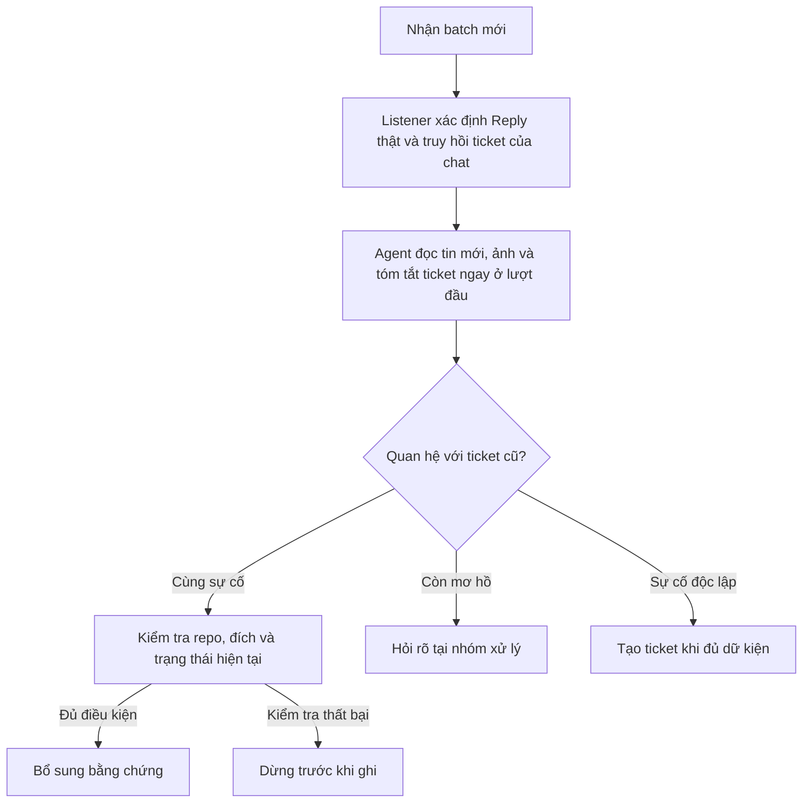

# Đối chiếu ticket gần đây khi phân loại tin Telegram

**#3018 · v1.0.0 · 23/11/2026 · Owner AlexChu**

## 1. Tình huống và phạm vi

Người gửi báo lỗi hộp thư, gửi ảnh lỗi chuyển hướng ở lượt kế tiếp, rồi hỏi về một thông báo đăng nhập trong ảnh thứ hai. Listener từng mở ba issue vì mỗi ảnh đều mô tả được một lỗi và Agent có thể kết thúc lượt phân loại trước khi tra lịch sử. Người gửi cần bổ sung bằng chứng qua nhiều batch mà vẫn theo dõi được cùng một sự cố. Một lỗi riêng xen giữa cuộc trao đổi vẫn cần ticket riêng.

Áp dụng cho các lượt được chuyển tới trợ lý sau bộ lọc cục bộ trong chế độ `live/decide`. Ảnh đứng riêng đã được bộ lọc xếp vào `MEDIA_ONLY` đi theo luồng xin ngữ cảnh hiện có. Đơn vị quyết định là nhóm tin do Agent phân loại. Cùng một batch có thể chứa cả lời trò chuyện, bằng chứng bổ sung và yêu cầu mới.

## 2. Luồng quyết định

## 3. Hợp đồng dữ liệu và quyền ghi

| Bước | Yêu cầu |
|---|---|
| Chọn ứng viên | Từ dữ liệu local về các lần tạo hoặc bổ sung ticket thành công trong cùng chat và repo cấu hình. Xét tối đa 3 ticket khác nhau trong 10 phút trước batch, ưu tiên lần tương tác gần nhất. Reply trực tiếp có nguồn đã xác minh được xét riêng kể cả khi ticket cũ hơn. |
| Gói đầu vào | Gửi số ticket, tiêu đề khi có, trích đoạn tin nguồn có giới hạn và thời điểm. Nội dung cũ chỉ giúp hiểu quan hệ. Các trường mô tả lỗi mới phải có bằng chứng từ tin mới hoặc ảnh tương ứng. |
| Chọn hành động | Agent đối chiếu đối tượng, triệu chứng và diễn biến. Nếu nội dung tóm tắt chưa đủ, Agent có thể đọc ticket qua công cụ hiện có. Khi có nhiều đích hợp lý và người gửi chưa làm rõ, Agent hỏi lại. |
| Xác minh | Đích bổ sung theo ngữ nghĩa phải có bằng chứng, quan hệ trùng sự cố và độ tin cậy đạt ngưỡng cấu hình. Listener kiểm tra lại repo và trạng thái mở trước khi ghi. Đi qua cơ chế giữ chỗ và chống lặp hiện có. |
| Truy vết | Từ lượt xử lý, operator xem được các số ticket đã cung cấp, quyết định của từng nhóm và lý do ngắn. Một ticket được đưa vào ngữ cảnh chỉ chứng minh Agent có cơ hội xét đích đó. |

Cửa sổ 10 phút tính theo thời gian tin nguồn. Ví dụ, tin của lượt sau đến lúc 16:24:26 trong khi listener đang mở ticket cho lượt đã chốt lúc 16:24:19. Ticket đó đủ điều kiện nếu thao tác tạo đã thành công lúc listener dựng ngữ cảnh cho lượt sau. Cách tính này vẫn hoạt động khi thời gian xử lý lâu hơn khoảng cách giữa hai tin.

Khi còn nhiều đích hợp lý, câu hỏi ở nhóm xử lý liệt kê số các ticket đã cung cấp. Để bổ sung, người gửi dùng Reply vào tin gốc của ticket đã chọn và kèm nội dung hoặc ảnh. Để làm rõ một sự cố mới, người gửi Reply vào câu hỏi ở nhóm xử lý và mô tả điểm khác biệt. Một số issue gõ riêng trong phần trả lời chưa đủ làm bằng chứng để ghi vào issue đó.

## 4. Tiêu chí nghiệm thu

| Ca kiểm thử bằng dữ liệu giả | Kết quả cần quan sát |
|---|---|
| Báo lỗi rồi gửi hai ảnh ở hai batch sau | Số ticket đầu xuất hiện ngay trong gói đầu của Agent ở lượt sau. Khi Agent xác định cùng sự cố, kết quả là một issue và các lần bổ sung, kể cả khi Agent dùng 0 công cụ. |
| Hai sự cố độc lập trong cùng chat, sát giờ | Agent có thể tạo issue mới kèm lý do. |
| Hai ticket có khả năng là đích | Có thể hỏi làm rõ, chưa ghi GitHub. |
| Reply có đích đã xác minh cũ hơn 10 phút | Reply vẫn có thể trỏ về đúng issue đó. |
| Ticket khác chat, khác repo, trong tương lai hoặc lần ghi chưa thành công | Không xuất hiện như ứng viên hợp lệ của lượt này. |
| Ticket đóng sau khi được chọn hoặc không xác minh được | Không gửi comment theo đường bổ sung vào ticket mở. |
| Nhận lại cùng batch | Áp dụng cơ chế phục hồi và chống ghi lặp hiện có. |

### Điểm đọc code

- `recent_tickets.py` chọn các lần ghi có kết quả trong SQLite và dựng danh sách ứng viên. Tiêu đề và trích đoạn có giới hạn độ dài. Ticket cũ thiếu tiêu đề vẫn có thể dùng bằng chứng tin nguồn.
- `assistant_extractor.py` đưa danh sách vào `decision_context.recent_ticket_candidates`. `assistant_contract.py` kiểm `target.basis = recent`, quan hệ và ngưỡng `append_confidence`.
- `rules_intake.py` thực thi kế hoạch qua đường ghi comment hiện có, xác minh lại đích và xử lý kết quả ghi. `classification_log.py` lưu trạng thái thực thi để đối chiếu với quyết định ban đầu trong Admin.

## 5. Tài liệu liên quan

- [Tổng quan hệ thống](../00-master/telegram-triage-noissue_overview_261027_v1.0.0.md)
- [Business DOCS, TG-18](../01-product/telegram-triage-noissue_business_261015_v1.0.0.md#tg-18--bổ-sung-và-intent)
- [Ticket thiết kế trợ lý #3018](https://github.com/vlink-group/vlink-nexora/issues/3018)

## Changelog

| Phiên bản | Giờ Việt Nam | Nội dung |
|---|---|---|
| v1.0.0 | 23/11/2026 16:57 | Spec cho bước đối chiếu ticket giữa các batch và các trường hợp nghiệm thu. |
