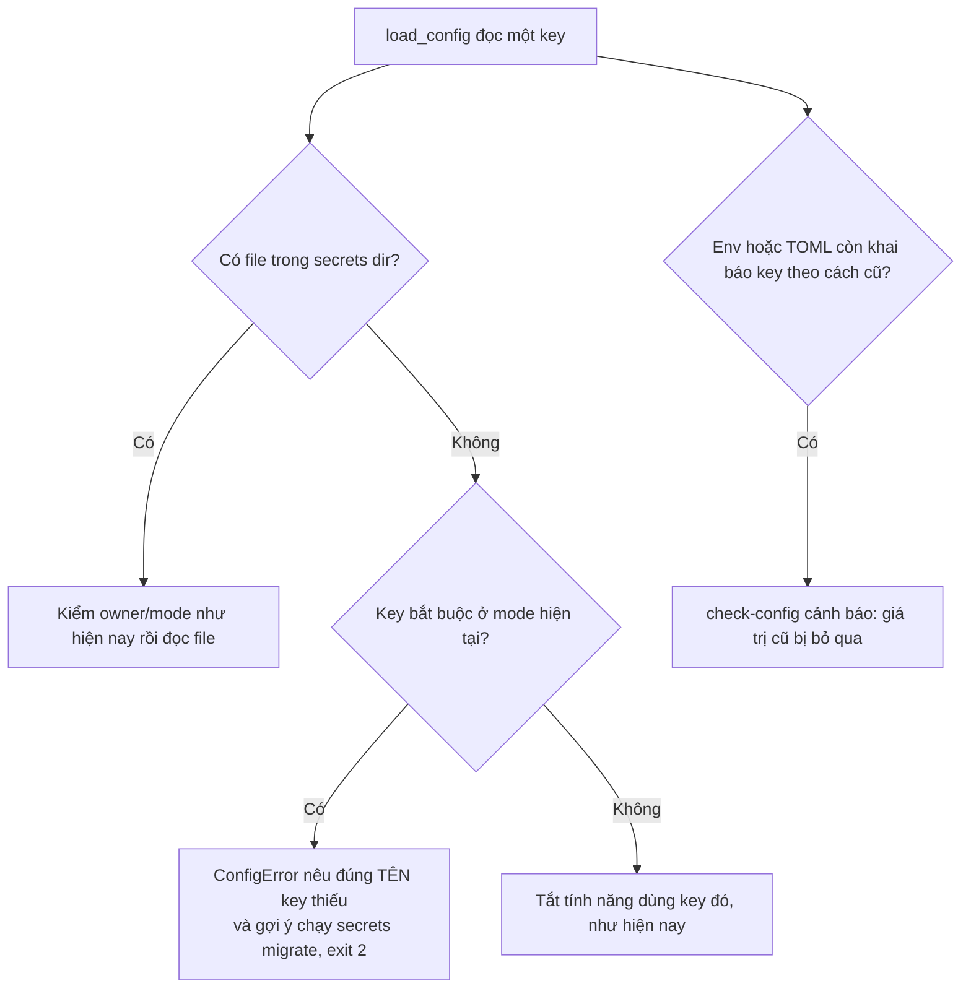
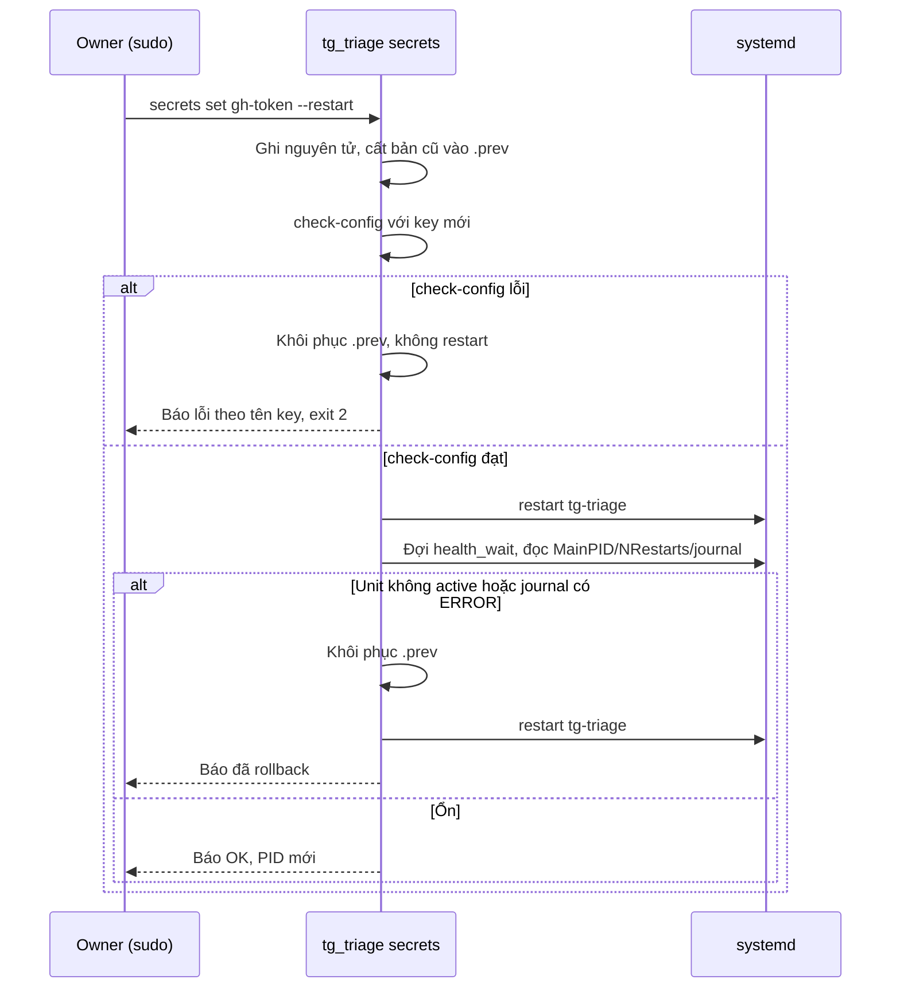
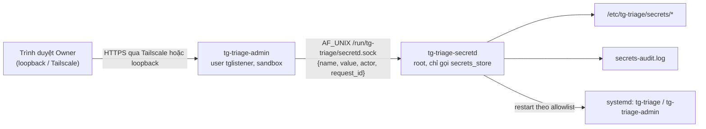

# Gom và quản lý key tập trung cho Listener

**noissue · v1.0.0 · 26/11/2026 · Owner AlexChu · Trạng thái: Owner đã chốt §8 ngày 26/11/2026, triển khai GĐ1**

Nguồn yêu cầu: feedback của PM sau buổi demo ngày 25/11/2026, gồm hai câu hỏi "Thay API key, key hoặc password ở đâu?" và "Bảo trì như thế nào?". Owner chọn hướng làm 2 giai đoạn ngày 26/11/2026.

## 1. Hiện trạng và vấn đề

Listener đang dùng 9 loại bí mật. Chúng nằm rải ở 5 vị trí, có 4 định dạng khác nhau, và mỗi loại có cách thay riêng:

| # | Bí mật | Đang nằm ở | Định dạng | Cách thay hiện nay |
|---|---|---|---|---|
| 1 | Token GitHub dùng tạo issue và upload file (`GH_TOKEN`) | `/etc/agentfleet/tg-triage.env` (root 600) | Biến môi trường | Sửa tay file env rồi restart |
| 2 | Repo đích (`GH_REPO`) | Cùng file env | Biến môi trường | Như trên. Đây không phải bí mật, chỉ đang để chung chỗ |
| 3 | `TG_API_ID`, `TG_API_HASH` | Cùng file env | Biến môi trường | Như trên |
| 4 | Mật khẩu MTProxy (`TG_PROXY_SECRET`) | Cùng file env | Biến môi trường | Như trên. Nếu ghi vào TOML, bot từ chối chạy |
| 5 | Key model trên cloud | File do `[model] key_file` trỏ tới | JSON `{"scope","key"}`, đọc bằng `agentfleet_common.ai_transport.read_key` | Tự tạo file JSON và tự đặt quyền |
| 6 | Key router của trợ lý | File do `[assistant] router_key_file` trỏ tới | Text thuần | Tự tạo file và tự đặt quyền |
| 7 | Token GitHub chỉ-đọc của trợ lý | File do `[assistant] github_token_file` trỏ tới | Text thuần | Như trên |
| 8 | Mật khẩu Admin UI | File do `[admin] password_hash_file` trỏ tới | Băm scrypt | `tg_triage admin-passwd`. Lệnh này mở file với `O_EXCL` nên **không ghi đè được**: muốn đổi mật khẩu phải xoá file cũ trước |
| 9 | Phiên đăng nhập Telegram | `/var/lib/agentfleet/tg/gateway.session` | File Telethon | `tg_triage login`, phải nhập OTP và 2FA tương tác |

Hệ quả:

- PM và Owner không có một chỗ duy nhất để biết key nào đang có, key nào thiếu, key nào thay lần cuối khi nào.
- Mỗi lần thay key phải SSH vào gw-01 và tự đặt đúng owner/mode. Đặt sai thì bot dừng với lỗi `credentials unavailable` mà không nói rõ file nào sai.
- Không có nhật ký ai đã thay key nào, vào lúc nào.
- Không có bản key cũ để quay lại khi key mới hỏng.
- Admin UI hiện chỉ đọc: chỉ có `POST /api/login`, `POST /api/logout`, còn lại là `GET`. Service này chạy sandbox (`ProtectSystem=strict`, `ReadOnlyPaths=/var/lib/agentfleet/tg`, `MemoryMax=256M`) nên không ghi được file nào.

## 2. Mục tiêu và phạm vi

| Giai đoạn | Mục tiêu | Trong phạm vi | Ngoài phạm vi |
|---|---|---|---|
| **GĐ1 — Gom về một chỗ, thay thủ công có kiểm soát** | Mọi bí mật nằm trong một thư mục, cùng một quy ước quyền. Một lệnh CLI thay được mọi key. Admin UI có trang xem trạng thái key | Bí mật #1–#8; lệnh `tg_triage secrets`; trang "Key & cấu hình" chỉ đọc; nhật ký thay key; rollback từng key | Ghi key từ web; thay đổi định dạng JSON của `read_key` (thuộc repo AgentBuilder) |
| **GĐ2 — Nhập key từ Admin UI** | Owner thay key trên UI mà không cần SSH | Form nhập key; helper chạy quyền root; xác thực lại trước khi ghi; restart có tự rollback | Phiên Telegram (#9) vẫn chỉ đăng nhập qua CLI vì cần OTP và 2FA tương tác |

GĐ2 chỉ bắt đầu khi GĐ1 đã chạy ổn trên gw-01 và Owner chốt các câu hỏi mở ở §8.

## 3. Thiết kế giai đoạn 1

### 3.1 Thư mục bí mật thống nhất

```text
/etc/tg-triage/secrets/            root:tglistener 0750
├── gh-token                      root:tglistener 0640   (#1)
├── tg-api-id                     root:tglistener 0640   (#3)
├── tg-api-hash                   root:tglistener 0640   (#3)
├── tg-proxy-secret               root:tglistener 0640   (#4, không bắt buộc)
├── model-key.json                root:tglistener 0640   (#5, giữ nguyên định dạng JSON scope hiện có)
├── router-key                    root:tglistener 0640   (#6)
├── assistant-github-token        root:tglistener 0640   (#7)
├── admin-password                root:tglistener 0640   (#8, băm scrypt)
├── .prev/                        root:root 0700         bản liền trước của từng key, dùng để rollback
└── manifest.json                 root:tglistener 0640   metadata, KHÔNG chứa giá trị
```

- Quyền `0640` với group `tglistener` là mức mà các bộ đọc hiện có (`_assistant_token`, `_validate_admin_secret_stat`, `read_key(..., group_name="tglistener")`) đều đã chấp nhận. GĐ1 không cần nới quy tắc kiểm quyền nào.
- `GH_REPO` không phải bí mật và **giữ nguyên trong file `.env` local trên server** (`/etc/agentfleet/tg-triage.env`), theo quyết định của Owner (§8). Sau khi migrate, file `.env` chỉ còn các thiết lập không bí mật: `GH_REPO` và `TG_TRIAGE_MODE`.
- `manifest.json` có dạng: `{"<tên>": {"updated_at", "updated_by", "length", "source": "cli|ui|migrate", "expires_at": null|"YYYY-MM-DD"}}`. File này không chứa giá trị hay hash của key.

### 3.2 Thứ tự ưu tiên khi đọc key

Thêm khóa cấu hình `[secrets] dir = "/etc/tg-triage/secrets"`, mặc định là đường dẫn này.

Owner chọn **bỏ đọc key từ env và từ đường dẫn cũ ngay trong bản phát hành này** (§8 câu 5). Code mới chỉ đọc key từ thư mục secrets; các biến `GH_TOKEN`, `TG_API_ID`, `TG_API_HASH`, `TG_PROXY_SECRET` trong env và các khóa `key_file`, `router_key_file`, `github_token_file`, `password_hash_file` trong TOML bị bỏ qua.



Thứ tự bắt buộc khi lên bản này trên gw-01:

1. Cài code mới vào stage, chưa restart.
2. Chạy `secrets migrate` rồi `secrets migrate --apply` **bằng bản code mới**, để thư mục secrets có đủ key trước khi bot mới khởi động.
3. Chạy `check-config` của bản mới. Phải sạch, không còn key bắt buộc nào bị thiếu.
4. Mới chạy `agentfleet_deploy.py`.
5. **Chưa xoá** các dòng key cũ trong `tg-triage.env` và các file key cũ: nếu deploy tự rollback về code cũ, code cũ vẫn cần chúng. Xoá khi bản mới đã chạy ổn ít nhất 7 ngày.

Thông báo lỗi chỉ được nêu **tên key** và **loại lỗi** (`missing`, `bad_mode`, `bad_owner`, `bad_format`). Không bao giờ in giá trị hay độ dài thật ra log. Riêng `check-config` vẫn được in độ dài như hiện nay.

### 3.3 Lệnh CLI `tg_triage secrets`

Mọi lệnh ghi đều yêu cầu chạy bằng root (`sudo`). Nếu không phải root, lệnh thoát với mã 2 và nhắc chạy bằng sudo. `updated_by` lấy từ `SUDO_USER`.

| Lệnh | Việc làm |
|---|---|
| `secrets status [--json]` | Bảng gồm tên, mô tả tiếng Việt, bắt buộc hay không ở mode hiện tại, tình trạng (`OK`, `Thiếu`, `Sai quyền`, `Sai định dạng`, `Sắp hết hạn` khi còn 7 ngày trở xuống, `Đã hết hạn`), ngày thay, người thay. Cần `sudo` hoặc user thuộc group `tglistener` (thư mục secrets là 0750); user khác thấy trạng thái "Không đọc được — chạy bằng sudo". Thoát khác 0 nếu thiếu key bắt buộc |
| `secrets set <tên> [--stdin] [--expires YYYY-MM-DD] [--restart]` | Nhập giá trị bằng `getpass` hai lần (không hiện ký tự), hoặc đọc một dòng từ stdin khi có `--stdin`. Kiểm định dạng theo từng loại key. Ghi nguyên tử: file tạm cùng thư mục → `fsync` → `chown`/`chmod` → `rename`. Bản cũ chuyển vào `.prev/`. Cập nhật `manifest.json` và ghi nhật ký. Khi có `--restart`: chạy `check-config` rồi restart các unit dùng key đó; restart lỗi thì tự rollback (§3.5) |
| `secrets set admin-password` | Dùng lại hàm băm scrypt của `admin-passwd` nhưng cho phép ghi đè (bỏ hạn chế `O_EXCL` hiện nay) |
| `secrets rollback <tên> [--restart]` | Đổi chỗ bản hiện tại với bản trong `.prev/`. Chỉ giữ 1 bản trước |
| `secrets migrate [--apply]` | Đọc `tg-triage.env` và các đường dẫn key cũ trong TOML, rồi in ra kế hoạch chuyển (chỉ tên và độ dài). Mặc định chỉ in, không ghi; có `--apply` mới chép vào thư mục mới. Không tự xoá bản cũ: in danh sách dòng cần xoá để Owner xoá sau khi bot đã chạy ổn |
| `secrets verify <tên>` | Owner đã đồng ý (§8 câu 3). Gọi thử dịch vụ bên ngoài: `GET /user` và quyền đọc/ghi issue trên `GH_REPO` cho token GitHub; một lời gọi nhỏ nhất cho key model và key router. Chỉ chạy khi gọi rõ lệnh này hoặc thêm cờ `--verify` vào `set`; không tự chạy theo lịch. Telegram API ID/hash không verify được nếu không đăng nhập lại, nên chỉ kiểm định dạng |

Kiểm định dạng khi `set`, chỉ ở mức cấu trúc:

| Key | Kiểm |
|---|---|
| `gh-token`, `assistant-github-token` | Không có ký tự điều khiển hay khoảng trắng; dài 20–255 |
| `tg-api-id` | Số nguyên dương |
| `tg-api-hash` | 32 ký tự hex |
| `model-key.json` | Hỏi provider và base_url, khớp với `[model]`, rồi tự dựng JSON `{"scope","key"}`. Người dùng không phải tự viết JSON |
| `admin-password` | Không rỗng, hai lần nhập khớp nhau |

### 3.4 Nhật ký thay key

Ghi thêm từng dòng JSON vào `/var/log/tg-triage/secrets-audit.log` (root 0600, chỉ ghi thêm), gồm `ts`, `action` (`set`, `rollback`, `migrate`), `name`, `actor`, `source`, `length`, `restart_result`. Không ghi giá trị hay hash của key. Nhật ký phải sống qua mỗi lần deploy: `agentfleet_deploy.py` không được xoá hoặc ghi đè thư mục này.

### 3.5 Restart và tự rollback



Bước kiểm sức khoẻ theo cùng tiêu chí với `deploy/agentfleet_deploy.py` nhưng được viết trong package listener, vì `deploy/` không nằm trong wheel cài trên server. Thứ tự: `systemctl stop` (chờ tối đa 180 giây, lớn hơn `TimeoutStopSec=150`) → ghi giờ UTC → `systemctl start` → chỉ đọc journal của MainPID mới → `NRestarts` không được tăng trong lúc chờ. Bị Ctrl-C khi đang khởi động lại sau rollback thì key cũ vẫn đã được khôi phục, CLI ghi `unhealthy_rollback_interrupted`, thoát 130 và hướng dẫn Owner tự `systemctl start`. `--restart` luôn khởi động unit, kể cả khi bot đang dừng có chủ đích (Owner chốt 27/11/2026); khi đó không dùng `--restart`. Ánh xạ key sang unit: `admin-password` → `tg-triage-admin`; mọi key còn lại → `tg-triage`.

### 3.6 Trang "Key & cấu hình" trên Admin UI (chỉ đọc)

- API mới `GET /api/secrets`, yêu cầu đã đăng nhập. Admin đọc `manifest.json` và gọi `stat` từng file để biết file có tồn tại không và quyền có đúng không. **Admin không mở file key**, nên service admin vẫn giữ nguyên sandbox hiện có.
- Mỗi dòng trên trang gồm: tên tiếng Việt, trạng thái (badge `OK`, `Thiếu`, `Sai quyền`, `Sắp hết hạn` khi còn 7 ngày trở xuống, `Đã hết hạn`), ngày thay, người thay, ngày hết hạn, và **lệnh CLI để thay** kèm nút sao chép, ví dụ `sudo tg-triage secrets set gh-token --restart`.
- Nhắc hết hạn (Owner chốt §8 câu 4): khi có key còn 7 ngày trở xuống hoặc đã hết hạn, dashboard admin hiện một banner ở đầu mọi màn hình sau khi đăng nhập, kèm link tới trang "Key & cấu hình". Chỉ nhắc trên dashboard, không gửi Telegram.
- Phiên Telegram (#9): trang chỉ hiện tình trạng file session, kèm hướng dẫn chạy `login`.
- Giao diện viết bằng HTML/JS tĩnh như `admin_static` hiện có, không thêm dependency. Thêm một mục vào `#view-nav`.

### 3.7 File thay đổi dự kiến (GĐ1)

| File | Loại | Nội dung |
|---|---|---|
| `listener/src/tg_triage/secrets_store.py` | Mới | Danh mục key, đọc/ghi nguyên tử, manifest, rollback, audit |
| `listener/src/tg_triage/config.py` | Sửa | `[secrets] dir`; chỉ đọc key từ thư mục secrets (§3.2); cảnh báo khai báo cũ; lỗi nêu tên key. `GH_REPO` vẫn đọc từ env |
| `listener/src/tg_triage/__main__.py` | Sửa | Nhóm lệnh `secrets`; `admin-passwd` gọi qua `secrets_store` |
| `listener/src/tg_triage/admin.py` + `admin_static/*` | Sửa | `GET /api/secrets` và trang chỉ đọc |
| `deploy/agentfleet_deploy.py` | Sửa nhỏ | Tách hàm kiểm sức khoẻ để dùng lại; không đụng thư mục secrets và audit |
| `config/listener.example.toml`, `.env.example` | Sửa | Ví dụ `[secrets]`; bỏ các khóa đường dẫn key cũ; `.env.example` chỉ còn `GH_REPO` và `TG_TRIAGE_MODE` |
| `systemd/agentfleet-tmpfiles.conf` | Sửa | Tạo `/etc/tg-triage/secrets` và `/var/log/tg-triage` đúng quyền |
| `listener/README.md`, `deploy/README.md` | Sửa | Runbook "Thay key" một trang cho Owner và PM |
| `listener/tests/test_secrets_*.py` | Mới | Xem §6 |

## 4. Thiết kế giai đoạn 2 — nhập key từ Admin UI

### 4.1 Kiến trúc

Service admin **không bao giờ** có quyền ghi bí mật. Việc ghi do một helper nhỏ chạy quyền root đảm nhận, nhận yêu cầu qua unix socket:



- Ai đăng nhập được Admin UI thì được thay key (Owner chốt §8 câu 1). **Ngoại lệ: mật khẩu admin không có form trên UI**, chỉ đổi local trên server bằng `sudo tg-triage secrets set admin-password`.
- `tg-triage-secretd` chỉ hiểu đúng 3 lệnh: `set`, `rollback`, `status`, và chỉ áp cho các tên key có trong danh mục, trừ `admin-password`. Helper không chạy lệnh shell tuỳ ý và chỉ được restart 2 unit trong allowlist.
- Socket có quyền `0660 root:tglistener-admin`. Cần tách user `tglistener-admin` khỏi `tglistener` để process bot không gửi được yêu cầu ghi key.
- Giá trị key chỉ đi trong bộ nhớ: từ trình duyệt → admin → socket → file đích. Không đi qua file tạm, không vào log, và không bao giờ được trả lại cho trình duyệt.

### 4.2 API

`POST /api/secrets/<tên>`

- **Body:** `{"value": "...", "confirm_password": "<mật khẩu admin>", "expires_at": null, "restart": true}`
- **Response 200:** `{"name", "status": "ok|rolled_back", "length", "updated_at", "unit_pid"}`
- **Response lỗi:**

| HTTP | Mã | Ý nghĩa |
|---|---|---|
| 400 | `bad_format` | Key sai định dạng theo §3.3 |
| 401 | `reauth_failed` | Nhập lại mật khẩu admin sai. Lỗi này tính chung bộ đếm khoá với `/api/login` |
| 403 | `csrf` | Header `Origin` không khớp hoặc thiếu token CSRF |
| 404 | `unknown_secret` | Tên key không có trong danh mục, hoặc là `admin-password` |
| 409 | `busy` | Đang có một lần thay key hoặc deploy khác chạy (dùng chung lock) |
| 429 | `rate_limited` | Quá 10 lần ghi mỗi giờ |
| 502 | `restart_failed_rolled_back` | Restart hỏng và đã tự khôi phục key cũ |
| 503 | `helper_unavailable` | `secretd` không chạy |

`POST /api/secrets/<tên>/rollback` dùng cùng cơ chế xác thực lại.

### 4.3 Kiểm soát bảo mật bắt buộc

1. Phải nhập lại mật khẩu admin cho **mỗi** lần ghi; một phiên đăng nhập còn hạn là chưa đủ.
2. Chống CSRF: cookie `la_sid` đã là `HttpOnly; SameSite=Strict`, và `POST` đã kiểm `Origin` so với `Host` (`admin.py:685`). Bổ sung: bắt buộc phải có `Origin` với các `POST /api/secrets/*` (hiện thiếu header này vẫn lọt qua), và thêm token CSRF gắn với phiên.
3. Ô nhập key là `type=password` với `autocomplete=off`. Xoá giá trị khỏi DOM ngay sau khi gửi.
4. Giữ nguyên giới hạn bind loopback/Tailscale hiện có. Không mở ra Internet.
5. Báo Telegram vào thread ops mỗi khi có key bị thay: chỉ nêu tên key, người thay và kết quả.
6. Phiên Telegram (#9) và mật khẩu admin (#8) không có form trên UI.

### 4.4 Điều kiện trước khi code GĐ2

- Có Product Doc hoặc wireframe cho form và các trạng thái lỗi ở §4.2.
- GĐ1 đã chạy trên gw-01 ít nhất một lần thay key thật thành công.

## 5. Quyết định kỹ thuật

| Quyết định | Lựa chọn | Phương án đã cân nhắc | Lý do |
|---|---|---|---|
| Nơi lưu key | Một thư mục file, quyền 0640 root:tglistener | systemd `LoadCredential=`; vault ngoài (HashiCorp, 1Password) | Các bộ đọc hiện có đã chấp nhận đúng mức quyền này nên ít thay đổi nhất. `LoadCredential` cần kiểm phiên bản systemd và quyền thật trên gw-01 trước khi dùng. Vault ngoài thêm dependency và thêm một điểm có thể hỏng |
| Key cũ ở env | Bỏ đọc ngay trong bản này (Owner chốt) | Đọc env làm dự phòng thêm một thời gian | Chỉ còn một nguồn key duy nhất, tránh nhầm "đã đổi mà bot vẫn dùng key cũ". Bù rủi ro bằng thứ tự migrate trước deploy và giữ dòng env cũ cho rollback code (§3.2) |
| `GH_REPO` | Giữ trong `.env` local trên server (Owner chốt) | Chuyển sang `[github] repo` trong TOML | Không phải bí mật; giữ chỗ cũ thì không phải đổi config |
| Ghi từ UI | Qua helper root có allowlist | Cho admin ghi thẳng | Admin là service chạy web, bề mặt tấn công lớn nhất, nên không được cầm quyền ghi bí mật |
| Định dạng key model | Giữ JSON scope, CLI tự dựng JSON | Đổi sang text thuần | `read_key` thuộc `agentfleet_common` (repo AgentBuilder); đổi định dạng sẽ kéo theo việc ở repo khác |

## 6. Kiểm thử và tiêu chí nghiệm thu

**GĐ1**

| # | Tiêu chí | Cách kiểm |
|---|---|---|
| AC1 | Bot chỉ dùng key trong thư mục secrets; key trong env hoặc đường dẫn cũ bị bỏ qua và `check-config` cảnh báo; `GH_REPO` vẫn đọc từ env | Unit test `load_config` với environ giả và thư mục tạm |
| AC1b | Key có ngày hết hạn còn 7 ngày trở xuống thì `status` và dashboard hiện "Sắp hết hạn"; quá hạn thì hiện "Đã hết hạn" | Unit test có đồng hồ giả |
| AC2 | Thiếu key bắt buộc thì exit 2 và thông báo lỗi nêu đúng tên key, không chứa giá trị | Unit test, kèm assert giá trị không xuất hiện trong stdout/stderr |
| AC3 | `set` ghi nguyên tử với đúng mode/owner, cất bản cũ, cập nhật manifest và audit | Unit test có giả lập `chown`; kiểm thêm trên Linux thật |
| AC4 | `set --restart` bị lỗi health thì tự khôi phục key cũ và restart lại | Test có systemctl và journal giả, theo cùng mẫu `--test-paths` của test deploy |
| AC5 | `migrate` mặc định không ghi gì; `--apply` chép đủ #1–#8 | Unit test có env giả |
| AC6 | `GET /api/secrets` chưa đăng nhập trả 401; đã đăng nhập thì không bao giờ trả giá trị | Test admin hiện có, mở rộng thêm |
| AC7 | Toàn bộ suite cũ vẫn xanh | `cd listener && PYTHONPATH=src python -m unittest discover -s tests -t .` |
| AC8 | Thay `gh-token` thật trên gw-01 bằng một lệnh, bot chạy lại với PID mới, `NRestarts=0`, journal không có ERROR | Owner chạy, đính kèm output |

**GĐ2:** test từng mã lỗi ở §4.2; test nhập lại mật khẩu sai thì bị khoá theo cùng bộ đếm với login; test giá trị key không xuất hiện trong log của admin, của helper và trong response; test process `tglistener` không kết nối được vào socket.

## 7. Rủi ro

| Rủi ro | Mức | Giảm thiểu |
|---|---|---|
| Migrate thiếu hoặc đặt sai quyền làm bot dừng; vì bỏ đọc env ngay nên không còn đường dự phòng | Cao | Migrate bằng code mới **trước** khi deploy; `check-config` của bản mới phải sạch; deploy tự rollback; giữ dòng env cũ cho code cũ; làm theo quy trình precheck trước deploy trên gw-01 |
| Key lọt ra log hoặc response | Cao | Assert trong test; chỉ log tên key và độ dài |
| Lỗi ở helper root (GĐ2) mở đường leo quyền | Cao | Helper tối giản: allowlist tên key và unit, không chạy lệnh shell; có review độc lập (GATE 0b) |
| Lẫn lộn hai token GitHub (tạo issue và chỉ-đọc) | Trung bình | Hai tên riêng trên UI. Thêm kiểm tra mới: token chỉ-đọc không được trùng token tạo issue. Hiện quy tắc này mới chỉ là ghi chú trong `listener.example.toml`, code chưa chặn |
| Ai có mật khẩu admin cũng thay được key (GĐ2) | Trung bình | Owner chấp nhận. Giới hạn bằng: nhập lại mật khẩu mỗi lần, nhật ký, báo Telegram ops, mật khẩu admin chỉ đổi local |

## 8. Quyết định của Owner (26/11/2026)

| # | Câu hỏi | Quyết định |
|---|---|---|
| 1 | GĐ2: ai được thay key trên UI? | Ai đăng nhập được Admin UI. Mật khẩu admin chỉ đổi local trên server, không có form trên UI |
| 2 | Có chuyển `GH_REPO` sang TOML? | Không. Giữ trong `.env` local trên server |
| 3 | `secrets verify` có được gọi ra dịch vụ ngoài? | Có |
| 4 | Nhắc hết hạn key? | Có: trước 7 ngày, chỉ trên dashboard admin |
| 5 | Khi nào bỏ đọc key từ env? | Ngay trong bản phát hành GĐ1 |

## 9. Task và ước lượng

| Task | GĐ | Ước lượng dev | Ghi chú |
|---|---|---|---|
| T1 `secrets_store.py` + đổi `config.py` + test AC1–AC3, AC5 | 1 | 1,5 ngày | Đụng quyền và production nên đi qua `/dispatch`, có reviewer độc lập |
| T2 CLI `secrets` + restart/rollback + test AC4 | 1 | 1 ngày | Dùng lại hàm health trong `agentfleet_deploy.py` |
| T3 `GET /api/secrets` + trang chỉ đọc + test AC6 | 1 | 1 ngày | |
| T4 Runbook "Thay key" + cập nhật README, example config | 1 | 0,5 ngày | Đây là tài liệu trả lời trực tiếp câu hỏi của PM |
| T5 Migrate trên gw-01 + AC8 | 1 | 0,5 ngày | Owner chạy sudo theo đúng thứ tự §3.2; trước đó làm precheck trên bản sao DB thật và đối chiếu commit đang cài |
| T6 Product Doc/wireframe cho form GĐ2 | 2 | 0,5 ngày | |
| T7 `tg-triage-secretd` + unit systemd + tách user admin | 2 | 2 ngày | Bắt buộc qua GATE 0b |
| T8 `POST /api/secrets/*` + form + báo Telegram + test | 2 | 1,5 ngày | |

Tổng: GĐ1 khoảng 4,5 ngày dev, GĐ2 khoảng 4 ngày dev, chưa tính thời gian review và nghiệm thu.

## Changelog

| Phiên bản | Ngày | Thay đổi |
|---|---|---|
| v1.0.0 | 26/11/2026 | Bản đầu: hiện trạng 9 loại bí mật, thiết kế GĐ1 và GĐ2. Cùng ngày cập nhật theo 5 quyết định của Owner ở §8 (chưa phát hành bản nào trước đó nên giữ số phiên bản) |
