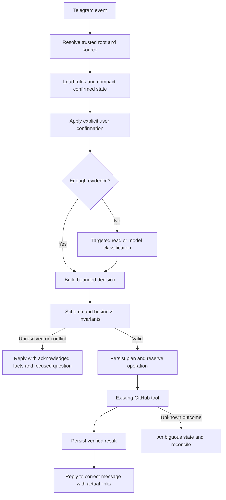

# Engineering: THINKING controller cho Telegram triage

**Version**: v1.7.0 · **Updated**: 2026-10-16 15:23 (Asia/Saigon) · **Owner**: AlexChu · **Executor**: Codex

**Status**: User đã yêu cầu triển khai sau nghiên cứu. Controller/budget/journal được triển khai trong code PR #43; kết quả test/review/deploy được ghi trong release evidence. Các mục pilot60/metric/shadow phía dưới vẫn là đề xuất, không phải kết quả đã đạt.

## Related Documents

- [Fleet Master](../00-master/worker-agent-fleet-1_master_261007_v1.0.8.md)
- [Nguồn nghiệp vụ TG-01..TG-33](../01-product/telegram-triage-noissue_business_261015_v1.0.0.md)
- [PR #43](https://github.com/PersonalProjectJob/telegram-agent/pull/43) · không có issue riêng.

## Harness foundation: durable topics và trace (2026-10-16)

Foundation trước đó thêm projection/trace. Increment v1.5.0 bổ sung autonomous semantic ingress và closed-ticket lifecycle; đường legacy hai phút giữ khi flag tắt. Contract duy nhất nằm ở [nguồn nghiệp vụ](../01-product/telegram-triage-noissue_business_261015_v1.0.0.md#nâng-cấp-harness-phạm-vi-foundation-và-quy-tắc-đích). Source implementation trong worktree không phải bằng chứng đã chạy trên THINKPAD.

- `topic_store.py`: registry additive `original_intake` theo chat/case/group, membership có role/provenance, revision và immutable events. Root đã followup split có siblings/bindings riêng; registry chưa project corrected split partition, trace phải nêu `split_partition_not_projected` thay vì khẳng định một topic là một ticket hiện tại. Hydration cursor/batch giới hạn công việc cũ, idempotent; projection từ kết quả đã lưu, không gọi model/GitHub/Telegram. Hook ở writable store chỉ cập nhật case bị tác động, không scan toàn transcript trên mỗi tin. Registry không được dùng để mở rộng quyền TG-16.
- `trace.py` và CLI: mở database read-only, schema capability discovery, query theo repository/issue hoặc chat/message; traversal/output có bounds và đánh dấu thiếu/cắt. Whitelist metadata; prose cần opt-in. Không build provider, load session hay chạy migration/recovery; config chỉ dùng để xác định database/repository, không in secrets.
- Giữ nguyên `cases/groups/reconciliation`, root key lịch sử và side-effect ledger. Case `done` nghĩa đã xử lý intake, không nghĩa GitHub issue đã đóng. Generic late followup không có proven job/root không được xác nhận thành topic binding.
- `[thinking] topic_memory_enabled=false` là mặc định; khi true, `run` khởi tạo registry sau ProcessLock/writable Store. `enable_topic_registry(hydration_batch=100)` tiến cursor theo case ID, batch hợp lệ 1–1000; tắt cờ giữ dữ liệu additive và không tiếp tục projection. Projector giới hạn 1000 originals, 20 roots và 1000 followup members/root; `membership_truncated` báo projection chưa đầy đủ, không dùng phần thiếu để suy quyền. Trace vẫn đọc được bảng đã có, không hydrate.
- Không bật WAL/FTS hoặc thêm framework trong đợt này. Autonomous mode triển khai bounded candidate search, event-driven readiness, semantic routing và trusted lifecycle reader/related create; không có toàn lịch sử semantic search. User đã chọn policy bổ sung ticket cũ / confirmed recurrence tạo related / unclear hỏi lại; chưa có quyền auto reopen.

Review/verification phải chứng minh: migration/hydration hai lần không thêm event trùng; membership partition đúng; old database trace không migrate; snapshot rollback-journal độc lập giữ DB hash/mtime/directory entries, WAL/concurrent writer có kiểm riêng và giới hạn auxiliary files được báo rõ; mặc định không lộ text/plan/payload; giới hạn SQL và output; cross-chat/repository isolation; toàn bộ regression listener vẫn đạt. Trạng thái các điều kiện này nằm trong evidence của lần verify, không tick PASS tại tài liệu thiết kế.

## Solution vs codebase

### POS context audit — production entry point and enrichment

Issue47's five short POS messages received zero model calls: the daemon passed its default topics asset as a custom prompt override, disabling THINKING's compact path. `_build_classifier` now validates active assets without setting an override; the configured-model smoke uses this same startup factory. Lossless shared metadata supports longer source windows within the existing byte limit. Internally tagged JSON packets redact textual contacts while retaining numeric provenance; raw user JSON cannot acquire that internal tag.

New reply pixels, caption, original sources and current ticket hypothesis travel in one source-indexed USER packet through existing provider/image consent. Validated enrichment uses the category renderer and an existing-root managed snapshot; uploaded evidence persists separately from the five-turn model history. Fixed-target refresh is reserved and read back, with detected manual edits blocked and unrelated labels preserved. Original case accounting and old followup operations remain unchanged. Explicit empty detail fields may correct an old hypothesis; omitted fields preserve supplied prior facts.

The remote preflight is best-effort, not atomic: GitHub documents conditional unsafe methods as unsupported unless an endpoint explicitly says otherwise. A human edit racing between GET and PATCH remains a limitation. No If-Match guarantee is assumed. See [GitHub REST best practices](https://docs.github.com/en/rest/using-the-rest-api/best-practices-for-using-the-rest-api?apiVersion=2026-03-10#use-conditional-requests). Model decisions retain the two-call/20-second-per-call/40-second turn budget; synchronous Telegram artifact download retains its existing bridge timeout, with pre/post deadline checks. This is not a claim that every artifact tool finishes within40seconds.

An initial real-model POS preview classified the complaint correctly and received the exact reply image, but rejected enrichment because source-role validation allowed only originals. That failed sample remains evidence. Update roles now validate against the actual enrichment packet; split authority remains originals-only. Fresh source/installed samples and independent verification must establish the final revision's observed result; no model accuracy guarantee follows.

### Hosted format validation repair — post-deploy finding

Installed image smoke at e4de1d5 preserved the correct one-USER bundle and pixels but returned malformed JSON, then exhausted the second slot on local timeout. Earlier malformed responses are retained as failures. The controller now spends the remaining slot on identical same-host validation retry only for invalid_json/invalid_output; transport errors still use configured fallback. Both calls share existing20/40second deadlines and max2 actual attempts. No raw response/private reasoning is fed back or logged, no parser is weakened, and repeated format failure still produces scoped questions. A small real-model replay is a release check, not an accuracy/stability guarantee.

### Implementation delta — 2026-10-15 21:42

User explicitly authorized implementation, tests, PR update and THINKPAD deployment. This supersedes the original research-only scope for this feature; historical Fleet Draft approvals stay unchanged. [QA acceptance](../03-qa/telegram-triage-noissue_qa_261015_v1.0.0.md) records production-path cases and proof criteria.

- `thinking.py` provides a ContextVar-scoped turn, versioned `triage.decision/v1`, strict compare-and-swap journal and immutable revision events. Owner lineage stays AlexChu; no developer Harness CLI is imported.
- Additive SQLite tables `thinking_decisions(turn_key,root_key,version,record)` and `thinking_decision_events(turn_key,version,record)` preserve existing data and operation ledgers. A resumed turn reads its expected version, does not silently adopt a concurrent writer. Existing root execution locks serialize conversational tools; this is not a new multi-host lease system.
- Initial Pipeline persists validated partition/actual reply targets before existing tool reservation, then verified results/accounting. Followups retain grounded context_state/bindings and persist concise confirmed/hypotheses/unresolved/conflict metadata before operations, then operation outcomes. No private chain-of-thought, raw source prose, profile or credentials enter the journal. Short model category labels/confidence remain hypotheses, never confirmations.
- Compact `thinking-topics.md` and `thinking.CASE_PROMPT` project initial topic/single-case policy while retaining supplied optional details. Followup context trims prose while preserving IDs, reply/sender/media flags and confirmed provenance. Oversize envelopes (including schema) fall back safely instead of silently dropping source IDs. Injected custom prompts remain honored.
- Shared two-attempt budget spans cloud invalid-output retries and local fallback. Queue-only cancellation uses existing `MODEL_LOCK.enter(stop=...)` and consumes no HTTP attempt. Listener-only `thinking_transport.py` bounds DNS, TCP, TLS and response reading with remaining deadlines, preserving shared transport/lock bytes and NailHub. DNS resolver threads have no credentials or model/HTTP requests; platform DNS itself cannot be forcibly cancelled, but waiting is bounded.
- Semantic deadline40s, request20s, three scoped read batches and8000UTF8 text bytes are conservative bounds. The timer starts before case retrieval/image preparation, so slow attachment preparation consumes the remaining semantic budget; existing attachment/tool timeouts still apply. **No40s end-to-end ticket/reply SLA**. Source-role512 output only; complete draft outputs retain configured limits. Images are outside the text-token approximation.
- `[thinking] enabled=true` defaults on when absent; explicit false restores legacy semantic prompt/context/budget path after restart. Rollback leaves both journal tables and all external-effect reservations intact. Provider/model/consent/auth stay configured as before. Journal retention is operator-managed; no automatic deletion added.

The original inventory and proposals below describe the inspected preimplementation baseline. They are retained as research history; the implementation delta above and canonical TG rules define current code. Deployment status requires independent installed-byte/service evidence.

### Provider-default correction after deployment diagnosis

The installed synthetic short-three-request smoke timed out at20.004seconds on DeepSeek then19.994seconds on local fallback, returning no JSON; this was transport latency, not a demonstrated schema failure. An isolated30/60experiment succeeded at16.093seconds, below the original20second request bound, so it did **not** causally prove a larger budget was required. Keep production20/40 and the fixed acceptance labels.

Primary API research then identified a concrete request bug: [DeepSeek Thinking Mode](https://api-docs.deepseek.com/guides/thinking_mode/) documents thinking enabled/high by default and the explicit `thinking.type=disabled` toggle; [Chat Completions API](https://api-docs.deepseek.com/api/create-chat-completion/) defines that request field. The bounded listener transport previously omitted it despite configured `model.think=false`. It now explicitly disables DeepSeek server thinking, honoring the existing setting rather than changing provider/model/consent. This application THINKING controller remains enabled: durable context/validation is independent of vendor private reasoning. Other providers, shared transport/model-lock and NailHub bytes are unchanged. The legacy semantic rollback path still uses the old shared transport.

Five-provider wire-body regression verifies the exact DeepSeek field and its absence for the other providers, without network or reading private reasoning. Content-free diagnostic smoke records outcome/timing/token/JSON-shape metadata; experiments are explicit and confined to the fake-tool process. Fresh default20/40 model smoke and installed-byte verification must establish the corrected package's observed behavior. No latency/accuracy guarantee follows from a small sample.

With explicit DeepSeek disable, preview calls returned in about1.5–3.8seconds and preserved all partitions. One fully specified existing-setting bug was still marked needs_human because the model demanded extra debugging detail. The topic projection now distinguishes identifiable work from a completed debugging specification: named module/control/setting + observed contrary behavior + desired correction is sufficient; device/logs/full reproduction remain nonblocking extras. A different-domain mute/notification example and a genuinely vague-control counterexample illustrate this general rule. Fixture labels, confidence threshold, source partition gates and20/40 budgets remain unchanged. Real-model proof is still required; this prompt change is not a universal quality guarantee.

The classifier already requests temperature0, but the hosted adapter previously omitted it. The bounded DeepSeek request now sends temperature0 explicitly in non-thinking mode. The [Chat Completions API](https://api-docs.deepseek.com/api/create-chat-completion/) documents temperature's default1 and its sampling effect outside thinking mode. This honors the existing classifier sampling intent; it does not change model/consent or prove deterministic model accuracy. Five-provider wire regression checks both DeepSeek-specific fields and keeps all other providers unchanged.

Original research scope: inspected2026-10-15 before implementation authorization. No provider/consent/model/auth or canonical Harness changes follow from this implementation.

## Conclusion

### Image-caption correction after issue46 audit

The production audit found zero model calls and `context_budget_exhausted`, then global visual fallback mixed a design caption with unrelated backend Q&A/ack. This was an envelope/partition fallback defect, not evidence that a model had inspected the screenshot incorrectly. Static topic prompt/details/schema occupied7042bytes before transcript and added vision instructions.

Default THINKING now uses compact policy/detail/visual projection and schema-aware fair source packing within the unchanged8000byte limit. Mandatory IDs, reply/sender/media/pixel provenance survive; truncated excerpts are marked. Image bytes keep exact source bindings and consent routes. Optional details keep their original schema/field types and supplied facts. Custom prompts/legacy rendering remain available.

Valid visual partitions retain independent groups and focused questions. Invalid partitions are scoped by explicit reply-connected components; image requests get scoped technical clarification, unrelated unknown text is not guessed chat or merged into an image issue. Such text receives a durable `context_pending` notice. Exact same-chat pending/no-issue/sent-notice proof routes the next reply into a fresh immediate case; old source/case accounting stays immutable, unknown/foreign/failed notices grant no bypass, and positive issue followups retain their existing authority. No new root permissions, schema migration, model/consent changes or write retries.

Unavailable pixels are explicit in text-only model context; known caption work and pure questions remain classifiable without visual claims. Image-command failures preserve type with needs_human; unrelated explicit commands preserve rule behavior. Budget, unavailable-pixel, model and semantic uncertainty reasons are distinct. The original image fixture is used only in opt-in fake-tool/memory-DB smoke; wire SHA, actual image receipt and sanitized generated title/summary/questions support independent review. Small live previews exposed unresolved mode references and excessive design-spec questions, retained as failed evidence; the fixture now requires actionable design work with panel/selected-mode grounding and no unnecessary owner/deadline/new-layout blockers. Tests and final installed-model evidence are reported separately, not inferred from prompt prose.

Telegram triage already has durable context, source provenance and safe execution. Recommend a bounded application THINKING controller reusing SQLite and existing tools, not installing a new framework. Developer Harness is a model for durable state and verification, not a directly deployable Telegram semantic brain. Keep Harness identity and lineage AlexChu independent of runtime executor. THINKING is state + evidence + bounded decision + execution feedback; `think=true` alone does not provide it. Never request, log or store private chain-of-thought; use short decision reasons and evidence IDs.

## Primary sources

All accessed 2026-10-15. The claims in this table are source-backed; later architecture and numeric targets are design inferences/proposals.

| Source | Supported claim |
| --- | --- |
| https://www.anthropic.com/engineering/building-effective-agents | Prefer simple composable workflows; routing/chaining with programmatic gates fit known paths; add complexity only when measured benefit justifies it. Published 2024-12-19. |
| https://www.anthropic.com/engineering/effective-context-engineering-for-ai-agents | Curate relevant context, structured notes and just-in-time retrieval; larger history alone does not solve context reliability. Published 2025-09-29. |
| https://www.anthropic.com/engineering/managed-agents | Separate orchestration brain, tool hands and durable session log; context window is not durable session storage. Published 2026-04-08. |
| https://docs.langchain.com/oss/python/langgraph/persistence | Thread-scoped checkpoints and cross-thread stores serve different memory purposes; RAM memory does not survive restart. |
| https://github.com/langchain-ai/docs/blob/main/src/oss/langgraph/functional-api.mdx | Resumed work may repeat incomplete side effects; checkpoint API tasks and design idempotency or verify prior results. |
| https://developers.openai.com/api/docs/guides/evaluation-best-practices | Evaluate task-specific real/edge/adversarial examples, calibrate with human labels and continuously rerun evals as behavior changes. |

No dependency adoption follows from citing LangGraph. No vendor eval API integration is proposed; use independent repository fixtures/runner.

## Local Harness inventory

Root: `C:/Users/AD/Documents/GitHub/skill-repo-vlink/harness`.

| File/symbol | Existing capability and boundary |
| --- | --- |
| `IDENTITY.json` | harnessName/dataOwner/stateOwner AlexChu; executor/runtime replaceable. Preserve identity. |
| `ROLES.json` | Role failover chains, reviewer differs from executor, scripted verification. Developer roles, not Telegram semantic intents. |
| `OPERATING-PROCEDURE.md` | Orient, durable plan, scope, execute, verify, handoff. Useful state-continuity pattern. |
| `KNOWLEDGE.md` | Shared files hold reusable knowledge; private agent memory cannot provide cross-runtime continuity. |
| `bin/harness-dispatch.mjs` | Read-only next-action controller; emits `harness.dispatch.action/v1`, run-command/run-agent/await-human, observed schema-2 CAS version. |
| `bin/harness-task.mjs`: withCas, atomicWrite, renewLease, requireLeaseOwner, validateArtifactPayload | Version checks, leases, atomic writes, verification tied to repo/head/diff. |
| `bin/harness-agent-adapter.mjs`: validateAction, validateTransitionCommands, assertReviewerSeparation, structuredResultSchema, applyTransitions | Validate actions and transition on acceptable verdict; actually invokes external executors, so do not embed into Telegram production. |
| `bin/harness-verify.mjs`: repositoryIdentity, loadTask, main | Script verification with stable repo identity; Node package-script assumptions do not verify Python bot semantics. |

## Preimplementation runtime inventory (historical baseline)

Root: `C:/Users/AD/.codex/worktrees/telegram-ticket-reply/AgentBuilder`. Baseline inspected before this documentation task: commit9746ef2.

| Path/symbol | Existing behavior |
| --- | --- |
| listener/src/tg_triage/pipeline.py: Pipeline._process, _plan, _safety, _run, validate_partition | Initial ingress, grouping, guardrails, execution, source accounting. |
| followup_store.py: followup_source, followup_context, save_followup_context_state, followup_binding_history | Trusted same-chat sent-notice/source association; explicit confirmed state outlives history window. followup_context reads last5 history turns. |
| followups.py: _apply_context, _context, _anchor_split, _plan | Desired ticket count and source→ordinal confirmation, sender/reply evidence validation, conflicts; targeted semantic role analysis for remaining text. |
| classifier.py: analyze_followup, analyze_source_roles | Bounded semantic calls; source-role labels ancillary/request/unknown. |
| followup_model.py: validate_followup, parse_source_roles | Treat model output as untrusted, check schema/limits. |
| followup_store.py: save_followup_plan, reserve_followup_operation, finish_followup_operation, remember_followup_result, init_followups | Persist plan before external operations; reserve before POST; restart reserved→ambiguous; no blind duplicate POST. |
| followups.py: _run, sweep, _notify | Execute/resume and report known actual outcomes. |
| provider.py: CloudProvider._ask, _ask_cloud | Cloud consent, redaction, fallback and invalid-output retries; no semantic-turn-wide deadline. |
| ai_transport.py: complete, request_json, redact | Bounded transport response/input, endpoint validation and per-call timeout. |
| usage.py: UsageRecorder.record, build_summary | Usage/cost/latency available; model latency excludes waiting for MODEL_LOCK. |
| classifier.py: strip_thinking, parsers and _ask | Ignores message.thinking; keep this invariant. |

Full relative runtime paths above are under `listener/src/tg_triage/` unless explicitly given.

## Gap matrix

| Capability | Current | Proposed |
| --- | --- | --- |
| Unified policy | Prompt/code/docs scattered | Canonical rule IDs with examples and code/test mapping; prompt application with drift check. |
| Provenance context | Present in followups | Common compact context packet for initial + followup, root-scoped retrieval only. |
| Confirmed memory | context_state + split_plan | Explicit confirmed facts vs model hypotheses vs unresolved/conflicts; hypotheses never overwrite confirmed facts. |
| Decision trace | plan/result/context_reason dispersed | Versioned decision contract with rule/prompt/model lineage and concise evidence reason. |
| Plan-act-verify | Durable operation reservation already good | Unified preflight and postcondition check of actual issue/link/reply/accounting. Model cannot choose authoritative repo/URL. |
| Reasoning budget | Per-call timeout/retry | Total turn deadline and call/retrieval/context bounds; preserve anchors and ask focused question when exhausted. |
| Context quality eval | Strong deterministic tests | Human-labelled multi-turn replay; grouping/binding/repeated-question/outcome metrics. |
| Recovery | Jobs + reserved/ambiguous | Crash drills, eventual event journal and versioned state if multiple workers. |
| Learning from correction | Individual fixes | Correction→regression fixture→reviewed policy/prompt improvement; no self-modifying online policy. |

## Technical

### Proposed architecture



Separate semantic proposal from permission to execute. Code proves root, partition, desired count, quota and operation state before write. Load canonical policy version plus selected confirmed facts/source references, not arbitrary whole-group history. A targeted read is scoped by chat/root and returns evidence IDs, not new write authority.

## Proposed decision contract

Illustrative only. IDs are synthetic, not production replay inputs. Harness ownership here is lineage design, not an automatic ownership migration of current SQLite data.

```json
{
  "schema": "triage.decision/v1",
  "decision_id": "synthetic-example-001",
  "harness_owner": "AlexChu",
  "root_key": "synthetic-trusted-root",
  "input_message_id": 9006,
  "state_version": 7,
  "policy_version": "triage-rules-v1",
  "prompt_version": "sha256-placeholder",
  "intent": "split",
  "confirmed": {
    "desired_count": 2,
    "bindings": [
      {"source_id": 9001, "ordinal": 0, "evidence_id": 9005},
      {"source_id": 9002, "ordinal": 1, "evidence_id": 9006}
    ]
  },
  "unresolved_source_ids": [9003],
  "conflicts": [],
  "reason_code": "confirmed_anchors_with_unassigned_context",
  "reason_summary": "Hai yêu cầu đã được người gửi xác nhận; một nguồn phụ chưa được gán.",
  "next_action": "classify_source_roles",
  "reply_to_message_id": 9006,
  "budget": {"model_calls_used": 0, "max_model_calls": 2},
  "operation_refs": []
}
```

reason_summary explains the decision briefly; no private reasoning transcript. Model-proposed fields are validated; authoritative identity, state version, evidence references and operation handles come from trusted application code.

## To-Do List

### Pilot phases and proof criteria

These are proposed review targets, not current runtime configuration or achieved metrics.

1. P0 offline baseline: canonical rules + rule→code→test map. Seed60 anonymized labelled conversations:15 initial grouping,15 ordinal/update,10 multi-sender/conflict,10 media/provider failure,10 duplicate/restart. Split datasets by whole conversation/root to avoid leakage.
2. P1 offline decision contract and shadow replay: fake tools only, paired comparison against baseline. Safety invariants100%; binding/partition≥95% on clearly-labelled cases; repeated questions≤5% when user has already supplied enough confirmation. Report denominators and uncertainty intervals. Model-reported confidence is not accuracy.
3. P2 authorized production-input shadow: no added GitHub write or Telegram messages. Measure receipt→decision including lock wait, model calls and total usage per turn; human-review disagreements.
4. P3 separately reviewed narrow canary: retain existing reserve/dedup tools; kill switch on duplicate, wrong source or cross-root write. Roll back code without undoing database records of external side effects. Only then consider model upgrade.

P1 budget proposal: max2 semantic calls total including retry/fallback, max3 read-only lookups,8000 input tokens,512 output tokens per narrow decision,20seconds/call,40seconds total turn deadline. When exhausted, retain confirmed state and ask focused clarification. This task must not change current120second timeout/provider defaults/consent.

Required crash/replay tests: before/after plan persistence; before/after reserve; POST success then DB failure; Telegram notice success then persistence failure; two concurrent replies; restart before ticket2 confirmation; history trimmed; repository changed; model invents source; third request mislabelled ancillary; multiple senders contest ordinal; unknown profile.

## Baseline limits

727 passing code tests are code regression evidence, not model accuracy. `.context/role-live-diagnostics.log` contains one successful targeted-role call1961ms, but also invalid JSON around23–25seconds and fallback timeout120seconds. n=1 cannot establish latency percentiles or model accuracy. CloudProvider currently can try invalid outputs twice then local fallback retries, multiplying per-call timeouts; future controller budget must cover the total chain, and telemetry must distinguish MODEL_LOCK queue time.

No canonical Harness/provider/auth/model changes were made. Synthetic fake-tool model smoke and deterministic regression are separate evidence; neither completes the proposed60human-labelled corpus or proves95% model accuracy.

## Quyết định đề xuất và quyền thực hiện

- **R-01 (đề xuất)**: tái sử dụng SQLite và tool đang có; không import CLI Harness developer vào daemon Telegram. Chỉ học mô hình state/CAS/lease/verify; chưa cần framework dependency.
- **R-02 (đề xuất)**: confirmed facts được chứng minh bằng source/reply và sender evidence; model hypothesis phải gắn nhãn riêng, không được ghi đè confirmed. Người dùng sửa ý định vẫn được xử lý bằng một confirmation mới có provenance.
- **R-03 (giữ invariant hiện hành)**: không lưu private chain-of-thought. Decision record chỉ giữ kết quả ngắn, reason code, rule version và evidence refs; một nút `think=true` không cung cấp durable context. Local `think` và hosted reasoning không được hứa cùng hiệu quả/giới hạn.
- [ ] Owner/Tech Lead duyệt contract và ngân sách pilot trước khi triển khai.
- [ ] Engineer thiết kế migration/version state và tổng deadline, đánh giá lock wait.
- [ ] QA tạo corpus có nhãn, crash drills và so sánh baseline; chạy offline trước shadow/canary.
- [ ] Review privacy/retention của telemetry và dữ liệu hội thoại trước shadow production.

Đoạn nghiên cứu gốc này không thay đổi FE/UI; decision JSON phía trên là mẫu thiết kế, không phải toàn bộ schema SQLite hiện hành. Các bảng decision đã triển khai được mô tả ở phần implementation; topic/trace mới của đợt 2026-10-16 được mô tả ở phần foundation. Routing/lifecycle v1.5.0 được mô tả bên dưới; metric/pilot nghiên cứu vẫn là đề xuất. Ngân sách và mốc đánh giá phải đo lại theo cấu hình host/provider thực tế. Tài liệu này không cấp quyền truy xuất thêm group, gửi message, tạo issue hay bật cloud consent.

## Changelog

| Version | Ngày giờ (Asia/Saigon) | Tác giả | Thay đổi |
|---|---|---|---|
| v1.7.0 | 2026-10-16 15:23 | Codex / owner AlexChu | Incident grounding, current-first/exact-reply vision and bounded semantic review before side effects. |
| v1.6.0 | 2026-10-16 12:00 | Codex / owner AlexChu | Per-chat pacing, sealed batch, durable clarification context and bounded candidate packing. |
| v1.5.0 | 2026-10-16 11:31 | Codex / owner AlexChu | Autonomous/lifecycle implementation, batch/provenance, current partition, bounded joint packing và verified episodes. |
| v1.4.0 | 2026-10-16 10:11 | Codex / owner AlexChu | Thiết kế triển khai topic/trace foundation, additive/bounded/read-only contracts và ranh giới lifecycle/routing. |
| v1.3.0 | 2026-10-16 09:11 Asia/Saigon | Codex / owner AlexChu | Production startup parity, bounded source packing/redaction and guarded multimodal canonical enrichment for the POS regression. |
| v1.2.0 | 2026-10-15 23:29 | Codex / owner AlexChu | Image-envelope root cause, scoped partition fallback/recovery and real-image semantic acceptance. |
| v1.1.2 | 2026-10-15 22:26 | Codex / owner AlexChu | Generic intake-essential principle and existing temperature0 intent; labels/threshold/budgets unchanged. |
| v1.1.1 | 2026-10-15 22:19 | Codex / owner AlexChu | Diagnose provider timeouts and explicit DeepSeek disable request; retain20/40, document experiment limits. |
| v1.1.0 | 2026-10-15 21:47 | Codex / owner AlexChu | Implement bounded controller/journal, separate historical pilot proposals and actual runtime limits; QA and isolated smoke. |
| v1.0.0 | 2026-10-15 21:08 | Codex / owner AlexChu | Nghiên cứu Harness và nguồn chính thức; kiến trúc/budget/pilot đề xuất, không đổi runtime. |

## Autonomous/lifecycle implementation v1.5.0

`autonomous.py` điều phối cùng `ingress_model.py`/`autonomy_store.py`: host candidates same-chat/fixed-repo, strict partition, one joint USER packet, canonical ingress draft reuse. `thinking.decision_turn` tái sử dụng CURRENT cho nested followup, tối đa hai attempts/40s/sáu reads. Cache plan trước mutation, kiểm lại repo/full source khi resume; atomic batch membership tránh tiêu model theo từng tin. Existing legacy cases vẫn được drain, không bỏ quên khi bật flag.

`lifecycle.py` kiểm evidence/recurrence/unclear bằng source và exact quotes; closed/updated timestamp không đủ chứng minh working. `github_issues.lifecycle_snapshot` trusted GET; related create preflight kiểm state/update token, verified readback trước episode registration. Historical evidence comment giữ closed, recurrence tạo canonical new related, unclear hỏi và không reopen. Episode provenance có namespace riêng, exact reply/current followup route vào episode mới; old parent không nuốt lại evidence đã chuyển.

Topic current projection không thay originals. Trace đọc các ledger routing/batch/episodes/current partition và explicit turn link, metadata mặc định. Prompt autonomous được đóng gói wheel; `[thinking] autonomous_enabled=false` mặc định, bật cùng enabled/topic_memory trên host sau kiểm immutable release. Rollback chỉ code/config, giữ additive ledger và backup nhất quán.

## Chat pacing / late-context increment

Autonomous Telegram worker owns async per-chat collection deadlines (quiet30s, cap60s) and a single processing lane. A sealed released-source ContextVar bounds autonomous backlog claims; direct Pipeline calls retain immediate behavior. The event loop/collector must stay responsive while the processing thread performs model/tool calls. Durable enqueue precedes collection; stop/cancel acknowledgment must leave unprocessed database rows queued, not reserve side effects early.

Pending clarification ledger stores normalized question reservation by proven case. Candidate packets include prior questions and delivery statuses; legacy empty-question plans derive the exact historical fallback. Technical provider failure sends one batch notice while individual case/routes remain independent. Classifier prioritizes current sources/exact replies, bounds optional history and filters omitted-candidate pixels. Packing metadata goes to the existing decision journal and safe trace output. No model/provider/consent change, no migration that deletes existing accounting. Operator settings and limits are canonical in the business source; this is implementation detail.

## Incident grounding correction — v1.7.0, 2026-10-16 15:23 Asia/Saigon

Read-only production audit confirmed installed `ad12cf4`, DeepSeek Flash, and one ingress for current sources463..466. The four sources were collected together; the model chose old pending login457 for current booking photo463, invented a standalone hung-system bug for emotion464, and split booking symptoms465/466. One model call produced issues49..52. This is semantic/source attribution failure after collection, not a missing deployment or quiet-window failure.

Ingress must prioritize current-source pixels and allow historical context/pixels only for candidates proven by an actual Reply. Other history remains in its ledger for debugging and cannot authorize old-content updates. Preserve existing received_at/is_forward metadata as hints, not membership authority or fabricated original-author attribution. A multi-group proposal involving an unlinked current image receives a bounded second semantic check before saveplan/sideeffects, even when no historical candidates are present. Same schema/parsers, source coverage, opaque candidate authority and two-call/40s limit remain. Failure stays visible pending; never execute an unreviewed partition or increase budgets to force a pass. Positive incident/ancillary guidance supplements independent-topic rules.

New isolated configured-model booking regression uses reviewed original463 pixels and synthetic old pending candidates. It must produce one booking issue on463, include COMMON_VALIDATION_ERROR, keep all four current sources, exclude oldlogin facts, and preserve independent-topic/late-context regressions. Prior frozen-runtime results do not prove this new behavior. Source review, configured-model preview, immutable release and installed proof remain separate. Already-created immutable routing/notice ledgers are not silently rewritten; retrospective issue/source repair requires a separately reviewed maintenance operation.

User clarification 2026-10-16: old content may be updated only through an actual Reply to its original source or a proven linked bot notice. Candidate gathering must exclude unthreaded history from old-content authority; group validation must require that group's own source IDs contain the Reply bound to the chosen candidate. Another group's reply cannot be borrowed. Apply this boundary to fresh ingress, cached plan replay and recovery; never silently migrate bad old plans. Unlinked-current-image multi-group review remains active even with no history candidates. Current-message grouping is still semantic, and old reply age is not an expiry. Independent login467 must confirm467, not resurrect pending457.
