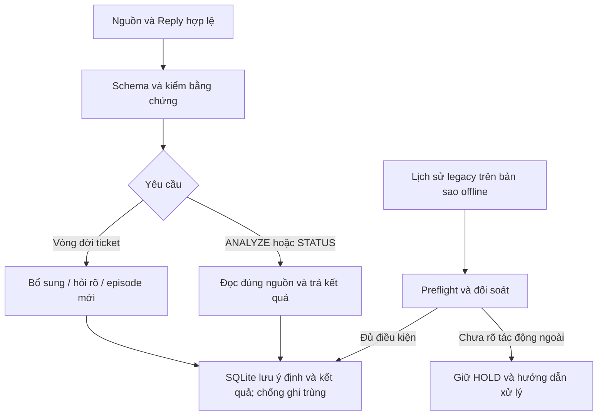

# Plan thực hiện ba task chức năng — Listener-ticket #2178

**Version:** v1.0.5 · **Cập nhật:** 03/11/2026 16:51 (Asia/Saigon)
**Owner:** AlexChu · **Trạng thái:** PM-01 High R5, PM-02 High R2 và PM-03 High R3 source APPROVED; full regression cuối đạt. Chưa có PM nghiệm thu.
**Tracking:** [#2178](https://github.com/vlink-group/vlink-nexora/issues/2178) · **Baseline:** main `e2833ec`.

Phạm vi đã chốt: **PM-01 → PM-02 → PM-03**, chạy kiểm chức năng từ source trước đóng gói. Codex `gpt-6.1-sol / Medium` thực thi; phiên độc lập `gpt-6.1-sol / High` review read-only. Estimate **4–8 giờ Agent**, gồm sửa, kiểm và review từng task; chưa phải thời gian thực tế hay cam kết ngày hoàn tất. CI, đóng gói và setup vận hành nằm ngoài đợt này.

## 1. Persona

Người gửi lỗi cần bot bổ sung đúng ticket hoặc tạo đúng lần tái diễn. Người vận hành cần phân tích, tra trạng thái và xử lý dữ liệu cũ an toàn. PM nhận từng output có bằng chứng kiểm và verdict độc lập.

## 2. Scenario

Đã có code nền và test offline; ba task vẫn **0/3 nghiệm thu**. Kết quả cần đạt: ticket đóng được xử lý đúng vòng đời; ANALYZE tạo đề xuất có căn cứ; STATUS đúng dữ liệu bot; dữ liệu SQLite cũ có phương án chuyển tiếp cụ thể, không mất lịch sử hoặc ghi trùng.

## 3. Audit

| Task | Khoảng trống đã thấy | Việc phải chứng minh |
|---|---|---|
| PM-01 | Schema gửi provider chưa có `reused_success` trong khi consumer chấp nhận; recurrence có căn cứ trực tiếp còn HOLD | Contract thật nhất quán; tái diễn đi qua đường ghi bền vững và chống trùng |
| PM-02 | `_task_grounded` yêu cầu task khớp nguyên văn nguồn, hạn chế suy luận và ảnh | Cho phép diễn đạt có căn cứ; giữ provenance, giới hạn đầu ra và quyền truy cập |
| PM-03 | Chuyển tiếp legacy mới hỗ trợ phạm vi hẹp | Phân loại đủ trạng thái cũ; chuyển được phải có chứng cứ, chưa được phải nêu cách đối soát |

Baseline đã ghi nhận: 1.533 test chạy, 2 skip, tức 1.531 pass; đây là bằng chứng cũ, không thay cho kiểm bản sửa sắp tới. Rules mở rộng vẫn DRAFT. Bảng PM: [ba task và output](../listener-completion-2178_tasks_261103_v1.0.0.md).

## 4. Solution (Product & UX)

- PM-01: phân biệt bổ sung bằng chứng cũ, lỗi chưa từng hết và lỗi đã hết rồi tái diễn. Chỉ tạo episode mới khi đủ căn cứ và đúng ticket cha mới nhất.
- PM-02: ANALYZE trả đề xuất việc cần làm từ nguồn đã cấp; STATUS thể hiện sổ xử lý của bot, gồm kết quả chưa chắc chắn. Hai chức năng này không tự cấp quyền ghi issue.
- PM-03: thử chuyển tiếp trên SQLite tạm/bản sao offline; giữ lịch sử và reservation. Chỉ đề xuất gỡ legacy sau khi đủ tương đương nghiệp vụ và khôi phục lịch sử.

Nghiệp vụ theo [Business DOCS](../../01-product/telegram-triage-noissue_business_261015_v1.0.0.md), triển khai tiếp [rules-spec](../telegram-triage-noissue_rules-spec_261029_v1.0.0.md). Không đổi nghĩa nghiệp vụ để làm test xanh.

## 5. User Flow



## 6. Wireframe

Không có màn hình mới. Dùng mẫu phản hồi Telegram hiện hữu; nộp preview cho các trường hợp hỏi lifecycle, ANALYZE và STATUS. Review nội dung cùng task tương ứng; chưa gửi tin thật trong đợt này.

## 7. Solution vs codebase

Các đường dẫn dưới tính từ root repository.

| Task | Nơi sửa chính | Tái sử dụng / ràng buộc |
|---|---|---|
| PM-01 | `listener/src/tg_triage/decision_rules.py`, `lifecycle.py`, `rules_intake.py`, tests tương ứng | Kiểm `extraction_schema()`, `validate_lifecycle()`, `grounded_recurrence()`; tái sử dụng `_create_related_episode()` và ledger. Chạm `followup_model.py` chỉ khi cần và có kiểm tương thích legacy |
| PM-02 | `rules_extraction.py`, `analysis_task.py`, `ticket_status.py`, `rules_intake.py`, `decision_rules.py` | Thay điều kiện nguyên văn tại `_task_grounded`; giữ đường `_read_only_result`, giới hạn task và nguồn Reply/document/image |
| PM-03 | `legacy_preflight.py`, `legacy_reconciliation.py`, `rules_pending_store.py`, `store.py`, `__main__.py` khi cần | Tái sử dụng `transition_pristine()` / `release_pristine()`, digest và receipt; giữ dữ liệu pending, notices, attachments, reservations |

Rule đề xuất nằm ở `listener/rules/lifecycle.md`, `analysis-status.md`; giữ DRAFT. SQLite thật lấy từ `[storage] db_path` trong cấu hình vận hành, không suy ra từ đường dẫn ví dụ. Hướng dẫn vị trí và thao tác: [báo cáo kỹ thuật, mục 8](../listener-ticket-2178_report_261103_v1.0.2.md#8-tra-cứu-lưu-trữ-hoạt-động-và-chỉnh-thủ-công).

## 8. Technical

**Một stream tuần tự:** ba task chia sẻ contract, intake và ledger. Bắt đầu implementation trong worktree riêng từ `origin/main` vừa fetch; giữ nguyên các doc đang sửa trong workspace hiện tại. Ghi source SHA và diff hash của bản đem kiểm; nếu thay code sau review phải kiểm lại phần bị ảnh hưởng.

**Contract:** ưu tiên host xác định success đã dùng từ ledger, model chỉ trích dữ kiện. Trước khi chốt cách sửa enum, tái hiện lỗi bằng schema thực sự gửi provider và kiểm consumer tương ứng. Không chỉ cho fake provider trả giá trị schema cấm.

**ANALYZE:** giữ liên kết với nguồn đã cung cấp và dữ liệu đọc được; cho phép diễn đạt lại thay vì bắt chép nguyên câu. Test phải bao gồm dữ kiện ngoài nguồn và thiếu bằng chứng, tránh biến bỏ so khớp nguyên văn thành chấp nhận mọi đầu ra. Chất lượng suy luận model thật phải đánh giá riêng.

**SQLite:** kiểm trên DB tạm hoặc bản sao offline nhất quán, không còn WAL chưa xử lý. Stage/release cần manifest, digest và receipt; thay đổi nguồn hoặc receipt phải bị từ chối và rollback. POST chưa rõ kết quả phải đối soát, không xoá reservation để retry.

**Rủi ro và cách xử lý:** nếu lịch sử linked/hydration/media không có đủ bằng chứng, ghi rõ trạng thái chưa hỗ trợ và quy trình đối soát; giữ legacy. Nếu phạm vi cần vượt estimate hoặc thay đổi nghiệp vụ, cập nhật phần còn lại và quyết định cần Owner trước khi mở rộng.

## 9. To-Do List

### PM-01 — Schema và lifecycle · 1–2 giờ Agent

- [x] Tái hiện mismatch tại provider boundary; lập bảng input → disposition → tác động ngoài mong đợi.
- [x] Thống nhất schema/parser/host cho success đã dùng; giữ tương thích với luồng legacy còn dùng schema chung.
- [x] Nối recurrence đủ bằng chứng trực tiếp vào cơ chế episode hiện có; kiểm parent mới nhất, chronology và binding cùng chat/repo.
- [x] Kiểm open append, closed evidence, recurrence, success đã dùng, thiếu căn cứ, restart và ghi chưa rõ kết quả.
- [x] Nộp contract diff, preview phản hồi, test log và verdict High; sửa finding trước khi chốt task. High R5 APPROVED tested-source PM-01 ngày 03/11/2026; còn global trace/full regression và PM nghiệm thu.

**Mốc nhận:** provider/schema/consumer khớp; ca hợp lệ tạo đúng một successor, ca mơ hồ không ghi sai; test duplicate/restart/unknown POST chứng minh không ghi lặp.

### PM-02 — ANALYZE / STATUS · 1,5–3 giờ Agent · sau PM-01

- [x] Định nghĩa task draft có căn cứ và giới hạn hiện hữu: title ≤90, work ≤160, acceptance 1–2 mục ≤90/mục; render ≤500 ký tự.
- [x] Thay điều kiện ép nguyên văn; giữ nguồn hiện tại, Reply context, document digest và ảnh thực sự được cấp cho provider.
- [x] Kiểm STATUS theo đúng repo/partition/Reply, phân biệt confirmed và uncertain; giữ đường chỉ đọc issue.
- [x] Chạy ca text diễn đạt lại, ảnh có pixel thật trong request, tài liệu, thiếu nguồn và đầu ra bịa; kiểm duplicate/recovery của notice.
- [x] Nộp bảng input/output và log; tách ca kiểm transport giả lập với ca chất lượng model thật chưa chạy; nhận verdict High. High R2 APPROVED tested-source PM-02 ngày 03/11/2026; chưa xác nhận chất lượng model thật.

**Mốc nhận:** task hợp lệ không cần có nguyên câu trong nguồn; đầu ra bịa/không đủ căn cứ được xử lý theo nghiệp vụ; STATUS không trộn ticket và không phát sinh issue write. Thiếu môi trường model thật thì ghi ca chưa xác minh, không đánh dấu chất lượng model PASS.

### PM-03 — SQLite và legacy · 1,5–3 giờ Agent · sau PM-02

- [x] Lập ma trận lịch sử: pristine, pending/notice/choice, linked ticket, hydration tiến triển, attachment, reserved/unknown write. Mỗi dòng có disposition, bằng chứng và thao tác operator khi cần.
- [x] Mở rộng chuyển tiếp chỉ cho trường hợp có thể chứng minh an toàn; giữ explicit HOLD và hướng dẫn đối soát cho trường hợp còn lại.
- [x] Chạy preflight → stage → release trên bản sao/fixture; kiểm digest, receipt, source binding và atomic rollback khi từ chối.
- [x] Kiểm lịch sử trước/sau, restart, duplicate và kết quả ghi ngoài chưa rõ; quyết định đề xuất giữ/gỡ legacy bằng ma trận parity.
- [x] Chạy chức năng từ source của cả ba task và full regression; nộp log, ma trận, hướng dẫn thủ công, giới hạn và verdict High.

**Mốc nhận:** mỗi loại trạng thái cũ được phân loại, ca hỗ trợ chuyển thành công và bảo toàn lịch sử, ca chưa hỗ trợ có quy trình xử lý rõ. HOLD an toàn không được tính là chuyển thành công; chưa chứng minh parity thì giữ legacy và báo phần migration còn thiếu.

**Theo dõi thời gian:** tính từ lúc executor bắt đầu PM-01: mốc lũy kế dự kiến PM-01 1–2h, PM-02 2,5–5h, PM-03 4–8h. Không bao gồm chờ Owner/môi trường bên ngoài. Sau mỗi task cập nhật giờ thực tế, estimate còn lại, blocker; không tự quy đổi thành phần trăm hoàn thành.

## 10. Test Cases

| Nhóm | Ca bắt buộc | Kết quả / bằng chứng cần có |
|---|---|---|
| Contract | Schema outgoing, parser, response hợp lệ/không hợp lệ; legacy contract | Ghi đúng schema gửi provider; không bypass enum |
| Lifecycle | Ticket open, closed evidence, recurrence trực tiếp, hỏi rõ, success đã dùng, episode kế tiếp | Đúng APPEND/ASK/related episode theo Business DOCS; không reopen hoặc tạo trùng ngoài ý định |
| Lifecycle safety | Sai chat/repo, future source, quote sai, duplicate, crash, uncertain POST | Từ chối/giữ trạng thái đúng; số lần ghi ngoài đúng mong đợi, không replay |
| ANALYZE | Text diễn đạt lại, Reply, document, ảnh; thiếu nguồn, câu trả lời bịa, quá giới hạn | Output có căn cứ, bounded; fixture ảnh phải có pixel trong request; zero issue writes |
| STATUS | Reply đúng/sai, batch nhiều partition, repo khác, confirmed/uncertain, restart notice | Đúng ledger/target; không nhận định hoàn tất nghiệp vụ từ ledger; zero issue writes |
| SQLite | Stage/release hợp lệ; thay digest/receipt/source/attachment; trigger/sidecar; unknown effect | Bảo toàn lịch sử; ca từ chối rollback; không xoá reservation/replay |
| Tổng hợp | Chạy source cho ba luồng, full suite, policy, compile | Source SHA/diff hash, lệnh, exit code, PASS/FAIL/SKIP và log; reviewer kiểm độc lập |

Lệnh dự kiến từ thư mục `listener/` trong worktree thực thi (PowerShell):

```powershell
$env:PYTHONPATH = 'src'
python -m unittest tests.test_decision_rules tests.test_lifecycle tests.test_rules_extraction tests.test_rules_extensions
python -m unittest tests.test_analysis_task_contract tests.test_analysis_task_safety tests.test_ticket_status_safety tests.test_status_reply_contract
python -m unittest tests.test_legacy_reconciliation tests.test_rules_pending_store tests.test_rules_bootstrap
python -m unittest discover -s tests -t . -v
python -m compileall -q src tests
```

Từ root repository:

```powershell
python scripts/check-telegram-triage-policy.py
python scripts/test_telegram_triage_policy.py
python scripts/test_reformat_telegram_issue.py
git diff --check
```

Chạy focused tests trong từng task; full suite sau tích hợp PM-03 và sau sửa ảnh hưởng rộng. Policy trace chỉ cập nhật sau review semantics, không chỉ đổi hash để qua gate. `harness-verify` hiện không hỗ trợ repo Python này (đòi `package.json`); giữ nguyên giới hạn và nộp log Python, không báo gate harness PASS.

UI/browser/a11y: không áp dụng vì không sửa giao diện. Kiểm source dùng SQLite tạm và fake external transport; **chưa phải E2E Telegram/model/GitHub thật**. Không đọc DB live, bật rules, khởi động service hoặc gửi tác động ngoài trong phạm vi này.

Mỗi task bàn giao: **ID · source SHA/diff hash · output · command/exit code · PASS/FAIL/SKIP · reviewer verdict · giờ thực tế · phần chưa xác minh**. PM ghi người/ngày nhận; task chỉ Accepted sau khi đủ đầu ra và finding đã xử lý.

**Kết quả 16:51:** Cả ba task source High APPROVED, full R3 **Ran 1650 / 537.600s, OK (skipped=2)** = 1648 pass; exit0, 130 file không đổi. R1/R2 findings đã sửa và review lại; không cộng các lượt kiểm chồng nhau. Elapsed tới kiểm tổng cuối ~5h14, PM-03 ~121 phút. Giữ legacy cho lịch sử chưa chứng minh parity; chưa có PM Accepted hoặc kiểm model/live thật. Trace cuối PASS 33 rules / 61 runtime files; 18 policy tests và 8 reformat tests pass. Chỉ đổi trace metadata, Python giữ nguyên.
