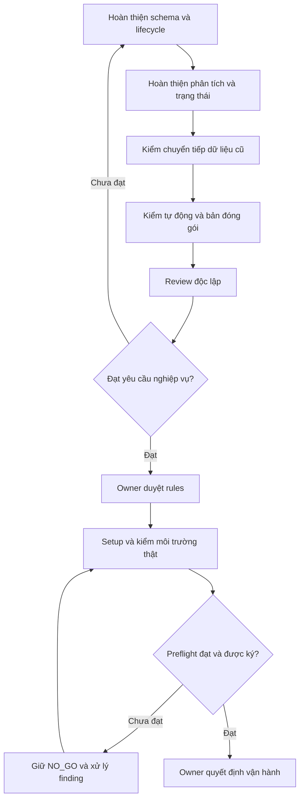

# Listener-ticket — Báo cáo tiến độ và kế hoạch triển khai

**Ngày báo cáo:** 03/11/2026, cập nhật 09:12 (Asia/Saigon)

**Phiên bản:** v1.0.2

**Owner:** AlexChu

**Trạng thái:** Hoàn thiện lõi và kiểm chứng offline; chưa đủ điều kiện vận hành thật (NO_GO).

**Phạm vi:** Bot tiếp nhận hội thoại Telegram, tạo/bổ sung ticket GitHub, hỏi làm rõ, phân tích yêu cầu và tra trạng thái ticket. Đây là bản xuất phục vụ báo cáo, không thay thế Business DOCS hoặc phiếu phê duyệt vận hành.

## 1. Tóm tắt điều hành

Listener-ticket đã có nền tảng xử lý và bộ kiểm thử offline. Phần còn lại là hoàn thiện chuyển sang bộ quy tắc Markdown, bảo đảm xử lý dữ liệu lịch sử an toàn và kiểm chứng trên môi trường thực tế.

**Dự kiến triển khai với AI: 8–16 giờ thực thi và giám sát, phân bổ khoảng 2–3 ngày lịch khi đủ điều kiện kiểm thử.** Đây là dự báo sơ bộ, chưa được đo trên toàn bộ phần việc còn lại; sẽ cập nhật sau vòng implementation và review đầu tiên.

Estimate giờ công dev tham chiếu đến mốc **vận hành lõi an toàn: 44–60 giờ công**, gồm:

- **24–40 giờ:** hoàn thiện chức năng, CI, kiểm thử offline, kiểm bản đóng gói và review độc lập.
- **20 giờ:** gói setup và kiểm vận hành đã có trong kế hoạch trước.

Tương đương khoảng **6–8 ngày làm việc của một dev**, giả định 8 giờ/ngày và đủ điều kiện đầu vào. Thời gian chờ máy, tài khoản, phê duyệt và đối soát dữ liệu lịch sử bất thường chưa được tính. Estimate này chưa phải lịch cam kết hoặc timesheet; phần 24–40 giờ là đề xuất mới, chưa được cập nhật lên ticket.

Hiện chưa có cơ sở đáng tin để công bố một tỷ lệ phần trăm hoàn thành toàn dự án: mức hoàn thiện code và mức sẵn sàng vận hành đang khác nhau.

## 2. Mục tiêu và nguyên tắc triển khai

Bot đọc text, ảnh, tài liệu và Reply trong group Telegram; xác định công việc, tạo hoặc bổ sung ticket đúng nguồn, hỏi đúng thông tin còn thiếu và bỏ qua hội thoại thông thường.

Model trích dữ kiện và đề xuất nội dung. Quy tắc Markdown cùng các kiểm tra của hệ thống quyết định hành động được phép. Khi kết quả ghi bên ngoài chưa rõ, hệ thống giữ trạng thái để đối soát, không tự gửi lại gây trùng ticket.

Nguồn phát triển chính là repository **Listener-ticket**. Repository AgentBuilder chỉ còn là nguồn lịch sử.

## 3. Tiến độ hiện tại

| Hạng mục | Trạng thái | Bằng chứng và phần còn lại |
|---|---|---|
| Nghiệp vụ và kiến trúc | Đã có nền tảng | Có Business DOCS, rules, template và preflight; cần đồng bộ các phần thay đổi khi hoàn thiện |
| Nghe Telegram, phân loại và tạo/bổ sung ticket | Đã có code và kiểm thử offline | Chưa kiểm đầy đủ trên môi trường thật của bản cleanup |
| Rules Markdown cơ bản | Đã triển khai | Sáu rules ACTIVE; cấu hình mặc định vẫn tắt |
| Pending, chống trùng và reservation | Đã có kiểm thử | Cần kiểm lại trên bản cài và khi restart service thật |
| Khóa một tiến trình trên Windows | Đã có kiểm thử đa tiến trình | Cần kiểm cùng service thực tế trên máy đích |
| Ticket đã đóng và lỗi tái diễn | Hoàn thành một phần | Có xác nhận A/B và chuỗi episode; tái diễn trực tiếp có chứng cứ vẫn còn HOLD |
| Phân tích yêu cầu (ANALYZE) | Hoàn thành một phần | Còn phụ thuộc trích nguyên văn text; chưa đạt đầy đủ xử lý ảnh và suy luận ngữ nghĩa theo nghiệp vụ |
| Tra trạng thái ticket (STATUS) | Có triển khai và safeguards offline | Cần regression trên bản hoàn thiện, giữ đúng nguồn Reply và phạm vi ticket |
| Chuyển tiếp SQLite cũ | Hỗ trợ phạm vi hẹp | Có công cụ offline; lịch sử phức tạp và kết quả ghi chưa rõ còn cần đối soát |
| Gỡ luồng xử lý legacy | Chưa hoàn thành | Chờ chứng minh tương đương nghiệp vụ và chuyển tiếp an toàn |
| CI tự động | Chưa có workflow trong snapshot đã kiểm | Cần bổ sung kiểm tra Python, policy và đóng gói |
| Setup máy và kiểm model/Telegram/GitHub thật | Chưa thực hiện | Gói setup có estimate 20 giờ; chưa có GO |
| Installer .exe, wizard, Jira/Azure | Backlog mở rộng | Chưa nằm trong estimate vận hành lõi |

### Trạng thái mã nguồn

- Tại bước kiểm trước publish: `main` cục bộ ở commit `520a7de`; `origin/main` còn ở `195f3b5`. Đây là mốc tham chiếu trước push, không phải khẳng định remote vẫn ở phiên bản cũ sau publish.
- Phần Antigravity/Gemini bổ sung: commit `520a7de`, branch `codex/2178_cleanup-legacy`.
- Commit cleanup `520a7de` đã được tích hợp fast-forward vào main cục bộ theo yêu cầu Owner ngày 03/11; việc publish remote được kiểm riêng. Các khoảng trống chức năng vẫn còn mở.
- Hai rules mở rộng cho lifecycle và ANALYZE/STATUS vẫn DRAFT. Khi bật rules mode, lệnh chạy thực tế dừng tại bước kiểm header ACTIVE. Việc đổi trạng thái cần phê duyệt riêng.
- Dispatch đã chuẩn bị kế hoạch tiếp tục; executor mới chưa được khởi chạy tại thời điểm xuất báo cáo.

## 4. Kết quả kiểm chứng gần nhất

| Kiểm tra | Kết quả | Giới hạn |
|---|---|---|
| Bộ test toàn phần trên commit 520a7de | `Ran 1533 tests in 269.852s; OK (skipped=2)` | 1.531 ca thành công, 2 ca bỏ qua; không phải kiểm chứng môi trường thật |
| Policy checker | PASS, 33 quy tắc / 59 file runtime | Kiểm trace và fingerprint không thay thế review nghiệp vụ |
| Policy và reformat tests | 26 ca thành công | Phạm vi offline |
| Đối chiếu bộ file đóng băng | 135 file khớp nội dung | 130 file khớp byte; 5 file chỉ khác LF/CRLF |
| Kiểm qua CLI | 8 tình huống, mỗi tình huống 2 lần | Kiểm config, startup gate và từ chối đầu vào không hợp lệ; chưa chạy luồng Telegram |

Kiểm CLI không tạo session Telegram hoặc DB runtime. Kiểm tra lại đã xác nhận một lỗi tích hợp: code chấp nhận `reused_success` nhưng schema gửi model chưa cho phép giá trị đó; model giả trong test đã bỏ qua sự lệch này.

Kiểm tích hợp trước publish ngày 03/11/2026 trên local main `520a7de`: `Ran 1533 tests in 303.568s; OK (skipped=2)`; 26 policy/reformat tests OK trong 8.155s; policy PASS 33/59; compile và diff whitespace checks đạt. Builder chuẩn `deploy/build_wheel.py` tạo wheel từ đúng commit `520a7de`, checksum SHA-256 `77bfd4271ca75e5a04483a97e015405a5951985db7df8ca58b0ca7f65b2e9704`. Đây là kiểm source/build offline; kiểm cài wheel vào môi trường tạm và kiểm service máy đích vẫn nằm trong các việc PM chưa nghiệm thu.

Các kết quả xanh hiện tại chứng minh những tình huống offline đã kiểm. Chất lượng phân tích của model thật và toàn bộ luồng Telegram → model → GitHub vẫn cần bằng chứng riêng.

## 5. Kế hoạch và thời gian còn lại

| Giai đoạn | Cách thực hiện | Đầu ra phải có | Estimate |
|---|---|---|---:|
| 1. Schema và lifecycle | Đồng bộ contract trích dữ kiện; hoàn thiện bổ sung ticket đóng, tái diễn trực tiếp, bằng chứng đã dùng và chuỗi episode | Kiểm qua schema/provider boundary; không tạo trùng khi duplicate, restart hoặc POST chưa rõ kết quả | 6–10h |
| 2. ANALYZE / STATUS | Xử lý text, ảnh và tài liệu theo nghiệp vụ; giữ nguồn chứng cứ, giới hạn đầu ra và quyền chỉ đọc | Task hữu ích không đòi nguồn chứa nguyên văn đáp án; STATUS đúng phạm vi; regression cho các đường liên quan | 6–10h |
| 3. SQLite và chuyển đổi legacy | Kiểm kê từng loại lịch sử; chuyển trên bản sao; thử từ chối/rollback và đối soát trường hợp chưa rõ | Bảng phạm vi hỗ trợ, cách xử lý từng loại dữ liệu, không mất dữ liệu hoặc replay tác động chưa xác định | 6–10h |
| 4. CI | Tự động chạy test và policy trên Windows/Linux, kiểm lỗi hồi quy | Workflow có kết quả kiểm thực tế | 2–4h |
| 5. Đóng băng và review offline | Chạy đầy đủ kiểm tra; build/cài wheel trong môi trường tạm; so fingerprint; cập nhật tài liệu và review độc lập | Bản mã cố định, log kiểm thử, kết quả review và bộ rules/ví dụ để Owner duyệt | 4–6h |
| **Tổng hoàn thiện offline** | | | **24–40h** |
| 6. Setup và kiểm vận hành | Thực hiện gói setup năm lát 4h theo bảng dưới | Bằng chứng máy đích và phiếu preflight để Owner xét GO | **20h** |
| **Tổng đến mốc vận hành lõi** | | | **44–60h** |

### Chi tiết gói setup đã có: 20 giờ

| Công việc | Đầu ra | Estimate |
|---|---|---:|
| Chuẩn bị release, config và rollback | Gói release xác định được phiên bản; config đã kiểm; diễn tập rollback có output | 4h |
| Kiểm model cấu hình thật và smoke | Kết quả từng ví dụ, phân tích lỗi và giới hạn chất lượng | 4h |
| Kiểm bản cài, service, khóa và phục hồi | PID/service readback, fingerprint, restart và contention có bằng chứng | 4h |
| Kiểm Telegram → GitHub và hai group | Tin kiểm được duyệt; ticket/attachment/Reply/reaction và ops đúng nguồn | 4h |
| Xử lý lỗi phát sinh, regression và bàn giao preflight | Danh sách finding, kết quả kiểm lại, đề xuất GO/NO_GO | 4h |
| **Tổng** | | **20h** |

Kiểm wheel trong môi trường tạm ở giai đoạn 5 và kiểm release/service trên máy đích ở giai đoạn 6 có mục đích khác nhau. Khi lập lịch chi tiết cần đối chiếu để tái sử dụng bằng chứng hợp lệ và tránh tính trùng công việc. Nếu phát hiện lỗi vượt phạm vi dự toán, cập nhật estimate và giữ NO_GO đến khi xử lý xong.

## 6. Trình tự và phân công

### 6.1. Estimate khi triển khai bằng AI

| Hạng mục | Giờ công dev tham chiếu | Thời gian dự kiến với AI |
|---|---:|---:|
| Schema và lifecycle | 6–10h | 1–2h |
| ANALYZE / STATUS | 6–10h | 1,5–3h |
| SQLite và chuyển đổi legacy | 6–10h | 1,5–3h |
| CI | 2–4h | 0,5–1h |
| Đóng gói, regression và review độc lập | 4–6h | 1,5–3h |
| Setup và kiểm vận hành thật | 20h | 2–4h |
| **Tổng** | **44–60h** | **8–16h** |

Giả định: có sẵn máy, tài khoản và dữ liệu kiểm được duyệt; executor và reviewer có quota; triển khai một stream với review độc lập. Khoảng 8–16 giờ gồm thời gian agent thực thi, chạy kiểm tra và người giám sát trong các phiên làm việc; không mặc định đây là 8–16 giờ lao động liên tục của người vận hành. Lịch 2–3 ngày phản ánh việc chia phiên, review và xử lý finding, không phải cam kết ngày hoàn tất.

AI giúp rút ngắn việc đọc/sửa code, tạo test và phân tích log. Thời gian chạy test, kiểm môi trường thật, đối soát SQLite và phê duyệt vẫn phụ thuộc điều kiện thực tế. Dữ liệu lịch sử bất thường, lỗi môi trường hoặc nhiều vòng review có thể làm vượt estimate; thời gian chờ các điều kiện này chưa được tính.

Phân biệt khi báo cáo và tracking:

- **Giờ công dev tham chiếu:** 44–60h là estimate để so sánh phạm vi và công sức.
- **Thời gian triển khai với AI:** dự kiến 8–16h, cập nhật theo kết quả từng vòng.
- **Thời gian thực tế:** ghi nhận sau từng phiên; không quy đổi giờ tiết kiệm thành giờ đã thực hiện và không cộng hai cột estimate với nhau.

Gói setup 20h vẫn giữ nguyên estimate tracking hiện có cho tới khi Owner quyết định cập nhật ticket. Khoảng 2–4h với AI là dự báo mới cho cùng phạm vi, chưa phải kết quả thực hiện hoặc estimate đã được duyệt trên board.

### 6.2. Luồng triển khai

- Tiếp tục từ commit `520a7de` trong worktree cách ly, bảo toàn công việc Gemini.
- Một executor triển khai tuần tự vì schema, lifecycle, phân tích và recovery dùng chung contract và bảng SQLite.
- Theo lựa chọn Owner: **Codex gpt-6.1-sol / Medium** thực thi; **phiên độc lập / High** review. Codex được xác nhận còn quota triển khai.
- Verifier chạy kiểm tra; reviewer độc lập đối chiếu nghiệp vụ và tính toàn vẹn dữ liệu. Finding được trả về executor để sửa.
- Mỗi lát lưu phạm vi thay đổi, lệnh kiểm, kết quả và phần chưa xác minh vào task để có thể bàn giao giữa các agent.
- Chỉ xét gỡ legacy sau khi mọi hành vi bắt buộc và dữ liệu lịch sử đã có phương án xử lý được kiểm chứng.

## 7. Phụ thuộc và rủi ro

| Phụ thuộc / rủi ro | Ảnh hưởng | Cách xử lý |
|---|---|---|
| Rules mở rộng còn DRAFT | Rules mode chưa khởi động được với bộ rules hiện tại | Chuẩn bị rules, ví dụ và kết quả kiểm để Owner duyệt riêng |
| Test giả bỏ qua contract thực tế | Test xanh nhưng tích hợp model vẫn sai | Kiểm schema và provider boundary thực tế; tách kiểm transport khỏi đánh giá chất lượng model |
| Dữ liệu lịch sử có tác động bên ngoài chưa rõ | Nguy cơ ticket/comment/attachment trùng nếu replay | Giữ reservation, kiểm trên bản sao, đối soát trước khi cho chuyển tiếp |
| Chưa có môi trường kiểm Telegram/model/GitHub thật | Chưa thể kết luận vận hành đạt | Setup máy, tài khoản và dữ liệu kiểm được duyệt trước giai đoạn 6 |
| Công cụ harness-verify hiện chỉ hỗ trợ Node | Không có verdict harness hợp lệ cho repository Python | Ghi đúng giới hạn, dùng output Python checks riêng; không tạo package.json giả để vượt gate |
| Estimate chưa bao gồm lỗi lớn chưa biết | Có thể vượt 44–60h | Báo repro, tác động và estimate bổ sung khi phát hiện |

## 8. Điều kiện hoàn thành và vận hành

- Chức năng đáp ứng Business DOCS; lifecycle, ANALYZE và STATUS có bằng chứng kiểm tương ứng.
- Không còn finding mức cao chưa được xử lý hoặc quyết định rõ.
- Bản cài xác định được phiên bản, rules/template khớp và kiểm trên đúng bản đó.
- Model thật đạt bộ ví dụ được duyệt; giới hạn chất lượng được ghi rõ.
- Telegram và GitHub xử lý đúng nguồn, đúng group và đúng ticket; restart không gây ghi trùng.
- Có phương án xử lý dữ liệu cũ và rollback đã thử.
- Phiếu preflight được ký; Owner quyết định GO.

Installer .exe, wizard và adapter Jira/Azure thuộc giai đoạn mở rộng. Các hạng mục này cần scope, tiêu chí và estimate riêng trước khi đưa vào lịch tổng thể.

## 9. Nguồn tham chiếu

- [Bảng kiểm soát đầu ra cho PM](listener-completion-2178_tasks_261103_v1.0.0.md): 13 mã việc, output, tiêu chí nghiệm thu, phụ thuộc, phân vai và estimate.

- [Repository Listener-ticket](https://github.com/SotaThao/Listener-ticket).
- [Overview nghiệp vụ](https://github.com/SotaThao/Listener-ticket/blob/195f3b5/Docs/00-master/telegram-triage-noissue_overview_261027_v1.0.0.md).
- [Business DOCS của bản cleanup](https://github.com/SotaThao/Listener-ticket/blob/520a7de/Docs/01-product/telegram-triage-noissue_business_261015_v1.0.0.md).
- [Audit và kế hoạch setup 20h](https://github.com/SotaThao/Listener-ticket/blob/195f3b5/Docs/02-engineering/listener-installer-noissue_devex-audit_261030_v1.0.0.md).
- [Kế hoạch rules hiện hữu](https://github.com/SotaThao/Listener-ticket/blob/520a7de/Docs/04-tasks/telegram-triage-noissue_rules-spec_261029_v1.0.0.md).
- Bằng chứng kiểm tra ngày 03/11/2026 được giữ trong artifact local của task; đây là báo cáo kiểm offline, chưa phải chứng nhận release hoặc vận hành.

## 10. Lịch sử tài liệu

| Phiên bản | Thời gian (Asia/Saigon) | Người xuất | Nội dung |
|---|---|---|---|
| v1.0.2 | 03/11/2026 09:12 | Codex / Owner AlexChu | Đưa báo cáo vào repository, bổ sung bảng kiểm soát PM và ghi nhận tích hợp mã cleanup theo yêu cầu Owner |
| v1.0.1 | 03/11/2026 09:06 | Codex / Owner AlexChu | Bổ sung estimate triển khai bằng AI 8–16h, dự kiến 2–3 ngày; phân biệt giờ công tham chiếu, thời gian AI và thời gian thực tế |
| v1.0.0 | 03/11/2026 09:00 | Codex / Owner AlexChu | Xuất báo cáo tiến độ, estimate còn lại, cách triển khai, phụ thuộc và điều kiện vận hành |
